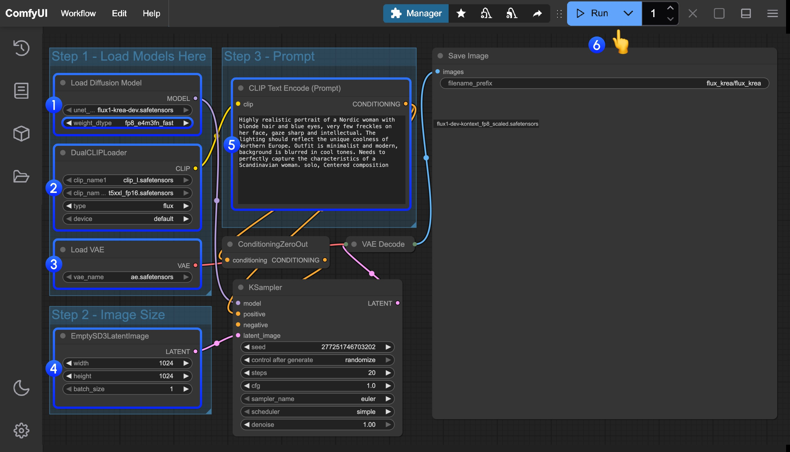

import UpdateReminder from "/snippets/de/tutorials/update-reminder.mdx"


[FLUX.1 Krea Dev](https://huggingface.co/black-forest-labs/FLUX.1-Krea-dev) ist ein fortschrittliches Text-zu-Bild-Modell, das in Zusammenarbeit von Black Forest Labs (BFL) und Krea entwickelt wurde. Es ist derzeit das beste Open-Source-FLUX-Modell und speziell für die Text-zu-Bild-Generierung konzipiert.

**Modellfunktionen**

- **Einzigartiger ästhetischer Stil**: Fokussiert sich auf die Generierung von Bildern mit eigenständiger Ästhetik und vermeidet das typische „KI-Aussehen“
- **Natürliche Details**: Erzeugt keine ausgebrannten Lichter und bewahrt eine natürliche Detailwiedergabe
- **Außergewöhnlicher Realismus**: Bietet herausragenden Realismus und hervorragende Bildqualität
- **Vollständig kompatible Architektur**: Architekturdesign, das vollständig mit FLUX.1 [dev] kompatibel ist

**Modelllizenz**
Dieses Modell wird unter der [flux-1-dev-non-commercial-license](https://huggingface.co/black-forest-labs/FLUX.1-Krea-dev/blob/main/LICENSE.md) veröffentlicht.

## FLUX.1 Krea Dev ComfyUI Workflow

<UpdateReminder />

### FLUX.1 Krea Dev {#flux1_krea_dev}

Ein feinabgestimmtes FLUX-Modell, das den Fotorealismus an die Grenze treibt.


<CardGroup cols={2}>
  <Card title="Auf Comfy Cloud ausführen" icon="cloud" href="https://cloud.comfy.org/?template=flux1_krea_dev&utm_source=docs&utm_medium=referral&utm_campaign=flux1-krea-dev">
    Diesen Workflow auf Comfy Cloud ausführen
  </Card>
  <Card title="Workflow herunterladen" icon="download" href="https://github.com/Comfy-Org/workflow_templates/blob/main/templates/flux1_krea_dev.json">
    JSON herunterladen oder in der Vorlagenbibliothek nach „FLUX.1 Krea Dev“ suchen
  </Card>
</CardGroup>

**Beispielausgabe**


#### 1. Workflow-Dateien

#### 2. Modelle manuell installieren

Bitte laden Sie die folgenden Modelldateien herunter:
**Diffusionsmodell**

- [flux1-krea-dev_fp8_scaled.safetensors](https://huggingface.co/Comfy-Org/FLUX.1-Krea-dev_ComfyUI/blob/main/split_files/diffusion_models/flux1-krea-dev_fp8_scaled.safetensors)

Wenn Sie eine höhere Qualität anstreben und über ausreichend VRAM verfügen, können Sie die ursprünglichen Modellgewichte ausprobieren

- [flux1-krea-dev.safetensors](https://huggingface.co/black-forest-labs/FLUX.1-Krea-dev/blob/main/flux1-krea-dev.safetensors) 

<Note>
Für die Datei `flux1-dev.safetensors` müssen Sie vor dem Herunterladen über den Browser der Vereinbarung [black-forest-labs/FLUX.1-Krea-dev](https://huggingface.co/black-forest-labs/FLUX.1-Krea-dev/) zustimmen.
</Note>

Wenn Sie bereits FLUX-bezogene Workflows verwendet haben, sind die folgenden Modelle identisch und müssen nicht erneut heruntergeladen werden

**Text-Encoder**
- [clip_l.safetensors](https://huggingface.co/comfyanonymous/flux_text_encoders/blob/main/clip_l.safetensors?download=true)
- [t5xxl_fp16.safetensors](https://huggingface.co/comfyanonymous/flux_text_encoders/blob/main/t5xxl_fp16.safetensors?download=true) Empfohlen, wenn Ihr VRAM größer als 32 GB ist.
- [t5xxl_fp8_e4m3fn.safetensors](https://huggingface.co/comfyanonymous/flux_text_encoders/blob/main/t5xxl_fp8_e4m3fn.safetensors)  Für wenig VRAM

**VAE**
- [ae.safetensors](https://huggingface.co/black-forest-labs/FLUX.1-schnell/blob/main/ae.safetensors?download=true)

Speicherort der Dateien:
```
ComfyUI/
├── models/
│   ├── diffusion_models/
│   │   └── flux1-krea-dev_fp8_scaled.safetensors or flux1-krea-dev.safetensors
│   ├── text_encoders/
│   │   ├── clip_l.safetensors
│   │   └── t5xxl_fp16.safetensors or t5xxl_fp8_e4m3fn.safetensors
│   ├── vae/
│   │   └── ae.safetensors

```

#### 3. Schrittweise Prüfung, damit der Workflow korrekt läuft

<Tip>
    Wenn Sie nur über wenig VRAM verfügen, läuft dieses Modell auf Ihrem Gerät möglicherweise nicht flüssig. Sie können abwarten, bis die Community eine FP8- oder GGUF-Version bereitstellt.
</Tip>

Bitte prüfen Sie anhand des folgenden Bildes, ob alle Modelldateien korrekt geladen wurden



1. Stellen Sie sicher, dass `flux1-krea-dev_fp8_scaled.safetensors` oder `flux1-krea-dev.safetensors` im Node `Load Diffusion Model` geladen ist
    - `flux1-krea-dev_fp8_scaled.safetensors` wird für Anwender mit wenig VRAM empfohlen
    - `flux1-krea-dev.safetensors` sind die ursprünglichen Gewichte. Wenn Sie über ausreichend VRAM verfügen, etwa 24 GB, können Sie diese für bessere Qualität verwenden
2. Stellen Sie sicher, dass die folgenden Modelle im Node `DualCLIPLoader` geladen sind:
   - clip_name1: t5xxl_fp16.safetensors oder t5xxl_fp8_e4m3fn.safetensors
   - clip_name2: clip_l.safetensors
3. Stellen Sie sicher, dass `ae.safetensors` im Node `Load VAE` geladen ist
4. Klicken Sie auf die Schaltfläche `Queue` oder verwenden Sie die Tastenkombination `Ctrl(cmd) + Enter`, um den Workflow auszuführen