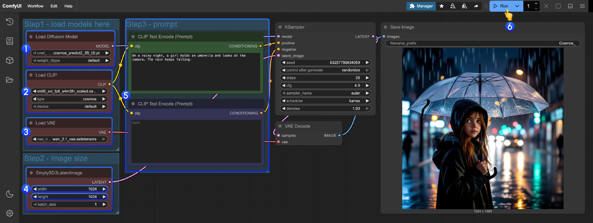

import UpdateReminder from "/snippets/de/tutorials/update-reminder.mdx"

Cosmos-Predict2 ist NVIDIAs Foundation-Modell der nächsten Generation für die physische Welt und wurde speziell für hochwertige visuelle Generierungs- und Vorhersageaufgaben in Szenarien der physischen KI entwickelt.
Das Modell zeichnet sich durch außergewöhnliche physikalische Genauigkeit, Interaktivität mit der Umgebung und Detailtreue aus und ermöglicht die realistische Simulation komplexer physikalischer Phänomene und dynamischer Szenen.

Cosmos-Predict2 unterstützt verschiedene Generierungsmethoden, darunter Text zu Bild (Text2Image) und Video zu Welt (Video2World), und wird vielfach in der industriellen Simulation, im autonomen Fahren, in der Stadtplanung, in der wissenschaftlichen Forschung und in weiteren Bereichen eingesetzt.

GitHub:[Cosmos-predict2](https://github.com/nvidia-cosmos/cosmos-predict2)
Hugging Face: [Cosmos-Predict2](https://huggingface.co/collections/nvidia/cosmos-predict2-68028efc052239369a0f2959)

Diese Anleitung führt Sie durch den Workflow für **Text zu Bild** in ComfyUI.

Den Abschnitt zur Videogenerierung finden Sie hier:

<Card title="Cosmos Predict2 Video Generation" icon="book" href="/de/tutorials/video/cosmos/cosmos-predict2-video2world">
  Cosmos-Predict2 für die Videogenerierung verwenden
</Card>

<UpdateReminder/>
{/* 
## Cosmos Predict2 Video2World Workflow

Beim Test der 2B-Version zeigte sich, dass sie etwa 16 GB VRAM belegt.

### 1. Workflow-Datei

Bitte laden Sie das untenstehende Bild herunter und ziehen Sie es in ComfyUI, um den Workflow zu laden. Der Workflow enthält bereits eingebettete Download-Links für die Modelle.


### 2. Modelle manuell installieren

Wenn der Modelldownload nicht erfolgreich war, können Sie die Modelle in diesem Abschnitt auch selbst manuell herunterladen.

**Diffusionsmodell**

- [cosmos_predict2_2B_t2i.safetensors](https://huggingface.co/Comfy-Org/Cosmos_Predict2_repackaged/blob/main/cosmos_predict2_2B_t2i.safetensors)

Weitere Gewichte finden Sie unter [Cosmos_Predict2_repackaged](https://huggingface.co/Comfy-Org/Cosmos_Predict2_repackaged) zum Herunterladen.

**Textencoder**

[oldt5_xxl_fp8_e4m3fn_scaled.safetensors](https://huggingface.co/comfyanonymous/cosmos_1.0_text_encoder_and_VAE_ComfyUI/blob/main/text_encoders/oldt5_xxl_fp8_e4m3fn_scaled.safetensors)

**VAE**

[wan_2.1_vae.safetensors](https://huggingface.co/Comfy-Org/Wan_2.1_ComfyUI_repackaged/blob/main/split_files/vae/wan_2.1_vae.safetensors)

Speicherort der Dateien
```
📂 ComfyUI/
├──📂 models/
│   ├── 📂 diffusion_models/
│   │   └─── cosmos_predict2_2B_t2i.safetensors
│   ├── 📂 text_encoders/
│   │   └─── oldt5_xxl_fp8_e4m3fn_scaled.safetensors
│   └── 📂 vae/
│       └──  wan_2.1_vae.safetensors
```

### 3. Workflow Schritt für Schritt abschließen



Bitte folgen Sie den Schritten im Bild, um den Workflow auszuführen:

1. Stellen Sie sicher, dass im Node `Load Diffusion Model` die Datei `cosmos_predict2_2B_t2i.safetensors` geladen ist
2. Stellen Sie sicher, dass im Node `Load CLIP` die Datei `oldt5_xxl_fp8_e4m3fn_scaled.safetensors` geladen ist
3. Stellen Sie sicher, dass im Node `Load VAE` die Datei `wan_2.1_vae.safetensors` geladen ist
4. Legen Sie die Bildgröße in `EmptySD3LatentImage` fest
5. Ändern Sie die Prompts im Node `ClipTextEncode`
6. Klicken Sie auf die Schaltfläche `Run` oder verwenden Sie die Tastenkombination `Ctrl(cmd) + Enter`, um den Workflow auszuführen
7. Nach Abschluss der Generierung wird das Bild automatisch im Verzeichnis `ComfyUI/output/` gespeichert. Sie können es auch im Node `save image` als Vorschau ansehen. */}