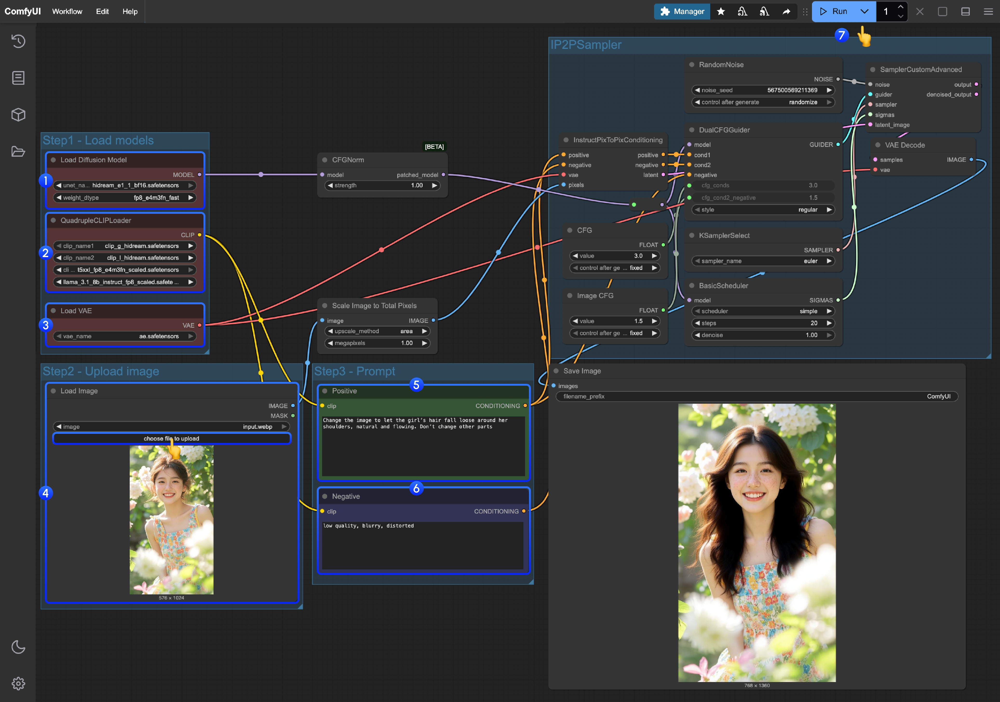
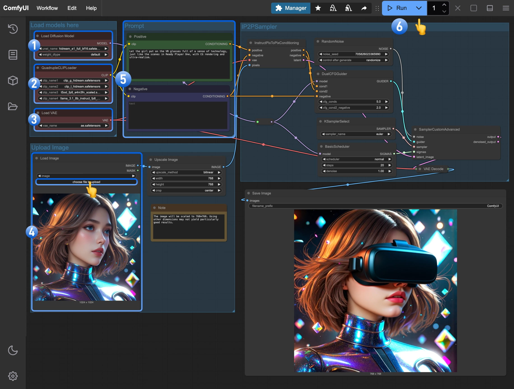

import UpdateReminder from '/snippets/de/tutorials/update-reminder.mdx'


HiDream-E1 ist ein interaktives großes Modell zur Bildbearbeitung, das von HiDream-ai offiziell als Open Source veröffentlicht wurde und auf HiDream-I1 basiert.

Mit HiDream-E1 können Sie Bilder in natürlicher Sprache bearbeiten. Das Modell ist unter der [MIT-Lizenz](https://github.com/HiDream-ai/HiDream-E1?tab=MIT-1-ov-file) veröffentlicht und kann in persönlichen Projekten, der wissenschaftlichen Forschung und kommerziellen Anwendungen eingesetzt werden.
In Kombination mit dem zuvor veröffentlichten [hidream-i1](/de/tutorials/image/hidream/hidream-i1) ermöglicht es **kreative Fähigkeiten von der Bilderzeugung bis zur Bildbearbeitung**.

| Name              | Aktualisierungsdatum | Inferenzschritte | Auflösung             | HuggingFace Repository         |
|-------------------|----------------------|------------------|------------------------|-------------------------------|
| HiDream-E1-Full   | 2025-4-28            | 28               | 768x768                | 🤗 [HiDream-E1-Full](https://huggingface.co/HiDream-ai/HiDream-E1-Full)        |
| HiDream-E1.1      | 2025-7-16            | 28               | Dynamisch (1 Megapixel) | 🤗 [HiDream-E1.1](https://huggingface.co/HiDream-ai/HiDream-E1-1)           |

[HiDream E1 auf GitHub](https://github.com/HiDream-ai/HiDream-E1)

<UpdateReminder/>

## Zugehörige Modelle für die Workflows HiDream E1 und E1.1

Alle Modelle, die in dieser Anleitung vorkommen, finden Sie [hier](https://huggingface.co/Comfy-Org/HiDream-I1_ComfyUI/tree/main/split_files). Mit Ausnahme des Diffusion-Modells verwenden E1 und E1.1 dieselben Modelle.
Die zugehörigen Workflow-Dateien enthalten ebenfalls die relevanten Modellinformationen. Sie können die Modelle manuell herunterladen und speichern oder nach dem Laden des Workflows den Hinweisen im Workflow folgen, um sie herunterzuladen. Es wird empfohlen, E1.1 zu verwenden.

Dieses Modell benötigt sehr viel VRAM zum Ausführen. Die konkreten VRAM-Anforderungen entnehmen Sie bitte den entsprechenden Abschnitten.

**Diffusion-Modell**

Sie müssen nicht beide Modelle herunterladen. Da E1.1 eine iterative Version auf Basis von E1 ist, zeigen unsere Tests, dass Qualität und Leistung im Vergleich zu E1 deutlich verbessert sind.
- [hidream_e1_1_bf16.safetensors (empfohlen)](https://huggingface.co/Comfy-Org/HiDream-I1_ComfyUI/blob/main/split_files/diffusion_models/hidream_e1_1_bf16.safetensors) 34.2GB
- [hidream_e1_full_bf16.safetensors](https://huggingface.co/Comfy-Org/HiDream-I1_ComfyUI/blob/main/split_files/diffusion_models/hidream_e1_full_bf16.safetensors) 34.2GB

**Text-Encoder**:

- [clip_l_hidream.safetensors](https://huggingface.co/Comfy-Org/HiDream-I1_ComfyUI/blob/main/split_files/text_encoders/clip_l_hidream.safetensors) 236.12MB
- [clip_g_hidream.safetensors](https://huggingface.co/Comfy-Org/HiDream-I1_ComfyUI/blob/main/split_files/text_encoders/clip_g_hidream.safetensors) 1.29GB
- [t5xxl_fp8_e4m3fn_scaled.safetensors](https://huggingface.co/Comfy-Org/HiDream-I1_ComfyUI/blob/main/split_files/text_encoders/t5xxl_fp8_e4m3fn_scaled.safetensors) 4.8GB
- [llama_3.1_8b_instruct_fp8_scaled.safetensors](https://huggingface.co/Comfy-Org/HiDream-I1_ComfyUI/blob/main/split_files/text_encoders/llama_3.1_8b_instruct_fp8_scaled.safetensors) 8.46GB

**VAE**
- [ae.safetensors](https://huggingface.co/Comfy-Org/HiDream-I1_ComfyUI/blob/main/split_files/vae/ae.safetensors) 319.77MB
> Dies ist das VAE-Modell für FLUX. Wenn Sie bereits mit dem FLUX-Workflow gearbeitet haben, haben Sie diese Datei möglicherweise schon heruntergeladen.

Speicherort der Modelle

```
📂 ComfyUI/
├── 📂 models/
│   ├── 📂 text_encoders/
│   │   ├─── clip_l_hidream.safetensors
│   │   ├─── clip_g_hidream.safetensors
│   │   ├─── t5xxl_fp8_e4m3fn_scaled.safetensors
│   │   └─── llama_3.1_8b_instruct_fp8_scaled.safetensors
│   └── 📂 vae/
│   │   └── ae.safetensors
│   └── 📂 diffusion_models/
│       ├── hidream_e1_1_bf16.safetensors
│       └── hidream_e1_full_bf16.safetensors
```
## Beispiel für den nativen ComfyUI-Workflow mit HiDream E1.1

### Bildbearbeitung mit HiDream E1.1 {#hidream_e1_1}

Bearbeiten Sie Bilder mit HiDream E1.1. Höhere Bildqualität und Bearbeitungsgenauigkeit als bei HiDream-E1-Full.


<CardGroup cols={2}>
  <Card title="Auf Comfy Cloud ausführen" icon="cloud" href="https://cloud.comfy.org/?template=hidream_e1_1&utm_source=docs&utm_medium=referral&utm_campaign=hidream-e1">
    In Comfy Cloud öffnen
  </Card>
  <Card title="Workflow herunterladen" icon="download" href="https://github.com/Comfy-Org/workflow_templates/blob/main/templates/hidream_e1_1.json">
    JSON herunterladen oder in der Vorlagenbibliothek nach &quot;HiDream E1.1&quot; suchen
  </Card>
</CardGroup>

**Eingabematerialien**

Laden Sie diese Datei in den passenden `LoadImage`-Node hoch:

<CardGroup cols={2}>
  <Card title="hidream_e1_1_input_image.jpg" icon="image" href="https://raw.githubusercontent.com/Comfy-Org/workflow_templates/main/input/hidream_e1_1_input_image.jpg">
    `LoadImage`-Node 13 · `hidream_e1_1_input_image.jpg`
  </Card>
</CardGroup>

<div style={{display: 'grid', gridTemplateColumns: 'repeat(2, minmax(0, 1fr))', gap: '1rem', alignItems: 'start'}}>
  
</div>

### 1. HiDream E1.1 Workflow und zugehörige Materialien

Laden Sie das folgende Bild herunter und ziehen Sie es in ComfyUI, während der entsprechende Workflow und die Modelle geladen sind:


Laden Sie das folgende Bild als Eingabe herunter:


### 2. Schritt-für-Schritt-Anleitung zum Ausführen des HiDream-e1-Workflows


Führen Sie die folgenden Schritte aus, um den Workflow auszuführen:
1. Stellen Sie sicher, dass der Node `Load Diffusion Model` das Modell `hidream_e1_1_bf16.safetensors` lädt.
2. Stellen Sie sicher, dass die vier entsprechenden Text-Encoder in `QuadrupleCLIPLoader` korrekt geladen sind:
    - clip_l_hidream.safetensors
    - clip_g_hidream.safetensors
    - t5xxl_fp8_e4m3fn_scaled.safetensors
    - llama_3.1_8b_instruct_fp8_scaled.safetensors
3. Stellen Sie sicher, dass der Node `Load VAE` die Datei `ae.safetensors` verwendet.
4. Laden Sie im Node `Load Image` die bereitgestellte Eingabe oder ein Bild Ihrer Wahl.
5. Geben Sie im Node `Empty Text Encoder(Positive)` **die Änderungen ein, die Sie am Bild vornehmen möchten**.
6. Geben Sie im Node `Empty Text Encoder(Negative)` **die Inhalte ein, die nicht im Bild erscheinen sollen**.
7. Klicken Sie auf die Schaltfläche `Run` oder verwenden Sie die Tastenkombination `Ctrl(cmd) + Enter`, um die Bildgenerierung auszuführen.

### 3. Zusätzliche Hinweise zum Workflow

- Da HiDream E1.1 dynamische Eingaben mit insgesamt 1 Million Pixeln unterstützt, verarbeitet der Workflow alle Eingabebilder mit `Scale Image to Total Pixels` und konvertiert sie, wodurch das Seitenverhältnis vom ursprünglichen Eingabebild abweichen kann.
- Bei Verwendung der fp16-Version des Modells ging in tatsächlichen Tests bei der Vollversion sowohl auf einer A100 40GB als auch auf einer 4090D 24GB der Arbeitsspeicher aus, daher ist im Workflow standardmäßig `fp8_e4m3fn_fast` für die Inferenz eingestellt.

## Beispiel für einen nativen ComfyUI-Workflow mit HiDream E1

### HiDream E1 Bildbearbeitung {#hidream_e1_full}

Bearbeiten Sie Bilder mit HiDream E1. Ein professionelles Modell zur Bildbearbeitung mit natürlicher Sprache.


<CardGroup cols={2}>
  <Card title="Auf Comfy Cloud ausführen" icon="cloud" href="https://cloud.comfy.org/?template=hidream_e1_full&utm_source=docs&utm_medium=referral&utm_campaign=hidream-e1">
    In Comfy Cloud öffnen
  </Card>
  <Card title="Workflow herunterladen" icon="download" href="https://github.com/Comfy-Org/workflow_templates/blob/main/templates/hidream_e1_full.json">
    JSON herunterladen oder in der Vorlagenbibliothek nach &quot;HiDream E1 Full&quot; suchen
  </Card>
</CardGroup>

**Eingabematerialien**

Laden Sie diese Datei in den passenden `LoadImage`-Node hoch:

<CardGroup cols={2}>
  <Card title="hidream_e1_full_input_image.jpg" icon="image" href="https://raw.githubusercontent.com/Comfy-Org/workflow_templates/main/input/hidream_e1_full_input_image.jpg">
    `LoadImage`-Node 13 · `hidream_e1_full_input_image.jpg`
  </Card>
</CardGroup>

<div style={{display: 'grid', gridTemplateColumns: 'repeat(2, minmax(0, 1fr))', gap: '1rem', alignItems: 'start'}}>
  
</div>

**Beispielausgabe**

<div style={{display: 'grid', gridTemplateColumns: 'repeat(2, minmax(0, 1fr))', gap: '1rem', alignItems: 'start'}}>
  
  
</div>

E1 ist ein Modell, das am 28. April 2025 veröffentlicht wurde.

<Tip>
Als Referenz: Dieser Workflow benötigt beim ersten Lauf etwa 500s und beim zweiten Lauf etwa 370s mit 28 Sampling-Schritten auf einem Google Colab L4 mit 22.5GB VRAM.
</Tip>

### 1. HiDream-e1-Workflow

Bitte laden Sie das untenstehende Bild herunter und ziehen Sie es in ComfyUI. Der Workflow enthält bereits die Downloadinformationen für die Modelle, und nach dem Laden werden Sie aufgefordert, die entsprechenden Modelle herunterzuladen.


Laden Sie das untenstehende Bild als Eingabe herunter:


### 2. HiDream-e1-Workflow Schritt für Schritt abschließen



Gehen Sie zum Abschließen des Workflows wie folgt vor:
1. Stellen Sie sicher, dass der Node `Load Diffusion Model` das Modell `hidream_e1_full_bf16.safetensors` geladen hat.
2. Stellen Sie sicher, dass die vier zugehörigen Text Encoder im Node `QuadrupleCLIPLoader` korrekt geladen sind:
    - clip_l_hidream.safetensors
    - clip_g_hidream.safetensors
    - t5xxl_fp8_e4m3fn_scaled.safetensors
    - llama_3.1_8b_instruct_fp8_scaled.safetensors
3. Stellen Sie sicher, dass der Node `Load VAE` die Datei `ae.safetensors` verwendet.
4. Laden Sie das zuvor heruntergeladene Eingabebild im Node `Load Image`.
5. (Wichtig) Geben Sie im Node `Empty Text Encoder(Positive)` **den Prompt dafür ein, wie Sie das Bild ändern möchten**.
6. Klicken Sie auf die Schaltfläche `Run` oder verwenden Sie die Tastenkombination `Ctrl(cmd) + Enter`, um das Bild zu generieren.

### Zusätzliche Hinweise zum ComfyUI-Workflow mit HiDream-e1

- Möglicherweise müssen Sie den Prompt mehrmals ändern oder mehrere Generierungen durchführen, um bessere Ergebnisse zu erzielen.
- Dieses Modell hat Schwierigkeiten, die Konsistenz beim Ändern von Bildstilen zu wahren, daher sollten Sie Ihre Prompts so vollständig wie möglich formulieren.
- Da das Modell eine Auflösung von 768*768 unterstützt, ist die Bildqualität in tatsächlichen Tests mit anderen Abmessungen schlecht oder weicht sogar deutlich von diesen ab.
