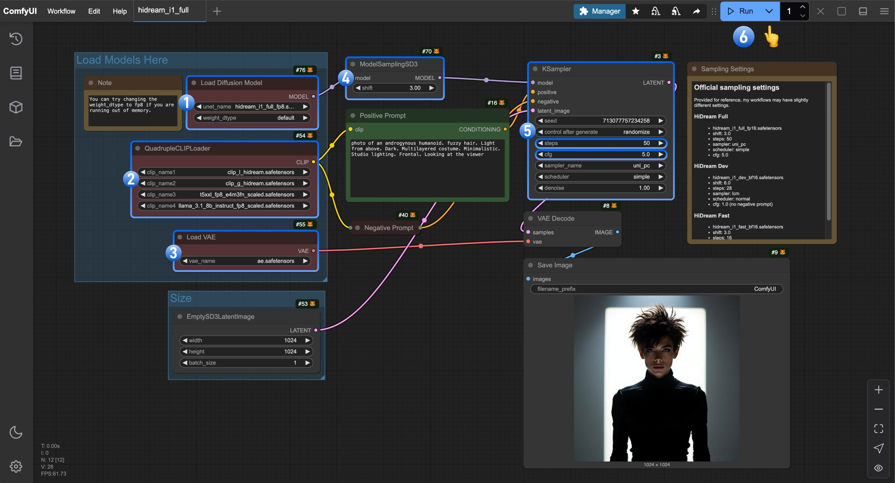
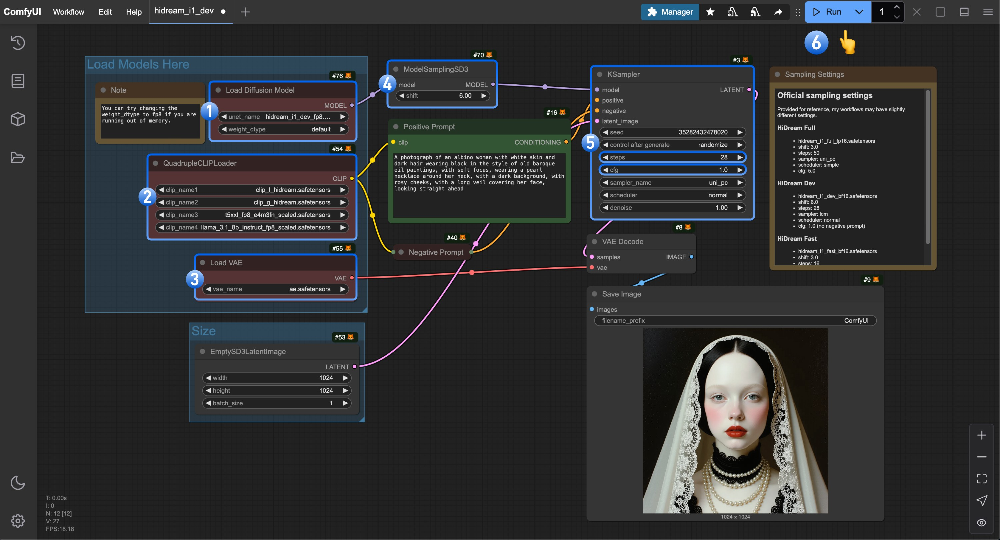
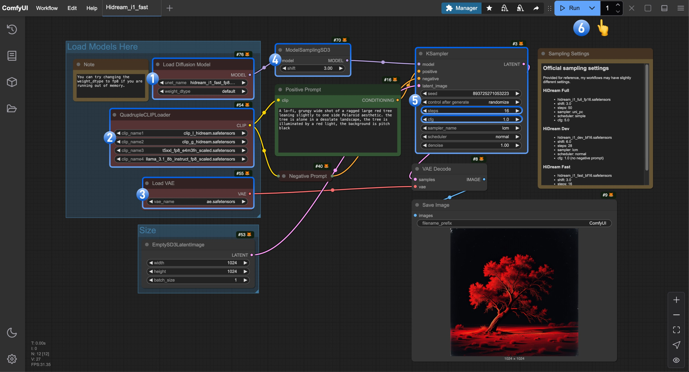

HiDream-I1 ist ein Text-zu-Bild-Modell, das HiDream-ai am 7. April 2025 offiziell als Open Source veröffentlicht hat. Das Modell hat 17B Parameter und steht unter der [MIT-Lizenz](https://github.com/HiDream-ai/HiDream-I1/blob/main/LICENSE), sodass es sich für persönliche Projekte, wissenschaftliche Forschung und kommerzielle Nutzung eignet. Derzeit erzielt es in mehreren Benchmark-Tests hervorragende Ergebnisse.

## Modellmerkmale

**Hybrides Architekturdesign**
Eine Kombination aus Diffusion Transformer (DiT) und Mixture-of-Experts-Architektur (MoE):
- Basierend auf Diffusion Transformer (DiT), mit Dual-Stream-MMDiT-Modulen, die multimodale Informationen verarbeiten, und Single-Stream-DiT-Modulen, die die globale Konsistenz optimieren.
- Ein dynamischer Routing-Mechanismus weist Rechenressourcen flexibel zu, verbessert die Verarbeitung komplexer Szenen und liefert hervorragende Leistung bei der Farbwiederherstellung, der Kantenverarbeitung und weiteren Details.

**Integration multimodaler Text-Encoder**
Es werden vier Text-Encoder integriert:
- OpenCLIP ViT-bigG, OpenAI CLIP ViT-L (visuell-semantische Ausrichtung)
- T5-XXL (Verarbeitung langer Texte)
- Llama-3.1-8B-Instruct (Instruktionsverständnis)
Diese Kombination erzielt SOTA-Leistung bei der komplexen semantischen Analyse von Farben, Mengen, räumlichen Beziehungen usw. Die Unterstützung chinesischer Prompts übertrifft vergleichbare Open-Source-Modelle deutlich.

**Originalmodellversionen**

HiDream-ai stellt drei Versionen des HiDream-I1-Modells bereit, um unterschiedliche Anforderungen zu erfüllen. Unten finden Sie die Hyperlinks zu den Repositories der Originalmodelle:

| Modellname      | Beschreibung    | Inferenzschritte | Repository-Hyperlink                                                        |
|-----------------|----------------|-----------------|------------------------------------------------------------------------|
| HiDream-I1-Full | Vollversion   | 50              | [🤗 HiDream-I1-Full](https://huggingface.co/HiDream-ai/HiDream-I1-Full)|
| HiDream-I1-Dev  | Destillierte Dev-Version  | 28              | [🤗 HiDream-I1-Dev](https://huggingface.co/HiDream-ai/HiDream-I1-Dev)  |
| HiDream-I1-Fast | Destillierte Fast-Version | 16              | [🤗 HiDream-I1-Fast](https://huggingface.co/HiDream-ai/HiDream-I1-Fast)|

## Über dieses Workflow-Beispiel

In diesem Beispiel verwenden wir die neu verpackte Version von ComfyOrg. Alle Modelldateien, die wir in diesem Beispiel verwenden, finden Sie im Repository [HiDream-I1_ComfyUI](https://huggingface.co/Comfy-Org/HiDream-I1_ComfyUI/).

<Tip>
Bevor Sie beginnen, aktualisieren Sie bitte Ihre ComfyUI-Version, sodass sie mindestens auf diesem [Commit](https://github.com/Comfy-Org/ComfyUI/commit/9ad792f92706e2179c58b2e5348164acafa69288) basiert oder neuer ist. So stellen Sie sicher, dass Ihr ComfyUI HiDream nativ unterstützt.
</Tip>

## HiDream-I1-Workflow

Die Modellanforderungen für die verschiedenen nativen HiDream-I1-Workflows von ComfyUI sind im Wesentlichen gleich, lediglich die Dateien der [Diffusionsmodelle](https://huggingface.co/Comfy-Org/HiDream-I1_ComfyUI/tree/main/split_files/diffusion_models) unterscheiden sich.

Wenn Sie nicht wissen, welche Version Sie wählen sollen, beachten Sie bitte die folgenden Empfehlungen:

- **HiDream-I1-Full** erzeugt Bilder in der höchsten Qualität
- **HiDream-I1-Dev** bietet einen Ausgleich zwischen hochwertiger Bilderzeugung und Geschwindigkeit
- **HiDream-I1-Fast** erzeugt Bilder in nur 16 Schritten und eignet sich für Szenarien, die eine Iteration in Echtzeit erfordern

Bei den Versionen **dev** und **fast** sind Negativ-Prompts nicht erforderlich, setzen Sie den Parameter `cfg` beim Sampling daher auf `1.0`. Die entsprechenden Parametereinstellungen haben wir in den jeweiligen Workflows vermerkt.

<Tip>
Die Full-Versionen aller drei Varianten benötigen sehr viel VRAM. Möglicherweise brauchen Sie mehr als 27GB VRAM, um sie flüssig auszuführen. In den jeweiligen Workflow-Tutorials
verwenden wir die **fp8**-Version als Demonstrationsbeispiel, damit die meisten Nutzer sie flüssig ausführen können.
In den entsprechenden Beispielen stellen wir jedoch weiterhin Download-Links für die verschiedenen Versionen des Modells bereit, und Sie können die passende Datei anhand Ihrer VRAM-Situation auswählen.
</Tip>

### Modelle installieren

Die folgenden Modelldateien sind gemeinsame Dateien, die wir verwenden.
Klicken Sie auf die jeweiligen Links, um sie herunterzuladen und am vorgesehenen Speicherort für Modelldateien zu speichern.
Die entsprechenden **Diffusionsmodelle** laden Sie in den jeweiligen Workflows herunter, dort leiten wir Sie an.

**text_encoders**:

- [clip_l_hidream.safetensors](https://huggingface.co/Comfy-Org/HiDream-I1_ComfyUI/blob/main/split_files/text_encoders/clip_l_hidream.safetensors)
- [clip_g_hidream.safetensors](https://huggingface.co/Comfy-Org/HiDream-I1_ComfyUI/blob/main/split_files/text_encoders/clip_g_hidream.safetensors)
- [t5xxl_fp8_e4m3fn_scaled.safetensors](https://huggingface.co/Comfy-Org/HiDream-I1_ComfyUI/blob/main/split_files/text_encoders/t5xxl_fp8_e4m3fn_scaled.safetensors) Dieses Modell wird in vielen Workflows verwendet, möglicherweise haben Sie diese Datei bereits heruntergeladen.
- [llama_3.1_8b_instruct_fp8_scaled.safetensors](https://huggingface.co/Comfy-Org/HiDream-I1_ComfyUI/blob/main/split_files/text_encoders/llama_3.1_8b_instruct_fp8_scaled.safetensors)

**VAE**
-  [ae.safetensors](https://huggingface.co/Comfy-Org/HiDream-I1_ComfyUI/blob/main/split_files/vae/ae.safetensors) Dies ist das VAE-Modell von Flux. Wenn Sie bereits mit einem Flux-Workflow gearbeitet haben, haben Sie diese Datei möglicherweise schon heruntergeladen.

**Diffusionsmodelle**
Wir leiten Sie an, die entsprechenden Modelldateien in den jeweiligen Workflows herunterzuladen.

Speicherort der Modelldateien
```
📂 ComfyUI/
├── 📂 models/
│   ├── 📂 text_encoders/
│   │   ├─── clip_l_hidream.safetensors
│   │   ├─── clip_g_hidream.safetensors
│   │   ├─── t5xxl_fp8_e4m3fn_scaled.safetensors
│   │   └─── llama_3.1_8b_instruct_fp8_scaled.safetensors
│   └── 📂 vae/
│   │   └── ae.safetensors
│   └── 📂 diffusion_models/
│       └── ...               # We will guide you to install in the corresponding version workflow       
```

### HiDream I1 Workflow (Vollversion)

### HiDream I1 Full {#hidream_i1_full}

Generieren Sie Bilder mit HiDream I1 Full. Vollständige Version mit 50 Inferenzschritten für Ausgaben in höchster Qualität.


<CardGroup cols={2}>
  <Card title="Auf Comfy Cloud ausführen" icon="cloud" href="https://cloud.comfy.org/?template=hidream_i1_full&utm_source=docs&utm_medium=referral&utm_campaign=hidream-i1">
    Führen Sie diesen Workflow ohne Einrichtung auf Comfy Cloud aus
  </Card>
  <Card title="Workflow herunterladen" icon="download" href="https://github.com/Comfy-Org/workflow_templates/blob/main/templates/hidream_i1_full.json">
    Laden Sie die JSON-Datei des Workflows herunter
  </Card>
</CardGroup>

**Beispielausgabe**


#### 1. Modelldatei herunterladen

Bitte wählen Sie die passende Version für Ihre Hardware. Klicken Sie auf den Link und laden Sie die entsprechende Modelldatei herunter, um sie im Ordner `ComfyUI/models/diffusion_models/` zu speichern.

- FP8-Version: [hidream_i1_full_fp8.safetensors](https://huggingface.co/Comfy-Org/HiDream-I1_ComfyUI/blob/main/split_files/diffusion_models/hidream_i1_full_fp8.safetensors?download=true) erfordert mehr als 16GB VRAM
- Vollversion: [hidream_i1_full_f16.safetensors](https://huggingface.co/Comfy-Org/HiDream-I1_ComfyUI/blob/main/split_files/diffusion_models/hidream_i1_full_fp16.safetensors?download=true) erfordert mehr als 27GB VRAM

#### 2. Workflowdatei herunterladen

Bitte laden Sie das folgende Bild herunter und ziehen Sie es in ComfyUI, um den entsprechenden Workflow zu laden


#### 3. Den Workflow Schritt für Schritt vervollständigen



Führen Sie die Ausführung des Workflows Schritt für Schritt durch
1. Stellen Sie sicher, dass der Node `Load Diffusion Model` die Datei `hidream_i1_full_fp8.safetensors` verwendet
2. Stellen Sie sicher, dass die vier entsprechenden Text-Encoder in `QuadrupleCLIPLoader` korrekt geladen sind
    - clip_l_hidream.safetensors
    - clip_g_hidream.safetensors
    - t5xxl_fp8_e4m3fn_scaled.safetensors
    - llama_3.1_8b_instruct_fp8_scaled.safetensors
3. Stellen Sie sicher, dass der Node `Load VAE` die Datei `ae.safetensors` verwendet
4. Für die **Vollversion** müssen Sie den Parameter `shift` in `ModelSamplingSD3` auf `3.0` setzen
5. Für den Node `Ksampler` müssen Sie die folgenden Einstellungen vornehmen
    - Setzen Sie `steps` auf `50`
    - Setzen Sie `cfg` auf `5.0`
    - (Optional) Setzen Sie `sampler` auf `lcm`
    - (Optional) Setzen Sie `scheduler` auf `normal`
6. Klicken Sie auf die Schaltfläche `Run` oder verwenden Sie die Tastenkombination `Ctrl(cmd) + Enter`, um die Bilderzeugung auszuführen

### HiDream-I1 Dev-Version-Workflow

### HiDream I1 Dev {#hidream_i1_dev}

Generieren Sie Bilder mit HiDream I1 Dev. Ausgewogene Version mit 28 Inferenzschritten, geeignet für Hardware der Mittelklasse.


<CardGroup cols={2}>
  <Card title="Auf Comfy Cloud ausführen" icon="cloud" href="https://cloud.comfy.org/?template=hidream_i1_dev&utm_source=docs&utm_medium=referral&utm_campaign=hidream-i1">
    Führen Sie diesen Workflow ohne Einrichtung auf Comfy Cloud aus
  </Card>
  <Card title="Workflow herunterladen" icon="download" href="https://github.com/Comfy-Org/workflow_templates/blob/main/templates/hidream_i1_dev.json">
    Laden Sie die JSON-Datei des Workflows herunter
  </Card>
</CardGroup>

**Beispielausgabe**


#### 1. Modelldatei herunterladen
Bitte wählen Sie die passende Version für Ihre Hardware aus, klicken Sie auf den Link und laden Sie die entsprechende Modelldatei herunter, um sie im Ordner `ComfyUI/models/diffusion_models/` zu speichern.

- FP8-Version: [hidream_i1_dev_fp8.safetensors](https://huggingface.co/Comfy-Org/HiDream-I1_ComfyUI/blob/main/split_files/diffusion_models/hidream_i1_dev_fp8.safetensors?download=true) benötigt mehr als 16 GB VRAM
- Vollversion: [hidream_i1_dev_bf16.safetensors](https://huggingface.co/Comfy-Org/HiDream-I1_ComfyUI/blob/main/split_files/diffusion_models/hidream_i1_dev_bf16.safetensors?download=true) benötigt mehr als 27 GB VRAM

#### 2. Workflow-Datei herunterladen
Bitte laden Sie das untenstehende Bild herunter und ziehen Sie es in ComfyUI, um den entsprechenden Workflow zu laden


#### 3. Den Workflow Schritt für Schritt vervollständigen


Führen Sie den Workflow Schritt für Schritt aus
1. Stellen Sie sicher, dass der Node `Load Diffusion Model` die Datei `hidream_i1_dev_fp8.safetensors` verwendet
2. Stellen Sie sicher, dass die vier entsprechenden Text-Encoder in `QuadrupleCLIPLoader` korrekt geladen sind
    - clip_l_hidream.safetensors
    - clip_g_hidream.safetensors
    - t5xxl_fp8_e4m3fn_scaled.safetensors
    - llama_3.1_8b_instruct_fp8_scaled.safetensors
3. Stellen Sie sicher, dass der Node `Load VAE` die Datei `ae.safetensors` verwendet
4. Für die Version **dev** müssen Sie den Parameter `shift` in `ModelSamplingSD3` auf `6.0` setzen
5. Für den Node `Ksampler` müssen Sie die folgenden Einstellungen vornehmen
    - Setzen Sie `steps` auf `28`
    - (Wichtig) Setzen Sie `cfg` auf `1.0`
    - (Optional) Setzen Sie `sampler` auf `lcm`
    - (Optional) Setzen Sie `scheduler` auf `normal`
6. Klicken Sie auf die Schaltfläche `Run` oder verwenden Sie die Tastenkombination `Ctrl(cmd) + Enter`, um die Bildgenerierung auszuführen

### HiDream-I1 Workflow (Schnellversion)

### HiDream I1 Fast {#hidream_i1_fast}

Generieren Sie Bilder schnell mit HiDream I1 Fast. Die leichtgewichtige Version mit 16 Inferenzschritten ist ideal für schnelle Vorschauen auf schwächerer Hardware.


<CardGroup cols={2}>
  <Card title="Auf Comfy Cloud ausführen" icon="cloud" href="https://cloud.comfy.org/?template=hidream_i1_fast&utm_source=docs&utm_medium=referral&utm_campaign=hidream-i1">
    Führen Sie diesen Workflow ohne Einrichtung auf Comfy Cloud aus
  </Card>
  <Card title="Workflow herunterladen" icon="download" href="https://github.com/Comfy-Org/workflow_templates/blob/main/templates/hidream_i1_fast.json">
    Laden Sie die JSON-Datei des Workflows herunter
  </Card>
</CardGroup>

**Beispielausgabe**


#### 1. Modelldatei herunterladen
Bitte wählen Sie die passende Version für Ihre Hardware aus, klicken Sie auf den Link und laden Sie die entsprechende Modelldatei herunter, um sie im Ordner `ComfyUI/models/diffusion_models/` zu speichern.

- FP8-Version: [hidream_i1_fast_fp8.safetensors](https://huggingface.co/Comfy-Org/HiDream-I1_ComfyUI/blob/main/split_files/diffusion_models/hidream_i1_fast_fp8.safetensors?download=true) erfordert mehr als 16GB VRAM
- Vollversion: [hidream_i1_fast_bf16.safetensors](https://huggingface.co/Comfy-Org/HiDream-I1_ComfyUI/blob/main/split_files/diffusion_models/hidream_i1_fast_bf16.safetensors?download=true) erfordert mehr als 27GB VRAM

#### 2. Workflow-Datei herunterladen
Bitte laden Sie das untenstehende Bild herunter und ziehen Sie es in ComfyUI, um den entsprechenden Workflow zu laden.


#### 3. Workflow Schritt für Schritt abschließen



Schließen Sie die Ausführung des Workflows Schritt für Schritt ab.
1. Stellen Sie sicher, dass der Node `Load Diffusion Model` die Datei `hidream_i1_fast_fp8.safetensors` verwendet.
2. Stellen Sie sicher, dass die vier entsprechenden Textencoder im `QuadrupleCLIPLoader` korrekt geladen sind.
    - clip_l_hidream.safetensors
    - clip_g_hidream.safetensors
    - t5xxl_fp8_e4m3fn_scaled.safetensors
    - llama_3.1_8b_instruct_fp8_scaled.safetensors
3. Stellen Sie sicher, dass der Node `Load VAE` die Datei `ae.safetensors` verwendet.
4. Für die **Fast**-Version müssen Sie den Parameter `shift` in `ModelSamplingSD3` auf `3.0` setzen.
5. Für den Node `Ksampler` müssen Sie die folgenden Einstellungen vornehmen:
    - Setzen Sie `steps` auf `16`.
    - (Wichtig) Setzen Sie `cfg` auf `1.0`.
    - (Optional) Setzen Sie `sampler` auf `lcm`.
    - (Optional) Setzen Sie `scheduler` auf `normal`.
6. Klicken Sie auf die Schaltfläche `Run` oder verwenden Sie die Tastenkombination `Ctrl(cmd) + Enter`, um die Bildgenerierung auszuführen.

## Weitere verwandte Ressourcen

### GGUF-Versionsmodelle

- [HiDream-I1-Full-gguf](https://huggingface.co/city96/HiDream-I1-Full-gguf) 
- [HiDream-I1-Dev-gguf](https://huggingface.co/city96/HiDream-I1-Dev-gguf) 

Sie müssen den Node „Unet Loader (GGUF)“ aus City96s [ComfyUI-GGUF](https://github.com/city96/ComfyUI-GGUF) verwenden, um den Node „Load Diffusion Model“ zu ersetzen.

### NF4-Versionsmodelle
- [HiDream-I1-nf4](https://github.com/hykilpikonna/HiDream-I1-nf4) 
- Verwenden Sie den Node [ComfyUI-HiDream-Sampler](https://github.com/SanDiegoDude/ComfyUI-HiDream-Sampler), um das NF4-Versionsmodell zu nutzen.
