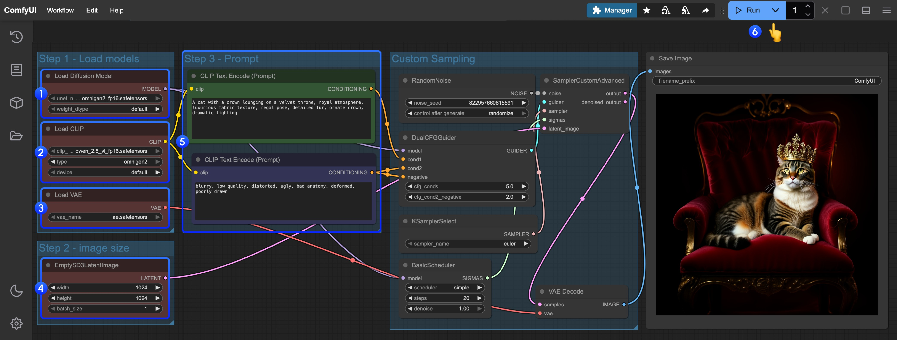
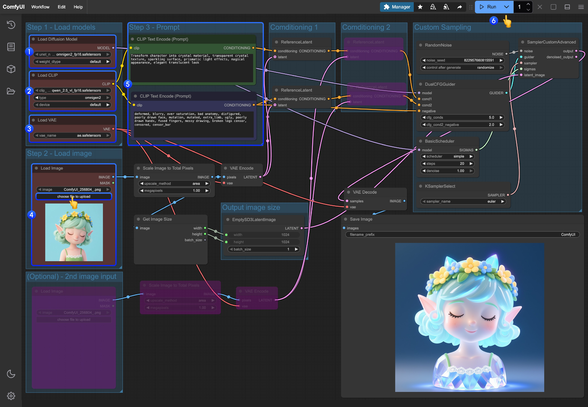

import UpdateReminder from '/snippets/de/tutorials/update-reminder.mdx'

OmniGen2 ist ein einheitliches multimodales Open-Source-Generierungsmodell des Forschungsteams von [VectorSpaceLab](https://github.com/VectorSpaceLab/OmniGen2). Ein einziger Gewichtssatz übernimmt die Text-zu-Bild-Generierung, anweisungsgesteuerte Bildbearbeitung und subjektgesteuerte In-Context-Generierung. ComfyUI unterstützt OmniGen2 nativ, sodass alle drei Aufgaben lokal über die offiziellen Beispiel-Workflows ausgeführt werden.

Das Modell kombiniert ein eingefrorenes 3B-Vision-Language-Modell Qwen2.5-VL mit einem separaten 4B-Diffusionstransformer und kommt insgesamt auf etwa 7B Parameter. Das Vision-Language-Modell liest Ihre Referenzbilder und Ihre schriftlichen Anweisungen, und der Diffusionstransformer wandelt dieses Verständnis in Pixel um. Da beide Pfade ihre eigenen Parameter und ihren eigenen Bild-Tokenizer behalten, bewahrt OmniGen2 seine Fähigkeit zum visuellen Verständnis und hält die Bildqualität hoch.

ComfyUI enthält zwei offizielle Workflows für das Modell: Text zu Bild sowie Bildbearbeitung anhand von Anweisungen in natürlicher Sprache wie „Ändern Sie das Kleid in Blau“. Der Workflow zur Bildbearbeitung übernimmt außerdem die Komposition mehrerer Bilder und kombiniert Personen, Referenzobjekte und Szenen aus mehreren Eingabebildern.

<UpdateReminder/>

**Modell-Highlights**:

- **Visuelles Verständnis**: Liest und analysiert Bildinhalte mithilfe des Qwen2.5-VL-Basismodells
- **Text-zu-Bild-Generierung**: Erzeugt hochgetreue Bilder aus Text-Prompts
- **Anweisungsgesteuerte Bildbearbeitung**: Nimmt komplexe Bearbeitungen anhand von Anweisungen in natürlicher Sprache vor
- **In-Context-Generierung**: Kombiniert Personen, Referenzobjekte und Szenen aus mehreren Eingaben zu neuen Bildern

**Technische Merkmale**:

- **Zweipfad-Architektur**: 3B-Textmodell Qwen2.5-VL sowie ein unabhängiger 4B-Diffusionstransformer
- **Omni-RoPE-Positionskodierung**: Räumliche Positionierung mehrerer Bilder und Unterscheidung ihrer Identitäten
- **Entkopplung der Parameter**: Verhindert, dass die autoregressive Textgenerierung die Bildqualität beeinträchtigt
- **Text im Bild**: Erzeugt lesbaren Textinhalt im generierten Bild

## OmniGen2-Modell herunterladen

Da dieser Artikel verschiedene Workflows behandelt, sind die zugehörigen Modelldateien und Speicherorte im Folgenden aufgeführt. Die Informationen zum Herunterladen der Modelldateien sind ebenfalls in den entsprechenden Workflows enthalten:

**Diffusionsmodelle**
- [omnigen2_fp16.safetensors](https://huggingface.co/Comfy-Org/Omnigen2_ComfyUI_repackaged/blob/main/split_files/diffusion_models/omnigen2_fp16.safetensors)

**VAE**
- [ae.safetensors](https://huggingface.co/Comfy-Org/Lumina_Image_2.0_Repackaged/blob/main/split_files/vae/ae.safetensors)

**Text-Encoder**
- [qwen_2.5_vl_fp16.safetensors](https://huggingface.co/Comfy-Org/Omnigen2_ComfyUI_repackaged/blob/main/split_files/text_encoders/qwen_2.5_vl_fp16.safetensors)

Speicherort der Dateien:
```
📂 ComfyUI/
├── 📂 models/
│   ├── 📂 diffusion_models/
│   │   └── omnigen2_fp16.safetensors
│   ├── 📂 vae/
│   │   └── ae.safetensors
│   └── 📂 text_encoders/
│       └── qwen_2.5_vl_fp16.safetensors
```
## ComfyUI OmniGen2 Text-zu-Bild-Workflow

### OmniGen2: Text zu Bild {#image_omnigen2_t2i}

Erzeugen Sie hochwertige Bilder aus Text-Prompts mit dem einheitlichen multimodalen 7B-Modell von OmniGen2 mit Dual-Path-Architektur.


<CardGroup cols={2}>
  <Card title="Auf Comfy Cloud ausführen" icon="cloud" href="https://cloud.comfy.org/?template=image_omnigen2_t2i&utm_source=docs&utm_medium=referral&utm_campaign=omnigen2">
    Diesen Workflow direkt in Comfy Cloud öffnen und ausführen
  </Card>
  <Card title="Workflow herunterladen" icon="download" href="https://github.com/Comfy-Org/workflow_templates/blob/main/templates/image_omnigen2_t2i.json">
    JSON herunterladen oder in der Vorlagenbibliothek nach &quot;OmniGen2&quot; suchen
  </Card>
</CardGroup>

**Beispielausgabe**


### 1. Workflow-Datei herunterladen

### 2. Den Workflow Schritt für Schritt durchführen



Bitte folgen Sie den nummerierten Schritten im Bild, um jeden Schritt einzeln zu bestätigen und einen reibungslosen Ablauf des entsprechenden Workflows sicherzustellen:

1. **Hauptmodell laden**: Stellen Sie sicher, dass der Node `Load Diffusion Model` `omnigen2_fp16.safetensors` lädt
2. **Text-Encoder laden**: Stellen Sie sicher, dass der Node `Load CLIP` `qwen_2.5_vl_fp16.safetensors` lädt
3. **VAE laden**: Stellen Sie sicher, dass der Node `Load VAE` `ae.safetensors` lädt
4. **Bildabmessungen festlegen**: Legen Sie die Abmessungen des generierten Bildes im Node `EmptySD3LatentImage` fest (empfohlen: 1024x1024)
5. **Prompts eingeben**:
    - Geben Sie den positiven Prompt im ersten Node `CLipTextEncode` ein (Inhalt, der im Bild erscheinen soll)
    - Geben Sie den negativen Prompt im zweiten Node `CLipTextEncode` ein (Inhalt, der nicht im Bild erscheinen soll)
6. **Generierung starten**: Klicken Sie auf die Schaltfläche `Queue Prompt` oder verwenden Sie die Tastenkombination `Ctrl(cmd) + Enter`, um die Text-zu-Bild-Generierung auszuführen
7. **Ergebnisse ansehen**: Nach Abschluss der Generierung werden die entsprechenden Bilder automatisch im Verzeichnis `ComfyUI/output/` gespeichert, und Sie können sie auch im Node `SaveImage` in der Vorschau ansehen

## ComfyUI OmniGen2 Workflow zur Bildbearbeitung

OmniGen2 bietet umfangreiche Möglichkeiten zur Bildbearbeitung und unterstützt das Hinzufügen von Text zu Bildern.

### OmniGen2 Bildbearbeitung {#image_omnigen2_image_edit}

Bearbeiten Sie Bilder mit Anweisungen in natürlicher Sprache. Nutzen Sie dabei die erweiterten Bildbearbeitungsfunktionen und die Unterstützung für Textdarstellung von OmniGen2.


<CardGroup cols={2}>
  <Card title="Auf Comfy Cloud ausführen" icon="cloud" href="https://cloud.comfy.org/?template=image_omnigen2_image_edit&utm_source=docs&utm_medium=referral&utm_campaign=omnigen2">
    Diesen Workflow direkt in Comfy Cloud öffnen und ausführen
  </Card>
  <Card title="Workflow herunterladen" icon="download" href="https://github.com/Comfy-Org/workflow_templates/blob/main/templates/image_omnigen2_image_edit.json">
    JSON herunterladen oder in der Vorlagenbibliothek nach „OmniGen2 Image Edit“ suchen
  </Card>
</CardGroup>

**Eingabematerialien**

Laden Sie diese Datei in den passenden `LoadImage`-Node hoch:

<CardGroup cols={2}>
  <Card title="image_omnigen2_image_edit_input_image.png" icon="image" href="https://raw.githubusercontent.com/Comfy-Org/workflow_templates/main/input/image_omnigen2_image_edit_input_image.png">
    `LoadImage`-Node 16 · `image_omnigen2_image_edit_input_image.png`
  </Card>
</CardGroup>

<div style={{display: 'grid', gridTemplateColumns: 'repeat(2, minmax(0, 1fr))', gap: '1rem', alignItems: 'start'}}>
  
</div>

**Beispielausgabe**

<div style={{display: 'grid', gridTemplateColumns: 'repeat(2, minmax(0, 1fr))', gap: '1rem', alignItems: 'start'}}>
  
  
</div>

### 1. Workflow-Datei herunterladen

### 2. Workflow Schritt für Schritt abschließen



1. **Hauptmodell laden**: Stellen Sie sicher, dass der Node `Load Diffusion Model` die Datei `omnigen2_fp16.safetensors` lädt
2. **Text-Encoder laden**: Stellen Sie sicher, dass der Node `Load CLIP` die Datei `qwen_2.5_vl_fp16.safetensors` lädt
3. **VAE laden**: Stellen Sie sicher, dass der Node `Load VAE` die Datei `ae.safetensors` lädt
4. **Bild hochladen**: Laden Sie das bereitgestellte Bild im Node `Load Image` hoch
5. **Prompts eingeben**:
    - Geben Sie die positiven Prompts im ersten Node `CLipTextEncode` ein (Inhalte, die im Bild erscheinen sollen)
    - Geben Sie die negativen Prompts im zweiten Node `CLipTextEncode` ein (Inhalte, die nicht im Bild erscheinen sollen)
6. **Generierung starten**: Klicken Sie auf die Schaltfläche `Queue Prompt` oder verwenden Sie die Tastenkombination `Ctrl(cmd) + Enter`, um die Text-zu-Bild-Generierung auszuführen
7. **Ergebnisse anzeigen**: Nach Abschluss der Generierung werden die entsprechenden Bilder automatisch im Verzeichnis `ComfyUI/output/` gespeichert. Sie können sie sich auch im Node `SaveImage` als Vorschau ansehen

### 3. Weitere Hinweise zum Workflow

- Wenn Sie die zweite Bildeingabe aktivieren möchten, können Sie mit der Tastenkombination **Ctrl + B** die entsprechenden Node-Eingänge für Nodes aktivieren, die im Workflow rosa/lila dargestellt sind
- Wenn Sie die Abmessungen anpassen möchten, können Sie den mit dem Node `EmptySD3LatentImage` verknüpften Node `Get image size` löschen und benutzerdefinierte Abmessungen eingeben
