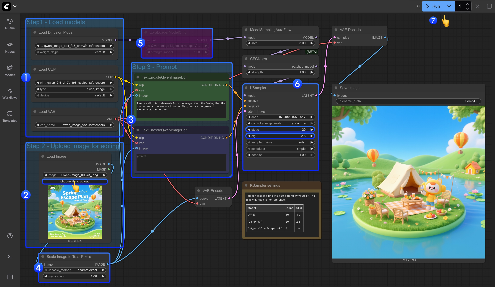

import UpdateReminder from "/snippets/de/tutorials/update-reminder.mdx"

**Qwen-Image-Edit** ist die Bildbearbeitungsversion von Qwen-Image. Es wurde auf Basis des 20B-Qwen-Image-Modells weiter trainiert und erweitert damit die einzigartigen Textrendering-Fähigkeiten von Qwen-Image erfolgreich auf Bearbeitungsaufgaben, wodurch eine präzise Textbearbeitung möglich wird. Darüber hinaus speist Qwen-Image-Edit das Eingabebild sowohl in Qwen2.5-VL (für die visuelle semantische Steuerung) als auch in den VAE Encoder (für die Steuerung des visuellen Erscheinungsbilds) ein und erreicht so eine doppelte Bearbeitung von Semantik und Erscheinungsbild.

**Modellfunktionen**

Zu den Funktionen gehören:
- Präzise Textbearbeitung: Qwen-Image-Edit unterstützt die zweisprachige Textbearbeitung (Chinesisch und Englisch) und ermöglicht das direkte Hinzufügen, Löschen und Ändern von Text in Bildern, während die ursprüngliche Textgröße, Schriftart und der Stil beibehalten werden.
- Doppelte Bearbeitung von Semantik und Erscheinungsbild: Qwen-Image-Edit unterstützt nicht nur die Bearbeitung des visuellen Erscheinungsbilds auf niedriger Ebene (wie Stilübertragung, Hinzufügen, Löschen, Ändern usw.), sondern auch die visuelle semantische Bearbeitung auf hoher Ebene (wie IP-Erstellung, Objektdrehung usw.).
- Starke Leistung über Benchmarks hinweg: Auswertungen auf mehreren öffentlichen Benchmarks zeigen, dass Qwen-Image-Edit bei Bearbeitungsaufgaben SOTA erreicht und damit ein leistungsstarkes Grundlagenmodell für die Bilderzeugung ist.

**Offizielle Links**:
- [GitHub-Repository](https://github.com/QwenLM/Qwen-Image)
- [Hugging Face](https://huggingface.co/Qwen/Qwen-Image-Edit)
- [ModelScope](https://modelscope.cn/models/qwen/Qwen-Image-Edit)

## ComfyOrg Qwen-Image-Edit Livestream

<iframe
  className="w-full aspect-video rounded-xl"
 src="https://www.youtube.com/embed/TZIijn-tvoc?si=Vb-ZNwTvJC67_UEE" 
 title="Qwen-Image Edit in ComfyUI - Image Editing Model / August 19th, 2025" frameborder="0" 
 allow="accelerometer; clipboard-write; encrypted-media; gyroscope; picture-in-picture; web-share" 
 referrerpolicy="strict-origin-when-cross-origin" 
 allowfullscreen>
 </iframe>

## Qwen-Image-Edit: Beispiel für einen nativen ComfyUI-Workflow

<UpdateReminder />

### Qwen Image Edit {#image_qwen_image_edit}

Bearbeiten Sie Bilder mit präziser zweisprachiger Textbearbeitung sowie kombinierter semantischer Bearbeitung und Bearbeitung des Erscheinungsbilds mithilfe des 20B-MMDiT-Modells von Qwen-Image-Edit.


<CardGroup cols={2}>
  <Card title="Auf Comfy Cloud ausführen" icon="cloud" href="https://cloud.comfy.org/?template=image_qwen_image_edit&utm_source=docs&utm_medium=referral&utm_campaign=qwen-image-edit">
    Führen Sie diesen Workflow ohne Einrichtung auf Cloud-GPUs aus
  </Card>
  <Card title="Workflow herunterladen" icon="download" href="https://github.com/Comfy-Org/workflow_templates/blob/main/templates/image_qwen_image_edit.json">
    Laden Sie die JSON-Datei herunter oder suchen Sie in der Vorlagenbibliothek nach &quot;Qwen Image Edit&quot;
  </Card>
</CardGroup>

**Eingabematerialien**

Laden Sie diese Datei in den passenden `LoadImage`-Node hoch:

<CardGroup cols={2}>
  <Card title="image_qwen_image_edit_input_image.png" icon="image" href="https://raw.githubusercontent.com/Comfy-Org/workflow_templates/main/input/image_qwen_image_edit_input_image.png">
    `LoadImage`-Node 78 · `image_qwen_image_edit_input_image.png`
  </Card>
</CardGroup>

<div style={{display: 'grid', gridTemplateColumns: 'repeat(2, minmax(0, 1fr))', gap: '1rem', alignItems: 'start'}}>
  
</div>

**Beispielausgabe**

<div style={{display: 'grid', gridTemplateColumns: 'repeat(2, minmax(0, 1fr))', gap: '1rem', alignItems: 'start'}}>
  
  
</div>

### 1. Workflow-Datei

### 2. Modelle herunterladen

Alle Modelle finden Sie unter [Comfy-Org/Qwen-Image_ComfyUI](https://huggingface.co/Comfy-Org/Qwen-Image_ComfyUI/tree/main) oder [Comfy-Org/Qwen-Image-Edit_ComfyUI](https://huggingface.co/Comfy-Org/Qwen-Image-Edit_ComfyUI)

**Diffusionsmodell**

- [qwen_image_edit_fp8_e4m3fn.safetensors](https://huggingface.co/Comfy-Org/Qwen-Image-Edit_ComfyUI/blob/main/split_files/diffusion_models/qwen_image_edit_fp8_e4m3fn.safetensors)

**LoRA**

- [Qwen-Image-Lightning-4steps-V1.0.safetensors](https://huggingface.co/lightx2v/Qwen-Image-Lightning/blob/main/Qwen-Image-Lightning-4steps-V1.0.safetensors)

**Textencoder**

- [qwen_2.5_vl_7b_fp8_scaled.safetensors](https://huggingface.co/Comfy-Org/Qwen-Image_ComfyUI/blob/main/split_files/text_encoders/qwen_2.5_vl_7b_fp8_scaled.safetensors)

**VAE**

- [qwen_image_vae.safetensors](https://huggingface.co/Comfy-Org/Qwen-Image_ComfyUI/blob/main/split_files/vae/qwen_image_vae.safetensors)

Speicherort der Modelle

```
📂 ComfyUI/
├── 📂 models/
│   ├── 📂 diffusion_models/
│   │   └── qwen_image_edit_fp8_e4m3fn.safetensors
│   ├── 📂 loras/
│   │   └── Qwen-Image-Lightning-4steps-V1.0.safetensors
│   ├── 📂 vae/
│   │   └── qwen_image_vae.safetensors
│   └── 📂 text_encoders/
│       └── qwen_2.5_vl_7b_fp8_scaled.safetensors
```

### 3. Den Schritten zum Abschließen des Workflows folgen



1. Modelle laden
    - Stellen Sie sicher, dass der `Load Diffusion Model`-Node `qwen_image_edit_fp8_e4m3fn.safetensors` lädt
    - Stellen Sie sicher, dass der `Load CLIP`-Node `qwen_2.5_vl_7b_fp8_scaled.safetensors` lädt
    - Stellen Sie sicher, dass der `Load VAE`-Node `qwen_image_vae.safetensors` lädt
2. Bilder laden
    - Stellen Sie sicher, dass Sie im `Load Image`-Node das zu bearbeitende Bild hochladen
3. Prompt festlegen
    - Legen Sie den Prompt im `CLIP Text Encoder`-Node fest
4. Der Node `Scale Image to Total Pixels` skaliert Ihr Eingabebild auf insgesamt eine Million Pixel.
    - Hauptsächlich, um Qualitätsverluste im Ausgabebild durch überdimensionierte Eingabebilder wie 2048x2048 zu vermeiden
    - Wenn Sie die Größe Ihres Eingabebilds kennen, können Sie diesen Node mit `Ctrl+B` umgehen
5. Wenn Sie die 4-Schritt-Lighting-LoRA verwenden möchten, um die Bildgenerierung zu beschleunigen, können Sie den `LoraLoaderModelOnly`-Node auswählen und `Ctrl+B` drücken, um ihn zu aktivieren
6. Für die Einstellungen `steps` und `cfg` des KSampler-Nodes haben wir unter dem Node einen Hinweis hinzugefügt, mit dem Sie die optimalen Parameter testen können
7. Klicken Sie auf die Schaltfläche `Queue` oder verwenden Sie die Tastenkombination `Ctrl(cmd) + Enter`, um den Workflow auszuführen

## Qwen Image Edit 2509 {#image_qwen_image_edit_2509}

Qwen-Image-Edit-2509 ist die nächste Generation von Qwen-Image-Edit. Die präzise zweisprachige Textbearbeitung des ursprünglichen Modells bleibt erhalten, dazu kommen Mehrbild-Eingaben, konsistentere Bearbeitungen über eine Bildserie hinweg und ControlNet-Unterstützung. So bearbeiten Sie ein Bild und beziehen dabei andere Bilder als Referenz ein.


<CardGroup cols={2}>
  <Card title="Run on Comfy Cloud" icon="cloud" href="https://cloud.comfy.org/?template=image_qwen_image_edit_2509&utm_source=docs&utm_medium=referral&utm_campaign=qwen-image-edit">
    In Comfy Cloud öffnen
  </Card>
  <Card title="Download Workflow" icon="download" href="https://github.com/Comfy-Org/workflow_templates/blob/main/templates/image_qwen_image_edit_2509.json">
    JSON herunterladen oder in der Template Library nach &quot;Qwen Image Edit 2509&quot; suchen
  </Card>
</CardGroup>

**Eingabematerial**

Laden Sie diese Datei in den passenden `LoadImage`-Node hoch:

<CardGroup cols={2}>
  <Card title="image_qwen_image_edit_2509_input_image.png" icon="image" href="https://raw.githubusercontent.com/Comfy-Org/workflow_templates/main/input/image_qwen_image_edit_2509_input_image.png">
    `LoadImage` node 78 · `image_qwen_image_edit_2509_input_image.png`
  </Card>
</CardGroup>

### Modelldownload

**Diffusionsmodell**

- [qwen_image_edit_2509_fp8_e4m3fn.safetensors](https://huggingface.co/Comfy-Org/Qwen-Image-Edit_ComfyUI/blob/main/split_files/diffusion_models/qwen_image_edit_2509_fp8_e4m3fn.safetensors)

**LoRA (optional, für die 4-Schritt-Lightning-Beschleunigung)**

- [Qwen-Image-Edit-2509-Lightning-4steps-V1.0-bf16.safetensors](https://huggingface.co/lightx2v/Qwen-Image-Lightning/blob/main/Qwen-Image-Edit-2509/Qwen-Image-Edit-2509-Lightning-4steps-V1.0-bf16.safetensors)

**Text-Encoder**

- [qwen_2.5_vl_7b_fp8_scaled.safetensors](https://huggingface.co/Comfy-Org/Qwen-Image_ComfyUI/blob/main/split_files/text_encoders/qwen_2.5_vl_7b_fp8_scaled.safetensors)

**VAE**

- [qwen_image_vae.safetensors](https://huggingface.co/Comfy-Org/Qwen-Image_ComfyUI/blob/main/split_files/vae/qwen_image_vae.safetensors)

**Modellspeicherort**

```
📂 ComfyUI/
├── 📂 models/
│   ├── 📂 diffusion_models/
│   │   └── qwen_image_edit_2509_fp8_e4m3fn.safetensors
│   ├── 📂 loras/
│   │   └── Qwen-Image-Edit-2509-Lightning-4steps-V1.0-bf16.safetensors
│   ├── 📂 vae/
│   │   └── qwen_image_vae.safetensors
│   └── 📂 text_encoders/
│       └── qwen_2.5_vl_7b_fp8_scaled.safetensors
```
