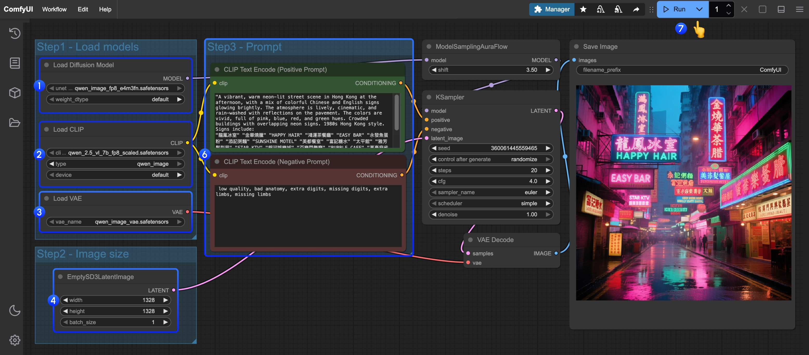
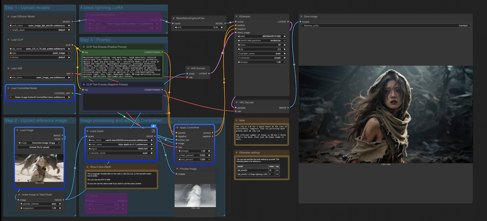
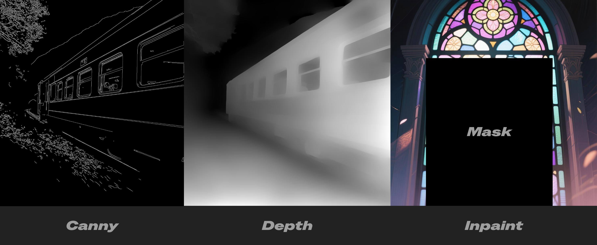
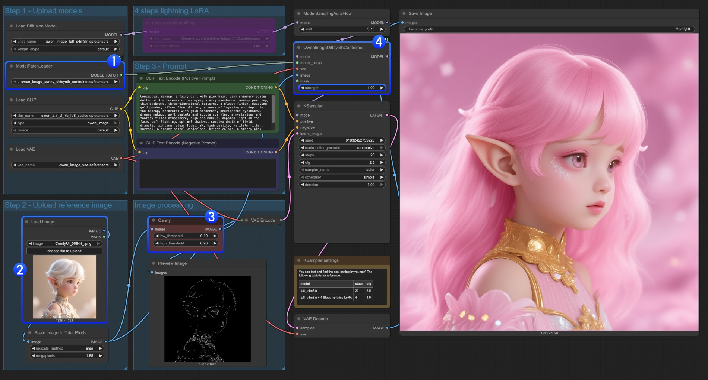
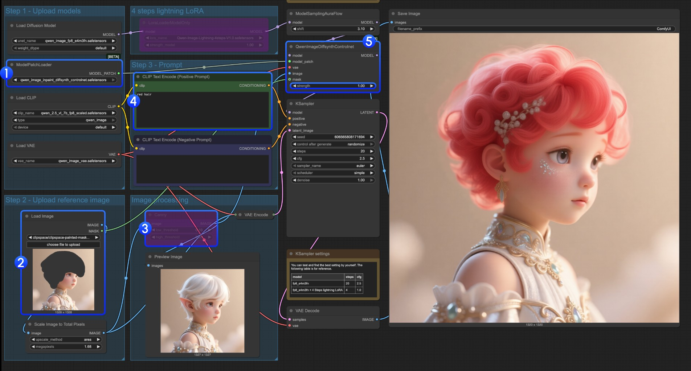
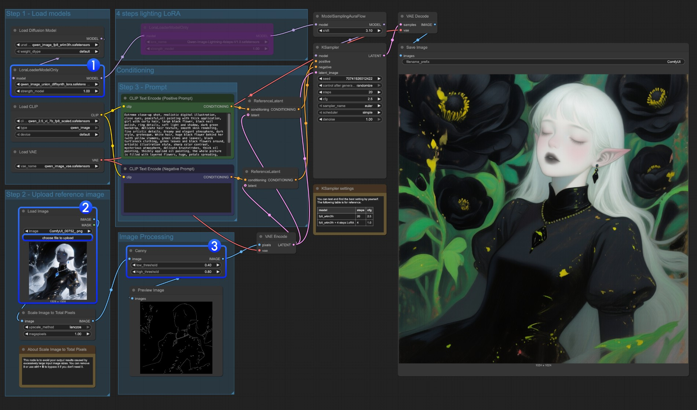

import UpdateReminder from "/snippets/de/tutorials/update-reminder.mdx"

**Qwen-Image** ist das erste Foundation-Modell zur Bildgenerierung, das vom Qwen-Team von Alibaba veröffentlicht wurde. Es ist ein MMDiT-Modell (Multimodal Diffusion Transformer) mit 20 Mrd. Parametern, das unter der Apache-2.0-Lizenz als Open Source bereitgestellt wird. Das Modell erzielt bedeutende Fortschritte bei der **komplexen Textdarstellung** und der **präzisen Bildbearbeitung** und liefert hochpräzise Ergebnisse für mehrere Sprachen, darunter Englisch und Chinesisch.

**Modell-Highlights**:
- **Hervorragende mehrsprachige Textdarstellung**: Unterstützt hochpräzise Textgenerierung in mehreren Sprachen, darunter Englisch, Chinesisch, Koreanisch und Japanisch, und behält dabei Schriftdetails sowie Layoutkonsistenz bei
- **Vielfältige künstlerische Stile**: Von fotorealistischen Szenen bis zu impressionistischen Gemälden, von Anime-Ästhetik bis zu minimalistischem Design: passt sich flexibel an verschiedene kreative Prompts an

**Weiterführende Links**:
 - [GitHub](https://github.com/QwenLM/Qwen-Image)
 - [Hugging Face](https://huggingface.co/Qwen/Qwen-Image)
 - [ModelScope](https://modelscope.cn/models/qwen/Qwen-Image)

Derzeit sind für Qwen-Image mehrere ControlNet-Optionen verfügbar:
- [Qwen-Image-DiffSynth-ControlNets/model_patches](https://huggingface.co/Comfy-Org/Qwen-Image-DiffSynth-ControlNets/tree/main/split_files/model_patches): Enthält Modelle für Canny, Tiefe und Inpainting
- [qwen_image_union_diffsynth_lora.safetensors](https://huggingface.co/Comfy-Org/Qwen-Image-DiffSynth-ControlNets/blob/main/split_files/loras/qwen_image_union_diffsynth_lora.safetensors): LoRA zur Steuerung der Bildstruktur, unterstützt Canny, Tiefe, Pose, Linienzeichnung, Softedge, Normal und OpenPose
- InstantX ControlNet: Aktualisierung folgt

## ComfyOrg Qwen-Image-Livestream

**Qwen-Image in ComfyUI - Lightning & LoRAs**
<iframe
  className="w-full aspect-video rounded-xl"
  src="https://www.youtube.com/embed/WBFHwrpYRtY?si=uREGRhBDryTJBIry"
  title="Qwen-Image in ComfyUI - Lightning & LoRAs / August 15th, 2025"
  allow="accelerometer; clipboard-write; encrypted-media; gyroscope; picture-in-picture"
  allowFullScreen
></iframe>

**Qwen-Image ControlNet in ComfyUI - DiffSynth**

<iframe
  className="w-full aspect-video rounded-xl"
  src="https://www.youtube.com/embed/bXMClHfEFn4?si=dcaNdqOMSwvu3t8x"
  title="Qwen-Image ControlNet in ComfyUI - DiffSynth / August 26th, 2025"
  allow="accelerometer; clipboard-write; encrypted-media; gyroscope; picture-in-picture"
  allowFullScreen
></iframe>

## Beispiel für einen nativen Qwen-Image-Workflow

<UpdateReminder />

### Qwen-Image: Text zu Bild {#image_qwen_image}

Generieren Sie Bilder mit herausragender mehrsprachiger Textwiedergabe und Bearbeitungsfunktionen mithilfe des 20B-MMDiT-Modells von Qwen-Image.


<CardGroup cols={2}>
  <Card title="Auf Comfy Cloud ausführen" icon="cloud" href="https://cloud.comfy.org/?template=image_qwen_image&utm_source=docs&utm_medium=referral&utm_campaign=qwen-image">
    In Comfy Cloud öffnen
  </Card>
  <Card title="Workflow herunterladen" icon="download" href="https://github.com/Comfy-Org/workflow_templates/blob/main/templates/image_qwen_image.json">
    JSON herunterladen oder in der Vorlagenbibliothek nach &quot;Qwen-Image&quot; suchen
  </Card>
</CardGroup>

**Beispielausgabe**


In dem zu diesem Dokument gehörenden Workflow werden drei verschiedene Modelle verwendet:
1. Qwen-Image Originalmodell fp8_e4m3fn
2. Beschleunigte 8-Schritte-Version: Qwen-Image Originalmodell fp8_e4m3fn mit lightx2v 8-Schritte-LoRA
3. Destillierte Version: Qwen-Image destilliertes Modell fp8_e4m3fn

**Referenz zur VRAM-Nutzung**
GPU: RTX4090D 24GB

| Verwendetes Modell                     | VRAM-Nutzung | Erste Generierung | Zweite Generierung |
| --------------------------------------- | ---------- | --------------- | ---------------- |
| fp8_e4m3fn                              | 86%        | ≈ 94s           | ≈ 71s            |
| fp8_e4m3fn mit lightx2v 8-Schritte-LoRA    | 86%        | ≈ 55s           | ≈ 34s            |
| Destilliertes fp8_e4m3fn                    | 86%        | ≈ 69s           | ≈ 36s            |

### 1. Workflow-Datei

Nachdem Sie ComfyUI aktualisiert haben, finden Sie die Workflow-Datei in den Vorlagen. Alternativ können Sie den unten stehenden Workflow in ComfyUI ziehen, um ihn zu laden.


Destillierte Version
<Card title="Workflow für das destillierte Modell herunterladen" icon="download" href="https://github.com/Comfy-Org/example_workflows/blob/main/image/qwen/image_qwen_image_distill.json">
    JSON-Workflow herunterladen
  </Card>
### 2. Modelle herunterladen

**Verfügbare Modelle in ComfyUI**

- Qwen-Image_bf16 (40.9 GB)
- Qwen-Image_fp8 (20.4 GB)
- Destillierte Versionen (inoffiziell, erfordern nur 15 Schritte)

Alle Modelle sind auf [Huggingface](https://huggingface.co/Comfy-Org/Qwen-Image_ComfyUI/tree/main) und [Modelscope](https://modelscope.cn/models/Comfy-Org/Qwen-Image_ComfyUI/files) verfügbar.

**Diffusionsmodell**

- [qwen_image_fp8_e4m3fn.safetensors](https://huggingface.co/Comfy-Org/Qwen-Image_ComfyUI/blob/main/split_files/diffusion_models/qwen_image_fp8_e4m3fn.safetensors)

Qwen_image_distill

- [qwen_image_distill_full_fp8_e4m3fn.safetensors](https://huggingface.co/Comfy-Org/Qwen-Image_ComfyUI/blob/main/non_official/diffusion_models/qwen_image_distill_full_fp8_e4m3fn.safetensors)
- [qwen_image_distill_full_bf16.safetensors](https://huggingface.co/Comfy-Org/Qwen-Image_ComfyUI/blob/main/non_official/diffusion_models/qwen_image_distill_full_bf16.safetensors)

<Note>
- Der Originalautor der destillierten Version empfiehlt 15 Schritte mit cfg 1.0.
- Tests zufolge erzielt diese destillierte Version auch mit 10 Schritten bei cfg 1.0 gute Ergebnisse. Je nach gewünschtem Bildtyp können Sie euler oder res_multistep wählen.
</Note>

**LoRA**

- [Qwen-Image-Lightning-8steps-V1.0.safetensors](https://huggingface.co/lightx2v/Qwen-Image-Lightning/blob/main/Qwen-Image-Lightning-8steps-V1.0.safetensors)

**Text-Encoder**

- [qwen_2.5_vl_7b_fp8_scaled.safetensors](https://huggingface.co/Comfy-Org/Qwen-Image_ComfyUI/blob/main/split_files/text_encoders/qwen_2.5_vl_7b_fp8_scaled.safetensors)

**VAE**

[qwen_image_vae.safetensors](https://huggingface.co/Comfy-Org/Qwen-Image_ComfyUI/blob/main/split_files/vae/qwen_image_vae.safetensors)

**Speicherort der Modelle**

```
📂 ComfyUI/
├── 📂 models/
│   ├── 📂 diffusion_models/
│   │   ├── qwen_image_fp8_e4m3fn.safetensors
│   │   └── qwen_image_distill_full_fp8_e4m3fn.safetensors ## Destillierte Version
│   ├── 📂 loras/
│   │   └── Qwen-Image-Lightning-8steps-V1.0.safetensors   ## 8-Schritte-Beschleunigungs-LoRA
│   ├── 📂 vae/
│   │   └── qwen_image_vae.safetensors
│   └── 📂 text_encoders/
│       └── qwen_2.5_vl_7b_fp8_scaled.safetensors
```

### 3. Anweisungen zum Workflow



1. Stellen Sie sicher, dass im Node `Load Diffusion Model` die Datei `qwen_image_fp8_e4m3fn.safetensors` geladen ist.
2. Stellen Sie sicher, dass im Node `Load CLIP` die Datei `qwen_2.5_vl_7b_fp8_scaled.safetensors` geladen ist.
3. Stellen Sie sicher, dass im Node `Load VAE` die Datei `qwen_image_vae.safetensors` geladen ist.
4. Stellen Sie sicher, dass der Node `EmptySD3LatentImage` mit den korrekten Bildabmessungen eingestellt ist.
5. Legen Sie Ihren Prompt im Node `CLIP Text Encoder` fest; derzeit werden mindestens Englisch, Chinesisch, Koreanisch, Japanisch, Italienisch usw. unterstützt.
6. Wenn Sie das 8-Schritte-Beschleunigungs-LoRA von lightx2v aktivieren möchten, wählen Sie den Node aus und aktivieren Sie ihn mit `Ctrl + B`, und ändern Sie die KSampler-Einstellungen wie in Schritt 8 beschrieben.
7. Klicken Sie auf die Schaltfläche `Queue` oder verwenden Sie die Tastenkombination `Ctrl(cmd) + Enter`, um den Workflow auszuführen.
8. Passen Sie die KSampler-Parameter je nach Modellversion und Workflow entsprechend an.

<Note>
 Das destillierte Modell und das 8-Schritte-Beschleunigungs-LoRA von lightx2v scheinen nicht für die gleichzeitige Verwendung kompatibel zu sein. Sie können verschiedene Kombinationen ausprobieren, um zu prüfen, ob sie zusammen verwendet werden können.
</Note>

## Qwen Image InstantX ControlNet Workflow

Dies ist ein ControlNet-Modell, Sie können es also wie ein normales ControlNet verwenden.

### Qwen-Image InstantX Union ControlNet {#image_qwen_image_instantx_controlnet}

Generieren Sie Bilder mit Qwen-Image InstantX ControlNet, unterstützt werden canny, soft edge, depth und pose.


<CardGroup cols={2}>
  <Card title="Auf Comfy Cloud ausführen" icon="cloud" href="https://cloud.comfy.org/?template=image_qwen_image_instantx_controlnet&utm_source=docs&utm_medium=referral&utm_campaign=qwen-image">
    In Comfy Cloud öffnen
  </Card>
  <Card title="Workflow herunterladen" icon="download" href="https://github.com/Comfy-Org/workflow_templates/blob/main/templates/image_qwen_image_instantx_controlnet.json">
    JSON herunterladen oder in der Vorlagenbibliothek nach „Qwen-Image InstantX ControlNet“ suchen
  </Card>
</CardGroup>

**Eingabematerialien**

Laden Sie diese Datei in den passenden `LoadImage`-Node hoch:

<CardGroup cols={2}>
  <Card title="image_qwen_image_instantx_controlnet_input_image.jpg" icon="image" href="https://raw.githubusercontent.com/Comfy-Org/workflow_templates/main/input/image_qwen_image_instantx_controlnet_input_image.jpg">
    `LoadImage`-Node 71 · `image_qwen_image_instantx_controlnet_input_image.jpg`
  </Card>
</CardGroup>

<div style={{display: 'grid', gridTemplateColumns: 'repeat(2, minmax(0, 1fr))', gap: '1rem', alignItems: 'start'}}>
  
</div>

## 1. Workflow und Eingabebilder
### 2. Modell-Links

1. InstantX Controlnet

Laden Sie [Qwen-Image-InstantX-ControlNet-Union.safetensors](https://huggingface.co/Comfy-Org/Qwen-Image-InstantX-ControlNets/blob/main/split_files/controlnet/Qwen-Image-InstantX-ControlNet-Union.safetensors) herunter und speichern Sie die Datei im Ordner `ComfyUI/models/controlnet/`.

2. **Lotus Depth-Modell**

Wir verwenden dieses Modell, um die Tiefenkarte des Bildes zu generieren. Die folgenden beiden Modelle müssen heruntergeladen werden:

**Diffusionsmodell**

- [lotus-depth-d-v1-1.safetensors](https://huggingface.co/Comfy-Org/lotus/blob/main/lotus-depth-d-v1-1.safetensors) 

**VAE-Modell**

- [vae-ft-mse-840000-ema-pruned.safetensors](https://huggingface.co/stabilityai/sd-vae-ft-mse-original/blob/main/vae-ft-mse-840000-ema-pruned.safetensors) oder ein beliebiges SD1.5-VAE

```
ComfyUI/
├── models/
│   ├── diffusion_models/
│   │   └─── lotus-depth-d-v1-1.safetensors
│   └── vae/
│       └──  lvae-ft-mse-840000-ema-pruned.safetensors
```

> Sie können auch Custom Nodes wie [comfyui_controlnet_aux](https://github.com/Fannovel16/comfyui_controlnet_aux) verwenden, um eine Tiefenkarte zu generieren.

### 3. Workflow-Anweisungen



1. Stellen Sie sicher, dass der Node `Load ControlNet Model` das Modell `Qwen-Image-InstantX-ControlNet-Union.safetensors` korrekt lädt.
2. Laden Sie das Eingabebild hoch.
3. Dieser Subgraph verwendet das Modell Lotus Depth. Sie finden es in den Vorlagen, oder Sie können den Subgraph bearbeiten, um mehr zu erfahren. Stellen Sie sicher, dass alle Modelle korrekt geladen sind.
4. Klicken Sie auf die Schaltfläche `Run`, oder verwenden Sie die Tastenkombination `Ctrl(cmd) + Enter`, um den Workflow auszuführen.

## Workflow für Modell-Patches mit Qwen Image ControlNet DiffSynth-ControlNets

### Qwen-Image ControlNet Modell-Patch {#image_qwen_image_controlnet_patch}

Steuern Sie die Bilderzeugung mit Qwen-Image-ControlNet-Modellen. Unterstützt Canny-, Depth- und Inpainting-Steuerung über Modell-Patching.


<CardGroup cols={2}>
  <Card title="Auf Comfy Cloud ausführen" icon="cloud" href="https://cloud.comfy.org/?template=image_qwen_image_controlnet_patch&utm_source=docs&utm_medium=referral&utm_campaign=qwen-image">
    In Comfy Cloud öffnen
  </Card>
  <Card title="Workflow herunterladen" icon="download" href="https://github.com/Comfy-Org/workflow_templates/blob/main/templates/image_qwen_image_controlnet_patch.json">
    JSON herunterladen oder in der Vorlagenbibliothek nach &quot;Qwen-Image ControlNet Patch&quot; suchen
  </Card>
</CardGroup>

**Eingabematerialien**

Laden Sie diese Datei in den passenden `LoadImage`-Node hoch:

<CardGroup cols={2}>
  <Card title="image_qwen_image_controlnet_patch_input_image.png" icon="image" href="https://raw.githubusercontent.com/Comfy-Org/workflow_templates/main/input/image_qwen_image_controlnet_patch_input_image.png">
    `LoadImage`-Node 71 · `image_qwen_image_controlnet_patch_input_image.png`
  </Card>
</CardGroup>

<div style={{display: 'grid', gridTemplateColumns: 'repeat(2, minmax(0, 1fr))', gap: '1rem', alignItems: 'start'}}>
  
</div>

### 1. Workflow und Eingabebilder

Nach dem Aktualisieren von ComfyUI finden Sie die Workflow-Datei in den Vorlagen, oder Sie ziehen die obige Workflow-Vorschau in ComfyUI, um sie zu laden.

### 2. Modell-Links

Die übrigen Modelle sind dieselben wie im Basis-Workflow für Qwen-Image. Sie müssen nur die folgenden Modelle herunterladen und im Ordner `ComfyUI/models/model_patches` speichern:

- [qwen_image_canny_diffsynth_controlnet.safetensors](https://huggingface.co/Comfy-Org/Qwen-Image-DiffSynth-ControlNets/blob/main/split_files/model_patches/qwen_image_canny_diffsynth_controlnet.safetensors)
- [qwen_image_depth_diffsynth_controlnet.safetensors](https://huggingface.co/Comfy-Org/Qwen-Image-DiffSynth-ControlNets/blob/main/split_files/model_patches/qwen_image_depth_diffsynth_controlnet.safetensors)
- [qwen_image_inpaint_diffsynth_controlnet.safetensors](https://huggingface.co/Comfy-Org/Qwen-Image-DiffSynth-ControlNets/blob/main/split_files/model_patches/qwen_image_inpaint_diffsynth_controlnet.safetensors)

### 3. Anweisungen zur Nutzung des Workflows

Derzeit gibt es bei diffsynth drei Patch-Modelle: Canny, Depth und Inpaint.

Wenn Sie zum ersten Mal ControlNet-bezogene Workflows verwenden, sollten Sie wissen, dass Steuerungsbilder erst in unterstützte Bildformate vorverarbeitet werden müssen, bevor das Modell sie verwenden und erkennen kann.



- Canny: Aufbereitete Canny-Kanten, Konturen der Linienkunst
- Depth: Vorverarbeitete Tiefenkarte, die die räumlichen Beziehungen zeigt
- Inpaint: Erfordert eine Maskierung, um die Bereiche zu markieren, die neu gezeichnet werden müssen

Da dieser Patch auf drei verschiedene Modelle aufgeteilt ist, müssen Sie bei der Eingabe den richtigen Vorverarbeitungstyp auswählen, damit die Bilder korrekt vorverarbeitet werden.

**Anweisungen zur Nutzung des Canny-Modells mit ControlNet**


1. Stellen Sie sicher, dass `qwen_image_canny_diffsynth_controlnet.safetensors` geladen ist
2. Laden Sie das Eingabebild für die weitere Verarbeitung hoch
3. Der Canny-Node ist ein nativer Vorverarbeitungs-Node, der das Eingabebild gemäß Ihren Parametern vorverarbeitet und so die Generierung steuert
4. Bei Bedarf können Sie den Wert `strength` im Node `QwenImageDiffsynthControlnet` ändern, um die Intensität der Steuerung durch die Linienkunst anzupassen
5. Klicken Sie auf die Schaltfläche `Run` oder verwenden Sie die Tastenkombination `Ctrl(cmd) + Enter`, um den Workflow auszuführen

> Um `qwen_image_depth_diffsynth_controlnet.safetensors` zu verwenden, müssen Sie das Bild zu einer Tiefenkarte vorverarbeiten und den Teil `image processing` ersetzen. Hinweise zu dieser Nutzung finden Sie in diesem Dokument unter der InstantX-Methode. Die übrigen Teile ähneln der Verwendung des Canny-Modells.

**Anweisungen zur Nutzung des Inpaint-Modells mit ControlNet**


Für das Inpaint-Modell müssen Sie im [Maskeneditor](/de/interface/maskeditor) eine Maskierung zeichnen und diese als Eingabe-Steuerungsbedingung verwenden.

1. Stellen Sie sicher, dass `ModelPatchLoader` das Modell `qwen_image_inpaint_diffsynth_controlnet.safetensors` lädt
2. Laden Sie das Bild hoch und zeichnen Sie im [Maskeneditor](/de/interface/maskeditor) eine Maskierung. Sie müssen den Ausgang `mask` des entsprechenden `Load Image`-Nodes mit dem Eingang `mask` von `QwenImageDiffsynthControlnet` verbinden, damit die passende Maskierung geladen wird
3. Setzen Sie den ursprünglichen Canny-Node im Workflow mit der Tastenkombination `Ctrl-B` in den Umgehungsmodus, sodass die Verarbeitung durch den Canny-Node unwirksam wird
4. Geben Sie im `CLIP Text Encoder` ein, was im maskierten Bereich stehen soll
5. Bei Bedarf können Sie den Wert `strength` im Node `QwenImageDiffsynthControlnet` ändern, um die Intensität der Steuerung anzupassen
6. Klicken Sie auf die Schaltfläche `Run` oder verwenden Sie die Tastenkombination `Ctrl(cmd) + Enter`, um den Workflow auszuführen

## Qwen Image Union ControlNet LoRA Workflow

### Qwen-Image Union Control {#image_qwen_image_union_control_lora}

Generieren Sie Bilder mit präziser struktureller Steuerung mithilfe des einheitlichen ControlNet-LoRA von Qwen-Image. Unterstützt mehrere Steuerungstypen, darunter canny, depth, lineart, softedge, normal und openpose.


<CardGroup cols={2}>
  <Card title="Auf Comfy Cloud ausführen" icon="cloud" href="https://cloud.comfy.org/?template=image_qwen_image_union_control_lora&utm_source=docs&utm_medium=referral&utm_campaign=qwen-image">
    In Comfy Cloud öffnen
  </Card>
  <Card title="Workflow herunterladen" icon="download" href="https://github.com/Comfy-Org/workflow_templates/blob/main/templates/image_qwen_image_union_control_lora.json">
    JSON herunterladen oder in der Vorlagenbibliothek nach &quot;Qwen-Image Union Control&quot; suchen
  </Card>
</CardGroup>

**Eingabematerialien**

Laden Sie diese Datei in den passenden `LoadImage`-Node hoch:

<CardGroup cols={2}>
  <Card title="image_qwen_image_union_control_lora_input_image.png" icon="image" href="https://raw.githubusercontent.com/Comfy-Org/workflow_templates/main/input/image_qwen_image_union_control_lora_input_image.png">
    `LoadImage`-Node 73 · `image_qwen_image_union_control_lora_input_image.png`
  </Card>
</CardGroup>

<div style={{display: 'grid', gridTemplateColumns: 'repeat(2, minmax(0, 1fr))', gap: '1rem', alignItems: 'start'}}>
  
</div>

**Beispielausgabe**

<div style={{display: 'grid', gridTemplateColumns: 'repeat(2, minmax(0, 1fr))', gap: '1rem', alignItems: 'start'}}>
  
  
</div>

Ursprüngliche Modelladresse: [DiffSynth-Studio/Qwen-Image-In-Context-Control-Union](https://www.modelscope.cn/models/DiffSynth-Studio/Qwen-Image-In-Context-Control-Union/)
Rehost-Adresse von Comfy Org: [qwen_image_union_diffsynth_lora.safetensors](https://huggingface.co/Comfy-Org/Qwen-Image-DiffSynth-ControlNets/blob/main/split_files/loras/qwen_image_union_diffsynth_lora.safetensors): LoRA zur Steuerung der Bildstruktur, unterstützt canny, depth, pose, lineart, softedge, normal, openpose

### 1. Workflow und Eingabebilder

Nachdem Sie ComfyUI aktualisiert haben, finden Sie die Workflow-Datei in den Vorlagen, oder ziehen Sie die obige Workflow-Vorschau in ComfyUI, um sie zu laden.

### 2. Modell-Links

Laden Sie das folgende Modell herunter. Da es sich um ein LoRA-Modell handelt, muss es im Ordner `ComfyUI/models/loras/` gespeichert werden
-  [qwen_image_union_diffsynth_lora.safetensors](https://huggingface.co/Comfy-Org/Qwen-Image-DiffSynth-ControlNets/blob/main/split_files/loras/qwen_image_union_diffsynth_lora.safetensors): LoRA zur Steuerung der Bildstruktur, unterstützt canny, depth, pose, lineart, softedge, normal, openpose

### 3. Anweisungen zum Workflow

Dieses Modell ist ein einheitliches Steuerungs-LoRA, das die Steuerungen canny, depth, pose, lineart, softedge, normal und openpose unterstützt. Da viele native Nodes zur Bildvorverarbeitung nicht vollständig unterstützt werden, sollten Sie etwas wie [comfyui_controlnet_aux](https://github.com/Fannovel16/comfyui_controlnet_aux) verwenden, um die übrige Bildvorverarbeitung durchzuführen.



1. Stellen Sie sicher, dass `LoraLoaderModelOnly` das Modell `qwen_image_union_diffsynth_lora.safetensors` korrekt lädt
2. Laden Sie das Eingabebild hoch
3. Bei Bedarf können Sie die Parameter des `Canny`-Nodes anpassen. Da verschiedene Eingabebilder unterschiedliche Parametereinstellungen erfordern, um bessere Ergebnisse bei der Bildvorverarbeitung zu erzielen, können Sie versuchen, die entsprechenden Parameterwerte anzupassen, um mehr oder weniger Details zu erhalten
4. Klicken Sie auf die Schaltfläche `Run` oder verwenden Sie die Tastenkombination `Ctrl(cmd) + Enter`, um den Workflow auszuführen

> Für andere Steuerungstypen müssen Sie auch den Teil der Bildverarbeitung ersetzen.
