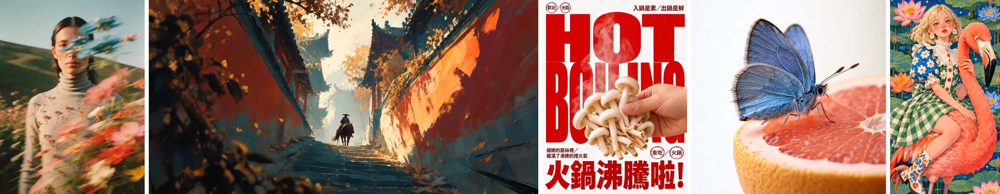
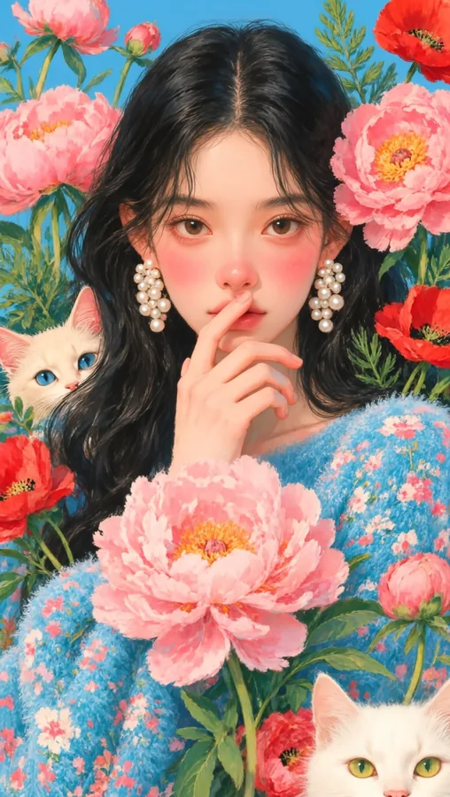
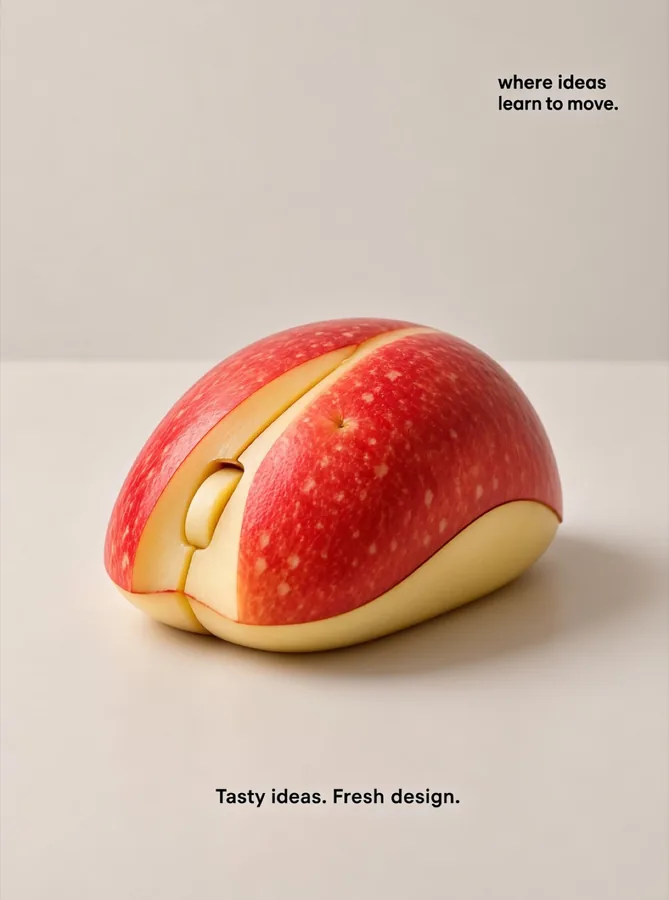
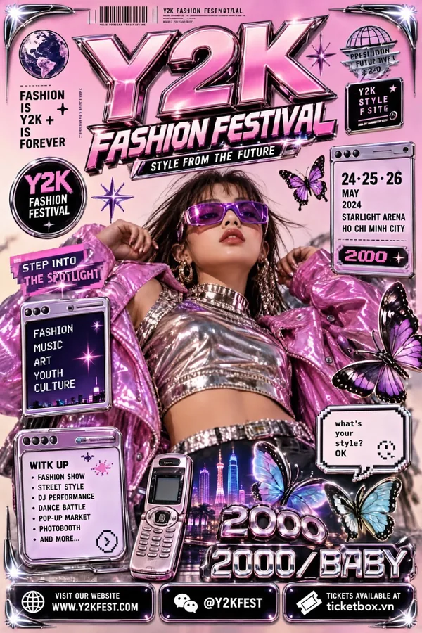
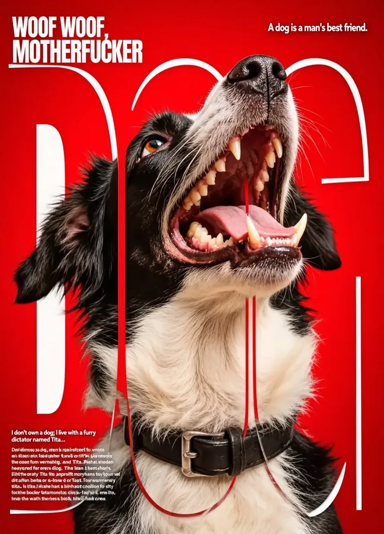
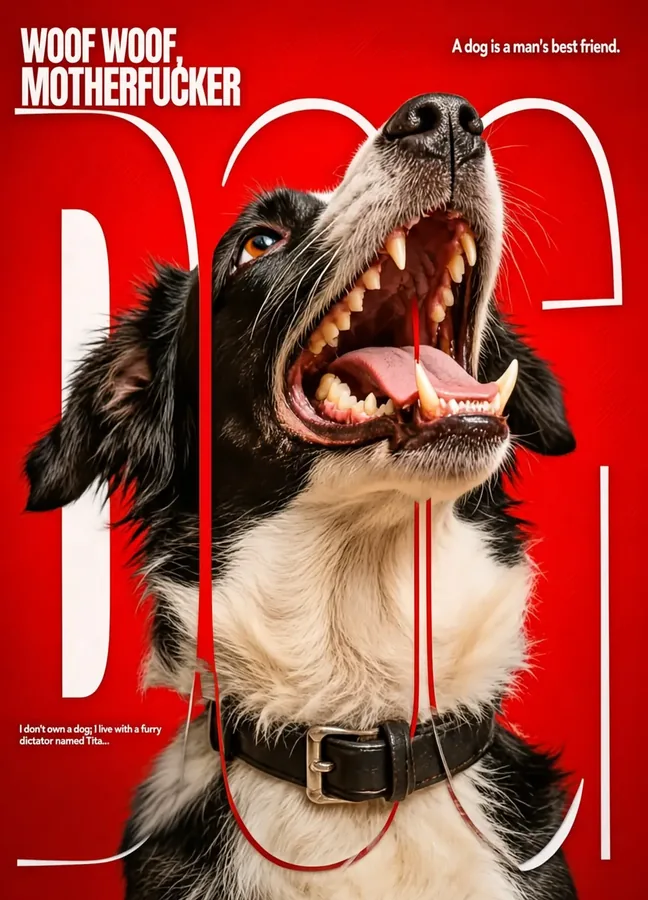
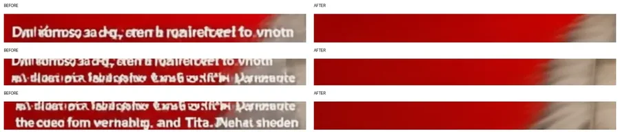
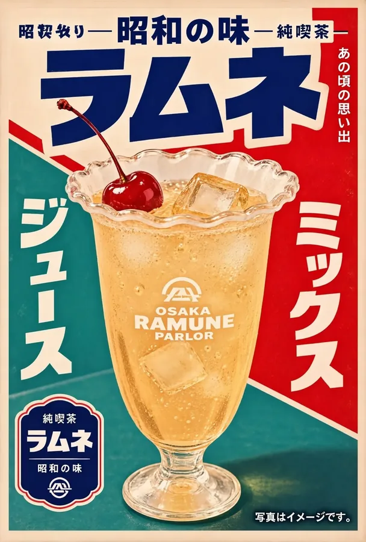
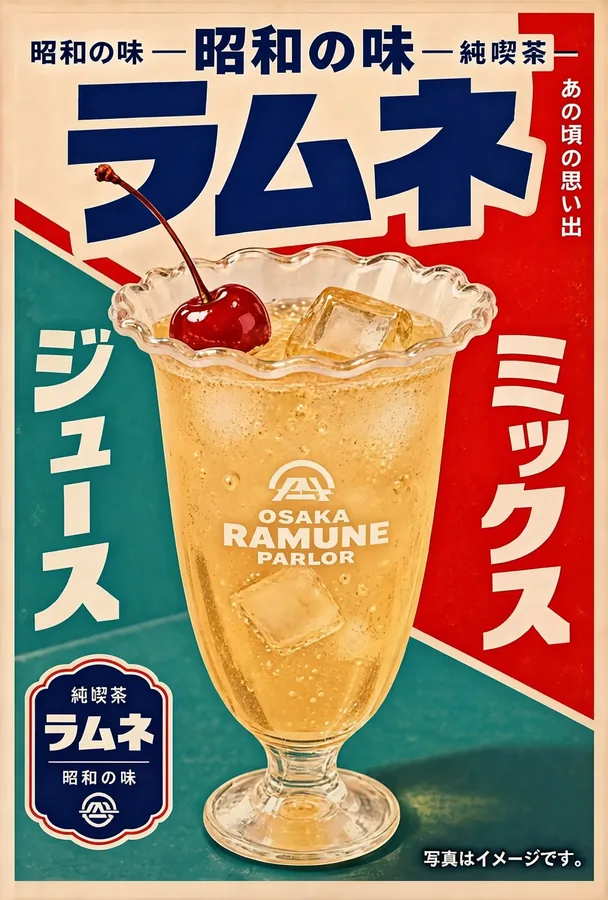
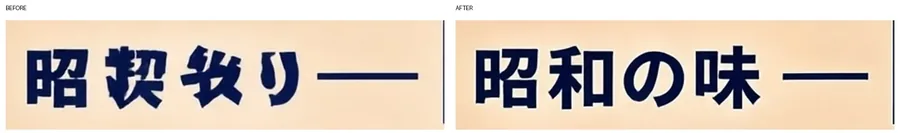

import UpdateReminder from "/snippets/de/tutorials/update-reminder.mdx"



**SenseNova-U1.6** ist ein vereinheitlichtes multimodales Modell. Visuelles Verstehen und Bilderzeugung laufen in einem einzigen 8B-`mot`-Backbone, sodass dasselbe Modell einen Prompt oder ein Quellbild liest und das Ergebnis zurückgibt. Es zielt auf Arbeiten, bei denen Genauigkeit und Erscheinungsbild gleichermaßen zählen, darunter Porträts, Poster, Illustrationen und Infografiken.

Zusätzlich führt es einen autonomen Selbstkorrektur-Durchlauf aus. Nachdem ein Ergebnis zurückgekommen ist, vergleicht das Modell seine eigene Ausgabe mit dem Prompt und generiert neu, wenn etwas nicht passt, und zwar bis zu 5 Durchläufe.

**Highlights**:
- **Ein Backbone, zwei Richtungen**: Dasselbe 8B-`mot`-Modell übernimmt Interpretation und Rendering, sowohl für Text zu Bild als auch für Bearbeitungen, die von einem Quellbild gesteuert werden.
- **Autonome Selbstkorrektur**: Das Modell vergleicht seine eigene Ausgabe mit dem Prompt und generiert neu, bis zu 5 Durchläufe.
- **Zwei Sampling-Modi**: Turbo mit dem 8-Schritt-LoRA bei 8 Schritten und CFG 1.0 oder Quality ohne LoRA bei 50 Schritten und CFG 4.0.
- **Verfeinerte Ästhetik, ausdrucksstärkere Ergebnisse**: **10 % Verbesserung der gesamten ästhetischen Qualität gegenüber U1.5** in subjektiven Benutzerbewertungen, wobei ästhetische Reward-Modelle getrennt für Porträts und fotorealistische Szenen, für künstlerische Arbeiten und für Infografiken abgestimmt sind.
- **Autonome Reflexion**: Bei dichten Infografik-Aufgaben in UltraTextBench erzielt die Selbstkorrektur-Schleife eine **durchschnittliche relative Verbesserung von 7 % gegenüber einer Generierung mit einem einzigen Durchlauf**.
- **Optionaler PE-Prompt-Rewriter**: Ein Qwen Image 2.1 PE Text-Encoder erweitert einen kurzen Prompt zu einer vollständigen visuellen Beschreibung und füllt den exakten Text im Bild ein.

**Offizielle Links**:
- [Hugging Face: Comfy-Org/SenseNova-U1](https://huggingface.co/Comfy-Org/SenseNova-U1) (Checkpoint und 8-Schritt-LoRA)
- [GitHub: OpenSenseNova/SenseNova-U1](https://github.com/OpenSenseNova/SenseNova-U1)
- [Hugging Face: sensenova/SenseNova-U1.6-8B-MoT](https://huggingface.co/sensenova/SenseNova-U1.6-8B-MoT) (offizielle Modellgewichte)
- [Hugging Face: sensenova/SenseNova-U1.6-8B-MoT-LoRAs](https://huggingface.co/sensenova/SenseNova-U1.6-8B-MoT-LoRAs) (offizieller 8-Schritt-LoRA)

Beide Vorlagen erfordern ComfyUI 0.46.0 oder neuer.

## Showcase

Sechs offizielle Beispiele von SenseNova, die die kreativen Richtungen abdecken, auf die das Modell abzielt. Sie wurden vom SenseNova-Team veröffentlicht und nicht mit diesen Workflows erzeugt. Das Team positioniert das Modell gleichzeitig anhand von zwei Zielen, kreativem visuellem Ausdruck und nativer Selbstkorrektur, sodass Genauigkeit und Schönheit Hand in Hand gehen sollen.

### Fotografie, Illustration und Poster

<Columns cols={2}>
  <Frame caption="Lange Belichtungszeit: Das Motiv bleibt scharf, während die Menge vorbeizieht.">
    
  </Frame>
  <Frame caption="High-Speed-Produktaufnahme: ein Glaskrug mitten in der Luft mit seiner Spritzwelle.">
    
  </Frame>
  <Frame caption="Illustration: ein Mädchen in Blau zwischen Blumen und Katzen.">
    
  </Frame>
  <Frame caption="Illustration: neblige Berge unter orangefarbenem Licht.">
    
  </Frame>
  <Frame caption="Poster mit Überschriftentypografie: „Tasty ideas. Fresh design.“">
    
  </Frame>
  <Frame caption="Poster: Y2K-Modefestival, Pixelblock-Typografie über einer flachen Studioszene.">
    
  </Frame>
</Columns>

## Selbstkorrektur in der Praxis

Jedes Paar unten verwendet denselben Prompt und denselben Seed: einmal ein einzelner Durchlauf, dann die Schleife aus Generieren, Prüfen und Verfeinern. Das dritte Bild ist ein Detailausschnitt des Texts, den die Schleife korrigiert hat.

<Columns cols={3}>
  <Frame caption="Rotes Haustier-Poster · VOR">
    
  </Frame>
  <Frame caption="Rotes Haustier-Poster · NACH">
    
  </Frame>
  <Frame caption="Rotes Haustier-Poster · Detailvergleich">
    
  </Frame>
</Columns>

<Columns cols={3}>
  <Frame caption="Getränkeposter der Showa-Ära · VOR">
    
  </Frame>
  <Frame caption="Getränkeposter der Showa-Ära · NACH">
    
  </Frame>
  <Frame caption="Getränkeposter der Showa-Ära · Detailvergleich">
    
  </Frame>
</Columns>

## Text-zu-Bild-Workflow

<UpdateReminder />

### SenseNova U1.6: Text zu Bild {#image_sensenova_u16_t2i}

Verwandeln Sie eine beschriebene Szene in ein fertiges Bild. Das Modell liest den Prompt, ergänzt die visuellen Details und gibt ein Bild mit 4 Megapixeln im von Ihnen gewählten Seitenverhältnis zurück.


<CardGroup cols={2}>
  <Card title="Auf Comfy Cloud ausführen" icon="cloud" href="https://cloud.comfy.org/?template=image_sensenova_u16_t2i&utm_source=docs&utm_medium=referral&utm_campaign=sensenova-u1-6">
    In Comfy Cloud öffnen
  </Card>
  <Card title="Workflow herunterladen" icon="download" href="https://github.com/Comfy-Org/workflow_templates/blob/main/templates/image_sensenova_u16_t2i.json">
    Laden Sie die JSON-Datei herunter oder suchen Sie in der Vorlagenbibliothek nach „SenseNova U1.6: Text zu Bild“
  </Card>
</CardGroup>

**Beispielausgabe**


#### Workflowdatei

Nach dem Aktualisieren von ComfyUI finden Sie die Vorlage in der Vorlagenbibliothek, oder ziehen Sie die oben gezeigte Vorschau in ComfyUI, um sie zu laden.

Der Workflow umfasst zwei Pipelines:
- **Basis-Pipeline**: ein einzelner Generierungsdurchlauf für Porträts, Fotografie, Poster und allgemeine Illustration.
- **Selbstkorrektur-Pipeline**: Generieren, Prüfen und Verfeinern mit bis zu 5 Durchläufen, danach Dekodieren. Am besten für Infografiken, dichten Text, Diagramme und Schritt-für-Schritt-Diagramme.

Über Schalter auf dem Canvas wählen Sie die Pipeline, die Turbo-LoRA sowie die Schritt- und CFG-Werte aus.

#### Modelle herunterladen

**Checkpoint**

- [sensenova_u1.6_8b_mot_int8_convrot.safetensors](https://huggingface.co/Comfy-Org/SenseNova-U1/resolve/main/checkpoints/sensenova_u1.6_8b_mot_int8_convrot.safetensors)

**LoRA (Turbo-Modus)**

- [sensenova_u1.6_8b_mot_8step_lora_bf16.safetensors](https://huggingface.co/Comfy-Org/SenseNova-U1/resolve/main/loras/sensenova_u1.6_8b_mot_8step_lora_bf16.safetensors)

**Text-Encoder (optionales PE)**

- [qwen3.5_9b_qwen_image_2.1_pe_t2i.int8_convrot.safetensors](https://huggingface.co/Comfy-Org/Qwen-Image-2.1/resolve/main/text_encoders/qwen3.5_9b_qwen_image_2.1_pe_t2i.int8_convrot.safetensors) (8.82 GB)

**Speicherort der Modelle**

```
📂 ComfyUI/
├── 📂 models/
│   ├── 📂 checkpoints/
│   │   └── sensenova_u1.6_8b_mot_int8_convrot.safetensors
│   ├── 📂 loras/
│   │   └── sensenova_u1.6_8b_mot_8step_lora_bf16.safetensors
│   └── 📂 text_encoders/
│       └── qwen3.5_9b_qwen_image_2.1_pe_t2i.int8_convrot.safetensors
```

#### Sampling-Einstellungen

| Modus | Schritte | CFG |
| --- | --- | --- |
| **Turbo** (8-Step-LoRA) | 8 | 1.0 |
| **Quality** (ohne LoRA) | 50 | 4.0 |

- **Turbo Mode?** lädt die 8-Step-LoRA oder überspringt sie. Lassen Sie sie aktiviert, während Sie iterieren, und deaktivieren Sie sie für maximale Texttreue und feinste Details.
- **Self-Correction** fügt die Schleife aus Generieren, Prüfen und Verfeinern hinzu. Aktivieren Sie sie für textlastige Layouts und deaktivieren Sie sie für schlichte Porträts, da jeder Durchlauf ein weiterer Sampling-Lauf ist.
- **Enable PE** fügt den oben beschriebenen Prompt-Umschreiber hinzu.
- **Auflösung** legt ein Gesamtbudget in Megapixeln fest, mit Voreinstellungen von 1:1 bis 21:9. Die Voreinstellung ist 4:3 (Standard) bei 4 Megapixeln, also 2368 × 1760.

#### Tipps zum Prompting

- Setzen Sie jedes Wort in Anführungszeichen, das im Bild erscheinen muss. In Anführungszeichen gesetzter Text wird wörtlich wiedergegeben, und Text ohne Anführungszeichen ist die Fehlerquelle.
- Bei deaktiviertem PE schreiben Sie die vollständige visuelle Beschreibung selbst. Eine einzeilige Anfrage schöpft die Stärken des Modells bei Typografie und Layout nicht aus.

## Bildbearbeitungs-Workflow

### SenseNova U1.6: Image Edit {#image_sensenova_u16_image_edit}

Bearbeiten Sie ein Foto, indem Sie es als Referenz anhängen und die gewünschte Änderung beschreiben. Dasselbe 8B-Backbone liest die Quelle, arbeitet sie um und gibt die Bearbeitung in der Auflösung und im Seitenverhältnis der Quelle zurück.


<CardGroup cols={2}>
  <Card title="Auf Comfy Cloud ausführen" icon="cloud" href="https://cloud.comfy.org/?template=image_sensenova_u16_image_edit&utm_source=docs&utm_medium=referral&utm_campaign=sensenova-u1-6">
    In Comfy Cloud öffnen
  </Card>
  <Card title="Workflow herunterladen" icon="download" href="https://github.com/Comfy-Org/workflow_templates/blob/main/templates/image_sensenova_u16_image_edit.json">
    Laden Sie die JSON herunter oder suchen Sie in der Vorlagenbibliothek nach „SenseNova U1.6: Image Edit“
  </Card>
</CardGroup>

**Eingabematerialien**

Laden Sie diese Datei in den passenden `LoadImage`-Node hoch:

<CardGroup cols={2}>
  <Card title="sensenova_u16_edit_women_in_car.png" icon="image" href="https://raw.githubusercontent.com/Comfy-Org/workflow_templates/main/input/sensenova_u16_edit_women_in_car.png">
    `LoadImage` Node 79 · `sensenova_u16_edit_women_in_car.png`
  </Card>
</CardGroup>

<div style={{display: 'grid', gridTemplateColumns: 'repeat(2, minmax(0, 1fr))', gap: '1rem', alignItems: 'start'}}>
  
</div>

**Beispielausgabe**

<div style={{display: 'grid', gridTemplateColumns: 'repeat(2, minmax(0, 1fr))', gap: '1rem', alignItems: 'start'}}>
  
  
</div>

#### Workflow-Datei

Nachdem Sie ComfyUI aktualisiert haben, finden Sie die Vorlage in der Vorlagenbibliothek, oder ziehen Sie die Vorschau oben in ComfyUI, um sie zu laden.

Das Quellbild wird auf 4 Megapixel skaliert, den Bereich, mit dem das Modell trainiert wurde, und anschließend auf ein Vielfaches von 32 aufgefüllt. Die Ausgabe folgt der Auflösung und dem Seitenverhältnis der Quelle, sodass die Bearbeitung die ursprüngliche Bildkomposition beibehält.

Das Modell akzeptiert bis zu 5 Referenzbilder. Der sinnvolle Bereich liegt bei 1 bis 4 Referenzen, und jede einzelne kostet Vision-Tokens und Speicher.

`ImageCompare` zeigt Quelle und Ergebnis nebeneinander.

#### Modell-Download

**Checkpoint**

- [sensenova_u1.6_8b_mot_int8_convrot.safetensors](https://huggingface.co/Comfy-Org/SenseNova-U1/resolve/main/checkpoints/sensenova_u1.6_8b_mot_int8_convrot.safetensors)

**LoRA (Turbo-Modus)**

- [sensenova_u1.6_8b_mot_8step_lora_bf16.safetensors](https://huggingface.co/Comfy-Org/SenseNova-U1/resolve/main/loras/sensenova_u1.6_8b_mot_8step_lora_bf16.safetensors)

**Text-Encoder (optionales PE, Image Edit)**

- [qwen3.5_9b_qwen_image_2.1_pe_i2i.int8_convrot.safetensors](https://huggingface.co/Comfy-Org/Qwen-Image-2.1/resolve/main/text_encoders/qwen3.5_9b_qwen_image_2.1_pe_i2i.int8_convrot.safetensors) (8.82 GB)

**Speicherort der Modelle**

```
📂 ComfyUI/
├── 📂 models/
│   ├── 📂 checkpoints/
│   │   └── sensenova_u1.6_8b_mot_int8_convrot.safetensors
│   ├── 📂 loras/
│   │   └── sensenova_u1.6_8b_mot_8step_lora_bf16.safetensors
│   └── 📂 text_encoders/
│       └── qwen3.5_9b_qwen_image_2.1_pe_i2i.int8_convrot.safetensors
```

#### Sampling-Einstellungen

| Modus | Schritte | CFG |
| --- | --- | --- |
| **Turbo** (8-Schritt-LoRA) | 8 | 1.0 |
| **Quality** (ohne LoRA) | 50 | 4.0 |

- **Turbo Mode?** lädt die 8-Schritt-LoRA oder überspringt sie. Lassen Sie sie beim Iterieren aktiv und schalten Sie sie für maximale Texttreue und feine Details aus.
- **Self-Correction** ergänzt die Schleife aus Bearbeiten, Prüfen und Verfeinern, die sich besonders auszahlt, wenn das Layout Text enthält.
- **Enable PE** liest das Quellbild zusammen mit Ihrer Anweisung und erweitert beides zu einem vollständigen Bearbeitungs-Prompt.
- **Reference images** bestimmen die Bildkomposition. Die Ausgabegröße folgt der Quelle, daher sollten Sie die Referenz vor dem Einreihen in die Warteschlange zuschneiden oder in der Größe ändern, wenn Sie eine andere Form benötigen.

#### Tipps zum Prompting

- Geben Sie an, was geändert werden soll, und listen Sie auf, was unverändert bleiben muss. Identität, Bildkomposition, Beleuchtung und Hintergrund sind die Details, die Sie nennen sollten.
- Setzen Sie jedes Wort in Anführungszeichen, das im bearbeiteten Bild erscheinen muss. Text in Anführungszeichen wird wörtlich wiedergegeben.
- Bei deaktiviertem PE schreiben Sie die vollständige Bearbeitungsanweisung selbst, einschließlich der Änderung und der Liste des zu Erhaltenden.

#### Bearbeitung über mehrere Durchläufe

Diese Version enthält keine Bearbeitung über mehrere Durchläufe. Jeder Durchlauf ist eine einzelne Anweisung, die auf das von Ihnen geladene Referenzbild angewendet wird, und das Modell führt zwischen den Durchläufen keinen Gesprächsverlauf mit. Eine LoRA oder eine eigene Verzweigung für die Bearbeitung über mehrere Durchläufe könnte folgen. Verketten Sie die Bearbeitungen vorerst selbst: Speichern Sie das Ergebnis, laden Sie es als nächste Referenz und beschreiben Sie die nächste Änderung.

## Über den Prompt-Enhancer

SenseNova U1.6 bringt kein eigenes dediziertes Prompt-Enhancer-Modell mit. Beide Vorlagen laden optional den **Qwen Image 2.1**-PE-Textencoder: `qwen3.5_9b_qwen_image_2.1_pe_t2i` für Text zu Bild, `..._pe_i2i` für Bildbearbeitung. Dieser schreibt einen kurzen Prompt in eine vollständige visuelle Beschreibung um und ergänzt den exakten Bildtext. Schalten Sie **Enable PE** aus, um stattdessen mit Ihrem unveränderten Prompt zu arbeiten.
