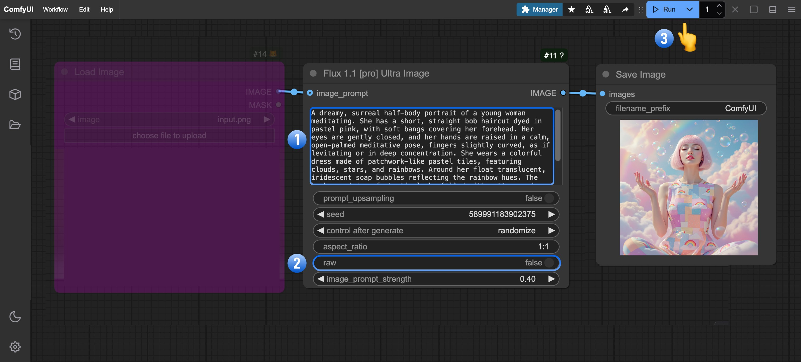
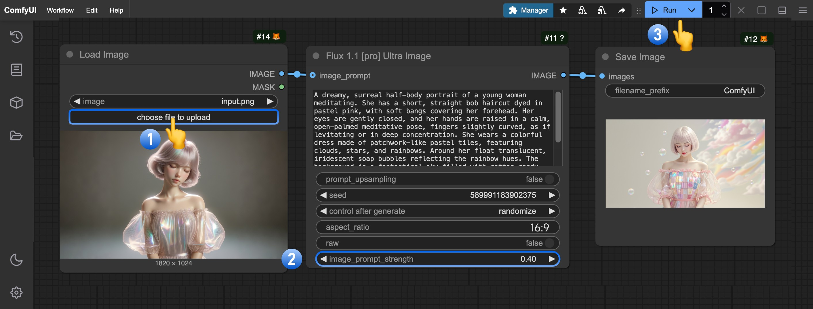
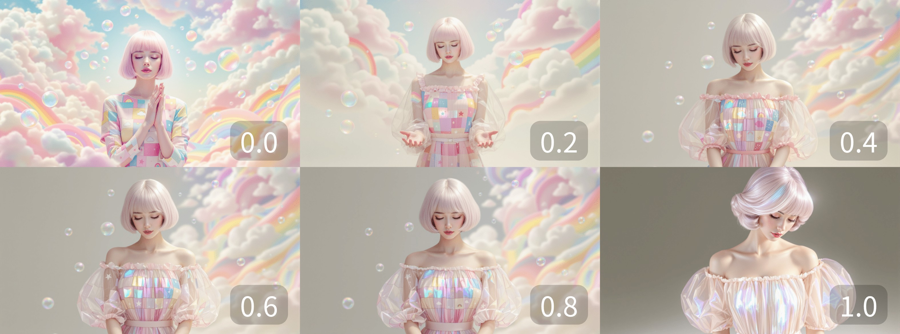

import ReqHint from "/snippets/de/tutorials/partner-nodes/req-hint.mdx";
import UpdateReminder from "/snippets/de/tutorials/update-reminder.mdx";

FLUX 1.1 Pro Ultra ist ein leistungsstarkes Werkzeug zur KI-Bildgenerierung von BlackForestLabs mit ultrahoher Auflösung und effizienter Generierung. Es unterstützt Auflösungen bis zu 4 MP (das Vierfache der Standardversion) und hält die Generierungszeit für ein einzelnes Bild unter 10 Sekunden. Das ist 2,5-mal schneller als bei vergleichbaren hochauflösenden Modellen.

Das Werkzeug bietet zwei zentrale Modi:
- **Ultra Mode**: Für hohe Auflösungsanforderungen konzipiert, ideal für Werbung und E-Commerce, wo die Vergrößerung von Details wichtig ist. Er gibt Prompts präzise wieder und behält dabei die Generierungsgeschwindigkeit bei.
- **Raw Mode**: Fokussiert auf natürlichen Realismus und optimiert Hauttöne, Beleuchtung und Landschaftsdetails. Reduziert den „AI-Look“ und ist ideal für Fotografie und die Erstellung realistischer Stile.

## Was FLUX 1.1 Pro Ultra Image besonders gut kann

- **Ultrahohe Auflösung**: Erzeugt Bilder mit bis zu 4 MP, also die 4-fache Auflösung der Standardversion
- **Schnelle Generierung**: Die Erzeugung eines einzelnen Bildes bleibt unter 10 Sekunden, 2,5-mal schneller als vergleichbare hochauflösende Modelle
- **Prompt-Genauigkeit auch bei hoher Auflösung**: Der Ultra Mode setzt Prompts präzise um und behält dabei die Generierungsgeschwindigkeit bei, ideal für Werbung und E-Commerce
- **Natürlicher Realismus**: Der Raw Mode optimiert Hauttöne, Beleuchtung und Landschaftsdetails, um den „KI-Look“ zu reduzieren
- **Bild zu Bild-Remixing**: Eine `image_prompt`-Eingabe mischt Merkmale eines Eingabebildes ein, wobei `image_prompt_strength` das Mischungsverhältnis steuert

## Beispielausgaben

Text-zu-Bild-Generierung mit dem Node Flux 1.1 [pro] Ultra Image:

Bild-zu-Bild-Remixing, bei dem Merkmale aus einem Eingabebild in die Ausgabe eingemischt werden:

## So verwenden Sie es

<Card title="Aus Code aufrufen" icon="code" href="/de/development/comfy-router/models/black-forest-labs/flux-1-1-pro-ultra-image/code">
  Rufen Sie es über HTTP durch Comfy Router auf, mit Python-, TypeScript-, Swift- und cURL-Snippets zum Kopieren und Einfügen
</Card>

Dies läuft über dasselbe Comfy-Konto und wird mit denselben Credits abgerechnet wie die Ausführung in ComfyUI weiter unten. Unter [Preise für Partner-Nodes](/tutorials/partner-nodes/pricing) finden Sie die Raten pro Modell, und unter [Grenzen für parallele Anfragen](/de/tutorials/partner-nodes/concurrency-limits) erfahren Sie, wie viele Anfragen Sie gleichzeitig ausführen können.

<ReqHint/>
<UpdateReminder/>

## FLUX 1.1 Pro Ultra Image Node-Dokumentation

Prüfen Sie die folgende Dokumentation für detaillierte Einstellungen der Node-Parameter:

- [FLUX 1.1 Pro Ultra Image](/images/built-in-nodes/api_nodes/bfl/flux-1-1-pro-ultra-image.jpg)

## FLUX 1.1 [pro] Text-zu-Bild-Tutorial

### 1. Workflow-Datei herunterladen

Laden Sie die folgende Datei herunter und ziehen Sie sie in ComfyUI, um den Workflow zu laden:

### 2. Workflow-Schritte abschließen

Folgen Sie den nummerierten Schritten, um den grundlegenden Workflow abzuschließen:

1. (Optional) Ändern Sie den Prompt im Node `Flux 1.1 [pro] Ultra Image`
2. (Optional) Setzen Sie den Parameter `raw` auf `false`, um eine realistischere Ausgabe zu erhalten
3. Klicken Sie auf `Run` oder verwenden Sie die Tastenkombination `Ctrl(cmd) + Enter`, um das Bild zu generieren
4. Nachdem die API die Ergebnisse zurückgegeben hat, sehen Sie sich das generierte Bild im Node `Save Image` an. Die Bilder werden im Verzeichnis `ComfyUI/output/` gespeichert

## FLUX 1.1[pro] Tutorial für Bild zu Bild

Wenn Sie dem Node-Eingang einen `image_prompt` hinzufügen, mischt die Ausgabe Merkmale des Eingabebilds bei (Remix). Der Wert `image_prompt_strength` beeinflusst das Mischungsverhältnis: Höhere Werte machen die Ausgabe dem Eingabebild ähnlicher.

### 1. Workflow-Datei herunterladen

Laden Sie die folgende Datei herunter und ziehen Sie sie in ComfyUI, oder klicken Sie mit der rechten Maustaste auf den lila Node im Text-zu-Bild-Workflow und setzen Sie `mode` auf `always`, um die `image_prompt`-Eingabe zu aktivieren:

Wir verwenden dieses Bild als Eingabe:

### 2. Die Workflow-Schritte ausführen

Folgen Sie diesen nummerierten Schritten:
1. Klicken Sie auf **Upload** im Node `Load Image`, um Ihr Eingabebild hochzuladen
2. (Optional) Passen Sie `image_prompt_strength` in `Flux 1.1 [pro] Ultra Image` an, um das Mischungsverhältnis zu ändern
3. Klicken Sie auf `Run` oder verwenden Sie die Tastenkombination `Ctrl(cmd) + Enter`, um das Bild zu generieren
4. Nachdem die API die Ergebnisse zurückgegeben hat, sehen Sie das generierte Bild im Node `Save Image`. Die Bilder werden im Verzeichnis `ComfyUI/output/` gespeichert

Hier ein Vergleich der Ausgaben mit unterschiedlichen Werten für `image_prompt_strength`:

