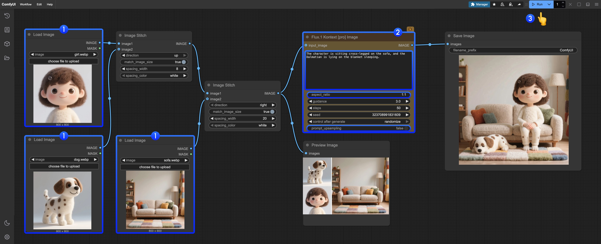
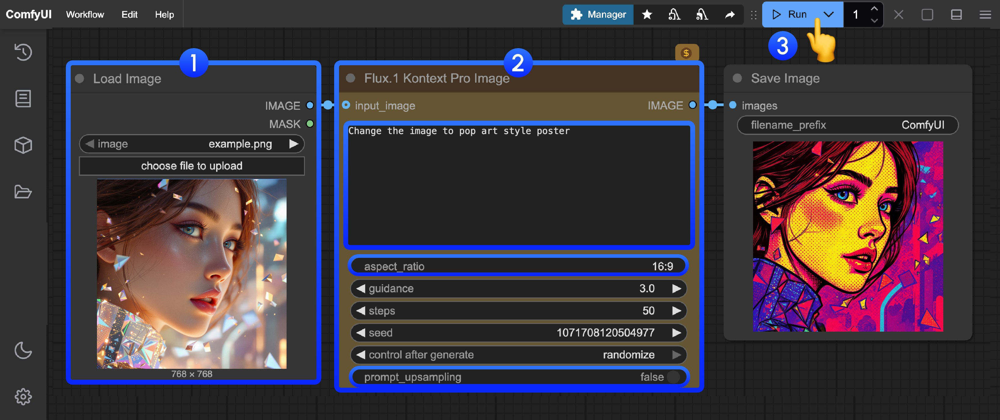
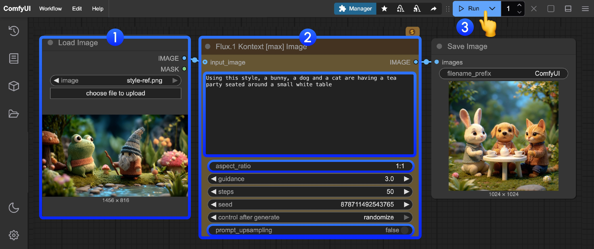

import ReqHint from "/snippets/de/tutorials/partner-nodes/req-hint.mdx";
import PromptTechniques from "/snippets/de/tutorials/flux/prompt-techniques.mdx";
import UpdateReminder from "/snippets/de/tutorials/update-reminder.mdx";

FLUX.1 Kontext ist ein professionelles Modell für die Bild-zu-Bild-Bearbeitung von Black Forest Labs, das sich auf das intelligente Verständnis des Bildkontexts und präzise Bearbeitung konzentriert.
Es erledigt vielfältige Bearbeitungsaufgaben ohne komplexe Beschreibungen, darunter das Ändern von Objekten, Stilübertragung, den Austausch des Hintergrunds, Bearbeitung mit konsistenten Charakteren und Textbearbeitung.
Der Kernvorteil von Kontext liegt in seiner hervorragenden Fähigkeit, den Kontext zu verstehen und die Konsistenz von Charakteren zu wahren. So bleiben zentrale Elemente wie Charaktermerkmale und die Komposition des Bildes auch nach mehreren Bearbeitungsiterationen stabil.

Derzeit unterstützt ComfyUI zwei Modelle von FLUX.1 Kontext:

* **Kontext Pro** eignet sich ideal zum Bearbeiten, Komponieren und Remixen.
* **Kontext Max** verschiebt die Grenzen bei Typografie, Prompt-Präzision und Geschwindigkeit.

## Wofür FLUX.1 Kontext geeignet ist

- **Vielseitige Bearbeitung ohne komplexe Beschreibungen**: Objektänderung, Stilübertragung, Hintergrundaustausch, Bearbeitung bei gleichbleibender Charakterkonsistenz und Textbearbeitung
- **Kontextverständnis**: Das intelligente Verständnis des Bildkontexts ermöglicht präzise, gezielte Bearbeitungen
- **Charakterkonsistenz**: Merkmale der Charaktere und das Kompositionslayout bleiben auch nach mehreren Bearbeitungsdurchläufen stabil
- **Mehrere Bildeingaben**: Der Node `Image Stitch` fügt mehrere Bilder zu einem einzigen Bild zusammen, das sich mit FLUX.1 Kontext bearbeiten lässt
- **Zwei Modellstufen**: Kontext Pro zum Bearbeiten, Komponieren und Remixen; Kontext Max für Typografie, Prompt-Präzision und Geschwindigkeit

## Beispielausgaben

Bearbeiten einer zusammengesetzten Eingabe aus mehreren Bildern (ein Mädchen, ein Hund und ein Sofa, kombiniert zu einer Szene):

Bildbearbeitung mit Kontext Pro, ideal zum Bearbeiten, Zusammensetzen und Remixen:

Bildbearbeitung mit Kontext Max, das die Grenzen bei Typografie, Prompt-Präzision und Geschwindigkeit auslotet:

## Verwenden

<Card title="Aus Code aufrufen" icon="code" href="/development/comfy-router/models/black-forest-labs/flux-1-kontext/code">
  Rufen Sie Kontext Pro oder Max über HTTP über den Comfy Router auf, mit Python-, TypeScript-, Swift- und cURL-Snippets zum Kopieren und Einfügen
</Card>

Dies läuft über dasselbe Comfy-Konto und wird mit denselben Credits abgerechnet wie die Ausführung in ComfyUI weiter unten. Unter [Preise für Partner-Nodes](/tutorials/partner-nodes/pricing) finden Sie die Preise pro Modell und unter [Grenzen für parallele Anfragen](/tutorials/partner-nodes/concurrency-limits), wie viele Anfragen Sie gleichzeitig ausführen können.

<ReqHint/>
<UpdateReminder/>

## Workflow mit mehreren Bildeingaben für FLUX.1 Kontext

Wir haben kürzlich die Unterstützung für Workflows mit mehreren Bildeingaben hinzugefügt. Mit dem neuen `Image Stitch` Node können Sie mehrere Bilder zu einem einzigen Bild zusammenfügen und dieses mit FLUX.1 Kontext bearbeiten.

### 1. Workflow-Datei herunterladen

Die `metadata` der untenstehenden Bilder enthält die Workflow-Informationen. Laden Sie die Bilder herunter und ziehen Sie sie in ComfyUI, um den entsprechenden Workflow zu laden.

Laden Sie die folgenden Bilder als Eingabe herunter oder verwenden Sie Ihre eigenen Bilder:

### 2. Den Workflow Schritt für Schritt abschließen

Sie können den nummerierten Schritten im Bild folgen, um den Workflow abzuschließen:

1. Laden Sie die bereitgestellten Bilder im `Load image` Node hoch.
2. Passen Sie die notwendigen Parameter in `Flux.1 Kontext Pro Image` an:
    - `prompt` Geben Sie den Prompt für das Bild ein, das Sie bearbeiten möchten
    - `aspect_ratio` Legen Sie das Seitenverhältnis des Originalbilds fest; es muss zwischen 1:4 und 4:1 liegen
    - `prompt_upsampling` Legen Sie fest, ob Prompt-Upsampling verwendet wird. Wenn aktiviert, wird der Prompt automatisch angepasst, um reichere Ergebnisse zu erzielen, die Ergebnisse sind jedoch nicht reproduzierbar
3. Klicken Sie auf die Schaltfläche `Run` oder verwenden Sie den Kurzbefehl `Ctrl(cmd) + Enter`, um die Bildbearbeitung auszuführen.
4. Nachdem die API die Ergebnisse zurückgegeben hat, können Sie das bearbeitete Bild im `Save Image` Node ansehen; das entsprechende Bild wird zusätzlich im Verzeichnis `ComfyUI/output/` gespeichert.

<Tip>
   Die beiden folgenden Workflows unterscheiden sich nur in den verwendeten Partner-Nodes. Tatsächlich müssen Sie nur den Workflow mit mehreren Bildeingaben anpassen, es gibt keine wesentlichen Unterschiede.
</Tip>

## FLUX.1 Kontext Pro Image Partner-Nodes-Workflow

### 1. Workflow-Datei herunterladen

Die `metadata` des unten abgebildeten Bildes enthält die Workflow-Informationen. Laden Sie das Bild herunter und ziehen Sie es in ComfyUI, um den entsprechenden Workflow zu laden.

Laden Sie das unten abgebildete Bild als Eingabe herunter oder verwenden Sie Ihr eigenes Bild:

### 2. Workflow Schritt für Schritt abschließen

Sie können den nummerierten Schritten im Bild folgen, um den Workflow abzuschließen:
1. Laden Sie das Bild, das Sie bearbeiten möchten, im Node `Load Image`
2. (Optional) Ändern Sie die erforderlichen Parameter in `Flux.1 Kontext Pro Image`
3. Klicken Sie auf die Schaltfläche `Run` oder verwenden Sie die Tastenkombination `Ctrl(cmd) + Enter`, um die Bildbearbeitung auszuführen
4. Nachdem die API die Ergebnisse zurückgegeben hat, können Sie das bearbeitete Bild im Node `Save Image` ansehen; das entsprechende Bild wird außerdem im Verzeichnis `ComfyUI/output/` gespeichert

## FLUX.1 Kontext Max Image Partner-Nodes-Workflow

### 1. Workflow-Datei herunterladen

Die `metadata` des untenstehenden Bildes enthält die Workflow-Informationen. Laden Sie das Bild herunter und ziehen Sie es in ComfyUI, um den entsprechenden Workflow zu laden.

Laden Sie das untenstehende Bild als Eingabe herunter oder verwenden Sie Ihr eigenes Bild zur Demonstration:

### 2. Workflow Schritt für Schritt abschließen

Sie können den nummerierten Schritten im Bild folgen, um den Workflow abzuschließen:
1. Laden Sie das Bild, das Sie bearbeiten möchten, im `Load Image`-Node.
2. (Optional) Ändern Sie die erforderlichen Parameter in `Flux.1 Kontext Max Image`.
3. Klicken Sie auf die Schaltfläche `Run` oder verwenden Sie die Tastenkombination `Ctrl(cmd) + Enter`, um die Bildbearbeitung auszuführen.
4. Nachdem Sie darauf gewartet haben, dass die API Ergebnisse zurückgibt, können Sie das bearbeitete Bild im `Save Image`-Node anzeigen; das entsprechende Bild wird außerdem im Verzeichnis `ComfyUI/output/` gespeichert.

<PromptTechniques/>
