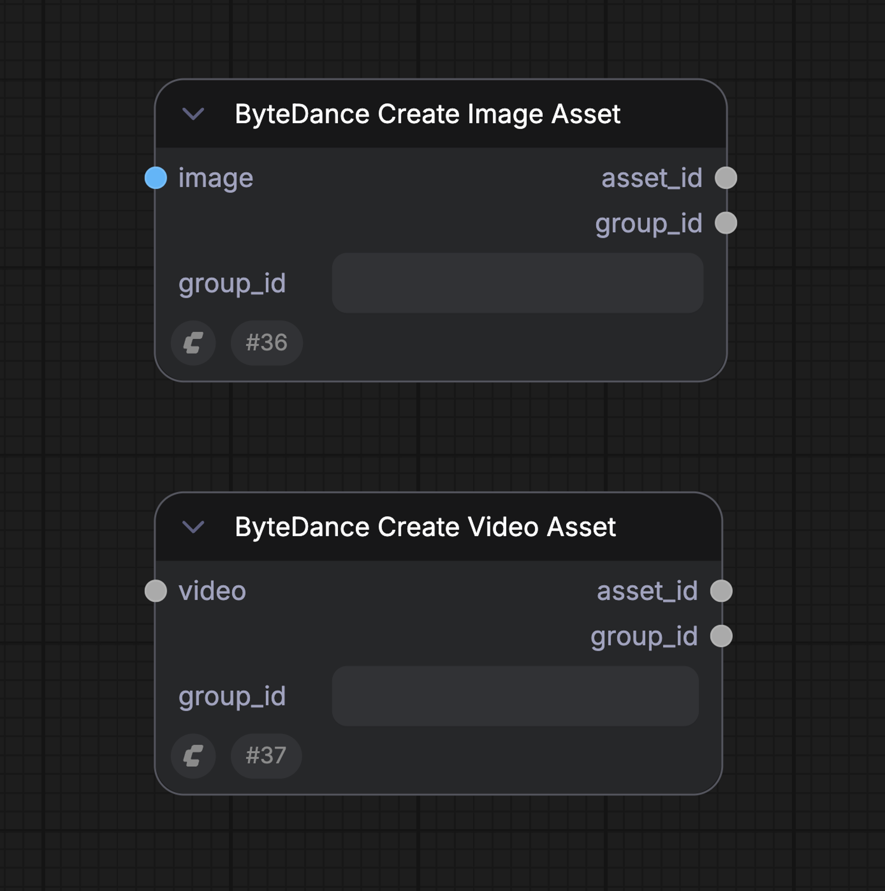
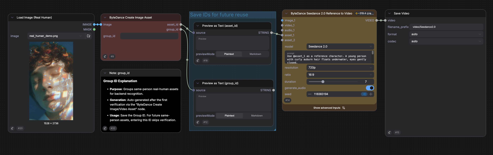
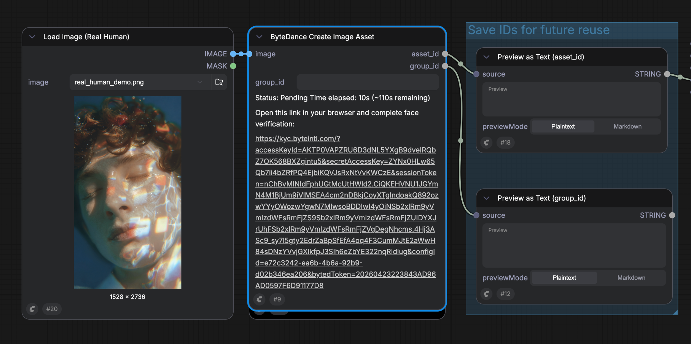
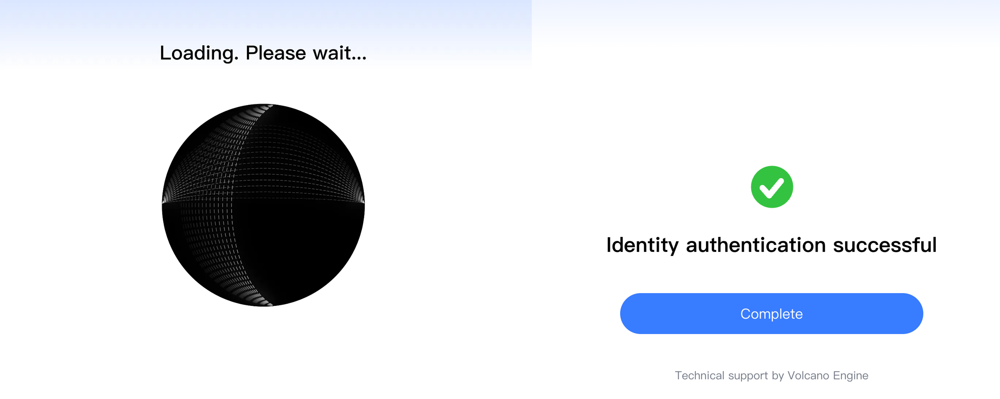
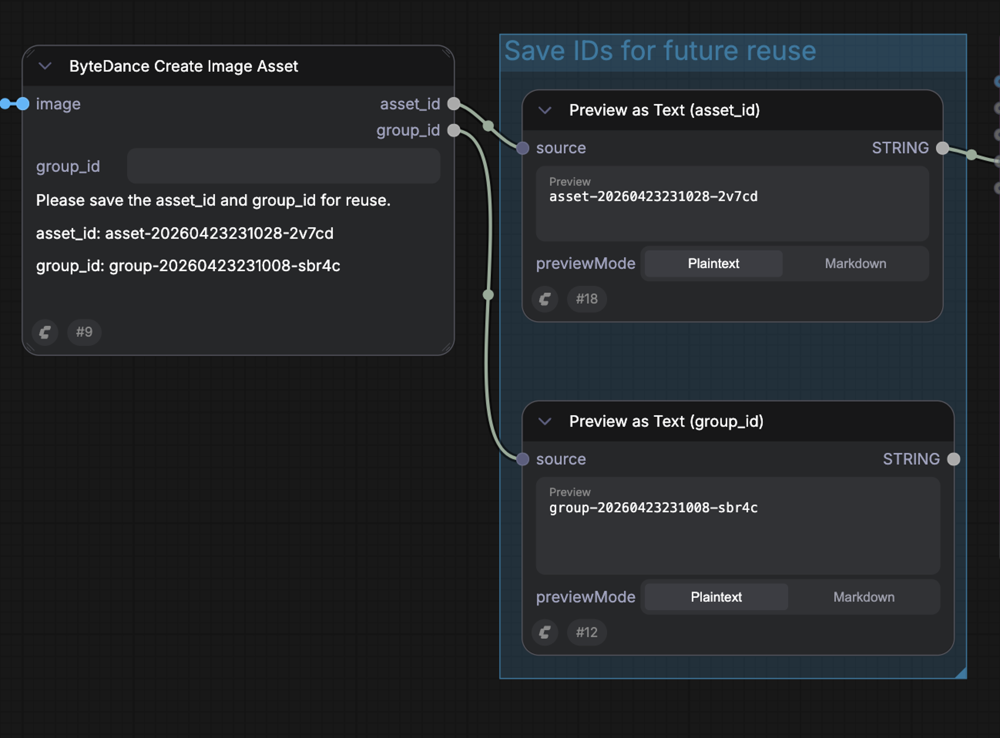
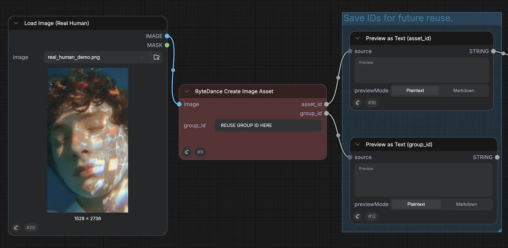

import ReqHint from "/snippets/de/tutorials/partner-nodes/req-hint.mdx";
import UpdateReminder from "/snippets/de/tutorials/update-reminder.mdx";

**Seedance 2.0 Real Human** ist direkt in ComfyUI verfügbar. Sie können ein Porträt über einen ComfyUI Workflow hochladen, eine einmalige Verifizierung abschließen und anschließend Videos mit dieser realen Person generieren, mit einer konsistenten Identität und authentischen Gesichtsausdrücken: ohne ComfyUI zu verlassen.

Mit der Real Human Unterstützung in ComfyUI sind Sie nicht länger auf virtuelle Charaktere beschränkt. Die Steuerbarkeit von Seedance 2.0 und die native Audio-Video-Synchronisation erstrecken sich nun auch auf reale Personen, wobei Identität und Performance über einen gesamten Clip hinweg erhalten bleiben, und das mit denselben Node-basierten Workflows, die Sie bereits für andere Seedance 2.0 Generierungen verwenden.

## Was Seedance 2.0 Real Human besonders gut kann

- **Realistische Menschen, filmische Kontrolle**: Kameraarbeit, Beleuchtung und Szenenwechsel direkt steuern, während die Person glaubwürdig bleibt
- **Beständige Identität**: Gesichtszüge und Erscheinungsbild bleiben über Bewegung, Kamerafahrten und Übergänge hinweg stabil
- **Native Audio-Video-Synchronisation**: Video und Audio (Dialog, Umgebungsgeräusche, Musik) werden gemeinsam generiert, mit verlässlicherem Lip-Sync und verlässlicherer Mimik
- **Regie mit mehreren Referenzen**: Text mit bis zu **9 Bildern**, **3 Videos** und **3 Audioclips** kombinieren, um Aussehen, Bewegung und Rhythmus festzulegen

<ReqHint/>
<UpdateReminder/>

## Videoanleitung

Sehen Sie sich die vollständige Demo an, die die Verifizierung und beide Workflows von Seedance 2.0 Real Human von Anfang bis Ende in ComfyUI behandelt.

<video
  controls
  className="w-full aspect-video"
  src="https://raw.githubusercontent.com/Comfy-Org/docs/refs/heads/main/images/tutorial/api_nodes/bytedance/seedance2_0/guide.mp4"
></video>

## So funktioniert die Verifizierung in ComfyUI

Die Verifizierung ist erforderlich, bevor eine echte Person in einer Seedance 2.0-Generierung erscheinen kann. Sie verhindert Identitätsbetrug und die unbefugte Nutzung des Abbilds einer Person und wird von ByteDance durchgeführt, das damit neue Vorschriften zur KI-Transparenz befolgt. Der gesamte Ablauf wird über den Node **ByteDance Create Image/Video Asset** aus ComfyUI heraus gesteuert: Sie müssen ComfyUI nur kurz verlassen, um die Liveness-Prüfung auf Ihrem Smartphone oder im Browser abzuschließen.

### Erster Durchlauf (Verifizierung erforderlich)

1. Fügen Sie in ComfyUI den Node **ByteDance Create Image/Video Asset** zu Ihrem Workflow hinzu und laden Sie ein Porträtbild hoch
2. Führen Sie den Workflow aus: ComfyUI gibt einen Verifizierungslink von ByteDance zurück
3. Öffnen Sie den Link auf Ihrem Smartphone oder im Browser und schließen Sie die Liveness-Prüfung ab (weniger als 1 Minute)
4. Sobald die Verifizierung erfolgreich war, kehren Sie zu ComfyUI zurück: Die Ausgabe des Nodes enthält nun das verifizierte Asset

#### Screenshots des Verifizierungsablaufs

**Schritt 1: Hochladen und ausführen, um die Verifizierung zu starten**

**Schritt 2: Verifizierungslink abrufen**

**Schritt 3: Liveness-Prüfung auf der H5-Seite abschließen**

**Schritt 4: Zu ComfyUI zurückkehren und IDs speichern (keine zusätzlichen Credits)**

Nach erfolgreicher Verifizierung einer echten Person gibt der Node zwei IDs aus, die Sie in nachgelagerten Seedance 2.0-Video-Nodes verwenden können:

- **Group ID**: steht für die verifizierte Person. Speichern Sie diese, damit Sie dieselbe Identität später ohne erneute Verifizierung wiederverwenden können
- **Asset ID**: steht für dieses konkrete Bild. Verbinden Sie sie mit einem Seedance 2.0-Videogenerierungs-Node, um ein Video der verifizierten Person zu erzeugen; sie kann in mehreren Workflows wiederverwendet werden

### Spätere Uploads (keine Verifizierung)

1. Laden Sie in ComfyUI mit dem Node **ByteDance Create Image/Video Asset** ein neues Foto oder Video derselben Person hoch
2. Geben Sie die gespeicherte **Group ID** im Node ein
3. Beim Ausführen vergleicht ByteDance die Gesichtsmerkmale mit der ursprünglichen Verifizierung
4. Bei Übereinstimmung wird das neue Asset automatisch aktiviert und an ComfyUI zurückgegeben, bereit zur Verwendung in der Seedance 2.0-Videogenerierung

#### Verifizierung mit einer vorhandenen Group ID überspringen

Wenn Sie die Verifizierung bereits einmal abgeschlossen haben, können Sie bei neuen Uploads derselben Person den Liveness-Schritt häufig überspringen, indem Sie die vorhandene **Group ID** angeben. Erkennt ByteDance, dass das neue Bild dieselbe Person zeigt, entfällt die Verifizierung.

## Verfügbare Workflows

In ComfyUI stehen zwei vorgefertigte Vorlagen für Seedance 2.0 Real Human bereit. Beide verbinden den Node **ByteDance Create Image/Video Asset** mit einem Node zur Videogenerierung von Seedance 2.0, sodass Verifizierung und Generierung in einem einzigen Lauf erfolgen.

### Seedance 2.0 Real Human Referenz-zu-Video

Verwenden Sie ein verifiziertes Porträt (optional mit weiteren Referenzbildern, -videos oder -audio), um ein Seedance 2.0-Video mit einer konsistenten Identität einer realen Person zu erzeugen.

<CardGroup cols={2}>
  <Card title="Seedance 2.0 Real Human R2V in der Cloud ausführen" icon="cloud" href="https://cloud.comfy.org/?template=api_seedance2_0_r2v_real_human&utm_source=docs&utm_medium=referral&utm_campaign=seedance-2-0-real-human">
    Testen Sie den Workflow Seedance 2.0 Real Human Referenz-zu-Video sofort in Comfy Cloud.
  </Card>
  <Card title="Seedance 2.0 Real Human R2V Workflow" icon="download" href="https://github.com/Comfy-Org/workflow_templates/blob/main/templates/api_seedance2_0_r2v_real_human.json">
    Laden Sie die Workflow-Datei für Seedance 2.0 Real Human Referenz-zu-Video herunter.
  </Card>
</CardGroup>

Eingabematerialien

Laden Sie dieses Beispiel-Eingabebild herunter, um den Workflow auszuprobieren:

<CardGroup cols={1}>
  <Card title="Porträt-Referenz" icon="image" href="https://raw.githubusercontent.com/Comfy-Org/workflow_templates/main/input/real_human_demo.png">
    Beispielporträt zur Verifizierung herunterladen
  </Card>
</CardGroup>

### Seedance 2.0 Real Human Erstes-Letztes-Bild-zu-Video

Geben Sie ein verifiziertes Startbild und ein Endbild an, um das Video zwischen beiden zu generieren und dabei die Identität der realen Person zu bewahren.

<CardGroup cols={2}>
  <Card title="Seedance 2.0 Real Human FLF2V in der Cloud ausführen" icon="cloud" href="https://cloud.comfy.org/?template=api_seedance2_0_flf2v_real_human&utm_source=docs&utm_medium=referral&utm_campaign=seedance-2-0-real-human">
    Testen Sie den Workflow Seedance 2.0 Real Human Erstes-Letztes-Bild-zu-Video sofort in Comfy Cloud.
  </Card>
  <Card title="Seedance 2.0 Real Human FLF2V Workflow" icon="download" href="https://github.com/Comfy-Org/workflow_templates/blob/main/templates/api_seedance2_0_flf2v_real_human.json">
    Laden Sie die Workflow-Datei für Seedance 2.0 Real Human Erstes-Letztes-Bild-zu-Video herunter.
  </Card>
</CardGroup>

Eingabematerialien

Laden Sie diese Beispiel-Eingabebilder herunter, um den Workflow auszuprobieren:

<CardGroup cols={2}>
  <Card title="Erstes Bild" icon="image" href="https://raw.githubusercontent.com/Comfy-Org/workflow_templates/main/input/flf2v_demo_first_frame.png">
    Beispiel für das erste Bild herunterladen
  </Card>
  <Card title="Letztes Bild" icon="image" href="https://raw.githubusercontent.com/Comfy-Org/workflow_templates/main/input/flf2v_demo_last_frame.png">
    Beispiel für das letzte Bild herunterladen
  </Card>
</CardGroup>

