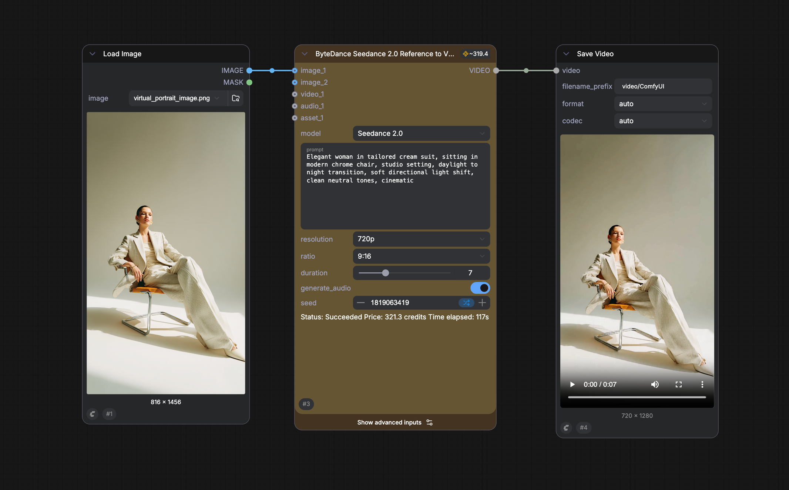

import ReqHint from "/snippets/de/tutorials/partner-nodes/req-hint.mdx";
import UpdateReminder from "/snippets/de/tutorials/update-reminder.mdx";

Seedance 2.0 ist ByteDances multimodales Video-Generierungsmodell der nächsten Generation und jetzt in ComfyUI verfügbar. Es akzeptiert Text, Bilder, Video und Audio als einheitliche Eingänge und erzeugt in einem einzigen Durchlauf hochwertige Videos mit synchronisiertem Audio, konsistenten Charakteren und filmischer Kamerabewegung.

## Was Seedance 2.0 gut kann

- **Multimodal in**: Prompt mit Text plus Bildern, Video und Audio
- **Audio-Video-Synchronisation**: Video und Audio zusammen generieren
- **Regieführung**: Kamerabewegungen und Shot-Timing bleiben steuerbar
- **Konsistenz**: Charaktere und Szenen über einen Clip hinweg stabil halten
- **Editing + Extend**: Footage bearbeiten oder Clips verlängern, ohne von vorn zu beginnen

Mit diesen Fähigkeiten eignet sich Seedance 2.0 für ein breites Spektrum an Anwendungsfällen, darunter Werbung, Kurzserien-Drama, Film-Previsualisierung, Produktpräsentationen, virtuelle Charakterinhalte sowie Assets für Spiele und Animation.

<ReqHint/>
<UpdateReminder/>

## Verfügbare Workflows

### Text zu Video (T2V)

Generieren Sie ein Video aus einem Text-Prompt, während Seedance 2.0 Szene, Bewegung und Timing übernimmt.

<CardGroup cols={2}>
  <Card title="Text zu Video in der Cloud ausführen" icon="cloud" href="https://cloud.comfy.org/?template=api_seedance2_0_t2v&utm_source=docs&utm_medium=referral&utm_campaign=seedance-2-0">
    Testen Sie den Text-zu-Video-Workflow direkt in Comfy Cloud.
  </Card>
  <Card title="Text-zu-Video-Workflow herunterladen" icon="download" href="https://github.com/Comfy-Org/workflow_templates/blob/main/templates/api_seedance2_0_t2v.json">
    Laden Sie das Workflow-JSON herunter.
  </Card>
</CardGroup>

### Referenz zu Video (R2V)

Verwenden Sie Referenzbilder, Videos oder Audio, um Aussehen, Bewegung und Rhythmus zu steuern und gleichzeitig kohärente Ergebnisse zu erzielen.

<CardGroup cols={2}>
  <Card title="Referenz-zu-Video in der Cloud ausführen" icon="cloud" href="https://cloud.comfy.org/?template=api_seedance2_0_r2v&utm_source=docs&utm_medium=referral&utm_campaign=seedance-2-0">
    Probieren Sie den Referenz-zu-Video-Workflow sofort auf Comfy Cloud aus.
  </Card>
  <Card title="Referenz-zu-Video-Workflow herunterladen" icon="download" href="https://github.com/Comfy-Org/workflow_templates/blob/main/templates/api_seedance2_0_r2v.json">
    Laden Sie das Workflow-JSON herunter.
  </Card>
</CardGroup>

Eingabematerialien

Laden Sie diese Beispiel-Eingabebilder herunter, um den Workflow auszuprobieren:

<CardGroup cols={4}>
  <Card title="Outfit-Referenz 1" icon="image" href="https://raw.githubusercontent.com/Comfy-Org/workflow_templates/main/input/sd_outfit_1.png">
    Beispiel-Outfit-Bild 1 herunterladen
  </Card>
  <Card title="Outfit-Referenz 2" icon="image" href="https://raw.githubusercontent.com/Comfy-Org/workflow_templates/main/input/sd_outfit_2.png">
    Beispiel-Outfit-Bild 2 herunterladen
  </Card>
  <Card title="Outfit-Referenz 3" icon="image" href="https://raw.githubusercontent.com/Comfy-Org/workflow_templates/main/input/sd_outfit_3.png">
    Beispiel-Outfit-Bild 3 herunterladen
  </Card>
  <Card title="Subjekt-Referenz" icon="image" href="https://raw.githubusercontent.com/Comfy-Org/workflow_templates/main/input/selfie_cartoon_style.png">
    Beispiel-Subjekt-Referenz herunterladen
  </Card>
</CardGroup>

### Vom Start- und Endbild zum Video (FLF2V)

Geben Sie ein Start- und ein Endbild an, und Seedance 2.0 erzeugt die Bewegung und die Übergänge dazwischen.

<CardGroup cols={2}>
  <Card title="FLF2V in der Cloud ausführen" icon="cloud" href="https://cloud.comfy.org/?template=api_seedance2_0_flf2v&utm_source=docs&utm_medium=referral&utm_campaign=seedance-2-0">
    Probieren Sie den Workflow für Start- und Endbild zu Video sofort in Comfy Cloud aus.
  </Card>
  <Card title="FLF2V-Workflow herunterladen" icon="download" href="https://github.com/Comfy-Org/workflow_templates/blob/main/templates/api_seedance2_0_flf2v.json">
    Laden Sie das Workflow-JSON herunter.
  </Card>
</CardGroup>

Eingabematerialien

Laden Sie diese Beispiel-Eingabebilder herunter, um den Workflow auszuprobieren:

<CardGroup cols={2}>
  <Card title="Startbild" icon="image" href="https://raw.githubusercontent.com/Comfy-Org/workflow_templates/main/input/sd_first_frame.png">
    Beispiel-Startbild herunterladen
  </Card>
  <Card title="Endbild" icon="image" href="https://raw.githubusercontent.com/Comfy-Org/workflow_templates/main/input/sd_last_frame.png">
    Beispiel-Endbild herunterladen
  </Card>
</CardGroup>

### Referenz zu Video 4K (R2V 4K)

Generieren Sie mit Seedance 2.0 4K-Video aus Referenzbildern. Der 4K-Workflow folgt demselben Referenzablauf wie Standard-R2V: Geben Sie Motiv-, Outfit- oder Szenenreferenzen an, und das Modell rendert den finalen Clip in 4K-Auflösung für große Bildschirme und Ausschnitte in der Postproduktion.

<CardGroup cols={2}>
  <Card title="Reference-to-Video 4K in der Cloud ausführen" icon="cloud" href="https://cloud.comfy.org/?template=api_seedance2_0_r2v_4k&utm_source=docs&utm_medium=referral&utm_campaign=seedance-2-0">
    Testen Sie den Reference-to-Video-4K-Workflow sofort auf Comfy Cloud.
  </Card>
  <Card title="Reference-to-Video-4K-Workflow herunterladen" icon="download" href="https://github.com/Comfy-Org/workflow_templates/blob/main/templates/api_seedance2_0_r2v_4k.json">
    Laden Sie das Workflow-JSON herunter.
  </Card>
</CardGroup>

Eingabematerialien

Laden Sie dieses Beispiel-Eingabebild herunter, um den Workflow auszuprobieren:

<CardGroup cols={1}>
  <Card title="Motivreferenz" icon="image" href="https://raw.githubusercontent.com/Comfy-Org/workflow_templates/main/input/green_rider.png">
    Beispiel-Motivreferenz herunterladen
  </Card>
</CardGroup>

### Storyboard zu Video

Verwandeln Sie ein Storyboard in zwei Durchgängen in ein Video. Generieren Sie zuerst das Storyboard: Nano Banana 2 und GPT Image zeichnen jedes Panel, ein Gemini-Node schreibt die Shot-Beschreibungen, und ImageStitch setzt das Panel-Blatt zusammen. Anschließend übergeben Sie das fertige Storyboard an Seedance 2.0, um es zu einem Video mit synchronisiertem Audio zu animieren.

Beide Schritte befinden sich in einem Workflow. Verwenden Sie [Partial Execution](/de/interface/features/partial-execution), um zuerst die Storyboard-Gruppe auszuführen, das Umgehen auf die Seedance-Gruppe umzuschalten und dann den Animationsdurchgang auszuführen.

<CardGroup cols={2}>
  <Card title="Storyboard to Video in Comfy Cloud ausführen" icon="cloud" href="https://cloud.comfy.org/?template=template_seedance2_storyboard_to_video&utm_source=docs&utm_medium=referral&utm_campaign=seedance-2-0">
    Testen Sie den Workflow Storyboard to Video direkt in Comfy Cloud.
  </Card>
  <Card title="Workflow Storyboard to Video herunterladen" icon="download" href="https://github.com/Comfy-Org/workflow_templates/blob/main/templates/template_seedance2_storyboard_to_video.json">
    Laden Sie das Workflow-JSON herunter.
  </Card>
</CardGroup>

Eingabematerialien

Laden Sie diese Beispiel-Eingabebilder herunter, um den Workflow auszuprobieren:

<CardGroup cols={2}>
  <Card title="Storyboard-Eingabe" icon="image" href="https://raw.githubusercontent.com/Comfy-Org/workflow_templates/main/input/storyboard_input.png">
    Beispiel-Storyboard-Eingabe herunterladen
  </Card>
  <Card title="Subjekt-Referenz" icon="image" href="https://raw.githubusercontent.com/Comfy-Org/workflow_templates/main/input/ninja.png">
    Beispiel-Subjekt-Referenz herunterladen
  </Card>
</CardGroup>

## Seedance 2.0 Mini

Seedance 2.0 Mini ist eine leichtere, schnellere Variante von Seedance 2.0 für die alltägliche Videogenerierung. Sie behält die gleiche Audio-Video-Synchronisation, Charakterkonsistenz und Kamerasteuerung wie das vollständige Modell, zu geringeren Kosten pro Lauf.

Mini ist heute als zwei Workflows verfügbar: Text zu Video und Referenz zu Video. Beide sind auf schnelle Iteration bei Multi-Shot-Storytelling, Markeninhalten und der Erstellung von Kurzfilmen ausgelegt.

<Note>
Seedance 2.0 Mini wird unter derselben Preiszeile `Seedance 2.0` abgerechnet wie das vollständige Modell. Die aktuellen Preise finden Sie in den [Preiseinträgen zu Seedance 2.0](/tutorials/partner-nodes/pricing#bytedance).
</Note>

### Seedance 2.0 Mini Text zu Video

Generieren Sie ein filmisches Video aus einem Text-Prompt mit KI-Kamerasteuerung und konsistenter Charaktergenerierung über Szenen hinweg.

<CardGroup cols={2}>
  <Card title="Seedance 2.0 Mini T2V auf Comfy Cloud ausführen" icon="cloud" href="https://cloud.comfy.org/?template=api_seedance2_0_mini_t2v&utm_source=docs&utm_medium=referral&utm_campaign=seedance-2-0">
    Testen Sie den Mini-Text-zu-Video-Workflow sofort auf Comfy Cloud.
  </Card>
  <Card title="Seedance 2.0 Mini T2V Workflow herunterladen" icon="download" href="https://github.com/Comfy-Org/workflow_templates/blob/main/templates/api_seedance2_0_mini_t2v.json">
    Laden Sie das Workflow-JSON herunter oder suchen Sie in der Template Library nach „Seedance 2.0 Mini“.
  </Card>
</CardGroup>

### Seedance 2.0 Mini Referenz zu Video

Generieren Sie ein filmisches Video aus zwei Referenzbildern (Subjekt + Szene) mit KI-gesteuerter Kamerabewegung und konsistenter Charaktergenerierung.

<CardGroup cols={2}>
  <Card title="Seedance 2.0 Mini R2V auf Comfy Cloud ausführen" icon="cloud" href="https://cloud.comfy.org/?template=api_seedance2_0_mini_r2v&utm_source=docs&utm_medium=referral&utm_campaign=seedance-2-0">
    Testen Sie den Mini-Referenz-zu-Video-Workflow sofort auf Comfy Cloud.
  </Card>
  <Card title="Seedance 2.0 Mini R2V Workflow herunterladen" icon="download" href="https://github.com/Comfy-Org/workflow_templates/blob/main/templates/api_seedance2_0_mini_r2v.json">
    Laden Sie das Workflow-JSON herunter oder suchen Sie in der Template Library nach „Seedance 2.0 Mini“.
  </Card>
  <Card title="Subjekt-Referenz herunterladen" icon="image" href="https://raw.githubusercontent.com/Comfy-Org/workflow_templates/main/input/asian_model_white_top.png">
    Laden Sie das Beispiel-Referenzbild für das Subjekt herunter.
  </Card>
  <Card title="Szenen-Referenz herunterladen" icon="image" href="https://raw.githubusercontent.com/Comfy-Org/workflow_templates/main/input/perfume_orange_shot.png">
    Laden Sie das Beispiel-Referenzbild für die Szene herunter.
  </Card>
</CardGroup>

## Echte Personen und KI-generierte Porträts in ComfyUI für Seedance 2.0 verwenden

Seedance 2.0 **unterstützt sowohl** **Porträts echter Personen** (Bildmaterial tatsächlicher Personen, das Sie als Aussehens- oder Kamerareferenz verwenden) als auch **KI-generierte Porträts** (fiktive, von KI erzeugte Personen vor der Kamera, die keine bestimmte reale Person darstellen). Welchen Weg Sie verwenden, entscheidet darüber, ob ByteDance-**Liveness**- und Identitätsprüfungen erforderlich sind.

| | **KI-generiertes Porträt** | **Porträt einer echten Person** |
| --- | --- | --- |
| **Worum es sich handelt** | Die Person wirkt wie eine KI-synthetisierte Figur; sie darf keiner identifizierbaren natürlichen Person entsprechen | Sie verwenden Porträt- oder Erscheinungsmaterial einer echten Person |
| **Identitätsprüfung** | Keine zusätzliche Prüfung | Einmalige ByteDance-Liveness-Prüfung (über **ByteDance Create Image/Video Asset**) |
| **Workflow** | Jeder Standard-Workflow von Seedance 2.0 (T2V, R2V, FLF2V) | Seedance 2.0 Real Human Workflow mit dem Node **ByteDance Create Image/Video Asset** |

### KI-generiertes Porträt

Verwenden Sie den Node Seedance 2.0 wie jeden anderen Generator: Laden Sie Ihr **KI-generiertes Charakterbild** (oder eine gleichwertige Referenz) hoch, verbinden Sie es und starten Sie den Lauf.

Nach der Übermittlung klassifiziert der Dienst das Asset. **Wird es als geschützter Inhalt im Zusammenhang mit echten Personen markiert**, gibt der Node einen Fehler zurück: Wechseln Sie stattdessen zum unten beschriebenen Workflow für **Porträts echter Personen**. Sobald das Backend es als KI-Porträt behandelt und die Prüfung bestanden ist, können Sie es direkt als Referenz verwenden, ohne zusätzliche Verifizierungsschritte.

### Porträt einer echten Person

Verwenden Sie den **Real Human**-Workflow (erfordert **ByteDance Create Image/Video Asset**): Eine echte Ähnlichkeit benötigt **eine** Liveness-Verifizierung, um Identitätsmissbrauch und die unbefugte Nutzung des Erscheinungsbilds einer Person zu verhindern und um den sich wandelnden Anforderungen an KI-Transparenz zu entsprechen.

**Erste Verwendung (Verifizierung erforderlich)**

1. Laden Sie Porträtmaterial über **ByteDance Create Image/Video Asset** hoch.
2. Führen Sie den Workflow aus: Es wird ein Verifizierungslink erzeugt.
3. Öffnen Sie den Link auf Ihrem Smartphone oder im Browser und schließen Sie die Liveness-Prüfung ab (in der Regel unter ca. 30 Sekunden).
4. Nach erfolgreicher Verifizierung erhalten Sie zwei IDs:
   - **Group ID**: die verifizierte Person; behalten Sie sie, wenn Sie dieselbe Person erneut hochladen.
   - **Asset ID**: an dieses Porträt gebunden; verbinden Sie sie für die Videogenerierung und verwenden Sie sie in weiteren Läufen erneut.

**Neues Foto oder Video derselben Person (keine erneute Liveness-Prüfung)**

1. Laden Sie ein neues Foto oder Video dieser Person hoch.
2. Geben Sie die gespeicherte **Group ID** in **ByteDance Create Image/Video Asset** ein.
3. Das System vergleicht die neuen Gesichtsdaten mit dem ursprünglichen Verifizierungseintrag. Stimmen sie überein, wird das neue Asset automatisch aktiviert.

<CardGroup cols={1}>
  <Card title="Seedance 2.0 Real Human" icon="book" href="/de/tutorials/partner-nodes/bytedance/seedance-2-0-real-human">
    Vollständige Anleitung, Verifizierungsablauf und Vorlagen für den Real Human Workflow.
  </Card>
</CardGroup>
