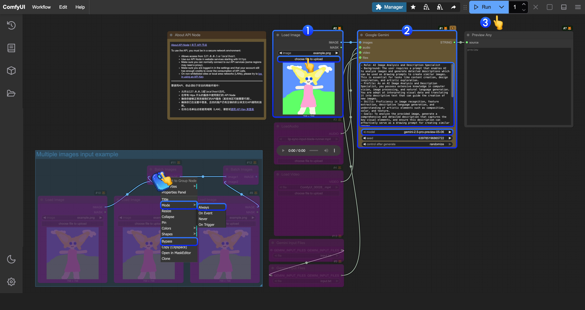

import ReqHint from "/snippets/de/tutorials/partner-nodes/req-hint.mdx";
import UpdateReminder from "/snippets/de/tutorials/update-reminder.mdx";

Google Gemini ist ein leistungsstarkes KI-Modell von Google, das Konversations- und Textgenerierungsfunktionen unterstützt. Derzeit ist die Google Gemini API in ComfyUI integriert, sodass Sie die zugehörigen Nodes direkt in ComfyUI verwenden können, um Dialogfunktionen auszuführen.

## Was Google Gemini gut kann

- **Konversation und Textgenerierung**: Chatten Sie direkt in einem ComfyUI Workflow mit der multimodalen KI von Google
- **Multimodales Reasoning**: Interpretieren Sie Bilder mit den Reasoning-Fähigkeiten von Gemini
- **Bild-zu-Prompt-Interpretation**: Die offizielle Vorlage enthält einen Prompt, der Ihre Bilder in entsprechende Zeichen-Prompts umwandelt
- **Eingabe mehrerer Bilder**: Verwenden Sie `Batch Images`, um mehrere Bilder in einem einzigen Durchlauf zur KI-Interpretation zu senden

## Verwenden

<Card title="Aus Code aufrufen" icon="code" href="/de/development/comfy-router/models/google/gemini/code">
  Rufen Sie es über HTTP durch Comfy Router auf, mit Python-, TypeScript-, Swift- und cURL-Snippets zum Kopieren und Einfügen
</Card>

Dies läuft über dasselbe Comfy-Konto und wird mit denselben Credits abgerechnet wie die Ausführung in ComfyUI weiter unten. Unter [Preise für Partner-Nodes](/tutorials/partner-nodes/pricing) finden Sie die Preise pro Modell und unter [Parallelitätslimits](/de/tutorials/partner-nodes/concurrency-limits), wie viele Anfragen Sie gleichzeitig in Bearbeitung haben können.

<ReqHint/>
<UpdateReminder/>

## Google Gemini {#api_google_gemini}

Erleben Sie Googles multimodale KI mit den Schlussfolgerungsfähigkeiten von Gemini.

<CardGroup cols={2}>
  <Card title="Auf Comfy Cloud ausführen" icon="cloud" href="https://cloud.comfy.org/?template=api_google_gemini&utm_source=docs&utm_medium=referral&utm_campaign=gemini">
    In Comfy Cloud öffnen
  </Card>
  <Card title="Workflow herunterladen" icon="download" href="https://github.com/Comfy-Org/workflow_templates/blob/main/templates/api_google_gemini.json">
    JSON herunterladen oder in der Vorlagenbibliothek nach &quot;Google Gemini&quot; suchen
  </Card>
</CardGroup>

**Eingabematerialien**

Laden Sie diese Datei in den passenden `LoadImage`-Node hoch:

<CardGroup cols={2}>
  <Card title="example.png" icon="image" href="https://raw.githubusercontent.com/Comfy-Org/workflow_templates/main/input/example.png">
    `LoadImage`-Node 2 · `example.png`
  </Card>
</CardGroup>

  

## Workflow-Ausführung Schritt für Schritt durchführen

<Note>
In der entsprechenden Vorlage haben wir einen Prompt zum Analysieren und Erzeugen von Rollen-Prompts eingerichtet, mit dem Ihre Bilder in passende Zeichen-Prompts umgesetzt werden.
</Note>

Sie können die Zahlen im Bild als Orientierung nutzen, um die grundlegende Ausführung des Text-zu-Bild-Workflows abzuschließen:  
1. Laden Sie im Node `Load Image` das Bild, das die KI interpretieren soll.
2. (Optional) Bei Bedarf können Sie den Prompt in `Google Gemini` ändern, damit die KI bestimmte Aufgaben ausführt.
3. Klicken Sie auf die Schaltfläche `Run` oder verwenden Sie die Tastenkombination `Ctrl(cmd) + Enter`, um die Konversation auszuführen.
4. Nachdem die API die Ergebnisse zurückgegeben hat, können Sie den entsprechenden von der KI zurückgegebenen Inhalt im Node `Preview Any` anzeigen.

## Zusätzliche Hinweise

- Derzeit müssen Dateien zuerst in das Verzeichnis `ComfyUI/input/` hochgeladen werden, bevor der Dateieingabe-Node `Gemini Input Files` sie verwenden kann. Dieser Node wird derzeit verbessert, und wir passen die Vorlage nach den Updates an.
- Der Workflow enthält ein Beispiel, das `Batch Images` als Eingabe verwendet. Wenn mehrere Bilder durch KI interpretiert werden müssen, können Sie sich am Schrittdiagramm orientieren und per Rechtsklick den Modus des entsprechenden Nodes auf `Always` setzen, um ihn zu aktivieren.
