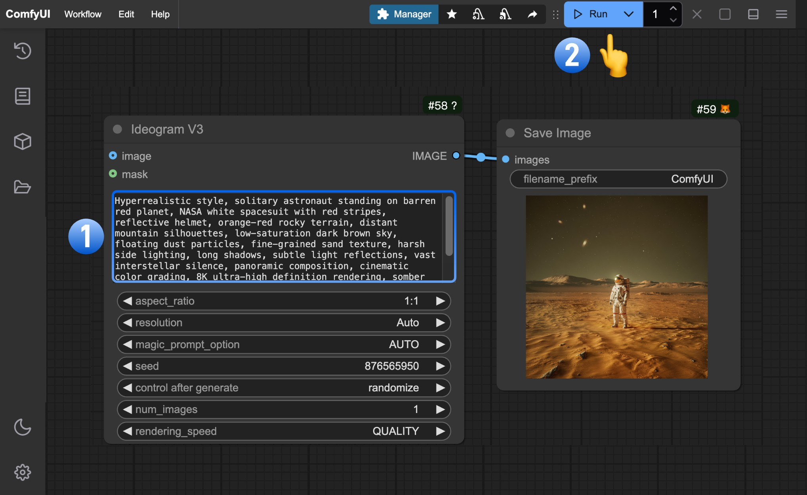

import ReqHint from "/snippets/de/tutorials/partner-nodes/req-hint.mdx";
import UpdateReminder from "/snippets/de/tutorials/update-reminder.mdx";

Ideogram 3.0 ist ein leistungsstarkes Text-zu-Bild-Modell von Ideogram, bekannt für seine fotorealistische Qualität, die präzise Textwiedergabe und die konsistente Stilsteuerung.

Der Node Ideogram V3 unterstützt derzeit zwei Modi:
- Text-zu-Bild-Modus
- Bildbearbeitungsmodus (wenn sowohl `image`- als auch `mask`-Eingabe bereitgestellt werden)

<ReqHint/>
<UpdateReminder/>

## Text-zu-Bild-Modus der Ideogram 3.0 Partner-Nodes

Wenn Sie Ideogram V3 ohne `image`- und `mask`-Eingaben verwenden, arbeitet der Node im Text-zu-Bild-Modus.

### 1. Workflow-Datei herunterladen

Laden Sie die folgende Datei herunter und ziehen Sie sie in ComfyUI, um den Workflow zu laden:

### 2. Workflow-Schritte ausführen

Folgen Sie den nummerierten Schritten, um den grundlegenden Workflow abzuschließen:
1. Geben Sie Ihre Bildbeschreibung in das Feld `prompt` des Nodes `Ideogram V3` ein
2. Klicken Sie auf `Run` oder verwenden Sie die Tastenkombination `Ctrl(cmd) + Enter`, um das Bild zu generieren
3. Nachdem die API die Ergebnisse zurückgegeben hat, sehen Sie sich das generierte Bild im Node `Save Image` an. Die Bilder werden im Verzeichnis `ComfyUI/output/` gespeichert

## Bildbearbeitungsmodus der Ideogram 3.0 Partner-Nodes

Verbinden Sie sowohl den `image`- als auch den `mask`-Eingang des Nodes `Ideogram V3`, um in den Bildbearbeitungsmodus zu wechseln. Der Node generiert den maskierten Bereich anhand Ihres Prompts neu und lässt den Rest des Bildes unverändert.

1. Laden Sie das Bild, das Sie bearbeiten möchten, mit einem `Load Image`-Node und verbinden Sie es mit dem `image`-Eingang des Nodes `Ideogram V3`
2. Klicken Sie mit der rechten Maustaste auf das geladene Bild, wählen Sie **Open in MaskEditor** und malen Sie den Bereich aus, den Sie ändern möchten
3. Verbinden Sie den Maskierungsausgang mit dem `mask`-Eingang des Nodes `Ideogram V3`. Bemalte (weiße) Bereiche werden ersetzt, alles außerhalb der Maskierung bleibt erhalten
4. Geben Sie die Bearbeitungsanweisung in das Feld `prompt` ein und beschreiben Sie, was innerhalb des maskierten Bereichs erscheinen soll
5. Klicken Sie auf `Run` oder verwenden Sie die Tastenkombination `Ctrl(cmd) + Enter`, um das bearbeitete Bild zu generieren
6. Sehen Sie sich das Ergebnis im Node `Save Image` an. Das bearbeitete Bild wird ebenfalls im Verzeichnis `ComfyUI/output/` gespeichert

<Note>
Der Node verwendet den Bearbeitungsmodus nur, wenn sowohl `image` als auch `mask` verbunden sind. Wenn Sie nur einen der beiden Eingänge verbinden, läuft der Node im Text-zu-Bild-Modus.
</Note>