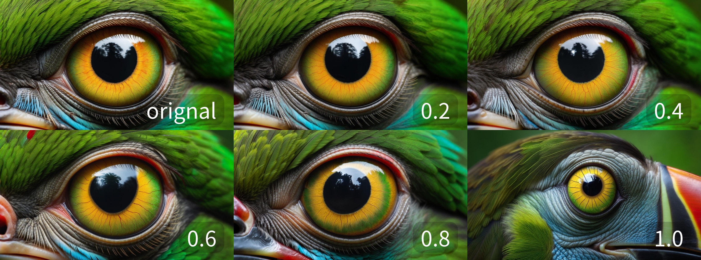
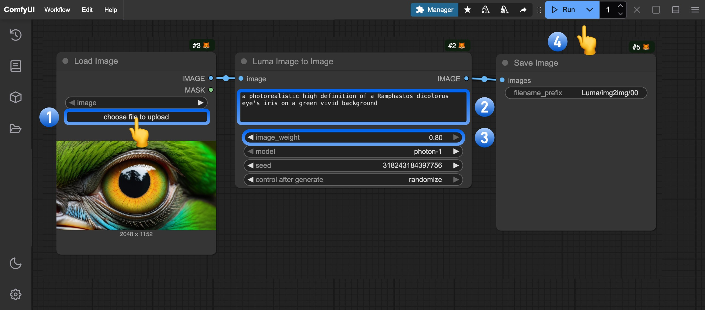

import ReqHint from "/snippets/de/tutorials/partner-nodes/req-hint.mdx";
import UpdateReminder from "/snippets/de/tutorials/update-reminder.mdx";

Der Node Luma Bild zu Bild ermöglicht es Ihnen, bestehende Bilder anhand von Text-Prompts mit der Technologie von Luma AI zu verändern und dabei bestimmte Merkmale und Strukturen des Originalbilds zu erhalten.

## Wofür Luma Bild zu Bild geeignet ist

- **Prompt-gesteuerte Bildbearbeitung**: Verändert bestehende Bilder anhand von Text-Prompts und bewahrt dabei bestimmte Merkmale und Strukturen des Originals
- **Objekte und Formen ändern**: Der Node eignet sich gut für das Ändern von Objekten und Formen, ist aber für Farbänderungen möglicherweise nicht ideal
- **Anpassbarer Einfluss der Eingabe**: Der Parameter `image_weight` steuert, wie stark das Eingabebild das Ergebnis prägt. Niedrigere Werte bleiben näher am Original

## Beispielausgaben

Ergebnisse mit unterschiedlichen Werten für `image_weight`, die zeigen, wie stark das Eingabebild die generierte Ausgabe beeinflusst:

<ReqHint/>
<UpdateReminder/>

## Workflow für Luma Bild zu Bild Partner-Nodes

<Tip>
Diese Funktion eignet sich gut für das Ändern von Objekten und Formen. Für Farbänderungen ist sie jedoch möglicherweise nicht ideal. Wir empfehlen niedrigere Gewichtswerte, etwa 0.0 bis 0.1.
</Tip>

### 1. Workflow-Datei herunterladen

Laden Sie das folgende Bild herunter und ziehen Sie es in ComfyUI, um den Workflow zu laden (die Workflow-Informationen sind in den Metadaten des Bilds enthalten):

Laden Sie dieses Bild herunter, um es als Eingabe zu verwenden:

### 2. Die Schritte des Workflows ausführen

Folgen Sie diesen nummerierten Schritten:
1. Klicken Sie auf **Upload** im Node `Load Image`, um Ihr Eingabebild hochzuladen
2. (Optional) Ändern Sie die Prompts des Workflows
3. (Optional) Passen Sie `image_weight` an, um den Einfluss des Eingabebilds zu verändern (niedrigere Werte bleiben näher am Original)
4. Klicken Sie auf `Run` oder verwenden Sie die Tastenkombination `Ctrl(cmd) + Enter`, um das Bild zu generieren
5. Nachdem die API Ergebnisse zurückgegeben hat, sehen Sie das generierte Bild im Node `Save Image` an. Die Bilder werden im Verzeichnis `ComfyUI/output/` gespeichert

### 3. Ergebnisse mit unterschiedlichen Werten für `image_weight`

