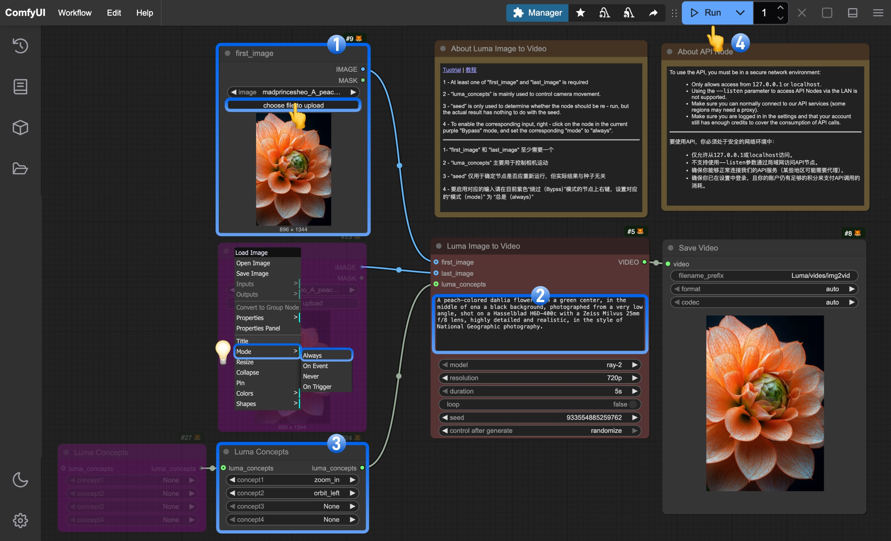

import ReqHint from "/snippets/de/tutorials/partner-nodes/req-hint.mdx";
import UpdateReminder from "/snippets/de/tutorials/update-reminder.mdx";

<Warning>
  **Veraltet**: Der alte Node **Luma Image to Video** ist veraltet, und Luma entfernt die von ihm verwendeten Endpunkte am 24. Oktober 2026. Verwenden Sie stattdessen den [**Luma Ray 3.2 Image to Video** Node](/built-in-nodes/LumaRay32ImageToVideoNode).
</Warning>

Der Node Luma Image to Video ermöglicht es Ihnen, statische Bilder mit der fortschrittlichen Technologie von Luma AI in glatte, dynamische Videos umzuwandeln und Ihren Bildern so Leben und Bewegung zu verleihen.

## Wofür Luma Image to Video sich eignet

- **Bildanimation**: Wandelt statische Bilder in glatte, dynamische Videos um und verleiht Ihren Bildern Leben und Bewegung
- **Prompt-gesteuerte Bewegung**: Text-Prompts bestimmen die Bewegungseffekte des Videos
- **Kamerasteuerung**: Die Funktion Luma Concepts steuert die Kamerabewegung für professionelle Kinematografie
- **Flexible Bildeingänge**: Funktioniert mit einem `first_image`, einem `last_image` oder beiden
- **Anpassbare Ausgabe**: Auflösung und Dauer des Videos sind anpassbar, und über den Modellparameter können verschiedene Videogenerierungsmodelle ausgewählt werden

<ReqHint/>
<UpdateReminder/>

## Bild-zu-Video-Workflow mit Luma Partner-Nodes

Der Node `Luma Image to Video` benötigt mindestens einen Bildeingang (`first_image` oder `last_image`) sowie Text-Prompts, um die Bewegungseffekte des Videos festzulegen. In dieser Anleitung haben wir ein Beispiel mit `first_image` und `luma_concepts` erstellt, das die Videogenerierungsfunktionen von Luma AI zeigt.

### 1. Workflow herunterladen

Diese Seite dokumentiert den eingestellten Node **Luma Image to Video** und den Beispiel-Workflow, der mit ihm ausgeliefert wurde und `ray-2` ausgewählt hat. Luma stellt dieses Modell am 24. Oktober 2026 ein, daher können weder der Node noch das Beispiel ausgeführt werden. Das Beispiel und die zugehörige Schritt-für-Schritt-Anleitung bleiben als Kommentar im Quelltext dieser Seite erhalten.

Der Ersatz ist ein eigener Node. Die zugehörige Anleitung:

<CardGroup cols={1}>
  <Card title="Luma Ray 3.2: Image to Video" icon="film" href="/built-in-nodes/LumaRay32ImageToVideoNode">
    Sehen Sie sich den Ersatz-Node und seine Eingänge an.
  </Card>
</CardGroup>

{/*
Legacy-Beispiel-Workflow und Schritt-Anleitung für den eingestellten Node. Er hat `ray-2` ausgewählt, das Luma am 24. Oktober 2026 nicht mehr anbietet, daher kann er nicht ausgeführt werden. Stellen Sie diesen Block mit den Ray 3.2-Nodes wieder her oder generieren Sie ihn neu.

Die Workflow-Informationen sind in den Metadaten des untenstehenden Videos enthalten. Laden Sie es herunter und ziehen Sie es in ComfyUI, um den Workflow zu laden.

Laden Sie das folgende Bild herunter, um es als Eingabe zu verwenden:

### 2. Den Workflow-Schritten folgen

Folgen Sie diesen grundlegenden Schritten, um den Workflow auszuführen:
1. Laden Sie Ihr Eingabebild im Node `first_image` hoch
2. (Optional) Schreiben Sie Prompts in den Node Luma Image to Video, um zu beschreiben, wie das Bild animiert werden soll
3. (Optional) Ändern Sie den Node `Luma Concepts`, um die Kamerabewegung für professionelle Kinematografie zu steuern
4. Klicken Sie auf `Run` oder verwenden Sie `Ctrl(cmd) + Enter`, um das Video zu generieren
5. Sobald die API Ergebnisse zurückgibt, sehen Sie sich das generierte Video im Node `Save Video` an. Das Video wird außerdem im Verzeichnis `ComfyUI/output/` gespeichert
*/}

### 2. Weitere Hinweise

- **Anforderungen an die Bildeingabe**: Mindestens eines von `first_image` oder `last_image` ist erforderlich, mit maximal 1 Bild pro Eingang
- **Luma Concepts**: Steuert die Kamerabewegung für professionelle Videoeffekte
- **Seed-Parameter**: Bestimmt nur, ob der Node erneut ausgeführt werden soll, und beeinflusst die Generierungsergebnisse nicht
- **Eingabe-Nodes aktivieren**: Klicken Sie mit der rechten Maustaste auf lila Nodes im Modus „Bypass“ und setzen Sie „mode“ auf „always“, um die Eingänge zu aktivieren
- **Modellauswahl**: Unterschiedliche Videogenerierungsmodelle haben eigene Eigenschaften, die über den Modellparameter angepasst werden können
- **Auflösung und Dauer**: Passen Sie Auflösung und Länge des Ausgabevideos über die Parameter für Auflösung und Dauer an
