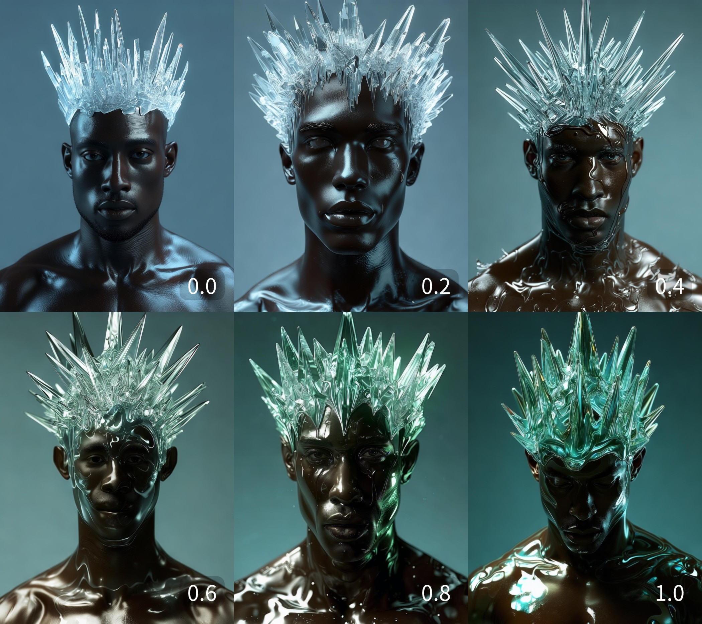
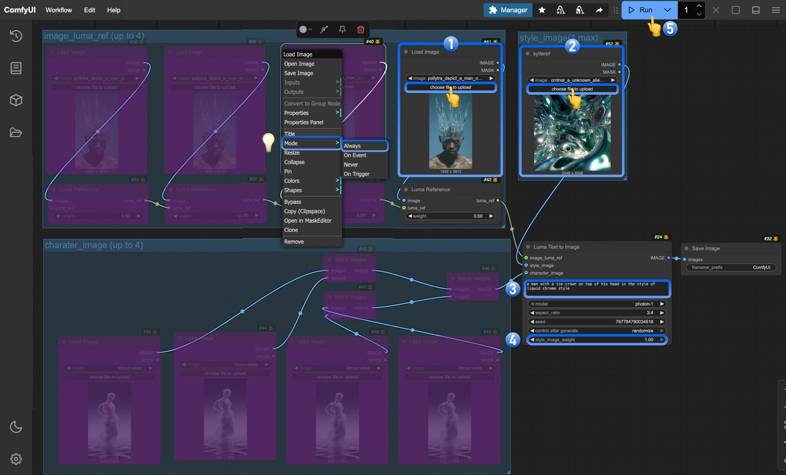

import ReqHint from "/snippets/de/tutorials/partner-nodes/req-hint.mdx";
import UpdateReminder from "/snippets/de/tutorials/update-reminder.mdx";

Der Node `Luma Text to Image` ermöglicht es Ihnen, hochwertige Bilder aus Text-Prompts mit der fortschrittlichen Technologie von Luma AI zu generieren. Er ist in der Lage, fotorealistische Inhalte und Bilder im künstlerischen Stil zu erstellen.

## Was Luma Text to Image besonders gut kann

- **Hochwertige Text-zu-Bild-Generierung**: Erzeugt fotorealistische Inhalte und Bilder im künstlerischen Stil aus Text-Prompts
- **Stilreferenzen**: Eine `style_image`-Eingabe steuert die Optik des Ergebnisses, wobei `style_image_weight` den Einfluss des Stilreferenzbilds festlegt
- **Bild- und Charakterreferenzen**: Die `image_luma_ref`-Eingabe unterstützt referenzgesteuerte Generierung, wobei bis zu 4 Referenzbilder und Charakterreferenzen gleichzeitig verwendet werden können

## Beispielausgaben

Stilgesteuerte Generierung mit unterschiedlichen Werten für `style_image_weight`, die den Einfluss des Stilreferenzbilds zeigt:

<ReqHint/>
<UpdateReminder/>

## Workflow für Luma Text to Image Partner-Nodes

Wenn der Node `Luma Text to Image` ohne Bildeingänge verwendet wird, fungiert er als Text-zu-Bild-Workflow. In dieser Anleitung haben wir Beispiele mit `style_image` und `image_luma_ref` erstellt, um die hervorragenden Bildverarbeitungsfähigkeiten von Luma AI zu zeigen.

### 1. Workflow-Dateien herunterladen

Die Workflow-Informationen sind in den Metadaten des folgenden Bildes enthalten. Laden Sie es herunter und ziehen Sie es in ComfyUI, um den Workflow zu laden.

Bitte laden Sie diese Bilder als Eingabe herunter:

### 2. Schritte zum Ausführen des Workflows befolgen

Befolgen Sie die nummerierten Schritte im Bild, um den Basis-Workflow abzuschließen:
1. Laden Sie das Referenzbild im Node `Load image` hoch
2. Laden Sie das Stil-Referenzbild im Node `Load image (renamed to styleref)` hoch
3. (Optional) Ändern Sie die Prompts im Node `Luma Text to Image`
4. (Optional) Passen Sie `style_image_weight` an, um den Einfluss des Stil-Referenzbildes zu steuern
5. Klicken Sie auf die Schaltfläche `Run` oder verwenden Sie die Tastenkombination `Ctrl(cmd) + Enter`, um das Bild zu generieren
6. Nachdem die API Ergebnisse zurückgegeben hat, sehen Sie sich das generierte Bild im Node `Save Image` an. Die Bilder werden im Verzeichnis `ComfyUI/output/` gespeichert

### 3. Zusätzliche Hinweise

- Der Node erlaubt bis zu 4 Referenzbilder und Charakter-Referenzen gleichzeitig.
- Um mehrere Bildeingänge zu aktivieren, klicken Sie mit der rechten Maustaste auf die lila Nodes mit dem Status „Bypassed“ und setzen Sie deren `mode` auf `always`
