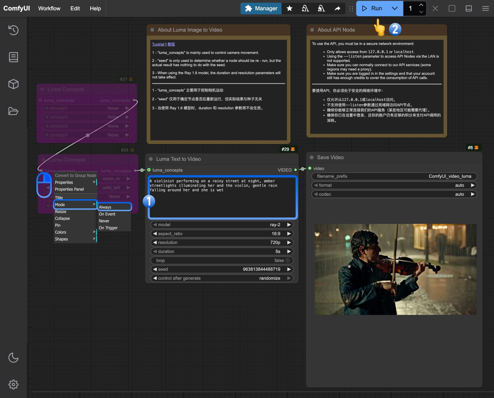

import ReqHint from "/snippets/de/tutorials/partner-nodes/req-hint.mdx";
import UpdateReminder from "/snippets/de/tutorials/update-reminder.mdx";

<Warning>
  **Veraltet**: Der Legacy-Node **Luma Text to Video** ist veraltet, und Luma entfernt die von ihm verwendeten Endpunkte am 24. Oktober 2026. Verwenden Sie stattdessen den [**Luma Ray 3.2 Text to Video** Node](/built-in-nodes/LumaRay32TextToVideoNode).
</Warning>

Der Node Luma Text to Video ermöglicht es Ihnen, mit der innovativen Videogenerierungstechnologie von Luma AI hochwertige, glatte Videos aus Textbeschreibungen zu erstellen.

## Wofür Luma Text to Video geeignet ist

- **Text-zu-Video-Generierung**: Erzeugt hochwertige, glatte Videos aus Textbeschreibungen von Szenen, Motiven, Aktionen und Stimmung
- **Kamerasteuerung**: Die Funktion Luma Concepts ergänzt Kamerabewegungen für professionelle Videoaufnahmen und Kinematografie
- **Modellauswahl**: Über den Modellparameter lassen sich verschiedene Videomodelle mit unterschiedlichen Funktionen auswählen
- **Anpassbare Ausgabe**: Auflösung und Dauer des Videos sind einstellbar (außer beim Modell Ray 1.6, bei dem diese Parameter nicht gelten)

<ReqHint/>
<UpdateReminder/>

## Text-to-Video-Workflow mit Luma Partner-Nodes

Der Node Luma Text to Video erfordert Text-Prompts, die den Videoinhalt beschreiben. In dieser Anleitung haben wir Beispiele mit `prompt` und `luma_concepts` erstellt, um die hervorragenden Videogenerierungsfunktionen von Luma AI zu zeigen.

### 1. Workflow herunterladen

Diese Seite dokumentiert den eingestellten Node **Luma Text to Video** und den Beispiel-Workflow, der damit ausgeliefert wurde und `ray-2` ausgewählt hat. Luma stellt dieses Modell ab dem 24. Oktober 2026 nicht mehr bereit, daher können weder der Node noch das Beispiel ausgeführt werden. Das Beispiel und die zugehörige Schritt-für-Schritt-Anleitung bleiben als Kommentar in der Quelle dieser Seite erhalten.

Der Ersatz ist ein eigener Node. Die zugehörige Anleitung:

<CardGroup cols={1}>
  <Card title="Luma Ray 3.2: Text to Video" icon="film" href="/built-in-nodes/LumaRay32TextToVideoNode">
    Sehen Sie sich den Ersatz-Node und seine Eingänge an.
  </Card>
</CardGroup>

{/*
Legacy-Beispiel-Workflow und Schritt-für-Schritt-Anleitung für den eingestellten Node. Er hat `ray-2` ausgewählt, das Luma ab dem 24. Oktober 2026 nicht mehr bereitstellt, daher kann er nicht ausgeführt werden. Stellen Sie diesen Block mit den Ray 3.2 Nodes wieder her oder generieren Sie ihn neu.

Die Workflow-Informationen sind in den Metadaten des folgenden Videos enthalten. Laden Sie es herunter und ziehen Sie es in ComfyUI, um den Workflow zu laden.

### 2. Den Schritten folgen

Führen Sie diese grundlegenden Schritte aus, um den Workflow auszuführen:
1. Schreiben Sie Ihren Prompt in den Node `Luma Text to Video`, um den gewünschten Videoinhalt zu beschreiben
2. Klicken Sie auf die Schaltfläche `Run` oder verwenden Sie die Tastenkombination `Ctrl(cmd) + Enter`, um das Video zu generieren
3. Nachdem die API Ergebnisse zurückgegeben hat, können Sie das generierte Video im Node `Save Video` ansehen. Das Video wird außerdem im Verzeichnis `ComfyUI/output/` gespeichert

> (Optional) Ändern Sie den Node `Luma Concepts`, um Kamerabewegungen zu steuern und professionelle Bildgestaltung hinzuzufügen
*/}

### 2. Weitere Hinweise

- **Prompts schreiben**: Beschreiben Sie Szenen, Motive, Aktionen und Stimmung ausführlich, um beste Ergebnisse zu erzielen
- **Luma Concepts**: Wird hauptsächlich zur Kamerasteuerung verwendet, um professionelle Videoaufnahmen zu erstellen
- **Seed-Parameter**: Bestimmt nur, ob der Node erneut ausgeführt werden soll, und beeinflusst die Generierungsergebnisse nicht
- **Modellauswahl**: Verschiedene Videomodelle haben unterschiedliche Funktionen, die über den Parameter `model` angepasst werden können
- **Auflösung und Dauer**: Passen Sie die Auflösung und Länge des Ausgabevideos mit diesen Parametern an
- **Hinweis zum Modell Ray 1.6**: Die Parameter für Dauer und Auflösung funktionieren beim Modell Ray 1.6 nicht. Luma hat Ray 1.6 im September 2026 eingestellt, daher läuft diese Option nicht mehr.
