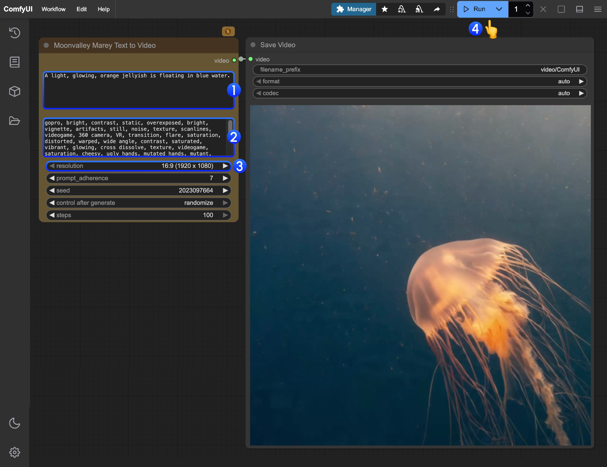
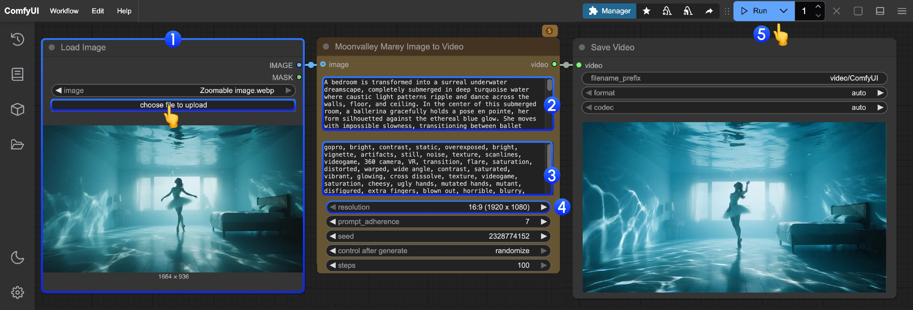
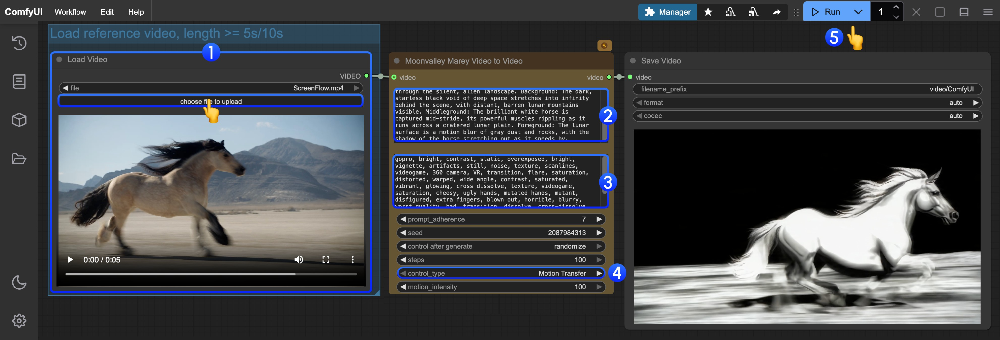

import ReqHint from "/snippets/de/tutorials/partner-nodes/req-hint.mdx";
import UpdateReminder from "/snippets/de/tutorials/update-reminder.mdx";

<Warning>
  **Dienst nicht verfügbar**: Der Moonvalley API-Dienst ist nicht mehr verfügbar. Diese Nodes sind veraltet und funktionieren möglicherweise nicht wie erwartet.
</Warning>

<iframe
  className="w-full aspect-video rounded-xl"
  src="https://www.youtube.com/embed/8Z8X9fFKapQ?si=lK_KFSzDcT0Mepk9"
  title="ComfyUI Selection Toolbox New Features"
  allow="accelerometer; clipboard-write; encrypted-media; gyroscope; picture-in-picture"
  allowFullScreen
></iframe>

Moonvalley Marey Realism v1.5 ist ein KI-Videogenerierungsmodell für die Erstellung auf Kinoniveau. Das Modell wurde **vollständig mit kommerziell lizenzierten Inhalten trainiert**, was **Urheberrechtskonformität und kommerzielle Sicherheit** gewährleistet.

## Was Moonvalley besonders gut kann

- Herausragendes Prompt-Verständnis: Komplexe Prompt-Anweisungen werden präzise interpretiert.
- Native 1080p-HD-Qualität: Der Trainingsdatensatz basiert auf **1080P**-Videos, was feine und detaillierte Ergebnisse liefert.
- Realistische Physik und dynamische Darstellung: Physikalische Bewegungsmodelle und natürliche Dynamiken werden präzise simuliert, für professionelle Realitätstreue.
- Komplexe Szenenschichtung und erweiterte Lichteffekte: Unterstützt Vordergrund-, Mittelgrund- und Hintergrundebenen in komplexen Szenen mit intelligentem Verständnis räumlicher Beziehungen.
- Steuerungsfunktionen auf Produktionsniveau wie Motion- und Pose-Transfer: Erzeugt automatisch realistisches Licht für zusammengesetzte Szenen.

Derzeit werden die zugehörigen Partner-Nodes von Moonvalley in ComfyUI nativ unterstützt. Sie können die entsprechenden Funktionen für Text zu Video, Bild zu Video und Video zu Video direkt in ComfyUI nutzen.

<Warning>
  **Dienst nicht verfügbar**: Der Moonvalley-API-Dienst ist nicht mehr verfügbar. Diese Nodes sind veraltet und funktionieren möglicherweise nicht wie erwartet.
</Warning>

<ReqHint/>
<UpdateReminder/>

## Moonvalley Text-zu-Video-Workflow

### 1. Workflow-Datei herunterladen

<video
  controls
  className="w-full aspect-video"
  src="https://raw.githubusercontent.com/Comfy-Org/example_workflows/refs/heads/main/api_nodes/moonvalley/api_moonvalley_text_to_video.mp4"
></video>

<a className="prose"  target='_blank'  href="https://raw.githubusercontent.com/Comfy-Org/example_workflows/refs/heads/main/api_nodes/moonvalley/api_moonvalley_text_to_video.json" style={{ display: 'inline-block', backgroundColor: '#0078D6', color: '#ffffff', padding: '10px 20px', borderRadius: '8px', borderColor: "transparent", textDecoration: 'none', fontWeight: 'bold'}}>
    
Workflow-Datei im JSON-Format herunterladen

</a>

### 2. Schritte zum Ausführen des Workflows befolgen

1. Geben Sie den positiven Prompt ein (Inhalt, der im Video erscheinen soll)
2. Geben Sie den negativen Prompt ein (Inhalt, der nicht im Video erscheinen soll)
3. Ändern Sie die Auflösung der Videoausgabe
4. Klicken Sie auf die Schaltfläche `Run` oder verwenden Sie die Tastenkombination `Ctrl(cmd) + Enter`, um die Videogenerierung zu starten
5. Nachdem die API das Ergebnis zurückgegeben hat, können Sie das generierte Video im Node `Save Video` ansehen. Das Video wird außerdem im Verzeichnis `ComfyUI/output/` gespeichert

## Moonvalley Workflow für Bild zu Video

### 1. Workflow-Datei herunterladen

<video
  controls
  className="w-full aspect-video"
  src="https://raw.githubusercontent.com/Comfy-Org/example_workflows/refs/heads/main/api_nodes/moonvalley/api_moonvalley_image_to_video.mp4"
></video>

<a className="prose"  target='_blank'  href="https://raw.githubusercontent.com/Comfy-Org/example_workflows/refs/heads/main/api_nodes/moonvalley/api_moonvalley_image_to_video.json" style={{ display: 'inline-block', backgroundColor: '#0078D6', color: '#ffffff', padding: '10px 20px', borderRadius: '8px', borderColor: "transparent", textDecoration: 'none', fontWeight: 'bold'}}>
    
Workflow-Datei im JSON-Format herunterladen

</a>

Laden Sie das untenstehende Bild als Eingabebild herunter

### 2. Schritte zum Ausführen des Workflows befolgen

1. Laden Sie das Eingabebild im Node `Load Image`
2. Geben Sie den positiven Prompt ein (Inhalt, der im Video erscheinen soll)
3. Geben Sie den negativen Prompt ein (Inhalt, der nicht im Video erscheinen soll)
4. Ändern Sie die Ausgabeauflösung des Videos
5. Klicken Sie auf die Schaltfläche `Run` oder verwenden Sie die Tastenkombination `Ctrl(cmd) + Enter`, um die Videoerzeugung zu starten
6. Nachdem die API das Ergebnis zurückgegeben hat, können Sie das generierte Video im Node `Save Video` ansehen. Das Video wird außerdem im Verzeichnis `ComfyUI/output/` gespeichert

## Moonvalley Workflow für Video-zu-Video

Der Node `Moonvalley Marey Video to Video` ermöglicht es Ihnen, ein Referenzvideo für die Neuzeichnung eines Videos einzugeben. Sie können die Bewegung oder die Posen der Charaktere aus dem Referenzvideo für die Videogenerierung verwenden.

### 1. Workflow-Datei herunterladen

<video
  controls
  className="w-full aspect-video"
  src="https://raw.githubusercontent.com/Comfy-Org/example_workflows/refs/heads/main/api_nodes/moonvalley/api_moonvalley_video_to_video.mp4"
></video>

<a className="prose"  target='_blank'  href="https://raw.githubusercontent.com/Comfy-Org/example_workflows/refs/heads/main/api_nodes/moonvalley/api_moonvalley_video_to_video.json" style={{ display: 'inline-block', backgroundColor: '#0078D6', color: '#ffffff', padding: '10px 20px', borderRadius: '8px', borderColor: "transparent", textDecoration: 'none', fontWeight: 'bold'}}>
    
Workflow-Datei im JSON-Format herunterladen

</a>

Laden Sie das folgende Video als Eingabevideo herunter:

<video
  controls
  className="w-full aspect-video"
  src="https://raw.githubusercontent.com/Comfy-Org/example_workflows/refs/heads/main/api_nodes/moonvalley/api_moonvalley_video_to_video_input.mp4"
></video>

### 2. Schritte zum Ausführen des Workflows befolgen

1. Laden Sie das Referenzvideo (oder Ihr eigenes Material) im Node `Load Video`
    - Wenn die endgültige Videodauer 5s beträgt, muss das Eingabevideo länger als 5s sein
    - Wenn die endgültige Videodauer 10s beträgt, muss das Eingabevideo länger als 10s sein
2. Geben Sie den positiven Prompt ein (Inhalte, die im Video erscheinen sollen)
3. Geben Sie den negativen Prompt ein (Inhalte, die im Video nicht erscheinen sollen)
4. Legen Sie den Parameter `control_type` fest, um den Referenztyp für die Video-Neuzeichnung zu wählen
    -  `Motion Transfer`: Generierung basierend auf der Bewegung im Referenzvideo
    -  `Pose Transfer`: Generierung basierend auf den Posen der Charaktere im Referenzvideo
5. Klicken Sie auf die Schaltfläche `Run` oder verwenden Sie die Tastenkombination `Ctrl(cmd) + Enter`, um die Videogenerierung zu starten
6. Nachdem die API das Ergebnis zurückgegeben hat, können Sie das generierte Video im Node `Save Video` ansehen. Das Video wird außerdem im Verzeichnis `ComfyUI/output/` gespeichert
