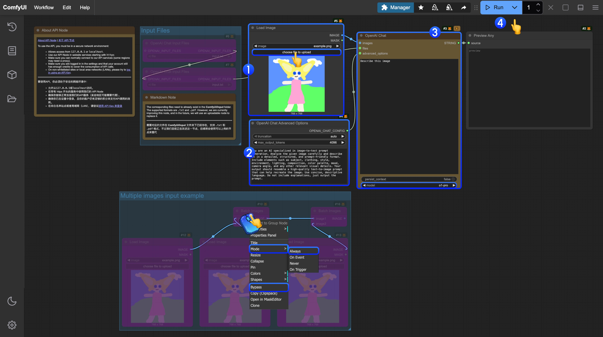

import ReqHint from "/snippets/de/tutorials/partner-nodes/req-hint.mdx";
import UpdateReminder from "/snippets/de/tutorials/update-reminder.mdx";

OpenAI ist ein Unternehmen mit Fokus auf generative KI und bietet leistungsstarke Konversationsfähigkeiten. ComfyUI bindet die OpenAI-API bereits ein, sodass Sie die zugehörigen Nodes direkt in ComfyUI verwenden können, um Konversationsfunktionen umzusetzen.

## Wofür OpenAI Chat geeignet ist

- **Intelligente Unterhaltungen**: Interagieren Sie direkt in ComfyUI mit den fortschrittlichen Sprachmodellen von OpenAI.
- **Bildverständnis**: Laden Sie ein Bild, damit die KI es interpretiert und darauf antwortet.
- **Aufgabensteuerung**: Passen Sie `OpenAI Chat Advanced Options` an, damit die KI bestimmte Aufgaben ausführt, etwa ein Bild analysieren und einen Prompt generieren.
- **Modellauswahl**: Wählen Sie im Node `OpenAI Chat` verschiedene OpenAI-Modelle aus.
- **Eingabe mehrerer Bilder**: Fassen Sie mehrere Bilder zu einem Batch zusammen, wenn mehr als ein Bild von der KI interpretiert werden muss.

<ReqHint/>
<UpdateReminder/>

## OpenAI: ChatGPT {#api_openai_chat}

Nutzen Sie die fortschrittlichen Sprachmodelle von OpenAI für intelligente Unterhaltungen.

<CardGroup cols={2}>
  <Card title="Auf Comfy Cloud ausführen" icon="cloud" href="https://cloud.comfy.org/?template=api_openai_chat&utm_source=docs&utm_medium=referral&utm_campaign=chat">
    In Comfy Cloud öffnen
  </Card>
  <Card title="Workflow herunterladen" icon="download" href="https://github.com/Comfy-Org/workflow_templates/blob/main/templates/api_openai_chat.json">
    JSON herunterladen oder in der Vorlagenbibliothek nach „OpenAI: ChatGPT“ suchen
  </Card>
</CardGroup>

**Eingabematerialien**

Laden Sie diese Datei in den passenden `LoadImage`-Node hoch:

<CardGroup cols={2}>
  <Card title="example.png" icon="image" href="https://raw.githubusercontent.com/Comfy-Org/workflow_templates/main/input/example.png">
    `LoadImage`-Node 5 · `example.png`
  </Card>
</CardGroup>

  

## Workflow Schritt für Schritt ausführen

<Note>
In der entsprechenden Vorlage haben wir eine Rolleneinstellung zur Analyse der Prompt-Generierung eingerichtet.
</Note>

Anhand der Nummern in der Abbildung können Sie die grundlegende Ausführung des Text-zu-Bild-Workflows abschließen:  
1. Laden Sie im Node `Load Image` das Bild, das die KI interpretieren soll.
2. (Optional) Bei Bedarf können Sie die Einstellungen in `OpenAI Chat Advanced Options` ändern, damit die KI bestimmte Aufgaben ausführt.
3. Im Node `OpenAI Chat` können Sie `Prompt` ändern, um den Konversations-Prompt festzulegen, oder `model` ändern, um ein anderes Modell auszuwählen.
4. Klicken Sie auf die Schaltfläche `Run` oder verwenden Sie die Tastenkombination `Ctrl(cmd) + Enter`, um die Konversation auszuführen.
5. Nachdem die API die Ergebnisse zurückgegeben hat, können Sie den entsprechenden von der KI zurückgegebenen Inhalt im Node `Preview Any` ansehen.

## Zusätzliche Hinweise

- Derzeit erfordert der Node `OpenAI Chat Input Files` für Dateieingaben, dass Dateien zuerst in das Verzeichnis `ComfyUI/input/` hochgeladen werden. Dieser Node wird derzeit verbessert, und wir werden die Vorlage nach den Aktualisierungen anpassen.
- Der Workflow enthält ein Beispiel, das `Batch Images` für die Eingabe verwendet. Wenn Sie mehrere Bilder haben, die von der KI interpretiert werden müssen, können Sie sich an der Abbildung der Schritte orientieren und per Rechtsklick den Modus des entsprechenden Nodes auf `Always` setzen, um ihn zu aktivieren.
