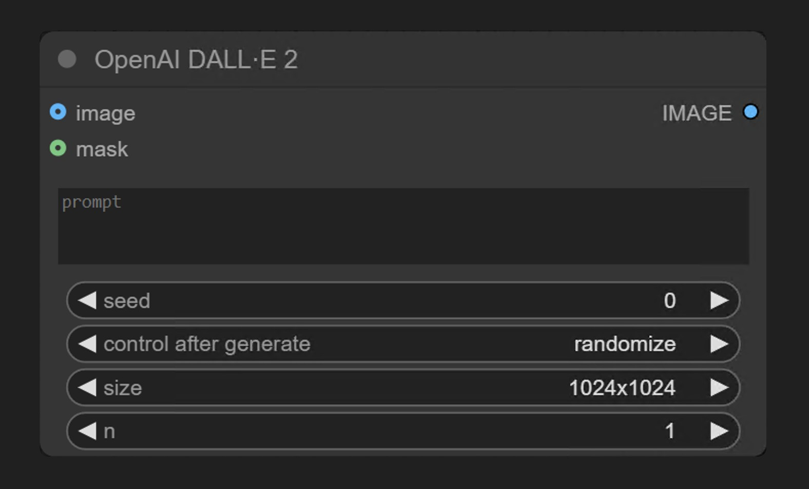
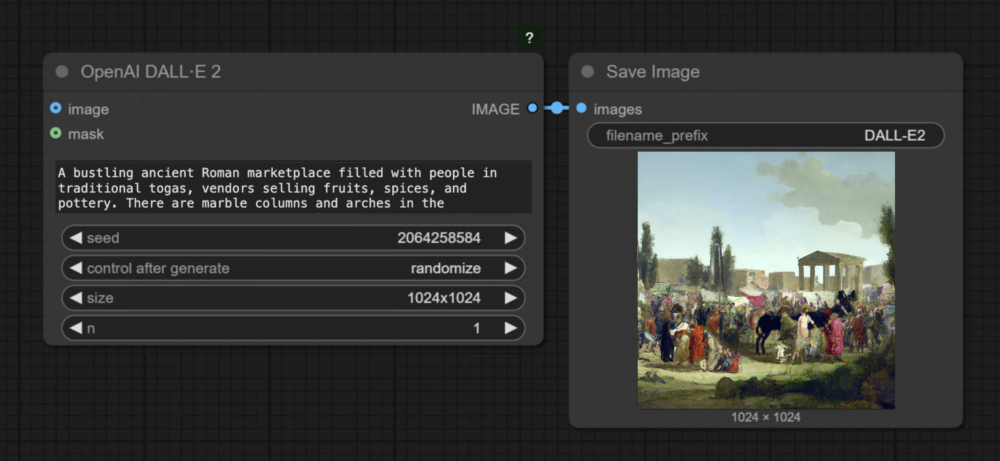
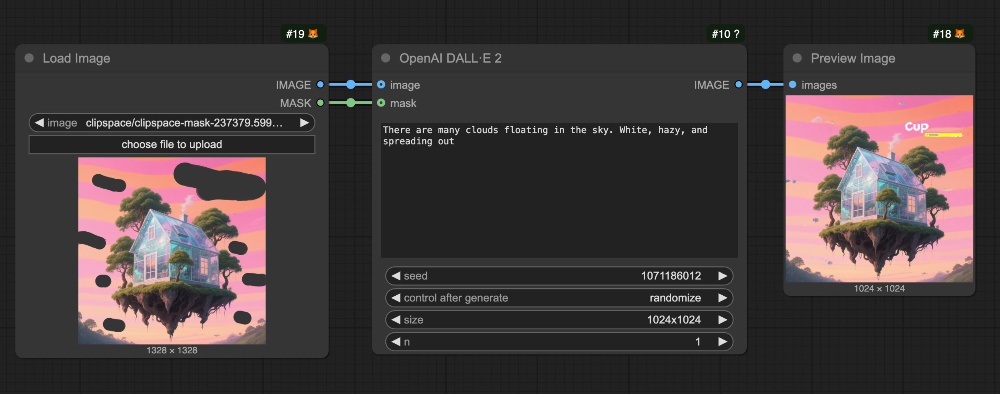

import Faq from "/snippets/de/tutorials/partner-nodes/faq.mdx";
import ReqHint from "/snippets/de/tutorials/partner-nodes/req-hint.mdx";
import UpdateReminder from "/snippets/de/tutorials/update-reminder.mdx";

<Warning>
  **Veraltet**: OpenAI hat das Modell DALL·E 2 eingestellt. Der Node **OpenAI DALL·E 2** wurde außer Betrieb genommen und aus ComfyUI entfernt. Verwenden Sie stattdessen den Node **GPT Image**. Diese Seite dient nur noch als Referenz.
</Warning>

OpenAI DALL·E 2 ist Teil der Reihe der Partner-Nodes von ComfyUI und ermöglicht es Ihnen, Bilder mit dem Modell **DALL·E 2** von OpenAI zu generieren.

Der Node **OpenAI DALL·E 2** generiert Bilder synchron über die Bildgenerierungs-API von OpenAI. Er empfängt Text-Prompts und gibt Bilder zurück, die der Beschreibung entsprechen.

## Wofür DALL·E 2 geeignet ist

- Text-zu-Bild-Generierung
- Funktion zur Bildbearbeitung (Inpainting über Masken)

## Beispielausgaben

Text zu Bild aus einem einzigen Text-Prompt:

Inpainting: Ersetzen eines maskierten Bereichs eines Eingabebilds anhand eines Text-Prompts:

<ReqHint/>
<UpdateReminder/>

## Parameterbeschreibung

### Erforderliche Parameter

| Parameter | Beschreibung                                                   |
|-----------|---------------------------------------------------------------|
| `prompt`  | Text-Prompt, der den Bildinhalt beschreibt, den Sie generieren möchten |

### Widget-Parameter

| Parameter | Beschreibung                                                                | Optionen/Bereich                     | Standardwert |
|-----------|----------------------------------------------------------------------------|-----------------------------------|---------------|
| `seed`    | Seed-Wert für die Bildgenerierung (derzeit im Backend nicht implementiert) | 0 bis 2^31-1                       | 0             |
| `size`    | Abmessungen des Ausgabebilds                                                    | "256x256", "512x512", "1024x1024" | "1024x1024"   |
| `n`       | Anzahl der zu generierenden Bilder                                               | 1 bis 8                            | 1             |

### Optionale Parameter

| Parameter | Beschreibung                                                                | Optionen/Bereich                     | Standardwert |
|-----------|----------------------------------------------------------------------------|-----------------------------------|---------------|
| `image`   | Optionales Referenzbild für die Bildbearbeitung                                 | Beliebige Bild-Eingabe                   | Keine          |
| `mask`    | Optionale Maskierung für lokales Inpainting                                         | Maskierungseingabe                        | Keine          |

## Workflow-Beispiele

Dieser Partner-Node unterstützt derzeit zwei Workflows:

- Text zu Bild
- Inpainting

<Note>
Der Workflow Bild zu Bild wird nicht unterstützt.
</Note>

### Beispiel für Text zu Bild

Das folgende Bild enthält einen einfachen Text-zu-Bild-Workflow. Laden Sie das entsprechende Bild herunter und ziehen Sie es in ComfyUI, um den Workflow zu laden.

Das zugehörige Beispiel ist sehr einfach.

Sie müssen lediglich den Node `OpenAI DALL·E 2` laden, im Node `prompt` die Beschreibung des Bildes eingeben, das Sie generieren möchten, einen Node `Save Image` verbinden und anschließend den Workflow ausführen.

### Inpainting-Workflow

DALL·E 2 unterstützt die Bildbearbeitung, sodass Sie mit einer Maskierung den Bereich festlegen können, der ersetzt werden soll. Unten finden Sie ein einfaches Beispiel für einen Inpainting-Workflow:

#### 1. Workflow-Datei herunterladen

Laden Sie das folgende Bild herunter und ziehen Sie es in ComfyUI, um den entsprechenden Workflow zu laden.

Als Eingabe verwenden wir das folgende Bild:

#### 2. Anweisungen zur Nutzung der Workflow-Datei

Da dieser Workflow relativ einfach ist, können Sie den entsprechenden Workflow auch selbst manuell erstellen. Gehen Sie dazu wie folgt vor:

1. Verwenden Sie den Node `Load Image`, um das Bild zu laden.
2. Klicken Sie mit der rechten Maustaste auf den Node zum Laden des Bildes und wählen Sie `MaskEditor` aus.
3. Zeichnen Sie im Maskeneditor mit dem Pinsel den Bereich ein, den Sie neu zeichnen möchten.
4. Verbinden Sie das geladene Bild mit der Eingabe `image` des Nodes **OpenAI DALL·E 2**.
5. Verbinden Sie die Maskierung mit der Eingabe `mask` des Nodes **OpenAI DALL·E 2**.
6. Bearbeiten Sie den Prompt im Node `prompt`.
7. Führen Sie den Workflow aus.

**Hinweise**

- Wenn Sie die Bildbearbeitungsfunktion nutzen möchten, müssen Sie sowohl ein Bild als auch eine Maskierung bereitstellen (beides ist erforderlich).
- Die Maskierung und das Bild müssen dieselbe Größe haben.
- Bei der Eingabe großer Bilder ändert der Node die Größe des Bildes automatisch auf eine passende Größe.
- Die von der API zurückgegebenen URLs sind nur kurze Zeit gültig. Speichern Sie die Ergebnisse daher zeitnah.
- Jede Generierung verbraucht Credits, die je nach Bildgröße und Anzahl abgerechnet werden.

## Häufig gestellte Fragen

<Faq/>
