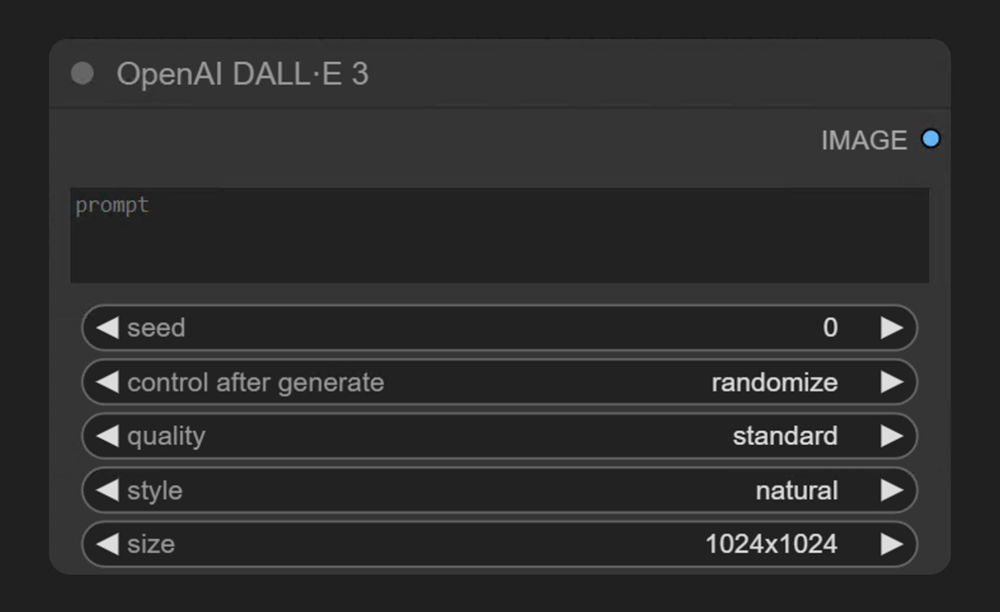
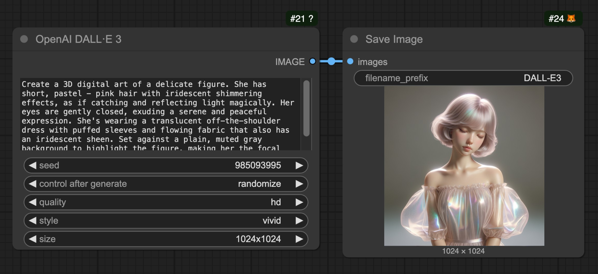

import Faq from "/snippets/de/tutorials/partner-nodes/faq.mdx";
import ReqHint from "/snippets/de/tutorials/partner-nodes/req-hint.mdx";
import UpdateReminder from "/snippets/de/tutorials/update-reminder.mdx";

<Warning>
  **Veraltet**: OpenAI hat das Modell DALL·E 3 eingestellt. Der Node **OpenAI DALL·E 3** wurde zurückgezogen und aus ComfyUI entfernt. Verwenden Sie stattdessen den Node **GPT Image**. Diese Seite wird nur als Referenz beibehalten.
</Warning>

OpenAI DALL·E 3 ist Teil der Reihe der ComfyUI Partner-Nodes und ermöglicht es Ihnen, Bilder über das Modell **DALL·E 3** von OpenAI zu generieren. Dieser Node unterstützt die Text zu Bild-Generierung.

DALL·E 3 ist das neueste Bildgenerierungsmodell von OpenAI und kann anhand von Text-Prompts detaillierte Bilder in hoher Qualität erstellen. Über diesen Node in ComfyUI greifen Sie direkt auf die Generierungsfunktionen von DALL·E 3 zu, ohne die ComfyUI-Oberfläche zu verlassen.

Der Node **OpenAI DALL·E 3** generiert Bilder synchron über die Bildgenerierungs-API von OpenAI. Er nimmt Text-Prompts entgegen und gibt Bilder zurück, die der Beschreibung entsprechen.

## Was DALL·E 3 gut kann

- **Text zu Bild**: erzeugt detaillierte Bilder in hoher Qualität aus Text-Prompts, mit Unterstützung für mehrzeilige Prompts, die den Bildinhalt im Detail beschreiben
- **Qualitätskontrolle**: wählen Sie zwischen der Ausgabe `standard` und `hd`, wobei `hd` Bilder in höherer Qualität generiert
- **Stilsteuerung**: wählen Sie `vivid` für hyperrealistische und dramatische Bilder oder `natural` für natürlichere, weniger übertriebene Bilder
- **Flexible Größen**: generieren Sie quadratische oder rechteckige Bilder in verschiedenen Ausrichtungen (1024x1024, 1024x1792, 1792x1024)

## Beispielausgaben

Text-zu-Bild-Generierung aus einem einzelnen Text-Prompt:

<ReqHint/>
<UpdateReminder/>

## Parameterdetails

### Erforderliche Parameter

| Parameter | Typ | Beschreibung                                                                                                                  |
|-----------|------|------------------------------------------------------------------------------------------------------------------------------|
| prompt    | Text | Text-Prompt zum Generieren von Bildern. Unterstützt mehrzeilige Eingaben und kann den gewünschten Bildinhalt detailliert beschreiben. |

### Widget-Parameter

| Parameter | Typ      | Optionen                        | Standardwert  | Beschreibung                                                                                                                               |
|-----------|-----------|---------------------------------|---------------|-------------------------------------------------------------------------------------------------------------------------------------------|
| seed      | Ganzzahl  | 0-2147483647                    | 0             | Zufälliger Seed zur Steuerung des Generierungsergebnisses                                                                                 |
| quality   | Option    | standard, hd                   | standard      | Einstellung der Bildqualität. Die Option „hd“ erzeugt Bilder in höherer Qualität, kann aber mehr Rechenressourcen erfordern              |
| style     | Option    | natural, vivid                  | natural       | Bildstil. „Vivid“ neigt zu hyperrealistischen und dramatischen Bildern, während „natural“ natürlichere, weniger übertriebene Bilder erzeugt |
| size      | Option    | 1024x1024, 1024x1792, 1792x1024 | 1024x1024     | Größe des generierten Bildes. Sie können quadratische oder rechteckige Bilder in verschiedenen Ausrichtungen wählen                       |

## Nutzungsbeispiele

Sie können das folgende Bild herunterladen und in ComfyUI ziehen, um den entsprechenden Workflow zu laden.

Da der entsprechende Workflow sehr einfach ist, können Sie den Node **OpenAI DALL·E 3** auch direkt in ComfyUI hinzufügen, die Beschreibung des Bildes, das Sie generieren möchten, eingeben und anschließend den Workflow ausführen.

1. Fügen Sie den Node **OpenAI DALL·E 3** in ComfyUI hinzu.
2. Geben Sie die Beschreibung des Bildes, das Sie generieren möchten, in das Prompt-Textfeld ein.
3. Passen Sie die optionalen Parameter nach Bedarf an (quality, style, size usw.).
4. Führen Sie den Workflow aus, um das Bild zu generieren.

## Häufig gestellte Fragen

<Faq/>
