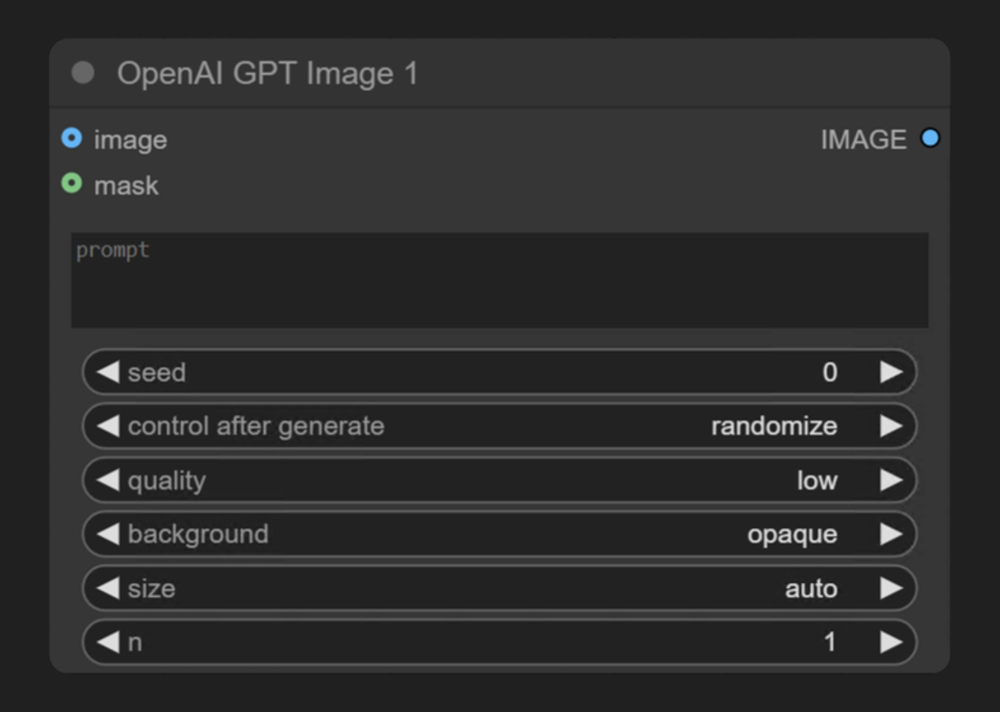
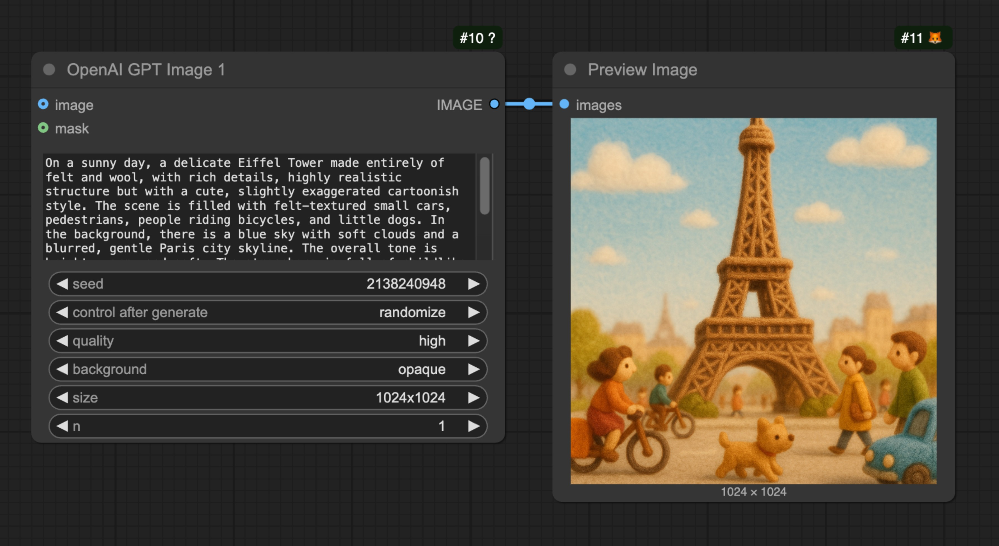
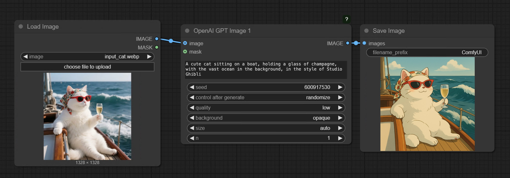
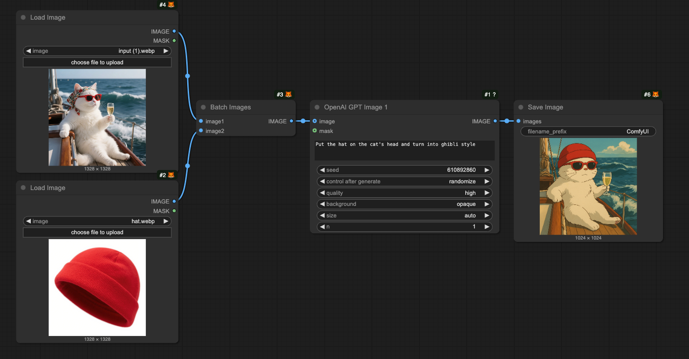
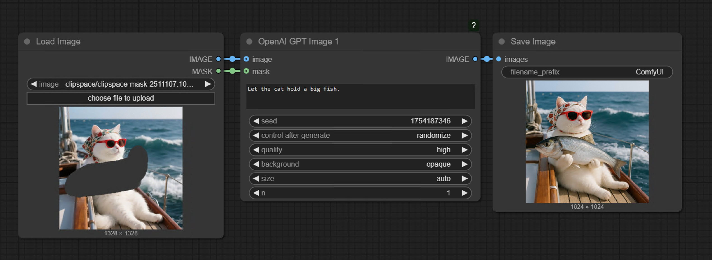

import Faq from "/snippets/de/tutorials/partner-nodes/faq.mdx";
import ReqHint from "/snippets/de/tutorials/partner-nodes/req-hint.mdx";
import UpdateReminder from "/snippets/de/tutorials/update-reminder.mdx";

<Note>
Der OpenAI-Bild-Node bietet `gpt-image-1` nicht mehr an. Wählen Sie `gpt-image-1.5` oder ein neueres Modell im Feld `model` des Nodes aus; die folgenden Schritte und Parameter gelten weiterhin.
</Note>

Diese Seite behandelt den OpenAI GPT Image Node in ComfyUI: Text zu Bild, ein Referenzbild, mehrere Referenzen und maskiertes Inpainting für die GPT-Image-Modelle, die der Node anbietet.

Der Node **OpenAI GPT-Image-1** generiert Bilder synchron über die Bildgenerierungs-API von OpenAI. Er empfängt Text-Prompts und gibt Bilder zurück, die der Beschreibung entsprechen. Das Feld `model` des Nodes wählt das GPT-Image-Modell aus, beginnend bei `gpt-image-1.5`.

## Wofür GPT-Image-1 geeignet ist

- Text-zu-Bild-Generierung
- Bildbearbeitung (Inpainting über Masken)
- Bild-zu-Bild-Generierung aus einem Referenzbild
- Eingabe mehrerer Bilder, wobei mehrere Referenzbilder in einer einzigen Generierung gebündelt werden

## Beispielausgaben

Text-zu-Bild-Generierung aus einem einzelnen Text-Prompt:

Bild-zu-Bild-Generierung aus einem Referenzbild:

Mehrere Bildeingaben, also das Zusammenführen mehrerer Referenzbilder zu einer Generierung:

Inpainting: Ersetzen eines maskierten Bereichs in einem Eingabebild:

<ReqHint/>
<UpdateReminder/>

## Parameterbeschreibung

### Erforderliche Parameter

| Parameter | Typ  | Beschreibung                                                      |
|-----------|------|-------------------------------------------------------------------|
| `prompt`  | Text | Text-Prompt, der den Bildinhalt beschreibt, den Sie generieren möchten |

### Widget-Parameter

| Parameter    | Typ     | Optionen                              | Standard | Beschreibung                                                    |
|--------------|---------|---------------------------------------|----------|-----------------------------------------------------------------|
| `seed`       | Integer | 0-2147483647                          | 0        | Zufälliger Seed zur Steuerung der Generierungsergebnisse        |
| `quality`    | Option  | low, medium, high                     | low      | Einstellung der Bildqualität, beeinflusst Kosten und Generierungszeit |
| `background` | Option  | opaque, transparent                   | opaque   | Ob das zurückgegebene Bild einen Hintergrund hat                |
| `size`       | Option  | auto, 1024x1024, 1024x1536, 1536x1024 | auto     | Größe des generierten Bildes                                    |
| `n`          | Integer | 1-8                                   | 1        | Anzahl der zu generierenden Bilder                              |

### Optionale Parameter

| Parameter | Typ   | Optionen         | Standard | Beschreibung                                                        |
|-----------|-------|------------------|----------|---------------------------------------------------------------------|
| `image`   | Image | Any image input  | None     | Optionale Referenz für die Bildbearbeitung                          |
| `mask`    | Mask  | Mask input       | None     | Optionale Maskierung für Inpainting (weiße Bereiche werden ersetzt) |

## Nutzungsbeispiele

### Beispiel für Text zu Bild

Das folgende Bild enthält einen einfachen Text-zu-Bild-Workflow. Bitte laden Sie das Bild herunter und ziehen Sie es in ComfyUI, um den entsprechenden Workflow zu laden.

Der entsprechende Workflow ist sehr einfach:

Sie müssen lediglich den `OpenAI GPT-Image-1`-Node laden, im `prompt`-Node die Beschreibung des Bildes eingeben, das Sie generieren möchten, einen `Save Image`-Node verbinden und dann den Workflow ausführen.

### Beispiel für Bild zu Bild

Das folgende Bild enthält einen einfachen Bild-zu-Bild-Workflow. Bitte laden Sie das Bild herunter und ziehen Sie es in ComfyUI, um den entsprechenden Workflow zu laden.

Wir verwenden das folgende Bild als Eingabe:

In diesem Workflow verwenden wir den `OpenAI GPT-Image-1`-Node zum Generieren von Bildern und den `Load Image`-Node zum Laden des Eingabebildes. Anschließend verbinden wir es mit der `image`-Eingabe des `OpenAI GPT-Image-1`-Nodes.

### Beispiel für mehrere Bildeingaben
Bitte laden Sie das folgende Bild herunter und ziehen Sie es in ComfyUI, um den entsprechenden Workflow zu laden.

Verwenden Sie das folgende Hut-Bild als zusätzliches Eingabebild.

Der entsprechende Workflow ist im folgenden Bild dargestellt:

Der `Batch Images`-Node wird verwendet, um mehrere Bilder in den `OpenAI GPT-Image-1`-Node zu laden.

### Inpainting-Workflow

GPT-Image-1 unterstützt außerdem Funktionen zur Bildbearbeitung, mit denen Sie Bereiche angeben können, die mithilfe einer Maskierung ersetzt werden sollen. Im Folgenden finden Sie ein einfaches Beispiel für einen Inpainting-Workflow:

Laden Sie das folgende Bild herunter und ziehen Sie es in ComfyUI, um den entsprechenden Workflow zu laden. Wir verwenden weiterhin das Eingabebild aus dem Abschnitt zum Bild-zu-Bild-Workflow.

Der entsprechende Workflow ist im Bild dargestellt

Im Vergleich zum Bild-zu-Bild-Workflow verwenden wir den MaskEditor im `Load Image`-Node über das Rechtsklickmenü, um eine Maskierung zu zeichnen. Anschließend verbinden wir sie mit der `mask`-Eingabe des `OpenAI GPT-Image-1`-Nodes, um den Workflow abzuschließen.

**Hinweise**

- Die Maskierung und das Bild müssen dieselbe Größe haben
- Wenn Sie große Bilder eingeben, ändert der Node die Größe des Bildes automatisch auf eine geeignete Größe

## Häufig gestellte Fragen

<Faq/>
