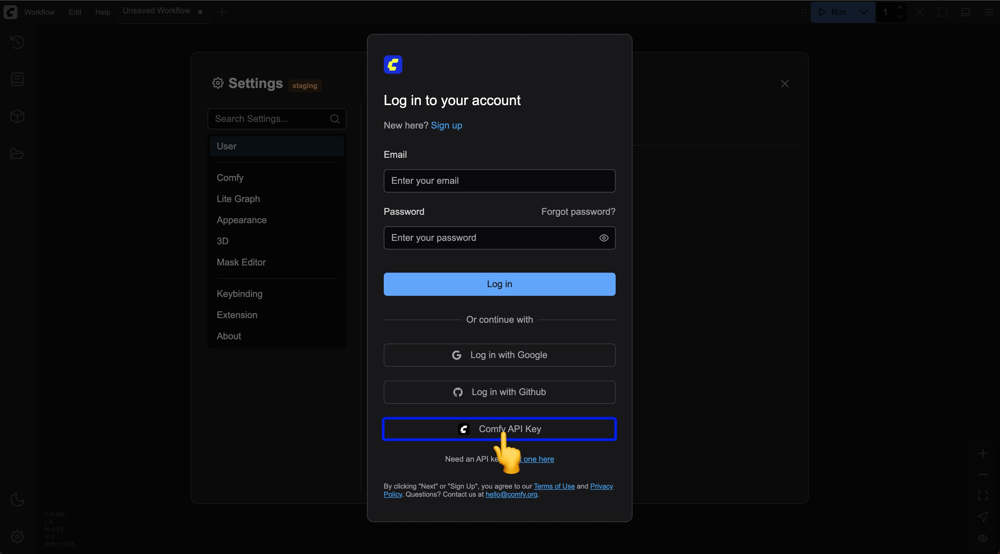

import Requirements from "/snippets/de/tutorials/partner-nodes/requirements.mdx";
import Faq from "/snippets/de/tutorials/partner-nodes/faq.mdx";

Partner-Nodes sind die neue Möglichkeit von ComfyUI, Closed-Source-Modelle über API-Anfragen aufzurufen. Sie bieten ComfyUI-Nutzern Zugriff auf externe, hochmoderne KI-Modelle, ohne dass eine komplexe Einrichtung von API-Schlüsseln erforderlich ist.

<a id="api-nodes"></a>

## Was sind Partner-Nodes?

Partner-Nodes sind eine Reihe spezieller Nodes, die eine Verbindung zu externen API-Diensten herstellen. So können Sie Closed-Source-Modelle oder von Drittanbietern gehostete KI-Modelle direkt in Ihren ComfyUI-Workflows verwenden. Diese Nodes sind darauf ausgelegt, die Funktionen externer Modelle nahtlos zu integrieren und dabei die Open-Source-Natur des ComfyUI-Kerns zu wahren.

<Requirements/>

<a id="log-in-with-api-key-on-non-whitelisted-websites"></a>

## Auf nicht gelisteten Websites mit dem API-Schlüssel des ComfyUI-Kontos anmelden

Derzeit haben wir eine Positivliste eingerichtet, um die Websites einzuschränken, auf denen Sie sich bei Ihrem ComfyUI-Konto anmelden können.
Wenn Sie sich auf bestimmten Websites außerhalb der Positivliste bei Ihrem ComfyUI-Konto anmelden müssen, lesen Sie im Abschnitt zur Kontoverwaltung nach, wie Sie sich mit einem API-Schlüssel anmelden.
In diesem Fall muss die entsprechende Website nicht auf unserer Positivliste stehen.

<Card title="Kontoverwaltung" icon="book" href="/de/interface/user#logging-in-with-an-api-key">
Erfahren Sie, wie Sie sich mit dem API-Schlüssel des ComfyUI-Kontos anmelden
</Card>



## Partner-Nodes für kostenpflichtige Modelle mit der ComfyUI Account API Key Integration aufrufen

Derzeit unterstützen wir den Zugriff auf unsere Dienste über die ComfyUI API Key Integration, um Partner-Nodes für kostenpflichtige Modelle aufzurufen. Wie Sie die API Key Integration zum Aufrufen von Partner-Nodes für kostenpflichtige Modelle verwenden, lesen Sie im Abschnitt API Key Integration.

<Note>
  **Wichtig:** Der hier besprochene API-Schlüssel ist Ihr **ComfyUI Account API Key** (für den Zugriff auf kostenpflichtige Partner-Nodes in Workflows). Er ist **NICHT** mit dem **Registry Publishing API Key** identisch, den Entwickler verwenden, um Custom Nodes in der Registry zu veröffentlichen. Wenn Sie Custom Nodes veröffentlichen möchten, lesen Sie [Nodes veröffentlichen](/de/registry/publishing).
</Note>

<Card title="API Key Integration" icon="link" href="/de/development/comfyui-server/api-key-integration">
Im Abschnitt API Key Integration erfahren Sie, wie Sie die API Key Integration zum Aufrufen von Partner-Nodes für kostenpflichtige Modelle verwenden.
</Card>

## Vorteile von Partner-Nodes

Partner-Nodes bieten ComfyUI-Nutzern mehrere wichtige Vorteile:

- **Zugang zu Closed-Source-Modellen**: Nutzen Sie modernste KI-Modelle, ohne sie selbst bereitstellen zu müssen
- **Nahtlose Integration**: Partner-Nodes sind vollständig mit anderen ComfyUI-Nodes kompatibel und lassen sich zu komplexen Workflows kombinieren
- **Vereinfachte Nutzung**: Sie müssen keine API-Schlüssel verwalten und sich nicht mit komplexen API-Anfragen befassen
- **Kontrollierte Kosten**: Das Prepaid-System gewährleistet volle Kontrolle über Ihre Ausgaben ohne unerwartete Belastungen

## Preise

<Card title="Preise für Partner-Nodes" icon="coin" href="/tutorials/partner-nodes/pricing">
Die Preise für den jeweiligen Partner finden Sie auf der Preisseite.
</Card>

## Modellanbieter

<Card title="Modellanbieter" icon="badge-check" href="/de/tutorials/partner-nodes/model-providers">
Sehen Sie den Verifizierungsstatus, die kommerzielle Lizenzierung und die Datenresidenz der Modellanbieter hinter den Partner-Nodes
</Card>

## Über Open Source und Opt-in

Wichtig zu wissen: **Partner-Nodes sind vollständig optional**. ComfyUI bleibt für lokale Nutzer immer vollständig Open Source und kostenlos. Partner-Nodes sind als „Opt-in“-Funktion gedacht und bieten Komfort für alle, die Zugriff auf externe SOTA-Modelle (State of the Art) wünschen.

## Partner-Nodes vollständig deaktivieren

Sie können das Startargument `--disable-partner-nodes` hinzufügen, um alle Partner-Nodes in ComfyUI zu deaktivieren. Verwenden Sie stattdessen `--offline`, wenn Sie zusätzlich verhindern möchten, dass das Frontend mit dem Internet kommuniziert.

**Für die manuelle Installation:**

```bash
python main.py --disable-partner-nodes
```

**Für Portable-Nutzer (Windows):**

Aktualisieren Sie Ihre `run_xxx.bat`-Datei:

```batch
.\python_embeded\python.exe -s ComfyUI\main.py --listen --windows-standalone-build --disable-partner-nodes
pause
```
## Anwendungsfälle

Eine leistungsstarke Anwendung von Partner-Nodes ist die Kombination der Ausgabe externer Modelle mit lokalen Nodes. Zum Beispiel:

- GPT-Image-1 zum Generieren eines Basisbildes verwenden und dieses anschließend mit einem lokalen `wan`-Node in ein Video umwandeln
- Extern generierte Bilder mit lokalen Nodes für Upscaling oder Stilübertragung kombinieren
- Hybride Workflows erstellen, die die Vorteile von Closed-Source- und Open-Source-Modellen nutzen

Diese Flexibilität macht ComfyUI zu einer wahrhaft universellen Schnittstelle für generative KI, die verschiedene KI-Fähigkeiten in einem einheitlichen Workflow integriert und mehr Möglichkeiten eröffnet.

## Häufig gestellte Fragen

<Faq/>
