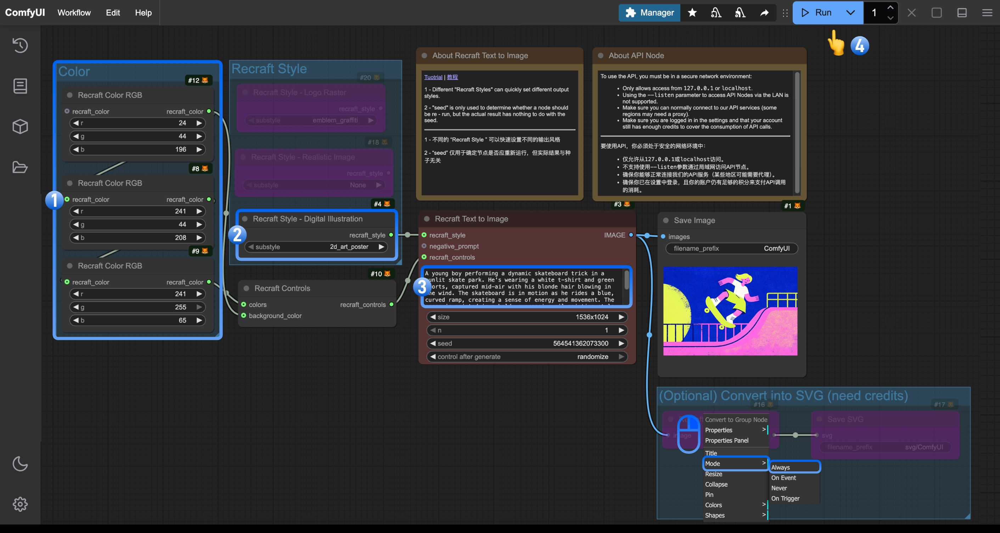

import ReqHint from "/snippets/de/tutorials/partner-nodes/req-hint.mdx";
import UpdateReminder from "/snippets/de/tutorials/update-reminder.mdx";

Der Node Recraft Text to Image ermöglicht es Ihnen, mit der Bildgenerierungstechnologie von Recraft AI auf Basis von Textbeschreibungen hochwertige Bilder in verschiedenen Stilen zu erstellen.

## Was Recraft Text to Image besonders gut kann

- **Hochwertige Generierung**: Erstellt Bilder aus Textbeschreibungen mit der Bildgenerierungstechnologie von Recraft AI
- **Stilsteuerung**: Voreingestellte Stile wie digitale Kunst, realistische Fotos und Logodesigns über den Node `Recraft Style`
- **Farbsteuerung**: Legen Sie mit dem Node `Recraft Color RGB` eine gewünschte Farbe fest
- **Anpassbare Ausgabegröße**: Ändern Sie den Parameter `size`, um die Abmessungen der Ausgabe zu steuern
- **SVG-Konvertierung**: Ein optionaler Node `Recraft Vectorize Image` konvertiert das generierte Bild ins SVG-Format

<ReqHint/>
<UpdateReminder/>

## Workflow mit den Partner-Nodes von Recraft Text to Image

### 1. Workflow-Datei herunterladen

Die Workflow-Informationen sind in den Metadaten des untenstehenden Bildes enthalten. Laden Sie es herunter und ziehen Sie es in ComfyUI, um den Workflow zu laden.

### 2. Schritte zum Ausführen des Workflows befolgen

Befolgen Sie diese nummerierten Schritte, um den Basis-Workflow auszuführen:
1. (Optional) Ändern Sie `Recraft Color RGB` im Node `Color` auf Ihre Wunschfarbe
2. (Optional) Passen Sie den Node `Recraft Style` an, um den visuellen Stil zu steuern, etwa digitale Kunst, realistisches Foto oder Logodesign. Diese Gruppe enthält weitere Stil-Nodes, die Sie bei Bedarf aktivieren können
3. (Optional) Bearbeiten Sie den Parameter `prompt` im Node `Recraft Text to Image`. Sie können auch den Parameter `size` ändern
4. Klicken Sie auf die Schaltfläche `Run` oder verwenden Sie die Tastenkombination `Ctrl(cmd) + Enter`, um das Bild zu generieren
5. Nachdem die API das Ergebnis zurückgegeben hat, können Sie das generierte Bild im Node `Save Image` ansehen. Das Bild wird außerdem im Verzeichnis `ComfyUI/output/` gespeichert

> (Optional) Wir haben eine Gruppe **Convert to SVG** in den Workflow eingebunden. Da der Node `Recraft Vectorize Image` in dieser Gruppe zusätzliche Credits verbraucht, aktivieren Sie diese nur, wenn Sie das generierte Bild ins SVG-Format konvertieren möchten

### 3. Zusätzliche Hinweise

- **Recraft Style**: Bietet verschiedene voreingestellte Stile wie realistische Fotos, digitale Kunst und Logodesigns
- **Seed-Parameter**: Dient nur dazu, festzustellen, ob der Node erneut ausgeführt werden soll; das eigentliche Generierungsergebnis wird vom Seed-Wert nicht beeinflusst