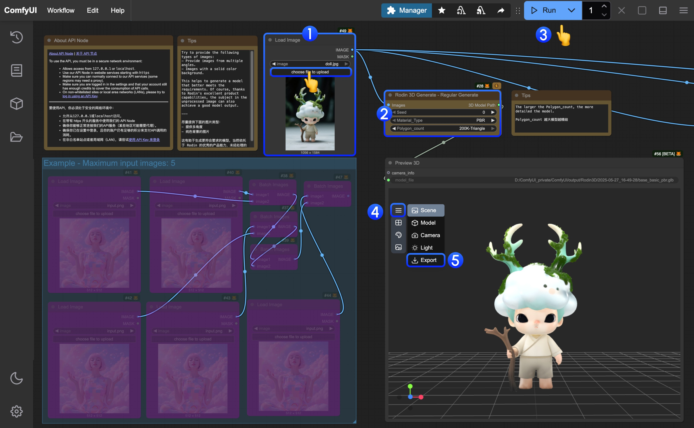
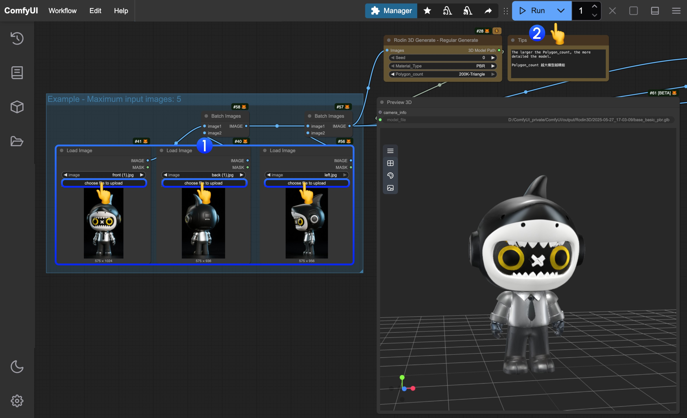
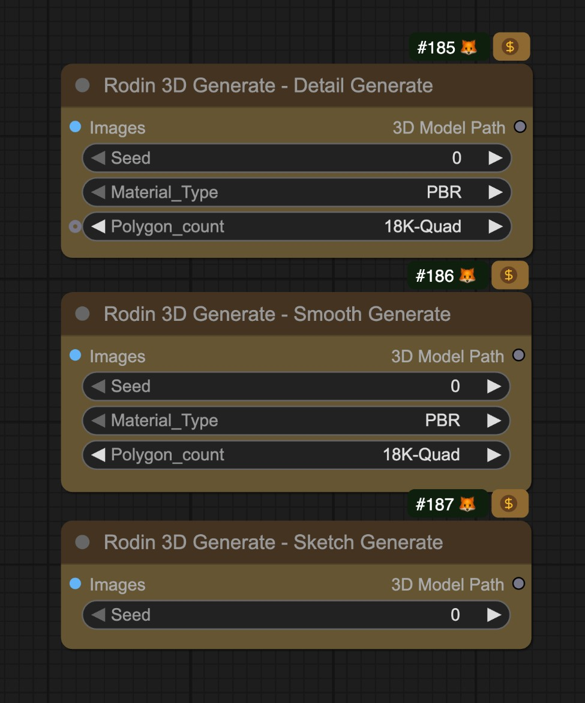

import ReqHint from "/snippets/de/tutorials/partner-nodes/req-hint.mdx";
import UpdateReminder from "/snippets/de/tutorials/update-reminder.mdx";

Hyper3D Rodin (hyper3d.ai) ist eine Plattform, die sich auf die schnelle Erzeugung hochwertiger, produktionsreifer 3D-Modelle und Materialien mit künstlicher Intelligenz spezialisiert hat.
ComfyUI hat die entsprechende Rodin-API zur Modellgenerierung nun nativ integriert, sodass Sie die zugehörigen Nodes in ComfyUI bequem für die Modellgenerierung nutzen können.

## Wofür Rodin Model Generation geeignet ist

- **Einzelansicht-Modellgenerierung**: Erzeugt ein 3D-Modell aus einer einzelnen Bildeingabe
- **Mehransicht-Modellgenerierung**: Erzeugt ein 3D-Modell aus bis zu 5 Bildeingaben, etwa Vorderansicht, Rückansicht und linke Ansicht
- **Verschiedene Detailstufen**: Unterstützt die Modellgenerierung mit anpassbarem Detailgrad, einschließlich unterschiedlicher Polygonanzahlen für glattere, detailliertere Modelle
- **Direkter Export**: Generierte Modelle werden im Verzeichnis `ComfyUI/output/Rodin` gespeichert und können aus dem `Preview 3D` Node exportiert werden

<ReqHint/>
<UpdateReminder/>

## Workflow zur Modellgenerierung aus einer Einzelansicht

Generieren Sie mit Rodin ein 3D-Modell aus einem einzelnen Eingabebild.

<CardGroup cols={2}>
  <Card title="Workflow-Datei herunterladen" icon="download" href="https://raw.githubusercontent.com/Comfy-Org/example_workflows/refs/heads/main/api_nodes/rodin/rodin_image_to_model.json">
    Modellgenerierung aus einer Einzelansicht (Json Format)
  </Card>
  <Card title="Auf Comfy Cloud ausführen" icon="cloud" href="https://cloud.comfy.org/?template=api_rodin_image_to_model&utm_source=docs&utm_medium=referral&utm_campaign=model-generation">
    In Comfy Cloud öffnen
  </Card>
</CardGroup>

Eingabematerialien

Laden Sie dieses Beispiel-Eingabebild herunter, um den Workflow auszuprobieren:

<CardGroup cols={1}>
  <Card title="Eingabebild" icon="image" href="https://raw.githubusercontent.com/Comfy-Org/workflow_templates/main/input/api_rodin_image_to_model_input_image.png">
    Beispiel-Eingabebild herunterladen
  </Card>
</CardGroup>

### 2. Workflow-Ausführung Schritt für Schritt abschließen

Anhand der Zahlen im Bild können Sie die grundlegende Ausführung des Text-zu-Bild-Workflows abschließen:  
1. Laden Sie im Node `Load Image` das bereitgestellte Eingabebild.
2. (Optional) Passen Sie im Node `Rodin 3D Generate - Regular Generate` die entsprechenden Parameter an
   - polygon_count: Sie können verschiedene Polygonanzahlen festlegen; je höher der Wert, desto glatter und detaillierter wird das Modell
3. Klicken Sie auf die Schaltfläche `Run` oder verwenden Sie die Tastenkombination `Ctrl(cmd) + Enter`, um die Modellgenerierung auszuführen. Nach Abschluss des Workflows wird das entsprechende Modell automatisch im Verzeichnis `ComfyUI/output/Rodin` gespeichert.
4. Klicken Sie im Node `Preview 3D`, um das Menü zu erweitern.
5. Wählen Sie `Export`, um das entsprechende Modell direkt zu exportieren.

## Workflow zur Modellgenerierung aus mehreren Ansichten

Der entsprechende `Rodin 3D Generate - Regular Generate` erlaubt bis zu 5 Bildeingaben

### 1. Workflow-Datei herunterladen

Sie können den Single-View-Workflow zu einem Multi-View-Workflow umbauen oder die Workflow-Datei direkt unten herunterladen

<CardGroup cols={2}>
  <Card title="Workflow-Datei herunterladen" icon="download" href="https://raw.githubusercontent.com/Comfy-Org/example_workflows/refs/heads/main/api_nodes/rodin/multiview_to_model/api_rodin_multiview_to_model.json">
    Modellgenerierung aus mehreren Ansichten (JSON-Format)
  </Card>
  <Card title="Auf Comfy Cloud ausführen" icon="cloud" href="https://cloud.comfy.org/?template=api_rodin_multiview_to_model&utm_source=docs&utm_medium=referral&utm_campaign=model-generation">
    In Comfy Cloud öffnen
  </Card>
</CardGroup>

Eingabematerialien

Laden Sie diese Beispiel-Eingabebilder herunter, um den Workflow auszuprobieren:

<CardGroup cols={3}>
  <Card title="Vorderansicht" icon="image" href="https://raw.githubusercontent.com/Comfy-Org/workflow_templates/main/input/api_rodin_multiview_to_model_front.jpg">
    Vorderansicht herunterladen
  </Card>
  <Card title="Rückansicht" icon="image" href="https://raw.githubusercontent.com/Comfy-Org/workflow_templates/main/input/api_rodin_multiview_to_model_back.jpg">
    Rückansicht herunterladen
  </Card>
  <Card title="Linke Ansicht" icon="image" href="https://raw.githubusercontent.com/Comfy-Org/workflow_templates/main/input/api_rodin_multiview_to_model_left.jpg">
    Linke Ansicht herunterladen
  </Card>
</CardGroup>

### 2. Workflow-Ausführung Schritt für Schritt durchführen

Anhand der Zahlen im Bild können Sie die grundlegende Ausführung des Text-zu-Bild-Workflows abschließen:  
1. Laden Sie im Node `Load Image` die bereitgestellten Eingabebilder
2. Klicken Sie auf die Schaltfläche `Run` oder verwenden Sie die Tastenkombination `Ctrl(cmd) + Enter`, um die Modellgenerierung auszuführen. Nach Abschluss des Workflows wird das entsprechende Modell automatisch im Verzeichnis `ComfyUI/output/Rodin` gespeichert
3. Klicken Sie im Node `Preview 3D`, um das Menü zu erweitern
4. Wählen Sie `Export`, um das entsprechende Modell direkt zu exportieren

## Weitere zugehörige Nodes

Derzeit stellt Rodin in ComfyUI verschiedene Arten von Nodes zur Modellgenerierung bereit. Da die entsprechenden Eingabebedingungen mit dem in diesem Artikel vorgestellten Workflow übereinstimmen, können Sie sie nach Bedarf aktivieren. Darüber hinaus haben wir entsprechende Nodes in den entsprechenden Vorlagen bereitgestellt. Sie können auch den entsprechenden Node-Modus nach Bedarf ändern, um sie zu aktivieren.

