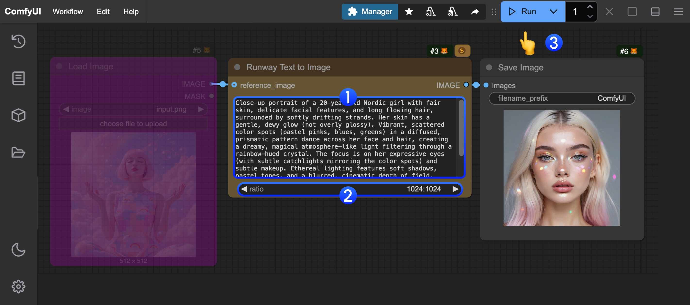
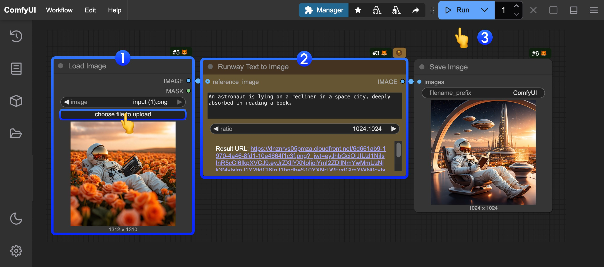

import ReqHint from "/snippets/de/tutorials/partner-nodes/req-hint.mdx";
import UpdateReminder from "/snippets/de/tutorials/update-reminder.mdx";

Runway ist ein Unternehmen mit Fokus auf generative KI und bietet leistungsstarke Bildgenerierungsfunktionen. Die Modelle unterstützen Funktionen wie Stilübertragung, Bildbereichserweiterung und Detailkontrolle. ComfyUI hat die Runway-API integriert, sodass Sie die zugehörigen Nodes direkt in ComfyUI für die Bildgenerierung verwenden können.

## Wofür sich die Bildgenerierung mit Runway eignet

- **Text-zu-Bild-Generierung**: Erzeugt Bilder aus einem Text-Prompt mit dem Node `Runway Text to Image`, mit anpassbaren Seitenverhältnissen für die Ausgabe
- **Referenz-zu-Bild-Generierung**: Erzeugt Bilder, gesteuert durch ein Referenzbild als Eingabe und einen Text-Prompt
- **Stilübertragung, Bild-Erweiterung und Detailsteuerung**: Die Modelle von Runway unterstützen diese Funktionen für die Bildgenerierung

<ReqHint/>
<UpdateReminder/>

## Runway Text zu Bild Workflow

### 1. Workflow-Datei herunterladen

Das folgende Bild enthält Workflow-Informationen in seinen `metadata`. Bitte laden Sie es herunter und ziehen Sie es in ComfyUI, um den entsprechenden Workflow zu laden.

### 2. Workflow-Ausführung Schritt für Schritt abschließen

Sie können die Zahlen im Bild verwenden, um die grundlegende Text-zu-Bild-Ausführung abzuschließen:  
1. Geben Sie im Node `Runway Text to Image` Ihren Prompt in das Feld `prompt` ein.
2. (Optional) Passen Sie die Einstellung `ratio` an, um unterschiedliche Seitenverhältnisse für die Ausgabe festzulegen.
3. Klicken Sie auf die Schaltfläche `Run` oder verwenden Sie die Tastenkombination `Ctrl(cmd) + Enter`, um die Bildgenerierung auszuführen.
4. Nachdem die API die Ergebnisse zurückgegeben hat, können Sie das generierte Bild im Node `Save Image` ansehen (Rechtsklick zum Speichern). Das entsprechende Bild wird außerdem im Verzeichnis `ComfyUI/output/` gespeichert.

## Workflow für Runway Image Reference-to-Image

### 1. Workflow und Eingabebild herunterladen

Das folgende Bild enthält die Workflow-Informationen in seinen `metadata`. Laden Sie es herunter und ziehen Sie es in ComfyUI, um den entsprechenden Workflow zu laden.

Laden Sie das folgende Bild als Eingabe herunter

### 2. Workflow-Ausführung Schritt für Schritt abschließen

Anhand der Nummern im Bild können Sie die grundlegende Ausführung des Reference-to-Image-Workflows abschließen:

1. Laden Sie im Node `Load Image` das bereitgestellte Eingabebild.
2. Geben Sie im Node `Runway Text to Image` Ihren Prompt in das Feld `prompt` ein und passen Sie die Abmessungen an.
3. Klicken Sie auf die Schaltfläche `Run` oder verwenden Sie die Tastenkombination `Ctrl(cmd) + Enter`, um die Bildgenerierung auszuführen.
4. Nachdem die API die Ergebnisse zurückgegeben hat, können Sie das generierte Bild im Node `Save Image` ansehen (Rechtsklick zum Speichern). Das entsprechende Bild wird außerdem im Verzeichnis `ComfyUI/output/` gespeichert.
