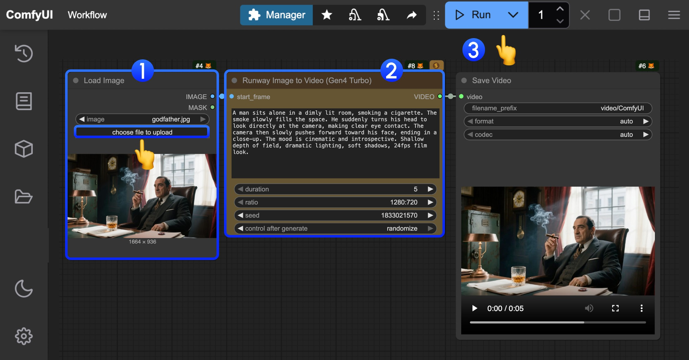

import ReqHint from "/snippets/de/tutorials/partner-nodes/req-hint.mdx";
import UpdateReminder from "/snippets/de/tutorials/update-reminder.mdx";

Runway ist ein Unternehmen mit Fokus auf generative KI, das leistungsstarke Funktionen zur Videogenerierung bietet. Derzeit hat ComfyUI die Runway API integriert, sodass Sie die zugehörigen Nodes direkt in ComfyUI für die Videogenerierung nutzen können.

Derzeit integriert ComfyUI nativ das folgende Runway-Modell zur Videogenerierung:
- Runway Gen4 turbo

<Warning>
  **End of Life (EOL)**: **Runway Gen3a Turbo** und **Runway First-Last-Frame to Video** haben am **30. Juli 2026** das End of Life erreicht. Runway hat Gen-3 Alpha Turbo an diesem Datum eingestellt. Die zugehörigen Partner-Nodes (`RunwayImageToVideoNodeGen3a`, `RunwayFirstLastFrameNode`) und Workflow-Vorlagen sind veraltet und werden nicht mehr unterstützt.
</Warning>

## Wofür Runway Video Generation geeignet ist

- **Bild-zu-Video-Generierung**: Der Node `Runway Gen4 turbo` erzeugt aus einem Eingabebild und einem Text-Prompt, der den Videoinhalt beschreibt, ein Video
- **Anpassbare Videolänge**: Ändern Sie den Parameter `duration`, um die Länge des Videos festzulegen
- **Anpassbares Seitenverhältnis**: Ändern Sie den Parameter `ratio`, um das Seitenverhältnis des Videos festzulegen

<Warning>
  **End of Life (EOL)**: **Runway Gen3a Turbo** und **Runway First-Last-Frame to Video** wurden am **30. Juli 2026** eingestellt. Runway hat Gen-3 Alpha Turbo an diesem Datum außer Betrieb genommen. Die zugehörigen Partner-Nodes (`RunwayImageToVideoNodeGen3a`, `RunwayFirstLastFrameNode`) und Workflow-Vorlagen sind veraltet und werden nicht mehr unterstützt.
</Warning>

### Eingestellte Workflows und Ersatz

| Entfernte Vorlage | Empfohlener Ersatz |
| :--------------- | :-------------------- |
| `api_runway_gen3a_turbo_image_to_video` | [`api_runway_gen4_turbo_image_to_video`](https://github.com/Comfy-Org/workflow_templates/blob/main/templates/api_runway_gen4_turbo_image_to_video.json) (Gen4 Turbo) |
| `api_runway_first_last_frame` | [Kling 3.0 FLF2V](/de/tutorials/partner-nodes/kling/kling-3-0) (`api_kling_v3_flf2v`) oder andere First-Last-Frame-Vorlagen |

<ReqHint/>
<UpdateReminder/>

## Gen4 turbo Bild-zu-Video-Workflow

### 1. Workflow-Datei herunterladen

Das folgende Video enthält Workflow-Informationen in seinen `metadata`. Bitte laden Sie es herunter und ziehen Sie es in ComfyUI, um den entsprechenden Workflow zu laden.

<video
  controls
  className="w-full aspect-video"
  src="https://raw.githubusercontent.com/Comfy-Org/example_workflows/refs/heads/main/api_nodes/runway/gen4_turbo_image_to_video/runway_gen4_turo_image_to_video.mp4"
></video>

<a className="prose"  target='_blank'  href="https://raw.githubusercontent.com/Comfy-Org/example_workflows/refs/heads/main/api_nodes/runway/gen4_turbo_image_to_video/runway_gen4_turo_image_to_video.json" style={{ display: 'inline-block', backgroundColor: '#0078D6', color: '#ffffff', padding: '10px 20px', borderRadius: '8px', borderColor: "transparent", textDecoration: 'none', fontWeight: 'bold'}}>
    
Workflow-Datei im JSON-Format herunterladen

</a>

Laden Sie das folgende Bild als Eingabebild herunter

### 2. Die Workflow-Ausführung Schritt für Schritt abschließen

Anhand der Zahlen im Bild können Sie die grundlegende Ausführung des Bild-zu-Video-Workflows abschließen:  

1. Laden Sie im Node `Load Image` das bereitgestellte Eingabebild.
2. Legen Sie im Node `Runway Gen4 turbo` den `prompt` fest, um den Videoinhalt zu beschreiben, ändern Sie den Parameter `duration`, um die Videolänge festzulegen, und ändern Sie den Parameter `ratio`, um das Seitenverhältnis des Videos festzulegen.
3. Klicken Sie auf die Schaltfläche `Run` oder verwenden Sie die Tastenkombination `Ctrl(cmd) + Enter`, um die Videogenerierung auszuführen.
4. Nachdem Sie auf die Rückgabe der Ergebnisse durch die API gewartet haben, können Sie das generierte Video im Node `Save Video` ansehen (Rechtsklick zum Speichern). Das entsprechende Video wird außerdem im Verzeichnis `ComfyUI/output/` gespeichert.
