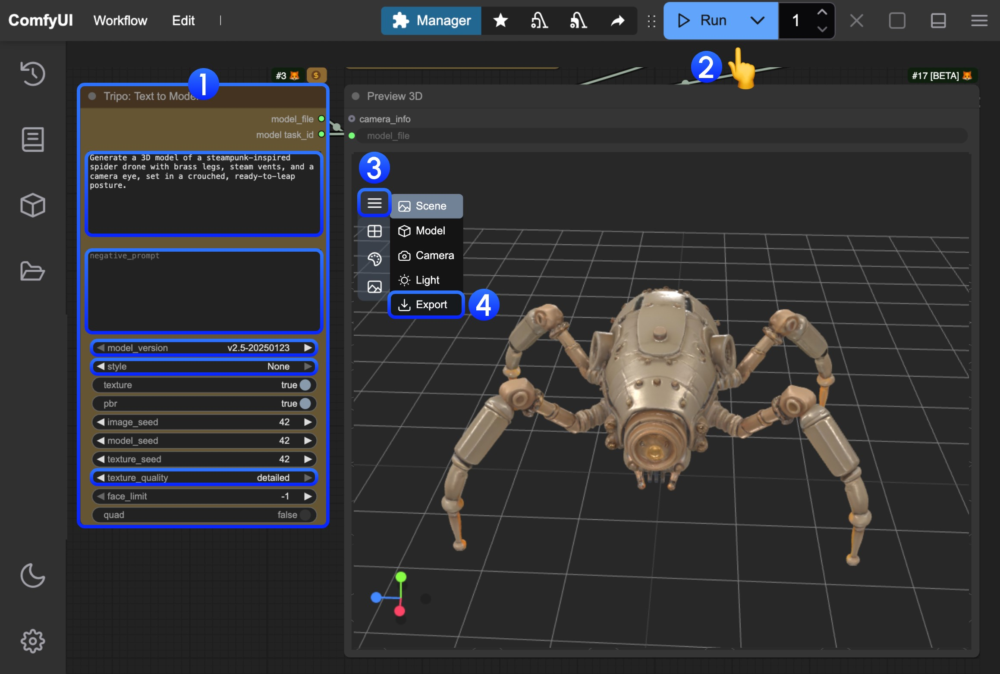
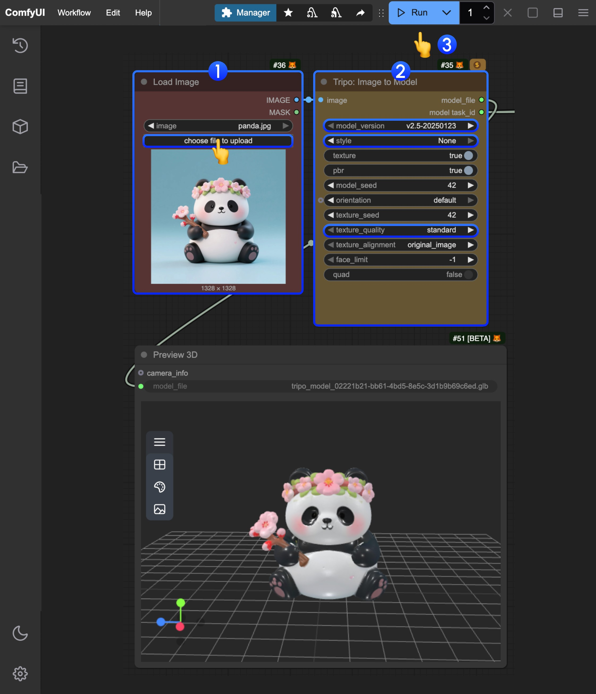
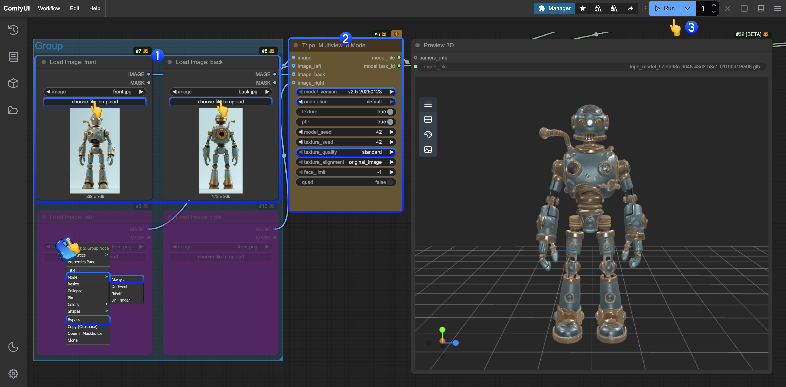
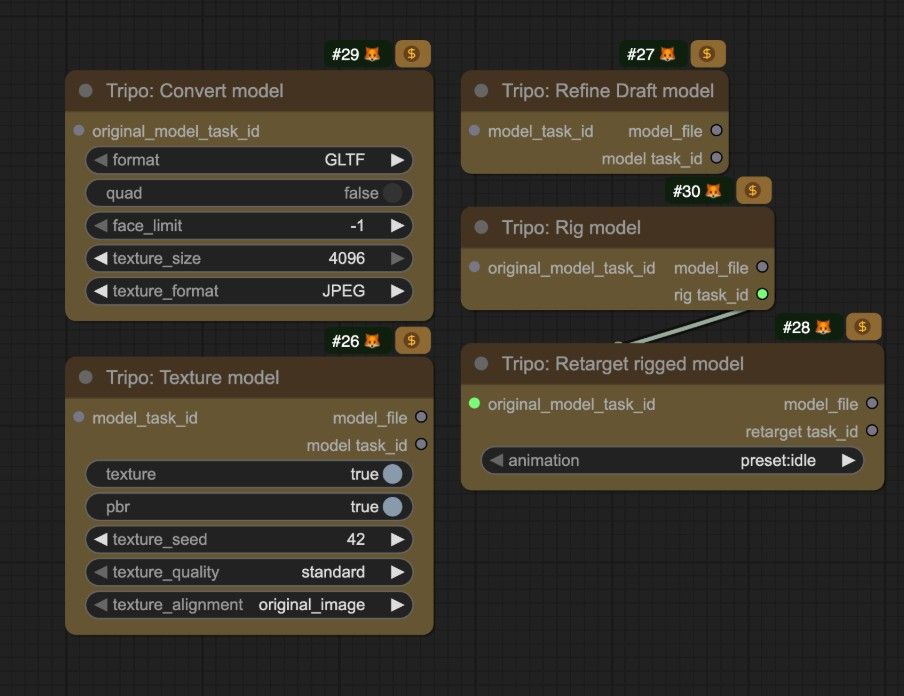

import ReqHint from "/snippets/de/tutorials/partner-nodes/req-hint.mdx";
import UpdateReminder from "/snippets/de/tutorials/update-reminder.mdx";

Tripo AI ist ein Unternehmen, das sich auf generative KI-3D-Modellierung spezialisiert hat. Es bietet benutzerfreundliche Plattformen und API-Dienste, die Text-Prompts oder 2D-Bilder (einzeln oder mehrere) schnell in hochwertige 3D-Modelle umwandeln können.
ComfyUI hat die entsprechende Tripo API inzwischen nativ integriert, sodass Sie die zugehörigen Nodes in ComfyUI bequem für die Modellgenerierung nutzen können.

## Was Tripo Model Generation besonders gut kann

Derzeit unterstützen die Partner-Nodes von ComfyUI die folgenden Funktionen zur Modellgenerierung mit Tripo:
- Text zu Modell
- Bild zu Modell
- Modellgenerierung aus mehreren Ansichten
- Modell riggen
- Geriggtes Modell retargeten

<ReqHint/>
<UpdateReminder/>

## Text-zu-Modell-Workflow

Generieren Sie mit den Text-zu-Modell-Funktionen von Tripo ein 3D-Modell aus einem Text-Prompt.

<CardGroup cols={2}>
  <Card title="Text-zu-Modell auf Comfy Cloud ausführen" icon="cloud" href="https://cloud.comfy.org/?template=api_tripo_text_to_model&utm_source=docs&utm_medium=referral&utm_campaign=model-generation">
    Testen Sie den Text-zu-Modell-Workflow direkt in Comfy Cloud.
  </Card>
  <Card title="Text-zu-Modell-Workflow herunterladen" icon="download" href="https://raw.githubusercontent.com/Comfy-Org/example_workflows/refs/heads/main/api_nodes/tripo/api_tripo_text_to_model.json">
    Laden Sie die JSON-Datei herunter, um sie lokal in ComfyUI auszuführen.
  </Card>
</CardGroup>

### 2. Workflow-Ausführung Schritt für Schritt abschließen

Anhand der Zahlen im Bild können Sie die grundlegende Ausführung des Text-zu-Modell-Workflows abschließen:  
1. Geben Sie im Node `Tripo: Text to Model` Ihren Prompt in das Feld `prompt` ein
   - model: Sie können verschiedene Modelle auswählen
   - style: Sie können verschiedene Styles festlegen
   - texture_quality: Sie können verschiedene Texturqualitäten festlegen
2. Klicken Sie auf die Schaltfläche `Run` oder verwenden Sie die Tastenkombination `Ctrl(cmd) + Enter`, um die Modellgenerierung auszuführen. Nach Abschluss des Workflows wird das entsprechende Modell automatisch im Verzeichnis `ComfyUI/output/` gespeichert
3. Klicken Sie im Node `Preview 3D`, um das Menü zu erweitern
4. Wählen Sie `Export`, um das entsprechende Modell direkt zu exportieren

## Workflow „Image to Model“

Generieren Sie ein 3D-Modell aus einem einzelnen Bild als Eingabe.

<CardGroup cols={2}>
  <Card title="Image to Model in Comfy Cloud ausführen" icon="cloud" href="https://cloud.comfy.org/?template=api_tripo_image_to_model&utm_source=docs&utm_medium=referral&utm_campaign=model-generation">
    Testen Sie den Workflow „Image to Model“ direkt in Comfy Cloud.
  </Card>
  <Card title="Image-to-Model-Workflow herunterladen" icon="download" href="https://raw.githubusercontent.com/Comfy-Org/example_workflows/refs/heads/main/api_nodes/tripo/image_to_model/api_tripo_image_to_model.json">
    Laden Sie die JSON-Datei herunter, um den Workflow lokal in ComfyUI auszuführen.
  </Card>
</CardGroup>

Eingabematerialien

Laden Sie dieses Beispiel-Eingabebild herunter, um den Workflow auszuprobieren:

<CardGroup cols={1}>
  <Card title="Eingabebild" icon="image" href="https://raw.githubusercontent.com/Comfy-Org/workflow_templates/main/input/api_tripo_image_to_model_input_image.jpg">
    Beispiel-Eingabebild herunterladen
  </Card>
</CardGroup>

### 2. Workflow-Ausführung Schritt für Schritt abschließen

Anhand der Nummern im Bild können Sie die grundlegende Ausführung des Image-to-Model-Workflows abschließen:  
1. Im Node `Load Image` laden Sie das bereitgestellte Eingabebild
2. Im Node `Tripo: Image to Model` passen Sie die entsprechenden Parametereinstellungen an
   - model: Sie können verschiedene Modelle auswählen
   - style: Sie können verschiedene Stile festlegen
   - texture_quality: Sie können verschiedene Texturqualitäten festlegen
3. Klicken Sie auf die Schaltfläche `Run` oder verwenden Sie die Tastenkombination `Ctrl(cmd) + Enter`, um die Modellgenerierung auszuführen. Nach Abschluss des Workflows wird das entsprechende Modell automatisch im Verzeichnis `ComfyUI/output/` gespeichert
4. Wie Sie das Modell herunterladen, erfahren Sie in den Anweisungen im Abschnitt Text to Model

## Workflow für die Multi-View-Modellgenerierung

Generieren Sie ein 3D-Modell aus mehreren Ansichtsbildern für eine höhere Genauigkeit.

<CardGroup cols={2}>
  <Card title="Multiview-to-Model in der Cloud ausführen" icon="cloud" href="https://cloud.comfy.org/?template=api_tripo_multiview_to_model&utm_source=docs&utm_medium=referral&utm_campaign=model-generation">
    Testen Sie den Multiview-to-Model-Workflow direkt in Comfy Cloud.
  </Card>
  <Card title="Multiview-to-Model-Workflow herunterladen" icon="download" href="https://raw.githubusercontent.com/Comfy-Org/example_workflows/refs/heads/main/api_nodes/tripo/multiview_to_image/api_tripo_multiview_to_model.json">
    Laden Sie die JSON-Datei herunter, um sie lokal in ComfyUI auszuführen.
  </Card>
</CardGroup>

Eingabematerialien

Laden Sie diese Beispiel-Eingabebilder herunter, um den Workflow auszuprobieren:

<CardGroup cols={2}>
  <Card title="Vorderansicht" icon="image" href="https://raw.githubusercontent.com/Comfy-Org/workflow_templates/main/input/api_tripo_multiview_to_model_front_image.jpg">
    Eingabebild der Vorderansicht herunterladen
  </Card>
  <Card title="Rückansicht" icon="image" href="https://raw.githubusercontent.com/Comfy-Org/workflow_templates/main/input/api_tripo_multiview_to_model_back_image.jpg">
    Eingabebild der Rückansicht herunterladen
  </Card>
</CardGroup>

### 2. Workflow-Ausführung Schritt für Schritt abschließen

Anhand der Nummern im Bild können Sie die grundlegende Ausführung des Multi-View-to-Model-Workflows abschließen:  
1. Laden Sie in den `Load Image`-Nodes jeweils die bereitgestellten Eingabebilder
2. Passen Sie im Node `Tripo: Image to Model` die entsprechenden Parametereinstellungen an
   - model: Sie können verschiedene Modelle auswählen
   - style: Sie können verschiedene Stile festlegen
   - texture_quality: Sie können verschiedene Texturqualitäten festlegen
3. Klicken Sie auf die Schaltfläche `Run` oder verwenden Sie die Tastenkombination `Ctrl(cmd) + Enter`, um die Modellgenerierung auszuführen. Nach Abschluss des Workflows wird das entsprechende Modell automatisch im Verzeichnis `ComfyUI/output/` gespeichert
4. Für weitere Ansichtseingaben können Sie sich an der Schrittdarstellung orientieren und den Modus des jeweiligen Nodes auf `Always` setzen, um ihn zu aktivieren
5. Zum Herunterladen des Modells beachten Sie bitte die Anweisungen im Abschnitt Text-to-Model

## Nachfolgende Verarbeitung für dieselbe Aufgabe

Die entsprechenden Nodes von Tripo bieten die nachfolgende Verarbeitung für dieselbe Aufgabe. Sie müssen lediglich die entsprechende `model_task_id` in den relevanten Nodes eingeben. Die passenden Nodes haben wir außerdem in den relevanten Vorlagen bereitgestellt, und Sie können den Modus des entsprechenden Nodes bei Bedarf ändern, um ihn zu aktivieren.

<Note>
  Generierte Modelle werden in Ihr Ausgabeverzeichnis heruntergeladen, sobald die Aufgabe abgeschlossen ist, sodass die Modelldatei unabhängig von Tripo erhalten bleibt. Die Aufgaben-IDs hingegen nicht. Tripo bewahrt eine Aufgabenaufzeichnung 7 Tage nach Abschluss der Aufgabe auf (gültig ab 1. Dezember 2026). Wenn Sie einen gespeicherten Workflow mehr als 7 Tage später mit einer älteren `model_task_id` erneut ausführen, schlägt dies am nachfolgenden Node fehl. Um fortzufahren, verbinden Sie `Tripo: Import Model` mit der Modelldatei in Ihrem Ausgabeverzeichnis und verwenden Sie deren neue `model_task_id`.
</Note>
