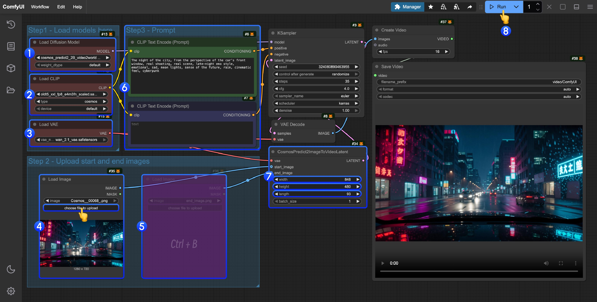

import UpdateReminder from "/snippets/de/tutorials/update-reminder.mdx"

Cosmos-Predict2 ist NVIDIAs Foundation-Modell der nächsten Generation für die physische Welt und wurde speziell für hochwertige visuelle Generierungs- und Vorhersageaufgaben in Physical-AI-Szenarien entwickelt.
Das Modell zeichnet sich durch außergewöhnliche physikalische Genauigkeit, Interaktivität mit der Umgebung und Detailtreue aus und ermöglicht die realistische Simulation komplexer physikalischer Phänomene und dynamischer Szenen.

Cosmos-Predict2 unterstützt verschiedene Generierungsmethoden, darunter Text zu Bild (Text2Image) und Video-to-World (Video2World),
und wird vielfach in der industriellen Simulation, im autonomen Fahren, in der Stadtplanung, in der wissenschaftlichen Forschung und in weiteren Bereichen eingesetzt.
Es dient als grundlegendes Werkzeug, um die tiefe Integration von intelligenter Vision und der physischen Welt voranzutreiben.

<CardGroup cols={2}>
  <Card title="GitHub" icon="github" href="https://github.com/nvidia-cosmos/cosmos-predict2">
    Quellcode und Dokumentation zu Cosmos-Predict2
  </Card>
  <Card title="Hugging Face" icon="cube" href="https://huggingface.co/collections/nvidia/cosmos-predict2-68028efc052239369a0f2959">
    Modellsammlung zu Cosmos-Predict2
  </Card>
</CardGroup>

Diese Anleitung führt Sie durch die **Video2World**-Generierung in ComfyUI.

Für den Text-zu-Bild-Bereich lesen Sie bitte den folgenden Abschnitt:

<CardGroup cols={2}>
  <Card title="Cosmos Predict2 Text zu Bild" icon="book" href="/de/tutorials/image/cosmos/cosmos-predict2-t2i">
    Cosmos-Predict2 für die Text-zu-Bild-Generierung verwenden
  </Card>
  <Card title="Auf Comfy Cloud ausführen" icon="cloud" href="https://comfy.org/cloud">
    Führen Sie Cosmos-Predict2 Workflows auf Comfy Cloud mit leistungsstarken GPUs aus
  </Card>
</CardGroup>

<UpdateReminder/>

## Cosmos Predict2 Video2World Workflow

Beim Testen der 2B-Version werden etwa 16GB VRAM benötigt.

### 1. Workflow-Datei

Bitte laden Sie das folgende Video herunter und ziehen Sie es in ComfyUI, um den Workflow zu laden. Der Workflow enthält bereits eingebettete Download-Links für die Modelle.

<video
  controls
  className="w-full aspect-video"
  src="https://raw.githubusercontent.com/Comfy-Org/example_workflows/refs/heads/main/video/cosmos/predict2/cosmos_predict2_2B_video2world_480p_16fps.mp4"
></video>

<CardGroup cols={2}>
  <Card title="Auf Comfy Cloud ausführen" icon="cloud" href="https://comfy.org/cloud">
    Diesen Workflow auf Comfy Cloud mit vorinstallierten Modellen ausführen
  </Card>
  <Card title="Workflow-Datei herunterladen" icon="download" href="https://raw.githubusercontent.com/Comfy-Org/example_workflows/refs/heads/main/video/cosmos/predict2/cosmos_predict2_2B_video2world_480p_16fps.json">
    Die Workflow-Datei im JSON-Format herunterladen
  </Card>
</CardGroup>

Bitte laden Sie das folgende Bild als Eingabe herunter:


### 2. Modelle manuell installieren

Wenn der Modelldownload nicht erfolgreich war, können Sie die Modelle in diesem Abschnitt selbst manuell herunterladen.

**Diffusionsmodell**

<Card title="Diffusionsmodell" icon="download" href="https://huggingface.co/Comfy-Org/Cosmos_Predict2_repackaged/blob/main/cosmos_predict2_2B_video2world_480p_16fps.safetensors">
  cosmos_predict2_2B_video2world_480p_16fps.safetensors
</Card>
Weitere Gewichte finden Sie zum Herunterladen unter [Cosmos_Predict2_repackaged](https://huggingface.co/Comfy-Org/Cosmos_Predict2_repackaged).

**Textencoder**

<Card title="Textencoder" icon="download" href="https://huggingface.co/comfyanonymous/cosmos_1.0_text_encoder_and_VAE_ComfyUI/blob/main/text_encoders/oldt5_xxl_fp8_e4m3fn_scaled.safetensors">
  oldt5_xxl_fp8_e4m3fn_scaled.safetensors
</Card>
**VAE**

<Card title="VAE" icon="download" href="https://huggingface.co/Comfy-Org/Wan_2.1_ComfyUI_repackaged/blob/main/split_files/vae/wan_2.1_vae.safetensors">
  wan_2.1_vae.safetensors
</Card>
Speicherort der Dateien
```
📂 ComfyUI/
├──📂 models/
│   ├── 📂 diffusion_models/
│   │   └─── cosmos_predict2_2B_video2world_480p_16fps.safetensors
│   ├── 📂 text_encoders/
│   │   └─── oldt5_xxl_fp8_e4m3fn_scaled.safetensors
│   └── 📂 vae/
│       └──  wan_2.1_vae.safetensors
```

### 3. Workflow Schritt für Schritt ausführen



Bitte folgen Sie den Schritten im Bild, um den Workflow auszuführen:
1. Stellen Sie sicher, dass im Node `Load Diffusion Model` die Datei `cosmos_predict2_2B_video2world_480p_16fps.safetensors` geladen ist
2. Stellen Sie sicher, dass im Node `Load CLIP` die Datei `oldt5_xxl_fp8_e4m3fn_scaled.safetensors` geladen ist
3. Stellen Sie sicher, dass im Node `Load VAE` die Datei `wan_2.1_vae.safetensors` geladen ist
4. Laden Sie das bereitgestellte Eingabebild im Node `Load Image` hoch
5. (Optional) Wenn Sie das erste und das letzte Frame steuern möchten, aktivieren Sie mit dem Tastenkürzel `Ctrl(cmd) + B` die Eingabe für das letzte Frame
6. (Optional) Sie können die Prompts im Node `ClipTextEncode` ändern
7. (Optional) Ändern Sie die Größe und die Frame-Anzahl im Node `CosmosPredict2ImageToVideoLatent`
8. Klicken Sie auf die Schaltfläche `Run` oder verwenden Sie das Tastenkürzel `Ctrl(cmd) + Enter`, um den Workflow auszuführen
9. Sobald die Generierung abgeschlossen ist, wird das Video automatisch im Verzeichnis `ComfyUI/output/` gespeichert; Sie können es auch im Node `save video` in der Vorschau ansehen