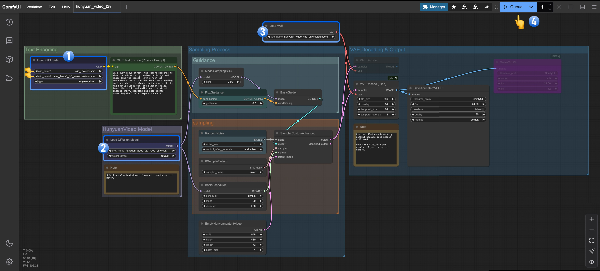
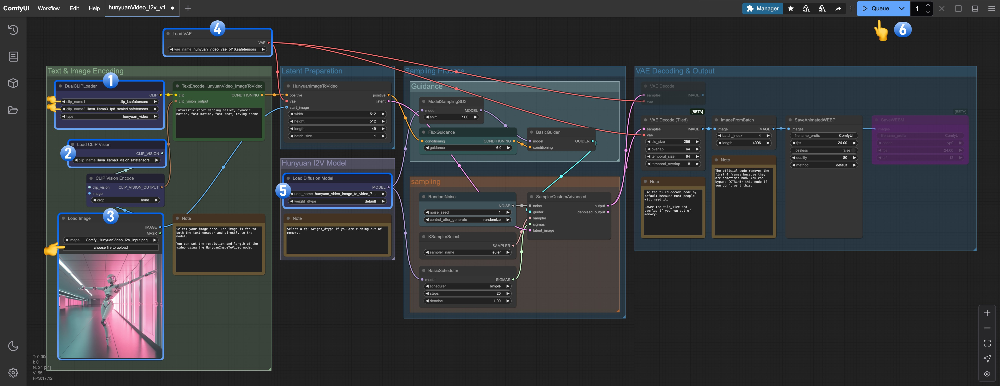
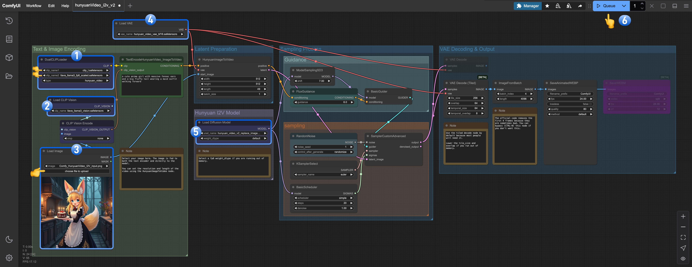

import UpdateReminder from "/snippets/de/tutorials/update-reminder.mdx";

<video
  controls
  className="w-full aspect-video"
  src="https://github.com/user-attachments/assets/442afb73-3092-454f-bc46-02361c285930"
></video>

Die Hunyuan Video-Serie wird von [Tencent](https://huggingface.co/tencent) entwickelt und als Open Source veröffentlicht. Sie zeichnet sich durch eine hybride Architektur aus, die sowohl Text zu Video als auch Bild zu Video mit einer Parametergröße von 13B unterstützt.

Technische Merkmale:
- **Kernarchitektur:** Verwendet eine DiT-Architektur (Diffusion Transformer) ähnlich Sora, die Text-, Bild- und Bewegungsinformationen effektiv fusioniert, um Konsistenz, Qualität und Ausrichtung zwischen den generierten Videoframes zu verbessern. Ein einheitlicher Full-Attention-Mechanismus ermöglicht Kameraübergänge zwischen mehreren Ansichten und gewährleistet gleichzeitig die Konsistenz des Motivs.
- **3D VAE:** Der benutzerdefinierte 3D VAE komprimiert Videos in einen kompakten Latent-Raum, wodurch die Generierung von Bild zu Video effizienter wird.
- **Überlegene Ausrichtung von Bild, Video und Text:** Durch MLLM-Text-Encoder, die sich sowohl bei der Bild- als auch bei der Videogenerierung auszeichnen, werden Textanweisungen besser befolgt, Details erfasst und komplexe Schlussfolgerungen gezogen.

Mehr erfahren Sie in den offiziellen Repositories: [Hunyuan Video](https://github.com/Tencent/HunyuanVideo) und [Hunyuan Video-I2V](https://github.com/Tencent/HunyuanVideo-I2V).

Diese Anleitung zeigt Ihnen Schritt für Schritt, wie Sie in ComfyUI sowohl Workflows für Text zu Video als auch für Bild zu Video einrichten.

<Tip>
Die Workflow-Bilder in dieser Anleitung enthalten Metadaten mit Download-Informationen zu den Modellen.

Ziehen Sie sie einfach in ComfyUI oder verwenden Sie das Menü `Workflows` -> `Open (ctrl+o)`, um den entsprechenden Workflow zu laden. Sie werden dann aufgefordert, die erforderlichen Modelle herunterzuladen.

Alternativ bietet diese Anleitung direkte Modell-Links, falls automatische Downloads fehlschlagen oder Sie nicht die Desktop-Version verwenden. Alle Modelle stehen [hier](https://huggingface.co/Comfy-Org/HunyuanVideo_repackaged/tree/main/split_files) zum Herunterladen zur Verfügung.
</Tip>

<UpdateReminder/>

## Gemeinsame Modelle für alle Workflows

Die folgenden Modelle werden sowohl in Text-zu-Video- als auch in Bild-zu-Video-Workflows verwendet. Laden Sie sie herunter und speichern Sie sie in den angegebenen Verzeichnissen:

<CardGroup cols={2}>
  <Card icon="cube" title="Textencoder: clip_l.safetensors" href="https://huggingface.co/Comfy-Org/HunyuanVideo_repackaged/blob/main/split_files/text_encoders/clip_l.safetensors?download=true">
    Speichern unter ComfyUI/models/text_encoders
  </Card>
  <Card icon="cube" title="Textencoder: llava_llama3_fp8_scaled.safetensors" href="https://huggingface.co/Comfy-Org/HunyuanVideo_repackaged/blob/main/split_files/text_encoders/llava_llama3_fp8_scaled.safetensors?download=true">
    Speichern unter ComfyUI/models/text_encoders
  </Card>
</CardGroup>

<Card icon="cube" title="VAE: hunyuan_video_vae_bf16.safetensors" href="https://huggingface.co/Comfy-Org/HunyuanVideo_repackaged/blob/main/split_files/vae/hunyuan_video_vae_bf16.safetensors?download=true">
  Speichern unter ComfyUI/models/vae
</Card>
Speicherort:

```
ComfyUI/
├── models/
│   ├── text_encoders/
│   │   ├── clip_l.safetensors
│   │   └── llava_llama3_fp8_scaled.safetensors
│   └── vae/
│       └── hunyuan_video_vae_bf16.safetensors
```
## Workflow für Hunyuan Text zu Video

Hunyuan Text zu Video wurde im Dezember 2024 als Open Source veröffentlicht und unterstützt die Generierung von 5-sekündigen Kurzvideos anhand natürlichsprachlicher Beschreibungen auf Chinesisch und Englisch.

### 1. Workflow

Laden Sie das untenstehende Workflow-Bild herunter und ziehen Sie es in ComfyUI, um den Workflow zu laden:


<CardGroup cols={2}>
  <Card title="Auf Comfy Cloud ausführen" icon="cloud" href="https://cloud.comfy.org/?template=hunyuan_video_text_to_video&utm_source=docs&utm_medium=referral&utm_campaign=hunyuan-video">
    In Comfy Cloud öffnen
  </Card>
  <Card title="Workflow herunterladen" icon="download" href="https://github.com/Comfy-Org/workflow_templates/blob/main/templates/hunyuan_video_text_to_video.json">
    JSON herunterladen oder in der Vorlagenbibliothek nach „Hunyuan Video“ suchen
  </Card>
</CardGroup>

### 2. Modelle manuell installieren

<Card icon="cube" title="Diffusionsmodell: hunyuan_video_t2v_720p_bf16.safetensors" href="https://huggingface.co/Comfy-Org/HunyuanVideo_repackaged/blob/main/split_files/diffusion_models/hunyuan_video_t2v_720p_bf16.safetensors?download=true">
  Nach ComfyUI/models/diffusion_models speichern
</Card>
Stellen Sie sicher, dass sich alle diese Modelldateien an den richtigen Orten befinden:

```
ComfyUI/
├── models/
│   ├── text_encoders/
│   │   ├── clip_l.safetensors                       // Gemeinsames Modell
│   │   └── llava_llama3_fp8_scaled.safetensors      // Gemeinsames Modell
│   ├── vae/
│   │   └── hunyuan_video_vae_bf16.safetensors       // Gemeinsames Modell
│   └── diffusion_models/
│       └── hunyuan_video_t2v_720p_bf16.safetensors  // T2V-Modell
```

### 3. Workflow ausführen



1. Stellen Sie sicher, dass der Node `DualCLIPLoader` diese Modelle geladen hat:
   - clip_name1: clip_l.safetensors
   - clip_name2: llava_llama3_fp8_scaled.safetensors
2. Stellen Sie sicher, dass der Node `Load Diffusion Model` `hunyuan_video_t2v_720p_bf16.safetensors` geladen hat
3. Stellen Sie sicher, dass der Node `Load VAE` `hunyuan_video_vae_bf16.safetensors` geladen hat
4. Klicken Sie auf die Schaltfläche `Queue` oder verwenden Sie die Tastenkombination `Ctrl(cmd) + Enter`, um den Workflow auszuführen

<Tip>
Wenn der Parameter `length` im Node `EmptyHunyuanLatentVideo` auf 1 gesetzt ist, kann das Modell ein statisches Bild generieren.
</Tip>

## Hunyuan Image-to-Video-Workflow

Das Modell Hunyuan Image-to-Video wurde am 6. März 2025 als Open Source veröffentlicht, basierend auf dem HunyuanVideo-Framework. Es wandelt statische Bilder in glatte, hochwertige Videos um und stellt außerdem LoRA-Trainingscode bereit, um spezielle Videoeffekte wie Haarwachstum, Objektverwandlung und mehr anzupassen.

Derzeit gibt es das Modell Hunyuan Image-to-Video in zwei Versionen:
- v1 „concat“: Bessere Bewegungsflüssigkeit, aber geringere Treue zur Bildvorgabe
- v2 „replace“: Einen Tag nach v1 aktualisiert, mit besserer Bildführung, aber scheinbar weniger dynamisch als v1

<div class="flex justify-between">
    <div class="text-center">
        <p>v1 „concat“</p>
        
    </div>
    <div class="text-center">
        <p>v2 „replace“</p>
        
    </div>
</div>

### Gemeinsames Modell für die Versionen v1 und v2

<Card icon="cube" title="CLIP Vision: llava_llama3_vision.safetensors" href="https://huggingface.co/Comfy-Org/HunyuanVideo_repackaged/blob/main/split_files/clip_vision/llava_llama3_vision.safetensors?download=true">
  Nach ComfyUI/models/clip_vision speichern
</Card>

### V1-„concat“-Bild-zu-Video-Workflow

#### 1. Workflow und Assets

Laden Sie das Workflow-Bild unten herunter und ziehen Sie es in ComfyUI, um den Workflow zu laden:


<CardGroup cols={2}>
  <Card title="Workflow herunterladen" icon="download" href="https://raw.githubusercontent.com/Comfy-Org/example_workflows/main/hunyuan-video/i2v/v1_robot.webp">
    Laden Sie das Workflow-Bild herunter und ziehen Sie es in ComfyUI
  </Card>
</CardGroup>

Laden Sie das folgende Bild herunter und verwenden Sie es als Startbild für die Bild-zu-Video-Generierung:

<Card icon="cube" title="Startbild: robot-ballet.png" href="https://raw.githubusercontent.com/Comfy-Org/example_workflows/refs/heads/main/hunyuan-video/i2v/robot-ballet.png">
  Speichern Sie es und verwenden Sie es als Eingabebild für die I2V-Generierung
</Card>
#### 2. Zugehörige Modelle manuell installieren

<Card icon="cube" title="Diffusionsmodell: hunyuan_video_image_to_video_720p_bf16.safetensors" href="https://huggingface.co/Comfy-Org/HunyuanVideo_repackaged/blob/main/split_files/diffusion_models/hunyuan_video_image_to_video_720p_bf16.safetensors?download=true">
  In ComfyUI/models/diffusion_models speichern
</Card>
Stellen Sie sicher, dass sich alle diese Modelldateien an den richtigen Orten befinden:

```
ComfyUI/
├── models/
│   ├── clip_vision/
│   │   └── llava_llama3_vision.safetensors                     // Gemeinsam genutztes I2V-Modell
│   ├── text_encoders/
│   │   ├── clip_l.safetensors                                  // Gemeinsam genutztes Modell
│   │   └── llava_llama3_fp8_scaled.safetensors                 // Gemeinsam genutztes Modell
│   ├── vae/
│   │   └── hunyuan_video_vae_bf16.safetensors                  // Gemeinsam genutztes Modell
│   └── diffusion_models/
│       └── hunyuan_video_image_to_video_720p_bf16.safetensors  // Modell der I2V-Version v1 „concat“
```

#### 3. Schritte zum Ausführen des Workflows



1. Stellen Sie sicher, dass `DualCLIPLoader` diese Modelle geladen hat:
   - clip_name1: clip_l.safetensors
   - clip_name2: llava_llama3_fp8_scaled.safetensors
2. Stellen Sie sicher, dass `Load CLIP Vision` das Modell `llava_llama3_vision.safetensors` geladen hat
3. Stellen Sie sicher, dass `Load Image Model` das Modell `hunyuan_video_image_to_video_720p_bf16.safetensors` geladen hat
4. Stellen Sie sicher, dass `Load VAE` den Wert `vae_name: hunyuan_video_vae_bf16.safetensors` geladen hat
5. Stellen Sie sicher, dass `Load Diffusion Model` das Modell `hunyuan_video_image_to_video_720p_bf16.safetensors` geladen hat
6. Klicken Sie auf die Schaltfläche `Queue` oder verwenden Sie die Tastenkombination `Ctrl(cmd) + Enter`, um den Workflow auszuführen

### v2 „replace“ Workflow für Bild zu Video

Der v2-Workflow ist im Wesentlichen derselbe wie der v1-Workflow. Sie müssen lediglich das **replace**-Modell herunterladen und im Node `Load Diffusion Model` verwenden.

#### 1. Workflow und Assets

Laden Sie das Workflow-Bild unten herunter und ziehen Sie es in ComfyUI, um den Workflow zu laden:


<CardGroup cols={2}>
  <Card title="Workflow herunterladen" icon="download" href="https://raw.githubusercontent.com/Comfy-Org/example_workflows/main/hunyuan-video/i2v/v2_fennec_gril.webp">
    Laden Sie das Workflow-Bild herunter und ziehen Sie es in ComfyUI.
  </Card>
</CardGroup>

Laden Sie das Bild unten herunter und verwenden Sie es als Startbild für die Bild-zu-Video-Generierung:

<Card icon="cube" title="Startbild: flux_dev_example.png" href="https://comfyanonymous.github.io/ComfyUI_examples/flux/flux_dev_example.png">
  Speichern Sie das Bild und verwenden Sie es als Eingabebild für die I2V-Generierung.
</Card>
#### 2. Zugehörige Modelle manuell installieren

<Card icon="cube" title="Diffusionsmodell: hunyuan_video_v2_replace_image_to_video_720p_bf16.safetensors" href="https://huggingface.co/Comfy-Org/HunyuanVideo_repackaged/blob/main/split_files/diffusion_models/hunyuan_video_v2_replace_image_to_video_720p_bf16.safetensors?download=true">
  Unter ComfyUI/models/diffusion_models speichern
</Card>
Stellen Sie sicher, dass sich alle diese Modelldateien an den richtigen Speicherorten befinden:

```
ComfyUI/
├── models/
│   ├── clip_vision/
│   │   └── llava_llama3_vision.safetensors                                // Gemeinsam genutztes I2V-Modell
│   ├── text_encoders/
│   │   ├── clip_l.safetensors                                             // Gemeinsam genutztes Modell
│   │   └── llava_llama3_fp8_scaled.safetensors                            // Gemeinsam genutztes Modell
│   ├── vae/
│   │   └── hunyuan_video_vae_bf16.safetensors                             // Gemeinsam genutztes Modell
│   └── diffusion_models/
│       └── hunyuan_video_v2_replace_image_to_video_720p_bf16.safetensors  // Modell der Version V2 „replace“
```

#### 3. Workflow ausführen



1. Stellen Sie sicher, dass der Node `DualCLIPLoader` die folgenden Modelle geladen hat:
   - clip_name1: clip_l.safetensors
   - clip_name2: llava_llama3_fp8_scaled.safetensors
2. Stellen Sie sicher, dass der Node `Load CLIP Vision` die Datei `llava_llama3_vision.safetensors` geladen hat.
3. Stellen Sie sicher, dass der Node `Load Image Model` die Datei `hunyuan_video_image_to_video_720p_bf16.safetensors` geladen hat.
4. Stellen Sie sicher, dass der Node `Load VAE` die Datei `hunyuan_video_vae_bf16.safetensors` geladen hat.
5. Stellen Sie sicher, dass der Node `Load Diffusion Model` die Datei `hunyuan_video_v2_replace_image_to_video_720p_bf16.safetensors` geladen hat.
6. Klicken Sie auf die Schaltfläche `Queue` oder verwenden Sie die Tastenkombination `Ctrl(cmd) + Enter`, um den Workflow auszuführen.

## Selbst ausprobieren

Hier finden Sie einige Bilder und Prompts, die wir bereitstellen. Verwenden Sie sie unverändert oder passen Sie sie an, um Ihr eigenes Video zu erstellen.


```
Futuristic robot dancing ballet, dynamic motion, fast motion, fast shot, moving scene
```

---


```
Samurai waving sword and hitting the camera. camera angle movement, zoom in, fast scene, super fast, dynamic
```

---


```
flying car fastly moving and flying through the city
```

---


```
cyberpunk car race in night city, dynamic, super fast, fast shot
```
