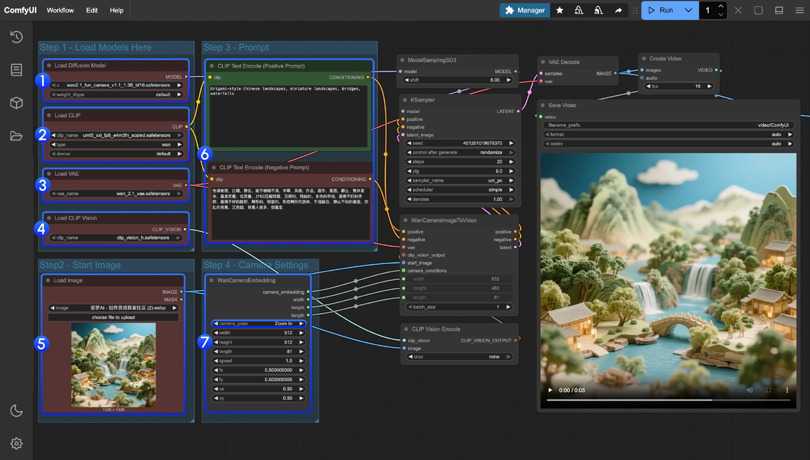

import UpdateReminder from "/snippets/de/tutorials/update-reminder.mdx"

Wan2.1 Fun Camera ist ein Modell zur Videogenerierung mit Kamerabewegung aus Alibabas VideoX-Fun-Projekt, das in ComfyUI nativ unterstützt wird. Es generiert Videos, deren Kamerabewegung Ihren Steuerbedingungen folgt, sodass Sie die Kamerabewegung in der Ausgabe steuern können, statt jede Aufnahme im Prompt beschreiben zu müssen.

Das Modell gehört zur Wan2.1-Fun-Familie und ist in zwei Größen erhältlich: die 1.3B-Version (etwa 19 GB) für ressourcenschonende lokale Ausführungen und die 14B-Version (etwa 47 GB) für Ausgaben mit höherer Wiedergabetreue. Beide unterstützen die Videovorhersage in mehreren Auflösungen bei 512, 768 und 1024 Pixeln, sind mit 16 Bildern pro Sekunde für bis zu 81 Bilder (etwa 5 Sekunden) trainiert und akzeptieren mehrsprachige Prompts. Die Gewichte werden unter der Apache-2.0-Lizenz veröffentlicht.

## Über Wan2.1 Fun Camera

**Wan2.1 Fun Camera** ist ein vom Alibaba-Team veröffentlichtes Projekt zur Videogenerierung, das sich darauf konzentriert, die Videogenerierung über Kamerabewegungen zu steuern.

**Modellgewichte herunterladen**:
- [14B-Version](https://huggingface.co/alibaba-pai/Wan2.1-Fun-V1.1-14B-Control-Camera)
- [1.3B-Version](https://huggingface.co/alibaba-pai/Wan2.1-Fun-V1.1-1.3B-Control-Camera)

**Code-Repository**: [VideoX-Fun](https://github.com/aigc-apps/VideoX-Fun)

**ComfyUI unterstützt das Modell Wan2.1 Fun Camera jetzt nativ**.

<UpdateReminder/>

## Modelle installieren

Diese Modelle müssen nur einmal installiert werden. Zusätzlich sind die Download-Informationen für die Modelle in den entsprechenden Workflow-Bildern enthalten, sodass Sie Ihre bevorzugte Art des Downloads wählen können.

Alle folgenden Modelle finden Sie unter [Wan_2.1_ComfyUI_repackaged](https://huggingface.co/Comfy-Org/Wan_2.1_ComfyUI_repackaged)

### Diffusionsmodelle

Wählen Sie entweder 1.3B oder 14B:

<CardGroup cols={2}>
  <Card title="wan2.1_fun_camera_v1.1_1.3B_bf16.safetensors" icon="download" href="https://huggingface.co/Comfy-Org/Wan_2.1_ComfyUI_repackaged/blob/main/split_files/diffusion_models/wan2.1_fun_camera_v1.1_1.3B_bf16.safetensors?download=true">
    Wan2.1 Fun Camera 1.3B Diffusionsmodell
  </Card>
  <Card title="wan2.1_fun_camera_v1.1_14B_bf16.safetensors" icon="download" href="https://huggingface.co/Comfy-Org/Wan_2.1_ComfyUI_repackaged/blob/main/split_files/diffusion_models/wan2.1_fun_camera_v1.1_14B_bf16.safetensors?download=true">
    Wan2.1 Fun Camera 14B Diffusionsmodell
  </Card>
</CardGroup>

Wenn Sie bereits Modelle aus dem Wan2.1-Umfeld verwendet haben, sollten Sie die folgenden Modelle schon haben. Falls nicht, laden Sie sie bitte herunter:

### Text-Encoder

Wählen Sie eine der folgenden Optionen:

<CardGroup cols={2}>
  <Card title="umt5_xxl_fp16.safetensors" icon="download" href="https://huggingface.co/Comfy-Org/Wan_2.1_ComfyUI_repackaged/blob/main/split_files/text_encoders/umt5_xxl_fp16.safetensors?download=true">
    Text-Encoder mit voller Präzision
  </Card>
  <Card title="umt5_xxl_fp8_e4m3fn_scaled.safetensors" icon="download" href="https://huggingface.co/Comfy-Org/Wan_2.1_ComfyUI_repackaged/blob/main/split_files/text_encoders/umt5_xxl_fp8_e4m3fn_scaled.safetensors?download=true">
    FP8-quantisierter Text-Encoder (empfohlen für weniger VRAM)
  </Card>
</CardGroup>

### VAE

<CardGroup cols={1}>
  <Card title="wan_2.1_vae.safetensors" icon="download" href="https://huggingface.co/Comfy-Org/Wan_2.1_ComfyUI_repackaged/blob/main/split_files/vae/wan_2.1_vae.safetensors?download=true">
    Wan2.1 VAE-Modell
  </Card>
</CardGroup>

### CLIP Vision

<CardGroup cols={1}>
  <Card title="clip_vision_h.safetensors" icon="download" href="https://huggingface.co/Comfy-Org/Wan_2.1_ComfyUI_repackaged/blob/main/split_files/clip_vision/clip_vision_h.safetensors?download=true">
    CLIP-Vision-Encoder
  </Card>
</CardGroup>

Speicherort der Dateien:

```
📂 ComfyUI/
├── 📂 models/
│ ├── 📂 diffusion_models/
│ │   ├── wan2.1_fun_camera_v1.1_1.3B_bf16.safetensors # 1.3B version
│ │   └── wan2.1_fun_camera_v1.1_14B_bf16.safetensors # 14B version
│ ├── 📂 text_encoders/
│ │   └── umt5_xxl_fp8_e4m3fn_scaled.safetensors
│ ├── 📂 vae/
│ │   └── wan_2.1_vae.safetensors
│ └── 📂 clip_vision/
│     └── clip_vision_h.safetensors
```
## ComfyUI Wan2.1 Fun Camera 1.3B Workflow

### Wan 2.1 Fun Camera 1.3B {#video_wan2.1_fun_camera_v1.1_1.3B}

Generieren Sie dynamische Videos mit filmischen Kamerabewegungen mithilfe des Modells Wan 2.1 Fun Camera 1.3B.


<CardGroup cols={2}>
  <Card title="Auf Comfy Cloud ausführen" icon="cloud" href="https://cloud.comfy.org/?template=video_wan2.1_fun_camera_v1.1_1.3B&utm_source=docs&utm_medium=referral&utm_campaign=fun-camera">
    In Comfy Cloud öffnen
  </Card>
  <Card title="Workflow herunterladen" icon="download" href="https://github.com/Comfy-Org/workflow_templates/blob/main/templates/video_wan2.1_fun_camera_v1.1_1.3B.json">
    Laden Sie die JSON herunter oder suchen Sie in der Vorlagenbibliothek nach „Wan 2.1 Fun Camera 1.3B“
  </Card>
</CardGroup>

Laden Sie das folgende Video herunter und ziehen Sie es in ComfyUI, um den entsprechenden Workflow zu laden:

<video
  controls
  className="w-full aspect-video"
  src="https://raw.githubusercontent.com/Comfy-Org/example_workflows/refs/heads/main/video/wan/fun-camera/v1.1/wan2.1_fun_camera_1.3B.mp4"
></video>

<Note>
Wenn Sie die 14B-Version verwenden möchten, ersetzen Sie einfach die Modelldatei durch die 14B-Version. Beachten Sie jedoch die VRAM-Anforderungen.
</Note>

**Eingabematerialien**

Laden Sie diese Datei in den passenden `LoadImage`-Node hoch:

<CardGroup cols={2}>
  <Card title="video_wan2.1_fun_camera_v1.1_1.3B_start_image.jpg" icon="image" href="https://raw.githubusercontent.com/Comfy-Org/workflow_templates/main/input/video_wan2.1_fun_camera_v1.1_1.3B_start_image.jpg">
    `LoadImage`-Node 52 · `video_wan2.1_fun_camera_v1.1_1.3B_start_image.jpg`
  </Card>
</CardGroup>

<div style={{display: 'grid', gridTemplateColumns: 'repeat(2, minmax(0, 1fr))', gap: '1rem', alignItems: 'start'}}>
  
</div>

### 3. Den Workflow Schritt für Schritt abschließen



1. Stellen Sie sicher, dass die richtige Version der Modelldatei geladen ist:
   - 1.3B-Version: `wan2.1_fun_camera_v1.1_1.3B_bf16.safetensors`
   - 14B-Version: `wan2.1_fun_camera_v1.1_14B_bf16.safetensors`
2. Stellen Sie sicher, dass im `Load CLIP`-Node `umt5_xxl_fp8_e4m3fn_scaled.safetensors` geladen ist
3. Stellen Sie sicher, dass im `Load VAE`-Node `wan_2.1_vae.safetensors` geladen ist
4. Stellen Sie sicher, dass im `Load CLIP Vision`-Node `clip_vision_h.safetensors` geladen ist
5. Laden Sie das Startbild in den `Load Image`-Node hoch
6. Passen Sie den Prompt an, wenn Sie Ihr eigenes Eingabebild verwenden
7. Legen Sie die Kamerabewegung im `WanCameraEmbedding`-Node fest
8. Klicken Sie auf die Schaltfläche `Run` oder verwenden Sie die Tastenkombination `Ctrl(cmd) + Enter`, um die Generierung auszuführen

## ComfyUI Wan2.1 Fun Camera 14B Workflow

### Wan 2.1 Fun Camera 14B {#video_wan2.1_fun_camera_v1.1_14B}

Generieren Sie hochwertige Videos mit erweiterter Kamerasteuerung mithilfe des vollständigen 14B-Modells.


<CardGroup cols={2}>
  <Card title="Auf Comfy Cloud ausführen" icon="cloud" href="https://cloud.comfy.org/?template=video_wan2.1_fun_camera_v1.1_14B&utm_source=docs&utm_medium=referral&utm_campaign=fun-camera">
    In Comfy Cloud öffnen
  </Card>
  <Card title="Workflow herunterladen" icon="download" href="https://github.com/Comfy-Org/workflow_templates/blob/main/templates/video_wan2.1_fun_camera_v1.1_14B.json">
    JSON herunterladen oder in der Vorlagenbibliothek nach „Wan 2.1 Fun Camera 14B“ suchen
  </Card>
</CardGroup>

<video
  controls
  className="w-full aspect-video"
  src="https://raw.githubusercontent.com/Comfy-Org/example_workflows/refs/heads/main/video/wan/fun-camera/v1.1/wan2.1_fun_camera_14B.mp4"
></video>

**Eingabematerialien**

Laden Sie diese Datei in den passenden `LoadImage`-Node hoch:

<CardGroup cols={2}>
  <Card title="video_wan2.1_fun_camera_v1.1_14B_start_image.jpg" icon="image" href="https://raw.githubusercontent.com/Comfy-Org/workflow_templates/main/input/video_wan2.1_fun_camera_v1.1_14B_start_image.jpg">
    `LoadImage`-Node 52 · `video_wan2.1_fun_camera_v1.1_14B_start_image.jpg`
  </Card>
</CardGroup>

<div style={{display: 'grid', gridTemplateColumns: 'repeat(2, minmax(0, 1fr))', gap: '1rem', alignItems: 'start'}}>
  
</div>

## Leistungsreferenz

**1.3B-Version**:
- Eine 512x512-Auflösung auf einer RTX 4090 dauert etwa 72 Sekunden, um 81 Frames zu generieren

**14B-Version**:
- Bei einer RTX4090 mit 24 GB VRAM kann es beim Generieren einer 512x512-Auflösung zu unzureichendem Speicher kommen; auch auf einer A100 sind bei größeren Auflösungen Speicherprobleme aufgetreten
