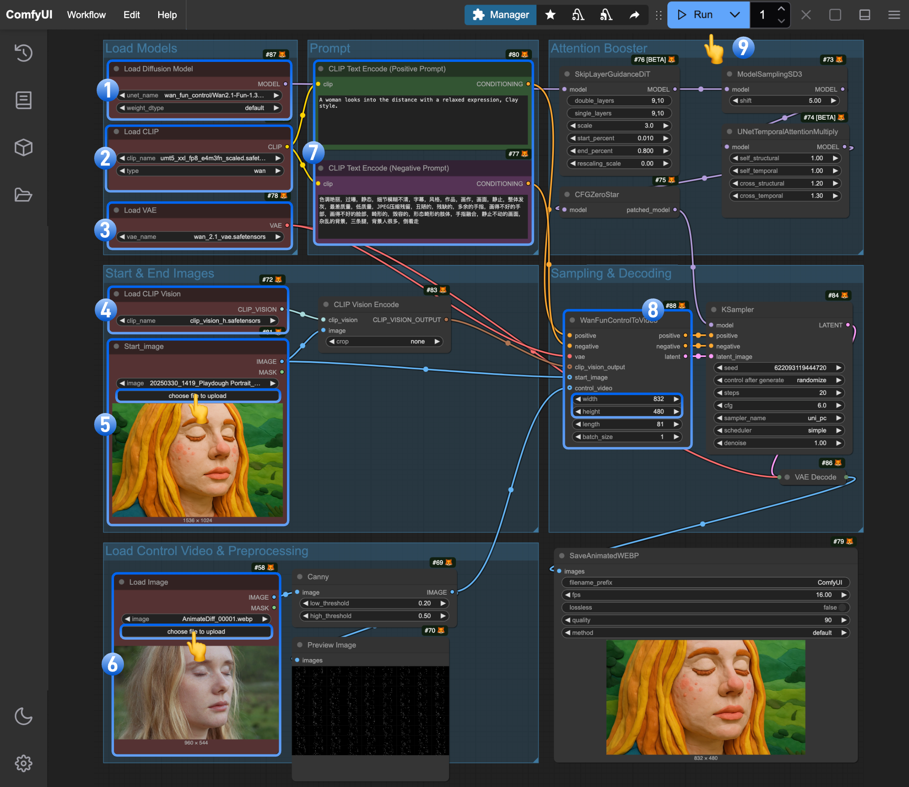
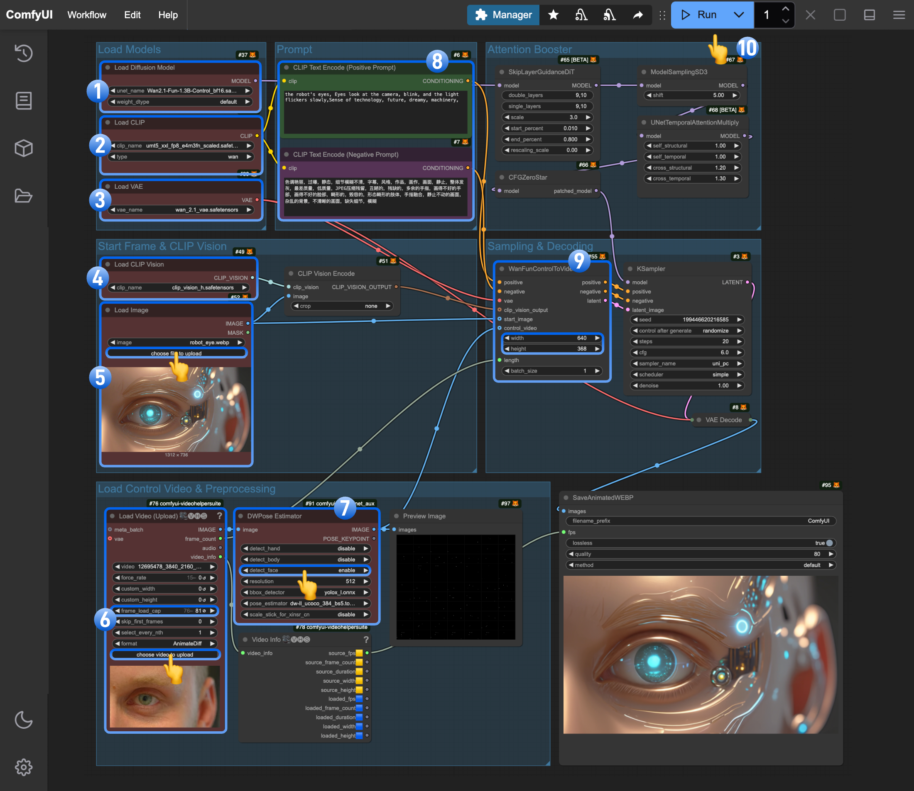
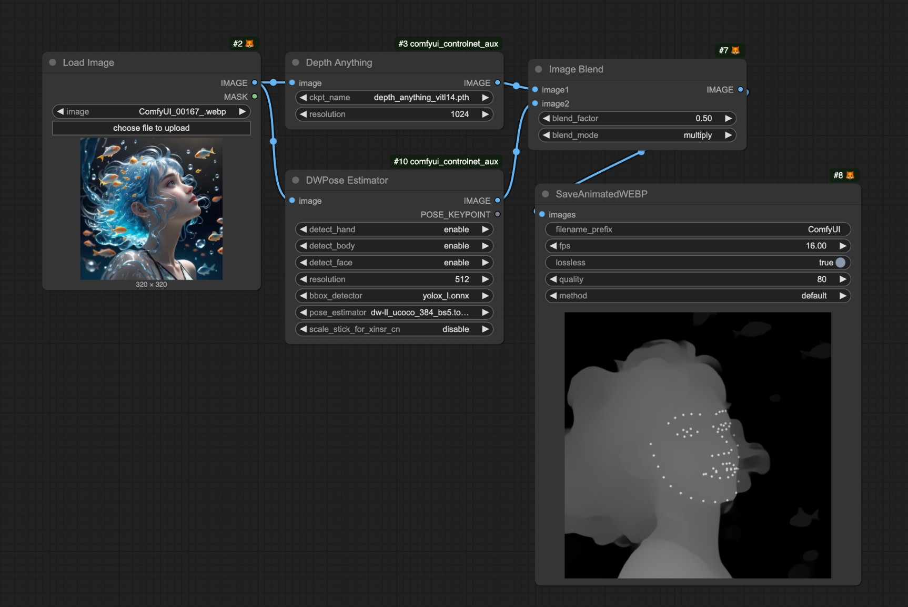

import UpdateReminder from "/snippets/de/tutorials/update-reminder.mdx";

Wan2.1-Fun-Control ist ein Open-Source-Modell zur Videogenerierung aus Alibabas VideoX-Fun-Projekt, das vorgegebenen Steuerungsbedingungen folgt, statt sich allein auf Prompt-Text zu verlassen. Sie können die Ausgabe mit Canny-Kantenkarten, Tiefenkarten, OpenPose-Skeletten, geometrischen MLSD-Kanten oder Punktverläufen steuern.

Das Modell ist in zwei Größen erhältlich: die 1.3B-Version (etwa 19 GB) für den leichtgewichtigen lokalen Einsatz mit geringeren VRAM-Anforderungen und die 14B-Version (etwa 47 GB Gesamtspeicher des Modells, davon rund 32.8 GB Diffusionsgewichte) für hochwertigere Ergebnisse. Beide unterstützen Videovorhersage in mehreren Auflösungen bei 512, 768 und 1024 Pixeln, generieren bis zu 81 Frames (etwa 5 Sekunden) bei 16 Bildern pro Sekunde und akzeptieren mehrsprachige Prompts. ComfyUI unterstützt Wan2.1-Fun-Control nativ.

## Über Wan2.1-Fun-Control

**Wan2.1-Fun-Control** ist ein Open-Source-Projekt zur Videogenerierung und -steuerung, das vom Alibaba-Team entwickelt wurde.
Es führt innovative Control-Codes-Mechanismen in Kombination mit Deep Learning und multimodalen konditionalen Eingaben ein, um hochwertige Videos zu generieren, die vorgegebenen Steuerungsbedingungen entsprechen. Der Schwerpunkt des Projekts liegt darauf, den generierten Videoinhalt präzise über multimodale Steuerungsbedingungen zu lenken.

Derzeit unterstützt das Fun-Control-Modell verschiedene Steuerungsbedingungen, darunter **Canny (Linienkunst), Depth, OpenPose (menschliche Körperhaltung), MLSD (geometrische Kanten) und Trajektoriensteuerung.**
Das Modell unterstützt außerdem Videovorhersage in mehreren Auflösungen mit den Optionen 512, 768 und 1024 bei 16 Bildern pro Sekunde und generiert Videos mit bis zu 81 Frames (etwa 5 Sekunden) Länge.

Modellversionen:
- **1.3B** Leichtgewichtig: Geeignet für den lokalen Einsatz und schnelle Inferenz mit **geringeren VRAM-Anforderungen**
- **14B** Hochleistungsfähig: Die Modellgröße erreicht 32GB+, liefert bessere Ergebnisse, **erfordert aber mehr VRAM**

**Modellgewichte herunterladen**:

<CardGroup cols={2}>
  <Card title="Wan2.1-Fun-1.3B-Control" icon="download" href="https://huggingface.co/alibaba-pai/Wan2.1-Fun-1.3B-Control">
    Leichtgewichtige Version, geringere VRAM-Anforderungen
  </Card>
  <Card title="Wan2.1-Fun-14B-Control" icon="download" href="https://huggingface.co/alibaba-pai/Wan2.1-Fun-14B-Control">
    Hochleistungsfähige Version, Dateigröße 32GB+, höhere VRAM-Anforderungen
  </Card>
</CardGroup>

**Code-Repository**: [VideoX-Fun](https://github.com/aigc-apps/VideoX-Fun)

ComfyUI **unterstützt** das Wan2.1 Fun Control Modell jetzt **nativ**. Bevor Sie mit diesem Tutorial beginnen, aktualisieren Sie bitte Ihr ComfyUI, um sicherzustellen, dass Sie eine Version nach [diesem Commit](https://github.com/Comfy-Org/ComfyUI/commit/3661c833bcc41b788a7c9f0e7bc48524f8ee5f82) verwenden.

In dieser Anleitung stellen wir zwei Workflows bereit:
1. Einen Workflow, der ausschließlich native Comfy-Core-Nodes verwendet
2. Einen Workflow, der Custom Nodes verwendet

<Tip>
Aufgrund aktueller Einschränkungen der nativen Nodes bei der Videounterstützung stellt der Workflow mit ausschließlich nativen Nodes sicher, dass Benutzer den Prozess ohne Installation von Custom Nodes abschließen können.
Wir haben jedoch festgestellt, dass eine gute Benutzererfahrung bei der Videogenerierung ohne Custom Nodes schwierig ist, daher stellen wir in dieser Anleitung beide Workflow-Versionen bereit.
</Tip>

<UpdateReminder/>

## Modellinstallation

Sie müssen diese Modelle nur einmal installieren. Die Workflow-Bilder enthalten ebenfalls Download-Informationen zu den Modellen, sodass Sie Ihre bevorzugte Download-Methode wählen können.

Die folgenden Modelle finden Sie unter [Wan_2.1_ComfyUI_repackaged](https://huggingface.co/Comfy-Org/Wan_2.1_ComfyUI_repackaged) und [Wan2.1-Fun](https://huggingface.co/collections/alibaba-pai/wan21-fun-67e4fb3b76ca01241eb7e334)

Klicken Sie auf die entsprechenden Links, um sie herunterzuladen. Wenn Sie bereits zuvor Wan-Workflows verwendet haben, müssen Sie nur die **Diffusion models** herunterladen.

**Diffusion models** -- wählen Sie 1.3B oder 14B. Die 14B-Version hat eine größere Dateigröße (32 GB) und höhere VRAM-Anforderungen:

<CardGroup cols={2}>
  <Card title="wan2.1_fun_control_1.3B_bf16.safetensors" icon="download" href="https://huggingface.co/Comfy-Org/Wan_2.1_ComfyUI_repackaged/blob/main/split_files/diffusion_models/wan2.1_fun_control_1.3B_bf16.safetensors?download=true">
    Wan2.1 Fun Control 1.3B Diffusion-Modell -- leichtgewichtig, geringere VRAM-Anforderungen
  </Card>
  <Card title="Wan2.1-Fun-14B-Control" icon="download" href="https://huggingface.co/alibaba-pai/Wan2.1-Fun-14B-Control/blob/main/diffusion_pytorch_model.safetensors">
    Wan2.1 Fun Control 14B Diffusion-Modell. Benennen Sie es nach dem Herunterladen in <code>Wan2.1-Fun-14B-Control.safetensors</code> um. Dateigröße über 32 GB, höhere VRAM-Anforderungen
  </Card>
</CardGroup>

**Text encoders** -- wählen Sie eines der folgenden Modelle (fp16-Präzision hat eine größere Dateigröße und höhere Leistungsanforderungen):

<CardGroup cols={2}>
  <Card title="umt5_xxl_fp16.safetensors" icon="download" href="https://huggingface.co/Comfy-Org/Wan_2.1_ComfyUI_repackaged/blob/main/split_files/text_encoders/umt5_xxl_fp16.safetensors?download=true">
    UMT5 XXL Text Encoder -- fp16-Präzision, größere Dateigröße, höhere Leistungsanforderungen
  </Card>
  <Card title="umt5_xxl_fp8_e4m3fn_scaled.safetensors" icon="download" href="https://huggingface.co/Comfy-Org/Wan_2.1_ComfyUI_repackaged/blob/main/split_files/text_encoders/umt5_xxl_fp8_e4m3fn_scaled.safetensors?download=true">
    UMT5 XXL Text Encoder -- fp8-Präzision, kleinere Dateigröße, geringere Leistungsanforderungen
  </Card>
</CardGroup>

**VAE**

<Card title="wan_2.1_vae.safetensors" icon="download" href="https://huggingface.co/Comfy-Org/Wan_2.1_ComfyUI_repackaged/blob/main/split_files/vae/wan_2.1_vae.safetensors?download=true">
  Wan2.1 VAE-Modell
</Card>
**CLIP Vision**

<Card title="clip_vision_h.safetensors" icon="download" href="https://huggingface.co/Comfy-Org/Wan_2.1_ComfyUI_repackaged/blob/main/split_files/clip_vision/clip_vision_h.safetensors?download=true">
  CLIP Vision-Modell zur Verarbeitung von Referenzbildern
</Card>
Speicherort der Dateien:
```
📂 ComfyUI/
├── 📂 models/
│   ├── 📂 diffusion_models/
│   │   ├── wan2.1_fun_control_1.3B_bf16.safetensors
│   │   └── Wan2.1-Fun-14B-Control.safetensors
│   ├── 📂 text_encoders/
│   │   └── umt5_xxl_fp8_e4m3fn_scaled.safetensors
│   ├── 📂 vae/
│   │   └── wan_2.1_vae.safetensors
│   └── 📂 clip_vision/
│       └── clip_vision_h.safetensors
```
## Nativer ComfyUI-Workflow

In diesem Workflow verwenden wir Videos, die in das **WebP-Format** konvertiert wurden, da der Node `Load Image` derzeit das mp4-Format nicht unterstützt. Außerdem verwenden wir **Canny Edge**, um das Originalvideo vorzuverarbeiten.
Da viele Nutzer bei der Installation von Custom Nodes auf Installationsfehler und Umgebungsprobleme stoßen, verwendet diese Version des Workflows ausschließlich native Nodes, um ein reibungsloseres Erlebnis zu gewährleisten.

Dank unserer leistungsstarken ComfyUI-Autoren, die funktionsreiche Nodes bereitstellen. Wenn Sie die zugehörige Version direkt prüfen möchten, sehen Sie sich [Workflow mit Custom Nodes](#workflow-mit-custom-nodes) an.

### 1. Workflow-Datei herunterladen


<CardGroup cols={2}>
  <Card title="Run on Comfy Cloud" icon="cloud" href="https://cloud.comfy.org/?template=wan2.1_fun_control&utm_source=docs&utm_medium=referral&utm_campaign=fun-control">
    In Comfy Cloud öffnen
  </Card>
  <Card title="Download Workflow" icon="download" href="https://raw.githubusercontent.com/Comfy-Org/example_workflows/main/wan2.1_fun_control/wan2.1_fun_control_native.webp">
    Laden Sie das Workflow-Bild herunter und ziehen Sie es in ComfyUI, um den Workflow zu laden
  </Card>
</CardGroup>

**Eingabematerialien**

<CardGroup cols={2}>
  <Card title="Startbild: wan2.1_fun_control_start_frame.png" icon="image" href="https://raw.githubusercontent.com/Comfy-Org/workflow_templates/main/input/wan2.1_fun_control_start_frame.png">
    Start-Frame als Eingabe für den nativen Workflow. Laden Sie dieses Bild herunter und verwenden Sie es, oder ersetzen Sie es durch Ihr eigenes.
  </Card>
  <Card title="Steuervideo: 01-portrait_video.webp" icon="video" href="https://raw.githubusercontent.com/Comfy-Org/example_workflows/main/wan2.1_fun_control/input/01-portrait_video.webp">
    Steuervideo im WebP-Format als Eingabe für den nativen Workflow. Der native Workflow erfordert das WebP-Format, da Load Image mp4 nicht unterstützt.
  </Card>
</CardGroup>

### 2. Workflow Schritt für Schritt abschließen



1. Stellen Sie sicher, dass im Node `Load Diffusion Model` die Datei `wan2.1_fun_control_1.3B_bf16.safetensors` geladen ist
2. Stellen Sie sicher, dass im Node `Load CLIP` die Datei `umt5_xxl_fp8_e4m3fn_scaled.safetensors` geladen ist
3. Stellen Sie sicher, dass im Node `Load VAE` die Datei `wan_2.1_vae.safetensors` geladen ist
4. Stellen Sie sicher, dass im Node `Load CLIP Vision` die Datei `clip_vision_h.safetensors` geladen ist
5. Laden Sie den Start-Frame in den Node `Load Image` hoch (umbenannt in `Start_image`)
6. Laden Sie das Steuervideo in den zweiten Node `Load Image` hoch. Hinweis: Dieser Node unterstützt derzeit kein mp4, sondern nur WebP-Videos
7. (Optional) Ändern Sie den Prompt (Englisch und Chinesisch werden unterstützt)
8. (Optional) Passen Sie die Videogröße in `WanFunControlToVideo` an und vermeiden Sie übermäßig große Abmessungen
9. Klicken Sie auf die Schaltfläche `Run` oder verwenden Sie die Tastenkombination `Ctrl(cmd) + Enter`, um die Videogenerierung auszuführen

### 3. Hinweise zur Nutzung

- Da wir in den Node `WanFunControlToVideo` dieselbe Anzahl an Frames wie im Steuervideo eingeben müssen, können die überzähligen Frames Szenen anzeigen, die nicht den Steuerbedingungen entsprechen, wenn die angegebene Anzahl der Frames die Anzahl der Frames im Steuervideo überschreitet. Wir werden dieses Problem im [Workflow mit Custom Nodes](#workflow-mit-custom-nodes) behandeln
- Vermeiden Sie übermäßig große Abmessungen, da dies den Sampling-Prozess sehr zeitaufwendig machen kann. Versuchen Sie, zunächst kleinere Bilder zu generieren und anschließend ein Upscale durchzuführen
- Lassen Sie Ihrer Fantasie freien Lauf und erweitern Sie diesen Workflow, indem Sie Text-zu-Bild- oder andere Workflow-Typen hinzufügen, um eine direkte Text-zu-Video-Generierung oder einen Stiltransfer zu erreichen
- Verwenden Sie Tools wie [ComfyUI-comfyui_controlnet_aux](https://github.com/Fannovel16/comfyui_controlnet_aux) für umfangreichere Steuerungsoptionen

## Workflow mit Custom Nodes

Wir müssen die folgenden beiden Custom Nodes installieren:

- [ComfyUI-VideoHelperSuite](https://github.com/Kosinkadink/ComfyUI-VideoHelperSuite) 
- [ComfyUI-comfyui_controlnet_aux](https://github.com/Fannovel16/comfyui_controlnet_aux)

Sie können [ComfyUI Manager](https://github.com/Comfy-Org/ComfyUI-Manager) verwenden, um fehlende Nodes zu installieren, oder die Installationsanweisungen für jedes Custom-Node-Paket befolgen.

### 1. Workflow-Datei herunterladen


<CardGroup cols={2}>
  <Card title="Auf Comfy Cloud ausführen" icon="cloud" href="https://cloud.comfy.org/?template=wan2.1_fun_control&utm_source=docs&utm_medium=referral&utm_campaign=fun-control">
    In Comfy Cloud öffnen
  </Card>
  <Card title="Workflow herunterladen" icon="download" href="https://github.com/Comfy-Org/workflow_templates/blob/main/templates/wan2.1_fun_control.json">
    Laden Sie JSON herunter oder suchen Sie in der Vorlagenbibliothek nach „Wan 2.1 ControlNet“
  </Card>
</CardGroup>

**Eingabematerialien**

<CardGroup cols={2}>
  <Card title="Start-Frame: wan2.1_fun_control_start_frame.png" icon="image" href="https://raw.githubusercontent.com/Comfy-Org/workflow_templates/main/input/wan2.1_fun_control_start_frame.png">
    Start-Frame als Eingabe für den Workflow mit Custom Nodes. Laden Sie dieses Bild herunter und verwenden Sie es, oder ersetzen Sie es durch Ihr eigenes.
  </Card>
  <Card title="Steuerungsvideo: wan2.1_fun_control_control_video.mp4" icon="video" href="https://raw.githubusercontent.com/Comfy-Org/workflow_templates/main/input/wan2.1_fun_control_control_video.mp4">
    Steuerungsvideo im MP4-Format als Eingabe für den Workflow mit Custom Nodes. Der Custom-Node `Load Video` unterstützt das mp4-Format.
  </Card>
</CardGroup>

### 2. Workflow Schritt für Schritt ausführen



> Der Modellteil ist im Wesentlichen derselbe. Wenn Sie bereits den reinen nativen Workflow ausprobiert haben, können Sie die entsprechenden Bilder direkt hochladen und den Workflow ausführen.

1. Stellen Sie sicher, dass im Node `Load Diffusion Model` `wan2.1_fun_control_1.3B_bf16.safetensors` geladen ist
2. Stellen Sie sicher, dass im Node `Load CLIP` `umt5_xxl_fp8_e4m3fn_scaled.safetensors` geladen ist
3. Stellen Sie sicher, dass im Node `Load VAE` `wan_2.1_vae.safetensors` geladen ist
4. Stellen Sie sicher, dass im Node `Load CLIP Vision` `clip_vision_h.safetensors` geladen ist
5. Laden Sie den Start-Frame in den Node `Load Image` hoch
6. Laden Sie ein Video im mp4-Format in den Custom-Node `Load Video(Upload)` hoch. Beachten Sie, dass der Workflow den Standardwert für `frame_load_cap` angepasst hat
7. Für das aktuelle Bild verwendet der `DWPose Estimator` nur die Option `detect_face`
8. (Optional) Ändern Sie den Prompt (Englisch und Chinesisch werden unterstützt)
9. (Optional) Passen Sie die Videogröße in `WanFunControlToVideo` an und vermeiden Sie übermäßig große Abmessungen
10. Klicken Sie auf die Schaltfläche `Run` oder verwenden Sie die Tastenkombination `Ctrl(cmd) + Enter`, um die Videogenerierung auszuführen

### 3. Hinweise zum Workflow

Dank an die Autorinnen und Autoren der ComfyUI-Community für ihre Custom-Node-Pakete:
- Dieses Beispiel verwendet `Load Video(Upload)`, um mp4-Videos zu unterstützen
- Die von `Load Video(Upload)` erhaltenen `video_info` ermöglichen es, dieselbe `fps` für das Ausgabevideo beizubehalten
- Sie können `DWPose Estimator` durch andere Vorverarbeitungs-Nodes aus dem Node-Paket `ComfyUI-comfyui_controlnet_aux` ersetzen
- Prompts unterstützen mehrere Sprachen

## Nutzungstipps



- Ein nützlicher Tipp: Sie können mehrere Bildvorverarbeitungstechniken kombinieren und anschließend den Node `Image Blend` verwenden, um mehrere Steuerungsmethoden gleichzeitig anzuwenden.
- Sie können den Node `Video Combine` aus `ComfyUI-VideoHelperSuite` verwenden, um Videos im mp4-Format zu speichern.
- Wir verwenden `SaveAnimatedWEBP`, weil wir derzeit das Einbetten von Workflows in **mp4** nicht unterstützen und auch einige andere Custom Nodes das Einbetten von Workflows möglicherweise nicht unterstützen. Um den Workflow im Video zu erhalten, wählen wir den Node `SaveAnimatedWEBP`.
- Im Node `WanFunControlToVideo` ist `control_video` nicht obligatorisch. Sie können daher manchmal auf ein Steuerungsvideo verzichten, zunächst eine sehr kleine Videogröße wie 320x320 generieren und diese dann als Eingabe für das Steuerungsvideo verwenden, um konsistente Ergebnisse zu erzielen.

- [ComfyUI-WanVideoWrapper](https://github.com/kijai/ComfyUI-WanVideoWrapper)
- [ComfyUI-KJNodes](https://github.com/kijai/ComfyUI-KJNodes)
