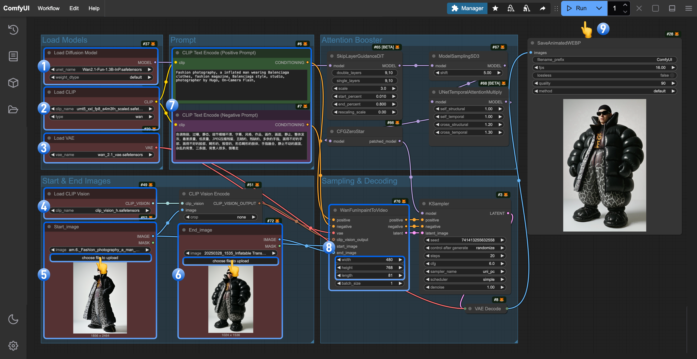

import UpdateReminder from "/snippets/de/tutorials/update-reminder.mdx";

**Wan2.1 Fun InP** ist ein Open-Source-Videogenerierungsmodell aus Alibabas Wan2.1-Fun-Serie. Sie stellen ein Bild für das erste und das letzte Frame bereit, und das Modell erzeugt daraus das Übergangsvideo mit stabiler, kohärenter Bewegung.

Diese Anleitung behandelt den offiziellen ComfyUI-Workflow für Wan2.1 Fun InP, der in einer leichten 1.3B-Version und einer leistungsstarken 14B-Version verfügbar ist, samt Modelldownloads und Schritt-für-Schritt-Anweisungen zur Generierung.

## Über Wan2.1-Fun-InP

**Wan-Fun InP** ist ein von Alibaba veröffentlichtes Open-Source-Modell zur Videogenerierung. Es gehört zur Wan2.1-Fun-Serie und konzentriert sich auf die Generierung von Videos aus Bildern mit Steuerung über das erste und letzte Frame.

**Wichtigste Funktionen**:
- **Steuerung des ersten und letzten Frames**: Unterstützt die Eingabe von Bildern sowohl für das erste als auch für das letzte Frame, um daraus ein Übergangsvideo zu generieren, was die Kohärenz des Videos und die kreative Freiheit erhöht. Im Vergleich zu früheren Community-Versionen liefert das offizielle Modell von Alibaba stabilere und deutlich hochwertigere Ergebnisse.
- **Unterstützung mehrerer Auflösungen**: Unterstützt die Generierung von Videos in 512x512, 768x768, 1024x1024 und weiteren Auflösungen, um unterschiedliche Szenarioanforderungen abzudecken.

**Modellversionen**:
- **1.3B** Leichtgewichtig: Geeignet für den lokalen Einsatz und schnelle Inferenz mit **geringeren VRAM-Anforderungen**
- **14B** Leistungsstark: Die Modellgröße erreicht 32GB+ und liefert bessere Ergebnisse, erfordert aber **mehr VRAM**

Im Folgenden finden Sie die relevanten Modellgewichte und Code-Repositories:

- [Wan2.1-Fun-1.3B-Input](https://huggingface.co/alibaba-pai/Wan2.1-Fun-1.3B-Input)
- [Wan2.1-Fun-14B-Input](https://huggingface.co/alibaba-pai/Wan2.1-Fun-14B-Input)
- Code-Repository: [VideoX-Fun](https://github.com/aigc-apps/VideoX-Fun)

<Tip>
Derzeit unterstützt ComfyUI das Modell Wan2.1 Fun InP nativ. Bitte aktualisieren Sie Ihr ComfyUI, bevor Sie mit diesem Tutorial beginnen, um sicherzustellen, dass Ihre Version nach [diesem Commit](https://github.com/Comfy-Org/ComfyUI/commit/0a1f8869c9998bbfcfeb2e97aa96a6d3e0a2b5df) liegt.
</Tip>

<UpdateReminder/>

## Wan2.1 Fun InP Workflow

### 1. Workflow herunterladen

Laden Sie das folgende Bild herunter und ziehen Sie es in ComfyUI, um den Workflow zu laden:


<CardGroup cols={2}>
  <Card title="Auf Comfy Cloud ausführen" icon="cloud" href="https://cloud.comfy.org/?template=wan2.1_fun_inp&utm_source=docs&utm_medium=referral&utm_campaign=fun-inp">
    In Comfy Cloud öffnen
  </Card>
  <Card title="Workflow herunterladen" icon="download" href="https://github.com/Comfy-Org/workflow_templates/blob/main/templates/wan2.1_fun_inp.json">
    Laden Sie die JSON-Datei herunter oder suchen Sie in der Vorlagenbibliothek nach „Wan 2.1 Inpainting“
  </Card>
</CardGroup>

<CardGroup cols={2}>
  <Card title="Startbild" icon="image" href="https://raw.githubusercontent.com/Comfy-Org/workflow_templates/main/input/wan2.1_fun_inp_start_image.png">
    Startframe für die Videogenerierung. Laden Sie dieses Bild herunter und verwenden Sie es, oder ersetzen Sie es durch Ihr eigenes.
  </Card>
  <Card title="Endbild" icon="image" href="https://raw.githubusercontent.com/Comfy-Org/workflow_templates/main/input/wan2.1_fun_inp_end_image.png">
    Endframe für die Videogenerierung. Laden Sie dieses Bild herunter und verwenden Sie es, oder ersetzen Sie es durch Ihr eigenes.
  </Card>
</CardGroup>

### 2. Modelle manuell installieren

Wenn das automatische Herunterladen der Modelle nicht funktioniert, laden Sie die Modelle bitte manuell herunter und speichern Sie sie in den entsprechenden Ordnern.

Alle in dieser Anleitung verwendeten Modelle finden Sie unter [Wan_2.1_ComfyUI_repackaged](https://huggingface.co/Comfy-Org/Wan_2.1_ComfyUI_repackaged) und [Wan2.1-Fun](https://huggingface.co/collections/alibaba-pai/wan21-fun-67e4fb3b76ca01241eb7e334).

**Diffusionsmodelle**: Wählen Sie 1.3B oder 14B. Die 14B-Version hat eine größere Dateigröße (32GB) und höhere VRAM-Anforderungen:

<CardGroup cols={2}>
  <Card title="Diffusionsmodell: Wan2.1 Fun InP 1.3B" icon="download" href="https://huggingface.co/Comfy-Org/Wan_2.1_ComfyUI_repackaged/blob/main/split_files/diffusion_models/wan2.1_fun_inp_1.3B_bf16.safetensors">
    `models/diffusion_models/wan2.1_fun_inp_1.3B_bf16.safetensors`
  </Card>
  <Card title="Diffusionsmodell: Wan2.1 Fun InP 14B" icon="download" href="https://huggingface.co/alibaba-pai/Wan2.1-Fun-14B-InP/blob/main/diffusion_pytorch_model.safetensors">
    `models/diffusion_models/Wan2.1-Fun-14B-InP.safetensors` (nach dem Herunterladen umbenennen)
  </Card>
</CardGroup>

**Text-Encoder**: Wählen Sie eines der folgenden Modelle (fp16 hat eine größere Dateigröße und höhere Leistungsanforderungen):

<CardGroup cols={2}>
  <Card title="Text-Encoder: umt5_xxl_fp16" icon="download" href="https://huggingface.co/Comfy-Org/Wan_2.1_ComfyUI_repackaged/blob/main/split_files/text_encoders/umt5_xxl_fp16.safetensors">
    `models/text_encoders/umt5_xxl_fp16.safetensors`
  </Card>
  <Card title="Text-Encoder: umt5_xxl_fp8" icon="download" href="https://huggingface.co/Comfy-Org/Wan_2.1_ComfyUI_repackaged/blob/main/split_files/text_encoders/umt5_xxl_fp8_e4m3fn_scaled.safetensors">
    `models/text_encoders/umt5_xxl_fp8_e4m3fn_scaled.safetensors`
  </Card>
</CardGroup>

**VAE**

<Card title="VAE: wan_2.1_vae" icon="download" href="https://huggingface.co/Comfy-Org/Wan_2.1_ComfyUI_repackaged/blob/main/split_files/vae/wan_2.1_vae.safetensors">
  `models/vae/wan_2.1_vae.safetensors`
</Card>
**CLIP Vision**

<Card title="CLIP Vision: clip_vision_h" icon="download" href="https://huggingface.co/Comfy-Org/Wan_2.1_ComfyUI_repackaged/blob/main/split_files/clip_vision/clip_vision_h.safetensors">
  `models/clip_vision/clip_vision_h.safetensors`
</Card>
Speicherort der Dateien:
```
📂 ComfyUI/
├── 📂 models/
│   ├── 📂 diffusion_models/
│   │   ├── wan2.1_fun_inp_1.3B_bf16.safetensors
│   │   └── Wan2.1-Fun-14B-InP.safetensors
│   ├── 📂 text_encoders/
│   │   ├── umt5_xxl_fp16.safetensors
│   │   └── umt5_xxl_fp8_e4m3fn_scaled.safetensors
│   ├── 📂 vae/
│   │   └── wan_2.1_vae.safetensors
│   └── 📂 clip_vision/
│       └── clip_vision_h.safetensors
```

### 3. Workflow Schritt für Schritt vervollständigen



1. Stellen Sie sicher, dass der Node `Load Diffusion Model` das Modell `wan2.1_fun_inp_1.3B_bf16.safetensors` geladen hat
2. Stellen Sie sicher, dass der Node `Load CLIP` das Modell `umt5_xxl_fp8_e4m3fn_scaled.safetensors` geladen hat
3. Stellen Sie sicher, dass der Node `Load VAE` das Modell `wan_2.1_vae.safetensors` geladen hat
4. Stellen Sie sicher, dass der Node `Load CLIP Vision` das Modell `clip_vision_h.safetensors` geladen hat
5. Laden Sie das Startframe in den Node `Load Image` hoch (umbenannt in `Start_image`)
6. Laden Sie das Endframe in den zweiten Node `Load Image` hoch
7. (Optional) Ändern Sie den Prompt (Englisch und Chinesisch werden beide unterstützt)
8. (Optional) Passen Sie die Videogröße in `WanFunInpaintToVideo` an und vermeiden Sie übermäßig große Abmessungen
9. Klicken Sie auf die Schaltfläche `Run` oder verwenden Sie die Tastenkombination `Ctrl(cmd) + Enter`, um die Videogenerierung auszuführen

### 4. Hinweise zum Workflow

<Tip>
Achten Sie bitte darauf, das richtige Modell zu verwenden, da `wan2.1_fun_inp_1.3B_bf16.safetensors` und `wan2.1_fun_control_1.3B_bf16.safetensors` im selben Ordner liegen und sehr ähnliche Namen haben. Stellen Sie sicher, dass Sie das richtige Modell verwenden.
</Tip>

- Bei der Verwendung von Wan Fun InP müssen Sie möglicherweise häufig die Prompts ändern, um die Genauigkeit der entsprechenden Szenenübergänge sicherzustellen.

## Weitere Wan2.1 Fun InP- oder videobezogene Custom-Node-Pakete

- [ComfyUI-VideoHelperSuite](https://github.com/Kosinkadink/ComfyUI-VideoHelperSuite)
- [ComfyUI-WanVideoWrapper](https://github.com/kijai/ComfyUI-WanVideoWrapper)
- [ComfyUI-KJNodes](https://github.com/kijai/ComfyUI-KJNodes)
