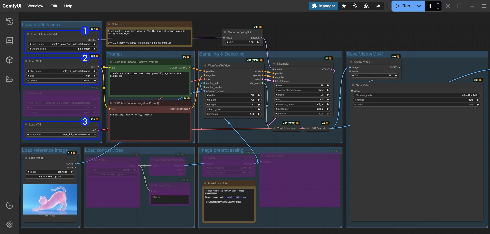
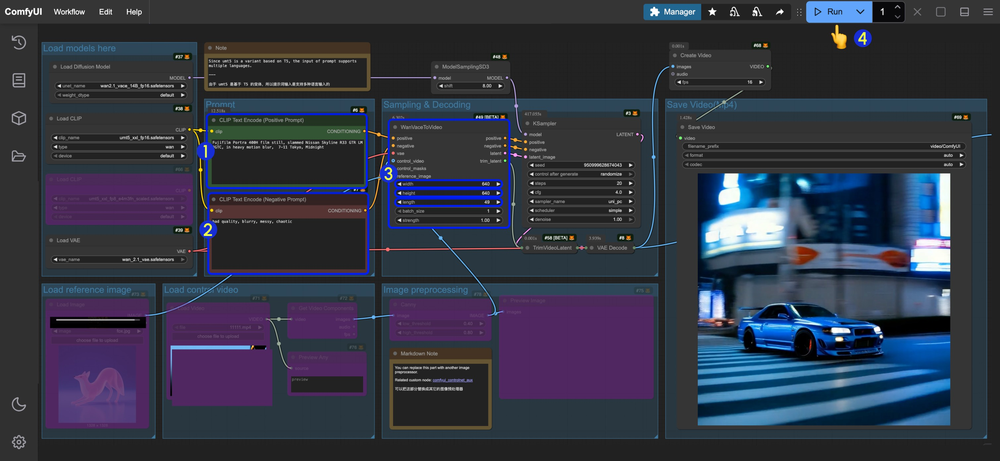
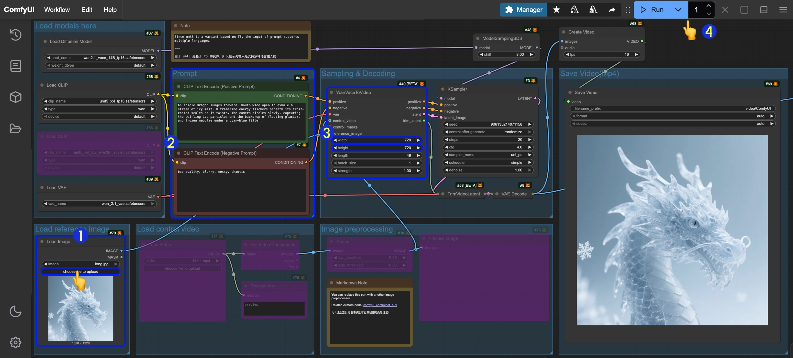
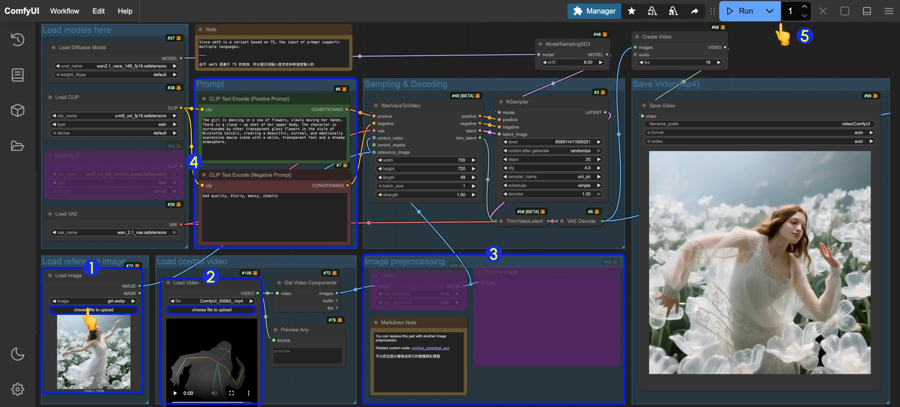

import CancelBypass from "/snippets/de/interface/cancel-bypass.mdx"
import UpdateReminder from "/snippets/de/tutorials/update-reminder.mdx";

<Warning>
Da wir Anpassungen an der Vorlage vorgenommen und zugehörige Nutzungshinweise sowie Anweisungen für CausVid LoRA hinzugefügt haben, muss dieses Dokument aktualisiert werden und erfordert etwas Vorbereitungszeit. Bis dahin beachten Sie bitte die Hinweise zur Nutzung in der Vorlage.
</Warning>

## Über VACE

VACE 14B ist ein quelloffenes, einheitliches Videobearbeitungsmodell, das vom Team Alibaba Tongyi Wanxiang veröffentlicht wurde. Durch die Integration von Multitasking-Fähigkeiten, die Unterstützung hochauflösender Verarbeitung und flexible multimodale Eingabemechanismen verbessert dieses Modell die Effizienz und Qualität der Videoerstellung erheblich.

Das Modell ist unter der Lizenz [Apache-2.0](https://github.com/ali-vilab/VACE?tab=Apache-2.0-1-ov-file) quelloffen verfügbar und kann für persönliche oder kommerzielle Zwecke verwendet werden.

Im Folgenden finden Sie eine umfassende Analyse der Kernfunktionen und technischen Highlights:

- Multimodale Eingabe: unterstützt mehrere Eingabeformen wie Text, Bilder, Video, Masken und Steuersignale
- Einheitliche Architektur: ein einziges Modell unterstützt mehrere Aufgaben mit frei kombinierbaren Funktionen
- Bewegungsübertragung: erzeugt zusammenhängende Aktionen auf Basis von Referenzvideos
- Lokaler Austausch: ersetzt bestimmte Bereiche in Videos mithilfe von Masken
- Videoerweiterung: vervollständigt Aktionen oder erweitert Hintergründe
- Hintergrundaustausch: behält Motive bei und ändert dabei die Umgebungshintergründe

Derzeit sind zwei Versionen von VACE veröffentlicht: 1.3B und 14B. Im Vergleich zur 1.3B-Version unterstützt die 14B-Version eine Ausgabe in 720P-Auflösung mit besseren Bilddetails und höherer Stabilität.

| Modell                                                      | 480P | 720P |
| ----------------------------------------------------------- | ---- | ---- |
| [VACE-1.3B](https://huggingface.co/Wan-AI/Wan2.1-VACE-1.3B) | ✅   | ❌   |
| [VACE-14B](https://huggingface.co/Wan-AI/Wan2.1-VACE-14B)   | ✅   | ✅   |

Zugehörige Modellgewichte und Code-Repositories:

<CardGroup cols={2}>
  <Card title="VACE-1.3B" icon="download" href="https://huggingface.co/Wan-AI/Wan2.1-VACE-1.3B">
    1.3B-Modellgewichte auf Hugging Face
  </Card>
  <Card title="VACE-14B" icon="download" href="https://huggingface.co/Wan-AI/Wan2.1-VACE-14B">
    14B-Modellgewichte auf Hugging Face
  </Card>
  <Card title="GitHub-Repository" icon="github" href="https://github.com/ali-vilab/VACE">
    VACE-Quellcode und Dokumentation
  </Card>
  <Card title="VACE-Projektseite" icon="globe" href="https://ali-vilab.github.io/VACE-Page/">
    Offizielle Projekt-Homepage mit Beispielen
  </Card>
</CardGroup>

<UpdateReminder/>

## Modelle herunterladen und laden in Workflows

Da alle in diesem Dokument behandelten Workflows dieselbe Workflow-Vorlage verwenden, können wir zuerst die Informationen zum Herunterladen und Laden der Modelle beschreiben und anschließend durch das Bypassen verschiedener Nodes unterschiedliche Eingänge aktivieren oder deaktivieren, um verschiedene Workflows zu erzielen.
Die Informationen zum Herunterladen der Modelle sind in den konkreten Beispielen bereits in den Workflow-Informationen enthalten, sodass Sie die Modelle auch beim Herunterladen der jeweiligen Beispiel-Workflows herunterladen können.

### Modelle herunterladen

**Diffusionsmodelle**

<CardGroup cols={2}>
  <Card title="wan2.1_vace_14B_fp16.safetensors" icon="download" href="https://huggingface.co/Comfy-Org/Wan_2.1_ComfyUI_repackaged/blob/main/split_files/diffusion_models/wan2.1_vace_14B_fp16.safetensors">
    VACE 14B Diffusionsmodell (empfohlen, ~32GB). Legen Sie es in <code>ComfyUI/models/diffusion_models/</code> ab
  </Card>
  <Card title="wan2.1_vace_1.3B_fp16.safetensors" icon="download" href="https://huggingface.co/Comfy-Org/Wan_2.1_ComfyUI_repackaged/blob/main/split_files/diffusion_models/wan2.1_vace_1.3B_fp16.safetensors">
    VACE 1.3B Diffusionsmodell (leichter, ~7GB). Legen Sie es in <code>ComfyUI/models/diffusion_models/</code> ab
  </Card>
</CardGroup>

<Tip>
Wenn Sie bereits Workflows im Zusammenhang mit Wan Video verwendet haben, haben Sie die folgenden Modelldateien bereits heruntergeladen.
</Tip>

**VAE**

<CardGroup cols={2}>
  <Card title="wan_2.1_vae.safetensors" icon="download" href="https://huggingface.co/Comfy-Org/Wan_2.1_ComfyUI_repackaged/blob/main/split_files/vae/wan_2.1_vae.safetensors">
    Wan VAE-Modell. Legen Sie es in <code>ComfyUI/models/vae/</code> ab
  </Card>
</CardGroup>

**Text-Encoder** (wählen Sie eine Version)

<CardGroup cols={2}>
  <Card title="umt5_xxl_fp16.safetensors" icon="download" href="https://huggingface.co/Comfy-Org/Wan_2.1_ComfyUI_repackaged/blob/main/split_files/text_encoders/umt5_xxl_fp16.safetensors">
    Text-Encoder in voller Präzision (höhere Qualität, größere Dateigröße). Legen Sie ihn in <code>ComfyUI/models/text_encoders/</code> ab
  </Card>
  <Card title="umt5_xxl_fp8_e4m3fn_scaled.safetensors" icon="download" href="https://huggingface.co/Comfy-Org/Wan_2.1_ComfyUI_repackaged/blob/main/split_files/text_encoders/umt5_xxl_fp8_e4m3fn_scaled.safetensors">
    FP8-Text-Encoder (geringerer VRAM-Verbrauch). Legen Sie ihn in <code>ComfyUI/models/text_encoders/</code> ab
  </Card>
</CardGroup>

Speicherort der Dateien:

```
📂 ComfyUI/
├── 📂 models/
│   ├── 📂 diffusion_models/
│   │   └─── wan2.1_vace_14B_fp16.safetensors
│   ├── 📂 text_encoders/
│   │   └─── umt5_xxl_fp8_e4m3fn_scaled.safetensors # oder umt5_xxl_fp16.safetensors
│   └── 📂 vae/
│       └──  wan_2.1_vae.safetensors
```

### Modelle laden

Da die in den in diesem Dokument behandelten Workflows verwendeten Modelle identisch sind, sind auch die Workflows gleich, und es werden nur Nodes gebypasst, um unterschiedliche Eingänge zu aktivieren oder zu deaktivieren. Bitte beachten Sie die folgende Abbildung, um sicherzustellen, dass die entsprechenden Modelle in den verschiedenen Workflows korrekt geladen sind.



1. Stellen Sie sicher, dass der Node `Load Diffusion Model` `wan2.1_vace_14B_fp16.safetensors` geladen hat
2. Stellen Sie sicher, dass der Node `Load CLIP` `umt5_xxl_fp8_e4m3fn_scaled.safetensors` oder `umt5_xxl_fp16.safetensors` geladen hat
3. Stellen Sie sicher, dass der Node `Load VAE` `wan_2.1_vae.safetensors` geladen hat

<CancelBypass/>

---

## 1. VACE Text zu Video

**Funktion:** Wandelt Textbeschreibungen mit dem Wan2.1 VACE 14B Modell in hochwertige Videos um. Unterstützt sowohl 480p als auch 720p Auflösung.

### Wan2.1 VACE Text zu Video {#video_wan_vace_14B_t2v}

Wandelt Textbeschreibungen in hochwertige Videos um. Unterstützt 480p und 720p mit dem VACE-14B Modell.


<CardGroup cols={2}>
  <Card title="Auf Comfy Cloud ausführen" icon="cloud" href="https://cloud.comfy.org/?template=video_wan_vace_14B_t2v&utm_source=docs&utm_medium=referral&utm_campaign=vace">
    In Comfy Cloud öffnen
  </Card>
  <Card title="Workflow herunterladen" icon="download" href="https://github.com/Comfy-Org/workflow_templates/blob/main/templates/video_wan_vace_14B_t2v.json">
    JSON herunterladen oder in der Vorlagenbibliothek nach „Wan2.1 VACE Text to Video“ suchen
  </Card>
</CardGroup>

<video
  controls
  className="w-full aspect-video"
  src="https://github.com/Comfy-Org/example_workflows/raw/refs/heads/main/video/wan/vace/vace-t2v.mp4"
></video>

<Tip>
Wenn Sie den Workflow nicht aus einer mp4-Datei laden können, stellen Sie bitte sicher, dass Ihre ComfyUI-Frontend-Version der aktuellen Version in [requirements.txt](https://github.com/Comfy-Org/ComfyUI/blob/master/requirements.txt) entspricht, damit Sie den Workflow aus einer mp4-Datei laden können.

Derzeit ist 1.19.9 die neueste ComfyUI-Frontend-Version in der Datei requirements.txt.
</Tip>

### Schritte zur Ausführung



Bitte folgen Sie den nummerierten Schritten im Bild, um eine reibungslose Ausführung des Workflows zu gewährleisten:

1. Geben Sie positive Prompts in den Node `CLIP Text Encode (Positive Prompt)` ein
2. Geben Sie negative Prompts in den Node `CLIP Text Encode (Negative Prompt)` ein
3. Legen Sie die Bildabmessungen (für den ersten Lauf wird eine Auflösung von 640x640 empfohlen) und die Frame-Anzahl (Videodauer) in `WanVaceToVideo` fest
4. Klicken Sie auf die Schaltfläche `Run` oder verwenden Sie die Tastenkombination `Ctrl(cmd) + Enter`, um die Videogenerierung auszuführen
5. Nach der Generierung wird das Video automatisch im Verzeichnis `ComfyUI/output/video` gespeichert (der Unterordner hängt von den Einstellungen des `save video` Nodes ab)

<Tip>
Bei Tests mit einer 4090 GPU:
- Auflösung 720x1280: Das Generieren von 81 Frames dauert etwa 40 Minuten
- Auflösung 640x640: Das Generieren von 49 Frames dauert etwa 7 Minuten

Die Videoqualität bei 720P ist jedoch besser.
</Tip>

---

## 2. VACE Bild zu Video

**Was er macht:** Generiert Videos, die Stil und Inhalt eines Referenzbildes entsprechen. Ideal für stilkonstente Videogenerierung.

Sie können den obigen Workflow weiterverwenden. Heben Sie einfach die Bypass-Markierung des `Load image`-Nodes in **Load reference image** auf und geben Sie Ihr Bild ein. Sie können auch das unten stehende Bild verwenden. In dieser Datei sind die entsprechenden Parameter bereits eingerichtet.

### Wan2.1 VACE Reference to Video {#video_wan_vace_14B_ref2v}

Erstellen Sie Videos, die Stil und Inhalt eines Referenzbildes entsprechen. Ideal für stilkonstente Videogenerierung.


<CardGroup cols={2}>
  <Card title="Auf Comfy Cloud ausführen" icon="cloud" href="https://cloud.comfy.org/?template=video_wan_vace_14B_ref2v&utm_source=docs&utm_medium=referral&utm_campaign=vace">
    In Comfy Cloud öffnen
  </Card>
  <Card title="Workflow herunterladen" icon="download" href="https://github.com/Comfy-Org/workflow_templates/blob/main/templates/video_wan_vace_14B_ref2v.json">
    JSON herunterladen oder in der Vorlagenbibliothek nach „Wan2.1 VACE Reference to Video“ suchen
  </Card>
</CardGroup>

<video
  controls
  className="w-full aspect-video"
  src="https://raw.githubusercontent.com/Comfy-Org/example_workflows/refs/heads/main/video/wan/vace/i2v/vace_i2v.mp4"
></video>

**Eingabematerialien**

Laden Sie diese Datei in den passenden `LoadImage`-Node hoch:

<CardGroup cols={2}>
  <Card title="video_wan_vace_14B_ref2v_reference_image.jpg" icon="image" href="https://raw.githubusercontent.com/Comfy-Org/workflow_templates/main/input/video_wan_vace_14B_ref2v_reference_image.jpg">
    `LoadImage`-Node 73 · `video_wan_vace_14B_ref2v_reference_image.jpg`
  </Card>
</CardGroup>

<div style={{display: 'grid', gridTemplateColumns: 'repeat(2, minmax(0, 1fr))', gap: '1rem', alignItems: 'start'}}>
  
</div>

### Schritte zur Ausführung



Folgen Sie bitte den nummerierten Schritten im Bild, um eine reibungslose Ausführung des Workflows zu gewährleisten:

1. Geben Sie das entsprechende Bild im `Load image`-Node ein
2. Sie können Prompts wie im Text-zu-Video-Workflow bearbeiten und anpassen
3. Legen Sie die Bildabmessungen (für den ersten Lauf werden 640x640 Auflösung empfohlen) und die Bildanzahl (Videodauer) in `WanVaceToVideo` fest
4. Klicken Sie auf die Schaltfläche `Run` oder verwenden Sie die Tastenkombination `Ctrl(cmd) + Enter`, um die Videogenerierung auszuführen
5. Nach der Generierung wird das Video automatisch im Verzeichnis `ComfyUI/output/video` gespeichert (der Unterordner hängt von den Einstellungen des `save video`-Nodes ab)

<Tip>
Sie können beispielsweise Nodes zum Abrufen der Bildabmessungen verwenden, um die Auflösung festzulegen. Aufgrund der Schritt-Anforderungen der entsprechenden Nodes bei Breite und Höhe können jedoch Fehlermeldungen auftreten, wenn Ihre Bildabmessungen nicht durch 16 teilbar sind.
</Tip>

### Weitere Hinweise

VACE unterstützt auch die Eingabe mehrerer Referenzbilder in einem einzigen Bild, um entsprechende Videos zu generieren. Beispiele dazu finden Sie auf der [Projektseite](https://ali-vilab.github.io/VACE-Page/) von VACE.

---

## 3. VACE Video-zu-Video

**Was es bewirkt:** Generieren Sie Videos, indem Sie Eingabevideos und Referenzbilder mit Wan VACE steuern. Steuern Sie Videostil und Bewegung über Referenzmaterialien.

### Wan2.1 VACE Control Video {#video_wan_vace_14B_v2v}

Generieren Sie Videos, indem Sie Eingabevideos und Referenzbilder mit Wan VACE steuern.


<CardGroup cols={2}>
  <Card title="Auf Comfy Cloud ausführen" icon="cloud" href="https://cloud.comfy.org/?template=video_wan_vace_14B_v2v&utm_source=docs&utm_medium=referral&utm_campaign=vace">
    In Comfy Cloud öffnen
  </Card>
  <Card title="Workflow herunterladen" icon="download" href="https://github.com/Comfy-Org/workflow_templates/blob/main/templates/video_wan_vace_14B_v2v.json">
    JSON herunterladen oder in der Vorlagenbibliothek nach „Wan2.1 VACE Control Video“ suchen
  </Card>
</CardGroup>

<video
  controls
  className="w-full aspect-video"
  src="https://raw.githubusercontent.com/Comfy-Org/example_workflows/refs/heads/main/video/wan/vace/v2v/vace_v2v.mp4"
></video>

Die folgenden Materialien werden als Eingabe verwendet:

<CardGroup cols={2}>
  <Card title="Referenzbild" icon="image" href="https://raw.githubusercontent.com/Comfy-Org/workflow_templates/refs/heads/main/input/video_wan_vace_14B_v2v_reference_image.jpg">
    Referenzbild als Eingabe für Stil und Inhalt.
  </Card>
  <Card title="Kontrollvideo (vorverarbeitet)" icon="video" href="https://raw.githubusercontent.com/Comfy-Org/workflow_templates/refs/heads/main/input/video_wan_vace_14B_v2v_reference_image_control_video.mp4">
    Vorverarbeitetes Kontrollvideo (Tiefe). Verwenden Sie es direkt in <code>Load Video</code> unter <strong>Load control video</strong>.
  </Card>
</CardGroup>

1. Eingabebild als Referenz:


2. Das folgende Video wurde vorverarbeitet und wird zur Steuerung der Videogenerierung verwendet:

<video
  controls
  className="w-full aspect-video"
  src="https://raw.githubusercontent.com/Comfy-Org/example_workflows/refs/heads/main/video/wan/vace/v2v/post+depth.mp4"
></video>

3. Das folgende Video ist das Originalvideo. Sie können diese Materialien herunterladen und Vorverarbeitungs-Nodes wie [comfyui_controlnet_aux](https://github.com/Fannovel16/comfyui_controlnet_aux) verwenden, um die Bilder vorzuverarbeiten:

<video
  controls
  className="w-full aspect-video"
  src="https://raw.githubusercontent.com/Comfy-Org/example_workflows/refs/heads/main/video/wan/vace/v2v/original.mp4"
></video>

### Schritte zur Ausführung



Bitte folgen Sie den nummerierten Schritten im Bild, um eine reibungslose Ausführung des Workflows zu gewährleisten:

1. Geben Sie das Referenzbild im Node `Load Image` unter **Load reference image** ein
2. Geben Sie das Kontrollvideo im Node `Load Video` unter **Load control video** ein. Da das bereitgestellte Video vorverarbeitet ist, ist keine zusätzliche Verarbeitung erforderlich
3. Wenn Sie das Originalvideo selbst vorverarbeiten müssen, können Sie die Gruppe **Image preprocessing** ändern oder `comfyui_controlnet_aux`-Nodes verwenden, um die Vorverarbeitung abzuschließen
4. Ändern Sie die Prompts
5. Legen Sie die Bildabmessungen (für den ersten Durchlauf wird eine Auflösung von 640x640 empfohlen) und die Frameanzahl (Videodauer) in `WanVaceToVideo` fest
6. Klicken Sie auf die Schaltfläche `Run` oder verwenden Sie die Tastenkombination `Ctrl(cmd) + Enter`, um die Videogenerierung auszuführen
7. Sobald das Video generiert wurde, wird es automatisch im Verzeichnis `ComfyUI/output/video` gespeichert (der Unterordner hängt von den Einstellungen des Nodes `save video` ab)

---

## 4. VACE Inpainting

**Was es bewirkt:** Bearbeiten Sie bestimmte Bereiche in Videos, während der umgebende Inhalt erhalten bleibt. Ideal zum Entfernen oder Ersetzen von Objekten.

### Wan2.1 VACE Inpainting {#video_wan_vace_inpainting}

Bearbeiten Sie bestimmte Bereiche in Videos, während der umgebende Inhalt erhalten bleibt. Ideal zum Entfernen oder Ersetzen von Objekten.


<CardGroup cols={2}>
  <Card title="Auf Comfy Cloud ausführen" icon="cloud" href="https://cloud.comfy.org/?template=video_wan_vace_inpainting&utm_source=docs&utm_medium=referral&utm_campaign=vace">
    In Comfy Cloud öffnen
  </Card>
  <Card title="Workflow herunterladen" icon="download" href="https://github.com/Comfy-Org/workflow_templates/blob/main/templates/video_wan_vace_inpainting.json">
    JSON herunterladen oder in der Vorlagenbibliothek nach „Wan2.1 VACE Inpainting“ suchen
  </Card>
</CardGroup>

**Eingabematerialien**

<CardGroup cols={2}>
  <Card title="Eingabevideo" icon="video" href="https://raw.githubusercontent.com/Comfy-Org/workflow_templates/refs/heads/main/input/video_wan_vace_inpainting_input_video.mp4">
    Eingabevideo für das Inpainting. Laden Sie es im Node <code>Load Video</code>.
  </Card>
  <Card title="Erstes Frame & Maskierung" icon="image" href="https://raw.githubusercontent.com/Comfy-Org/workflow_templates/refs/heads/main/input/video_wan_vace_inpainting_1st_frame_and_mask.png">
    Erstes Frame mit überlagerter Maskierung für den Inpainting-Bereich.
  </Card>
  <Card title="Referenzbild" icon="image" href="https://raw.githubusercontent.com/Comfy-Org/workflow_templates/refs/heads/main/input/video_wan_vace_inpainting_reference_image.jpg">
    Referenzbild für den Inhalt des Inpaintings.
  </Card>
</CardGroup>

[Wird noch aktualisiert]

---

## 5. Video-Outpainting mit VACE

**Funktion:** Generieren Sie erweiterte Videos, indem Sie die Videoabmessungen mit Wan VACE Outpainting erweitern.

### Wan2.1 VACE Outpainting {#video_wan_vace_outpainting}

Generieren Sie erweiterte Videos, indem Sie die Videoabmessungen mit Wan VACE Outpainting erweitern.


<CardGroup cols={2}>
  <Card title="Auf Comfy Cloud ausführen" icon="cloud" href="https://cloud.comfy.org/?template=video_wan_vace_outpainting&utm_source=docs&utm_medium=referral&utm_campaign=vace">
    In Comfy Cloud öffnen
  </Card>
  <Card title="Workflow herunterladen" icon="download" href="https://github.com/Comfy-Org/workflow_templates/blob/main/templates/video_wan_vace_outpainting.json">
    Laden Sie die JSON-Datei herunter oder suchen Sie in der Vorlagenbibliothek nach „Wan2.1 VACE Outpainting“.
  </Card>
</CardGroup>

**Eingabematerialien**

<CardGroup cols={2}>
  <Card title="Eingabevideo" icon="video" href="https://raw.githubusercontent.com/Comfy-Org/workflow_templates/refs/heads/main/input/video_wan_vace_outpainting_input_video.mp4">
    Eingabevideo für Outpainting. Laden Sie es über den Node <code>Load Video</code>.
  </Card>
</CardGroup>

[Wird noch aktualisiert]

## 6. VACE-Videogenerierung mit Start- und End-Frame

**Was es bewirkt:** Generieren Sie glatte Videoübergänge, indem Sie Start- und End-Frames definieren. Unterstützt benutzerdefinierte Keyframe-Sequenzen.

### Wan2.1 VACE First-Last Frame {#video_wan_vace_flf2v}

Generieren Sie glatte Videoübergänge, indem Sie Start- und End-Frames definieren. Unterstützt benutzerdefinierte Keyframe-Sequenzen.


<CardGroup cols={2}>
  <Card title="Auf Comfy Cloud ausführen" icon="cloud" href="https://cloud.comfy.org/?template=video_wan_vace_flf2v&utm_source=docs&utm_medium=referral&utm_campaign=vace">
    In Comfy Cloud öffnen
  </Card>
  <Card title="Workflow herunterladen" icon="download" href="https://github.com/Comfy-Org/workflow_templates/blob/main/templates/video_wan_vace_flf2v.json">
    JSON herunterladen oder in der Vorlagenbibliothek nach „Wan2.1 VACE First-Last Frame“ suchen
  </Card>
</CardGroup>

**Eingabematerialien**

<CardGroup cols={2}>
  <Card title="Start-Frame" icon="image" href="https://raw.githubusercontent.com/Comfy-Org/workflow_templates/refs/heads/main/input/video_wan_vace_flf2v_start_image.png">
    Start-Frame-Bild. Im Node <code>Load Image</code> laden.
  </Card>
  <Card title="End-Frame" icon="image" href="https://raw.githubusercontent.com/Comfy-Org/workflow_templates/refs/heads/main/input/video_wan_vace_flf2v_end_image.png">
    End-Frame-Bild. Im Node <code>Load Image</code> laden.
  </Card>
</CardGroup>

Damit der erste und der letzte Frame wirksam sind, muss die Einstellung `length` des Videos die Bedingung erfüllen, dass `length-1` durch 4 teilbar ist.

Die entsprechende Einstellung `Batch_size` muss die Bedingung `Batch_size = length - 2` erfüllen.

[Wird noch aktualisiert]
