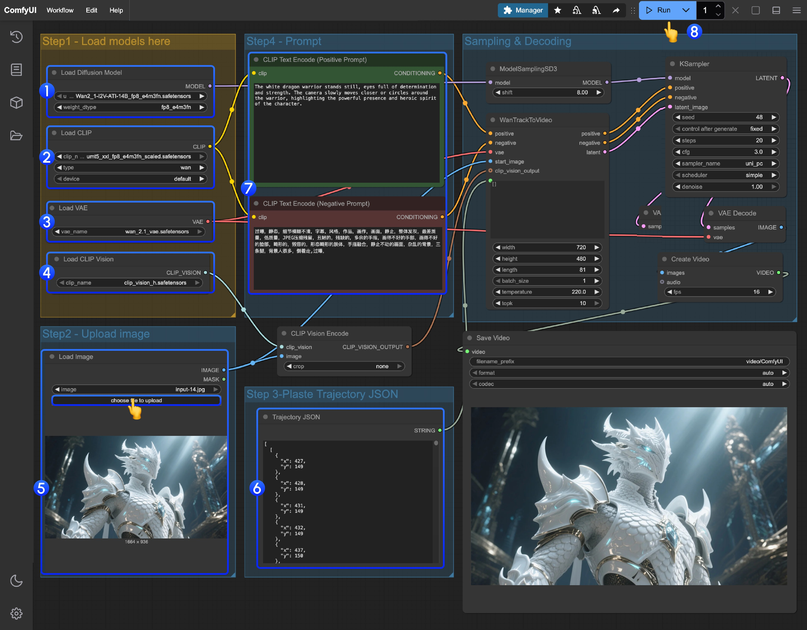

import UpdateReminder from "/snippets/de/tutorials/update-reminder.mdx"

**ATI (Any Trajectory Instruction)** ist ein Framework zur kontrollierbaren Videogenerierung, das vom ByteDance-Team vorgestellt wurde. ATI basiert auf Wan2.1 und ermöglicht die einheitliche Steuerung von Objekten, lokalen Bereichen und Kamerabewegungen in Videos durch beliebige Trajektorienanweisungen.

<CardGroup cols={2}>
  <Card title="Projekt-Repository" icon="github" href="https://github.com/bytedance/ATI">
    ATI-Quellcode und Dokumentation auf GitHub
  </Card>
  <Card title="Online-Werkzeug zum Bearbeiten von Trajektorien" icon="pencil" href="https://comfyui-wiki.github.io/Trajectory-Annotation-Tool/">
    Visuelles Werkzeug zum Zeichnen und Bearbeiten von Bewegungstrajektorien auf Bildern
  </Card>
</CardGroup>

## Hauptfunktionen

- **Einheitliche Bewegungssteuerung**: Unterstützt die Trajektoriensteuerung für mehrere Bewegungsarten, darunter Objekte, lokale Bereiche und Kamerabewegungen.
- **Interaktiver Trajektorieneditor**: Visuelles Werkzeug, mit dem Sie Bewegungsbahnen auf Bildern frei zeichnen und bearbeiten können.
- **Wan2.1-kompatibel**: Basierend auf der offiziellen Wan2.1-Implementierung, kompatibel mit Umgebungen und Modellstrukturen.
- **Umfangreiche Visualisierungswerkzeuge**: Unterstützt die Visualisierung von Eingabetrajektorien, Ausgabevideos und Trajektorienüberlagerungen.

## Beispiel-Workflow: WAN ATI Trajektoriensteuerung

<UpdateReminder />

### 1. Workflow herunterladen

Aktualisieren Sie ComfyUI auf die neueste Version, laden Sie dann die Workflow-Datei herunter und ziehen Sie sie in ComfyUI, oder suchen Sie „Wan2.1 ATI“ in der Vorlagenbibliothek unter `Workflow` → `Browse Templates` → `Video`.


<CardGroup cols={2}>
  <Card title="Auf Comfy Cloud ausführen" icon="cloud" href="https://cloud.comfy.org/?template=video_wan_ati&utm_source=docs&utm_medium=referral&utm_campaign=wan-ati">
    In Comfy Cloud öffnen
  </Card>
  <Card title="Workflow herunterladen" icon="download" href="https://github.com/Comfy-Org/workflow_templates/blob/main/templates/video_wan_ati.json">
    JSON herunterladen oder in der Vorlagenbibliothek nach „Wan2.1 ATI“ suchen
  </Card>
</CardGroup>

<video
  controls
  className="w-full aspect-video"
  src="https://raw.githubusercontent.com/Comfy-Org/example_workflows/refs/heads/main/video/wan/ati/wan_ati.mp4"
></video>

Wir verwenden das folgende Bild als Eingabe:

<CardGroup cols={1}>
  <Card title="Eingabebild: video_wan_ati_input_image.jpg" icon="image" href="https://raw.githubusercontent.com/Comfy-Org/workflow_templates/main/input/video_wan_ati_input_image.jpg">
    Laden Sie das Standard-Eingabebild herunter oder verwenden Sie Ihr eigenes Bild als Startbild.
  </Card>
</CardGroup>

<video
  controls
  className="w-full aspect-video"
  src="https://raw.githubusercontent.com/Comfy-Org/workflow_templates/main/output/template-Animation_Trajectory_Control_Wan_ATI.mp4"
></video>

### 2. Modelle manuell installieren

Alle in dieser Anleitung verwendeten Modelle finden Sie [hier](https://huggingface.co/Comfy-Org/Wan_2.1_ComfyUI_repackaged/tree/main/split_files).

**Diffusionsmodell**: Wählen Sie eine Version:

<CardGroup cols={1}>
  <Card title="Diffusionsmodell: Wan2_1-I2V-ATI-14B_fp8_e4m3fn.safetensors" icon="download" href="https://huggingface.co/Kijai/WanVideo_comfy/blob/main/Wan2_1-I2V-ATI-14B_fp8_e4m3fn.safetensors">
    Wan2.1 I2V ATI 14B Diffusionsmodell (fp8-Präzision). Ablegen in <code>ComfyUI/models/diffusion_models/</code>
  </Card>
</CardGroup>

**Text-Encoder**: Wählen Sie eine Version:

<CardGroup cols={2}>
  <Card title="Text-Encoder: umt5_xxl_fp16.safetensors" icon="download" href="https://huggingface.co/Comfy-Org/Wan_2.1_ComfyUI_repackaged/blob/main/split_files/text_encoders/umt5_xxl_fp16.safetensors">
    Text-Encoder mit voller Präzision (höhere Qualität, größere Datei). Ablegen in <code>ComfyUI/models/text_encoders/</code>
  </Card>
  <Card title="Text-Encoder: umt5_xxl_fp8_e4m3fn_scaled.safetensors" icon="download" href="https://huggingface.co/Comfy-Org/Wan_2.1_ComfyUI_repackaged/blob/main/split_files/text_encoders/umt5_xxl_fp8_e4m3fn_scaled.safetensors">
    FP8-Text-Encoder (geringerer VRAM-Verbrauch). Ablegen in <code>ComfyUI/models/text_encoders/</code>
  </Card>
</CardGroup>

**VAE**

<Card title="VAE: wan_2.1_vae.safetensors" icon="download" href="https://huggingface.co/Comfy-Org/Wan_2.1_ComfyUI_repackaged/blob/main/split_files/vae/wan_2.1_vae.safetensors">
  Wan2.1 VAE-Modell. Ablegen in <code>ComfyUI/models/vae/</code>
</Card>
**CLIP Vision**

<Card title="CLIP Vision: clip_vision_h.safetensors" icon="download" href="https://huggingface.co/Comfy-Org/Wan_2.1_ComfyUI_repackaged/blob/main/split_files/clip_vision/clip_vision_h.safetensors">
  CLIP Vision-Modell zur Verarbeitung von Referenzbildern. Ablegen in <code>ComfyUI/models/clip_vision/</code>
</Card>
**Speicherort der Dateien**

```
📂 ComfyUI/
├── 📂 models/
│   ├── 📂 diffusion_models/
│   │   └── Wan2_1-I2V-ATI-14B_fp8_e4m3fn.safetensors
│   ├── 📂 text_encoders/
│   │   └── umt5_xxl_fp8_e4m3fn_scaled.safetensors  # oder Ihre gewählte Version
│   ├── 📂 clip_vision/
│   │   └── clip_vision_h.safetensors
│   └── 📂 vae/
│       └── wan_2.1_vae.safetensors
```

### 3. Den Workflow Schritt für Schritt ausführen



Bitte folgen Sie den nummerierten Schritten im Bild, damit der zugehörige Workflow reibungslos ausgeführt wird.

1. Stellen Sie sicher, dass im Node `Load Diffusion Model` das Modell `Wan2_1-I2V-ATI-14B_fp8_e4m3fn.safetensors` geladen ist
2. Stellen Sie sicher, dass im Node `Load CLIP` das Modell `umt5_xxl_fp8_e4m3fn_scaled.safetensors` geladen ist
3. Stellen Sie sicher, dass im Node `Load VAE` das Modell `wan_2.1_vae.safetensors` geladen ist
4. Stellen Sie sicher, dass im Node `Load CLIP Vision` das Modell `clip_vision_h.safetensors` geladen ist
5. Laden Sie das bereitgestellte Eingabebild im Node `Load Image` hoch
6. Trajektorienbearbeitung: Derzeit gibt es in ComfyUI noch keinen passenden Trajektorien-Editor. Über den folgenden Link können Sie die Trajektorienbearbeitung durchführen.
    - [Online-Werkzeug zur Trajektorienbearbeitung](https://comfyui-wiki.github.io/Trajectory-Annotation-Tool/)
7. Wenn Sie die Prompts (Positiv und Negativ) ändern möchten, nehmen Sie die Änderungen im Node `CLIP Text Encoder` mit der Nummer `5` vor
8. Klicken Sie auf die Schaltfläche `Run` oder verwenden Sie die Tastenkombination `Ctrl(cmd) + Enter`, um die Videogenerierung auszuführen
