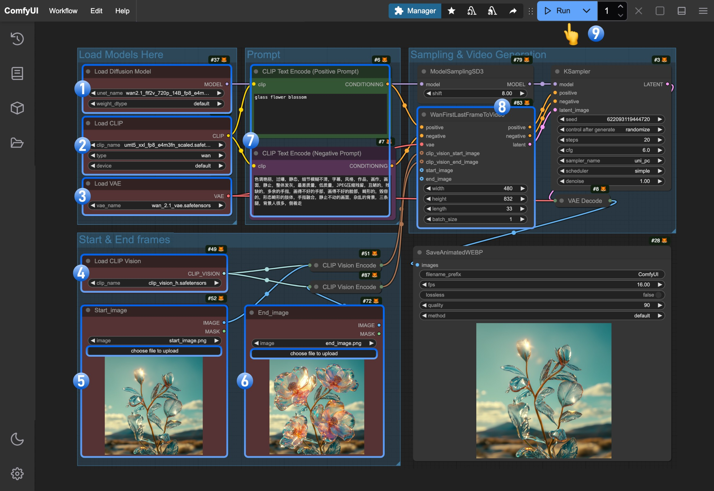

import UpdateReminder from "/snippets/de/tutorials/update-reminder.mdx";

Wan FLF2V (First-Last Frame Video Generation) ist ein Open-Source-Videogenerierungsmodell, das vom Alibaba Tongyi Wanxiang Team entwickelt wurde. Die Open-Source-Lizenz ist [Apache 2.0](https://github.com/Wan-Video/Wan2.1?tab=Apache-2.0-1-ov-file).
Sie müssen lediglich zwei Bilder als Start- und Endframe bereitstellen, und das Modell generiert automatisch die Zwischenbilder des Übergangs und gibt ein logisch kohärentes, natürlich fließendes 720p-HD-Video aus.

**Wichtigste technische Merkmale**

1. **Präzise Steuerung von erstem und letztem Frame**: Die Übereinstimmungsrate von erstem und letztem Frame erreicht 98 %. Anfangs- und Endszene definieren die Grenzen des Videos, während die dynamischen Veränderungen dazwischen intelligent gefüllt werden, um Szenenübergänge und Morphing-Effekte von Objekten zu erzielen.
2. **Stabile und glatte Videogenerierung**: Durch CLIP-Semantikmerkmale und Cross-Attention-Mechanismen wird die Jitter-Rate des Videos im Vergleich zu ähnlichen Modellen um 37 % reduziert, was natürliche und glatte Übergänge gewährleistet.
3. **Vielseitige kreative Möglichkeiten**: Unterstützt das dynamische Einbetten chinesischer und englischer Untertitel sowie die Generierung von Anime-, realistischen und Fantasy-Stilen und passt sich so unterschiedlichen kreativen Anforderungen an.
4. **720p-HD-Ausgabe**: Erzeugt direkt Videos mit 1280x720 Auflösung ohne Nachbearbeitung, geeignet für soziale Medien und kommerzielle Anwendungen.
5. **Unterstützung durch das Open-Source-Ökosystem**: Modellgewichte, Code und Trainingsframework sind vollständig Open Source und unterstützen die Bereitstellung auf gängigen KI-Plattformen.

**Technische Prinzipien und Architektur**

1. **DiT-Architektur**: Basierend auf Diffusionsmodellen und der Diffusion-Transformer-Architektur, kombiniert mit einem Full-Attention-Mechanismus zur Optimierung der Modellierung räumlich-zeitlicher Abhängigkeiten, um die Kohärenz des Videos zu gewährleisten.
2. **3D-kausaler variationaler Encoder**: Die Wan-VAE-Technologie komprimiert HD-Frames auf 1/128 der Größe und behält dabei feine dynamische Details bei, was den Speicherbedarf deutlich reduziert.
3. **Dreistufige Trainingsstrategie**: Ausgehend von einem Pre-Training bei 480P-Auflösung wird schrittweise auf 720P erweitert, wobei durch phasenweise Optimierung Generierungsqualität und Recheneffizienz ausbalanciert werden.

**Weiterführende Links**

- **GitHub-Repository**: [GitHub](https://github.com/Wan-Video/Wan2.1)
- **Hugging-Face-Modellseite**: [Hugging Face](https://huggingface.co/Wan-AI/Wan2.1-FLF2V-14B-720P)
- **ModelScope-Community**: [ModelScope](https://www.modelscope.cn/models/Wan-AI/Wan2.1-FLF2V-14B-720P)

<UpdateReminder/>

## Beispiel: Nativer ComfyUI-Workflow für Wan2.1 FLF2V 720P

### 1. Workflow-Dateien und zugehörige Eingabedateien herunterladen
<Tip>
Da dieses Modell mit hochauflösenden Bildern trainiert wurde, liefern kleinere Größen möglicherweise keine guten Ergebnisse. Im Beispiel verwenden wir die Größe 720 * 1280. Das kann dazu führen, dass es für Nutzer mit wenig VRAM schwierig ist, flüssig zu laufen, und die Generierung dauert lange.
Bei Bedarf passen Sie die Größe der Videogenerierung für Tests an. Eine kleine Generierungsgröße erzeugt mit diesem Modell möglicherweise keine guten Ergebnisse; bitte beachten Sie dies.
</Tip>

Aktualisieren Sie ComfyUI auf die neueste Version, laden Sie dann die Workflow-Datei herunter und ziehen Sie sie in ComfyUI, oder finden Sie „Wan2.1 FLF2V 720P“ in der Vorlagenbibliothek unter `Workflow` → `Browse Templates` → `Video`.


<CardGroup cols={2}>
  <Card title="Auf Comfy Cloud ausführen" icon="cloud" href="https://cloud.comfy.org/?template=wan2.1_flf2v_720_f16&utm_source=docs&utm_medium=referral&utm_campaign=wan-flf">
    In Comfy Cloud öffnen
  </Card>
  <Card title="Workflow herunterladen" icon="download" href="https://github.com/Comfy-Org/workflow_templates/blob/main/templates/wan2.1_flf2v_720_f16.json">
    JSON herunterladen oder in der Vorlagenbibliothek nach „Wan2.1 FLF2V“ suchen
  </Card>
</CardGroup>

<CardGroup cols={2}>
  <Card title="Startbild: wan2.1_flf2v_720_f16_start_image.png" icon="image" href="https://raw.githubusercontent.com/Comfy-Org/workflow_templates/main/input/wan2.1_flf2v_720_f16_start_image.png">
    Startframe für die Videogenerierung (LoadImage-Node 52). Laden Sie dieses Bild herunter und verwenden Sie es, oder ersetzen Sie es durch Ihr eigenes.
  </Card>
  <Card title="Endbild: wan2.1_flf2v_720_f16_end_image.png" icon="image" href="https://raw.githubusercontent.com/Comfy-Org/workflow_templates/main/input/wan2.1_flf2v_720_f16_end_image.png">
    Endframe für die Videogenerierung (LoadImage-Node 72). Laden Sie dieses Bild herunter und verwenden Sie es, oder ersetzen Sie es durch Ihr eigenes.
  </Card>
</CardGroup>

### 2. Modelle manuell installieren

Alle in dieser Anleitung verwendeten Modelle finden Sie [hier](https://huggingface.co/Comfy-Org/Wan_2.1_ComfyUI_repackaged/tree/main/split_files).

**Diffusionsmodelle** : Wählen Sie je nach Ihrer Hardware eine Version

<CardGroup cols={2}>
  <Card title="Diffusionsmodell: Wan2.1 FLF2V 14B FP16" icon="download" href="https://huggingface.co/Comfy-Org/Wan_2.1_ComfyUI_repackaged/blob/main/split_files/diffusion_models/wan2.1_flf2v_720p_14B_fp16.safetensors">
    wan2.1_flf2v_720p_14B_fp16.safetensors : Volle Präzision, benötigt mehr VRAM. Ablage in <code>ComfyUI/models/diffusion_models/</code>
  </Card>
  <Card title="Diffusionsmodell: Wan2.1 FLF2V 14B FP8" icon="download" href="https://huggingface.co/Comfy-Org/Wan_2.1_ComfyUI_repackaged/blob/main/split_files/diffusion_models/wan2.1_flf2v_720p_14B_fp8_e4m3fn.safetensors">
    wan2.1_flf2v_720p_14B_fp8_e4m3fn.safetensors : Quantisierte Version, geringerer VRAM-Verbrauch. Ablage in <code>ComfyUI/models/diffusion_models/</code>
  </Card>
</CardGroup>

<Tip>
Wenn Sie bereits Workflows rund um Wan Video ausprobiert haben, verfügen Sie möglicherweise schon über die folgenden Dateien.
</Tip>

**Text-Encoder** : Wählen Sie eine Version

<CardGroup cols={2}>
  <Card title="Text-Encoder: UMT5 XXL FP16" icon="download" href="https://huggingface.co/Comfy-Org/Wan_2.1_ComfyUI_repackaged/blob/main/split_files/text_encoders/umt5_xxl_fp16.safetensors">
    umt5_xxl_fp16.safetensors : Text-Encoder mit voller Präzision. Ablage in <code>ComfyUI/models/text_encoders/</code>
  </Card>
  <Card title="Text-Encoder: UMT5 XXL FP8" icon="download" href="https://huggingface.co/Comfy-Org/Wan_2.1_ComfyUI_repackaged/blob/main/split_files/text_encoders/umt5_xxl_fp8_e4m3fn_scaled.safetensors">
    umt5_xxl_fp8_e4m3fn_scaled.safetensors : Quantisierter Text-Encoder. Ablage in <code>ComfyUI/models/text_encoders/</code>
  </Card>
</CardGroup>

**VAE**

<Card title="VAE: Wan2.1 VAE" icon="download" href="https://huggingface.co/Comfy-Org/Wan_2.1_ComfyUI_repackaged/blob/main/split_files/vae/wan_2.1_vae.safetensors">
  wan_2.1_vae.safetensors : Wan2.1 VAE zum Kodieren/Dekodieren. Ablage in <code>ComfyUI/models/vae/</code>
</Card>
**CLIP Vision**

<Card title="CLIP Vision: CLIP Vision H" icon="download" href="https://huggingface.co/Comfy-Org/Wan_2.1_ComfyUI_repackaged/blob/main/split_files/clip_vision/clip_vision_h.safetensors">
  clip_vision_h.safetensors : CLIP Vision Encoder. Ablage in <code>ComfyUI/models/clip_vision/</code>
</Card>
Ablageort der Dateien
```
ComfyUI/
├───📂 models/
│   ├───📂 diffusion_models/
│   │   └─── wan2.1_flf2v_720p_14B_fp16.safetensors           # oder FP8-Version
│   ├───📂 text_encoders/
│   │   └─── umt5_xxl_fp8_e4m3fn_scaled.safetensors           # oder Ihre gewählte Version
│   ├───📂 vae/
│   │   └─── wan_2.1_vae.safetensors
│   └───📂 clip_vision/
│       └─── clip_vision_h.safetensors   
```

### 3. Workflow Schritt für Schritt ausführen



1. Stellen Sie sicher, dass der Node `Load Diffusion Model` die Datei `wan2.1_flf2v_720p_14B_fp16.safetensors` oder `wan2.1_flf2v_720p_14B_fp8_e4m3fn.safetensors` geladen hat
2. Stellen Sie sicher, dass der Node `Load CLIP` die Datei `umt5_xxl_fp8_e4m3fn_scaled.safetensors` geladen hat
3. Stellen Sie sicher, dass der Node `Load VAE` die Datei `wan_2.1_vae.safetensors` geladen hat
4. Stellen Sie sicher, dass der Node `Load CLIP Vision` die Datei `clip_vision_h.safetensors` geladen hat
5. Laden Sie das Startframe in den Node `Start_image` hoch
6. Laden Sie das Endframe in den Node `End_image` hoch
7. (Optional) Ändern Sie die positiven und negativen Prompts; sowohl Chinesisch als auch Englisch wird unterstützt
8. (**Wichtig**) In `WanFirstLastFrameToVideo` verwenden wir 720*1280 als Standardgröße. Da es sich um ein 720P-Modell handelt, liefert eine kleine Größe keine guten Ergebnisse. Bitte verwenden Sie für eine gute Generierung eine Größe um 720*1280.
9. Klicken Sie auf die Schaltfläche `Run` oder verwenden Sie die Tastenkombination `Ctrl(cmd) + Enter`, um die Videogenerierung auszuführen