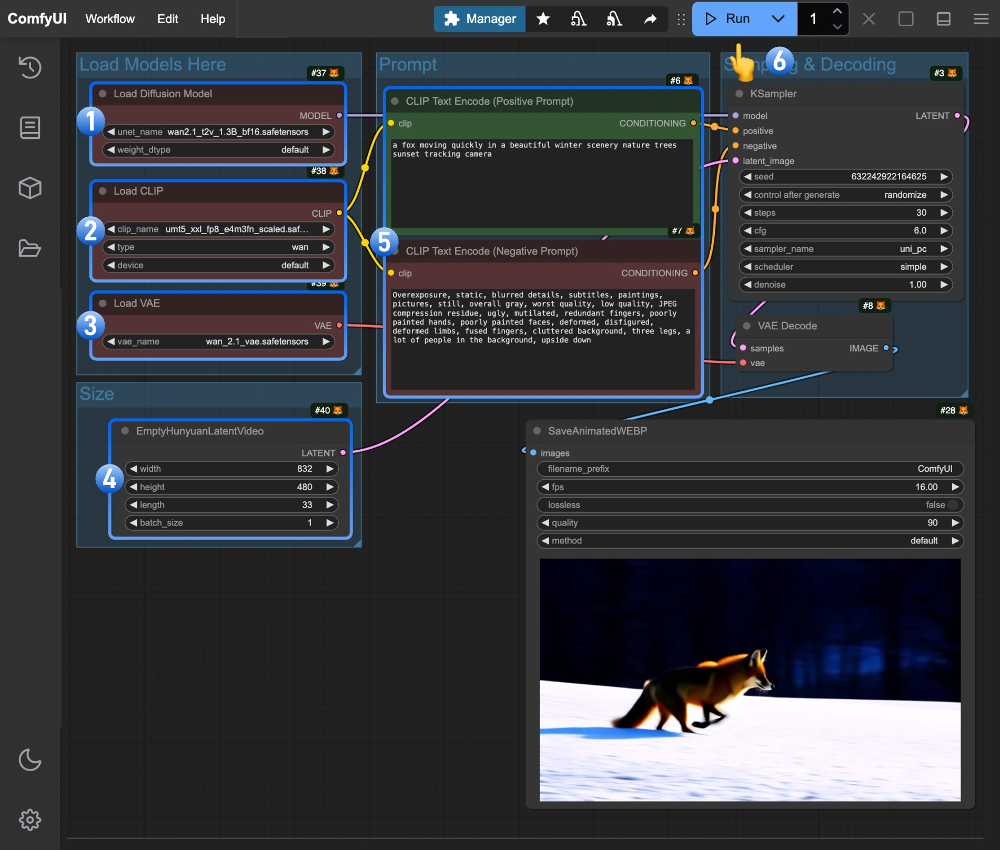
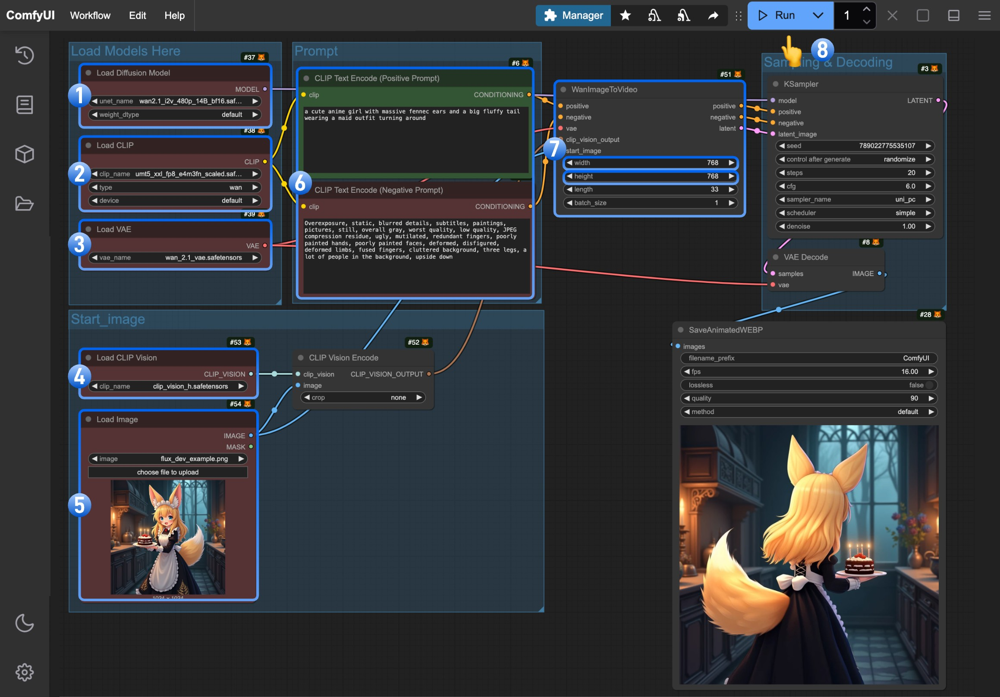
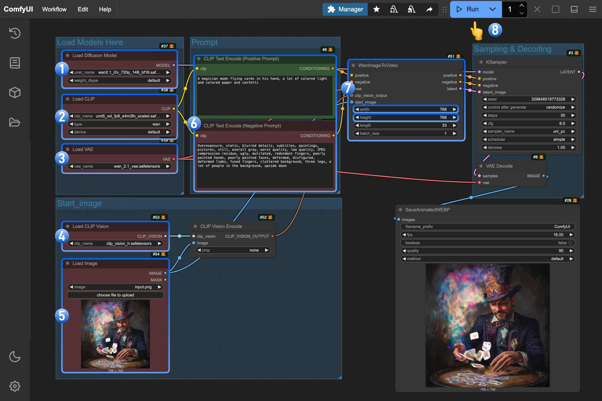

import UpdateReminder from "/snippets/de/tutorials/update-reminder.mdx";

Die Wan2.1-Videoserie ist ein Modell zur Videogenerierung, das Alibaba im Februar 2025 unter der [Apache-2.0-Lizenz](https://github.com/Wan-Video/Wan2.1?tab=Apache-2.0-1-ov-file) als Open Source veröffentlicht hat.
Es ist in zwei Versionen verfügbar:
- 14B (14 Milliarden Parameter)
- 1.3B (1.3 Milliarden Parameter)
Abgedeckt sind mehrere Aufgaben, darunter Text zu Video (T2V) und Bild zu Video (I2V).
Das Modell übertrifft bestehende Open-Source-Modelle nicht nur in der Leistung: Vor allem benötigt die Lightweight-Version nur 8 GB VRAM zum Ausführen, was die Einstiegshürde deutlich senkt.

<video controls>
  <source src="https://github.com/user-attachments/assets/4aca6063-60bf-4953-bfb7-e265053f49ef" type="video/mp4"/>
</video>

- [Wan2.1 Code-Repository](https://github.com/Wan-Video/Wan2.1)
- [Wan2.1 Modell-Repository](https://huggingface.co/Wan-AI)

<UpdateReminder/>

## Beispiele für native Wan2.1-Workflows in ComfyUI

<Tip>
Bitte aktualisieren Sie ComfyUI auf die neueste Version, bevor Sie mit den Beispielen beginnen, damit native Wan Video-Unterstützung verfügbar ist.
</Tip>

## Modelle installieren

Alle in dieser Anleitung genannten Modelle finden Sie [hier](https://huggingface.co/Comfy-Org/Wan_2.1_ComfyUI_repackaged/tree/main/split_files). Im Folgenden finden Sie die gängigen Modelle, die Sie für die Beispiele in dieser Anleitung benötigen und die Sie vorab herunterladen können:

Wählen Sie eine Version aus **Text-Encoder** zum Herunterladen:

<CardGroup cols={2}>
  <Card title="umt5_xxl_fp16.safetensors" icon="download" href="https://huggingface.co/Comfy-Org/Wan_2.1_ComfyUI_repackaged/blob/main/split_files/text_encoders/umt5_xxl_fp16.safetensors?download=true">
    Text-Encoder mit FP16-Präzision. Ablage in <code>ComfyUI/models/text_encoders/</code>
  </Card>
  <Card title="umt5_xxl_fp8_e4m3fn_scaled.safetensors" icon="download" href="https://huggingface.co/Comfy-Org/Wan_2.1_ComfyUI_repackaged/blob/main/split_files/text_encoders/umt5_xxl_fp8_e4m3fn_scaled.safetensors?download=true">
    Skalierter Text-Encoder mit FP8-Präzision. Ablage in <code>ComfyUI/models/text_encoders/</code>
  </Card>
</CardGroup>

**VAE**

<Card title="wan_2.1_vae.safetensors" icon="download" href="https://huggingface.co/Comfy-Org/Wan_2.1_ComfyUI_repackaged/blob/main/split_files/vae/wan_2.1_vae.safetensors?download=true">
    Wan2.1 VAE-Modell. Ablage in <code>ComfyUI/models/vae/</code>
</Card>
**CLIP Vision**

<Card title="clip_vision_h.safetensors" icon="download" href="https://huggingface.co/Comfy-Org/Wan_2.1_ComfyUI_repackaged/blob/main/split_files/clip_vision/clip_vision_h.safetensors?download=true">
    CLIP-Vision-Modell für die Bildkonditionierung. Ablage in <code>ComfyUI/models/clip_vision/</code>
</Card>
Speicherorte der Dateien:
```
ComfyUI/
├── models/
│   ├── diffusion_models/
│   │   └── ... (download per workflow below)
│   ├── text_encoders/
│   │   └── umt5_xxl_fp8_e4m3fn_scaled.safetensors
│   ├── vae/
│   │   └── wan_2.1_vae.safetensors
│   └── clip_vision/
│       └── clip_vision_h.safetensors
```

<Note>
Für Diffusion-Modelle verwenden wir in dieser Anleitung die Modelle mit FP16-Präzision, da sie nach unseren Erfahrungen bessere Ergebnisse liefern als die bf16-Versionen. Wenn Sie andere Präzisionsversionen benötigen, besuchen Sie bitte [diese Seite](https://huggingface.co/Comfy-Org/Wan_2.1_ComfyUI_repackaged/tree/main/split_files/diffusion_models), um sie herunterzuladen.
</Note>

## Wan2.1 Text-zu-Video-Workflow (1.3B)

### Wan 2.1 Text zu Video {#text_to_video_wan}

Generieren Sie Videos aus Text-Prompts mit Wan 2.1.


<CardGroup cols={2}>
  <Card title="Auf Comfy Cloud ausführen" icon="cloud" href="https://cloud.comfy.org/?template=text_to_video_wan&utm_source=docs&utm_medium=referral&utm_campaign=wan-video">
    In Comfy Cloud öffnen
  </Card>
  <Card title="Workflow herunterladen" icon="download" href="https://github.com/Comfy-Org/workflow_templates/blob/main/templates/text_to_video_wan.json">
    JSON herunterladen oder in der Vorlagenbibliothek nach „Wan 2.1 Text to Video“ suchen
  </Card>
</CardGroup>

### Modelle herunterladen

<Card title="wan2.1_t2v_1.3B_fp16.safetensors" icon="download" href="https://huggingface.co/Comfy-Org/Wan_2.1_ComfyUI_repackaged/blob/main/split_files/diffusion_models/wan2.1_t2v_1.3B_fp16.safetensors?download=true">
    Diffusionsmodell für Wan2.1 Text zu Video. Ablegen in <code>ComfyUI/models/diffusion_models/</code>
</Card>
> Wenn Sie andere t2v-Präzisionsversionen benötigen, besuchen Sie [hier](https://huggingface.co/Comfy-Org/Wan_2.1_ComfyUI_repackaged/tree/main/split_files/diffusion_models), um sie herunterzuladen.

### Schritte zum Ausführen



1. Stellen Sie sicher, dass der Node `Load Diffusion Model` das Modell `wan2.1_t2v_1.3B_fp16.safetensors` geladen hat
2. Stellen Sie sicher, dass der Node `Load CLIP` das Modell `umt5_xxl_fp8_e4m3fn_scaled.safetensors` geladen hat
3. Stellen Sie sicher, dass der Node `Load VAE` das Modell `wan_2.1_vae.safetensors` geladen hat
4. (Optional) Bei Bedarf können Sie die Videoabmessungen im Node `EmptyHunyuanLatentVideo` ändern
5. (Optional) Wenn Sie die Prompts (Positiv und Negativ) ändern möchten, nehmen Sie die Änderungen im Node `CLIP Text Encoder` bei Nummer `5` vor
6. Klicken Sie auf die Schaltfläche `Run` oder verwenden Sie die Tastenkombination `Ctrl(cmd) + Enter`, um die Videogenerierung auszuführen

## Wan2.1 Bild-zu-Video-Workflow (14B)

**Da Wan Video die 480P- und 720P-Modelle trennt**, müssen wir in dieser Anleitung Beispiele für beide Auflösungen bereitstellen. Neben der Verwendung unterschiedlicher Modelle gibt es auch leichte Unterschiede bei den Parametern.

### 480P-Version

### Wan 2.1 Bild zu Video {#image_to_video_wan}

Generieren Sie mit Wan 2.1 Videos aus Bildern.


<CardGroup cols={2}>
  <Card title="Auf Comfy Cloud ausführen" icon="cloud" href="https://cloud.comfy.org/?template=image_to_video_wan&utm_source=docs&utm_medium=referral&utm_campaign=wan-video">
    In Comfy Cloud öffnen
  </Card>
  <Card title="Workflow herunterladen" icon="download" href="https://github.com/Comfy-Org/workflow_templates/blob/main/templates/image_to_video_wan.json">
    JSON herunterladen oder in der Vorlagenbibliothek nach „Wan 2.1 Image to Video“ suchen
  </Card>
</CardGroup>

**Eingabematerialien**

Laden Sie diese Datei in den passenden `LoadImage`-Node hoch:

<CardGroup cols={2}>
  <Card title="image_to_video_wan_start_image.png" icon="image" href="https://raw.githubusercontent.com/Comfy-Org/workflow_templates/main/input/image_to_video_wan_start_image.png">
    `LoadImage`-Node 52 · `image_to_video_wan_start_image.png`
  </Card>
</CardGroup>

<div style={{display: 'grid', gridTemplateColumns: 'repeat(2, minmax(0, 1fr))', gap: '1rem', alignItems: 'start'}}>
  
</div>
#### Modell-Downloads

<Card title="wan2.1_i2v_480p_14B_fp16.safetensors" icon="download" href="https://huggingface.co/Comfy-Org/Wan_2.1_ComfyUI_repackaged/blob/main/split_files/diffusion_models/wan2.1_i2v_480p_14B_fp16.safetensors?download=true">
    Diffusionsmodell für Wan2.1 I2V 480P. Ablegen in <code>ComfyUI/models/diffusion_models/</code>
</Card>
#### Schritte zur Ausführung



1. Stellen Sie sicher, dass im `Load Diffusion Model`-Node das Modell `wan2.1_i2v_480p_14B_fp16.safetensors` geladen ist
2. Stellen Sie sicher, dass im `Load CLIP`-Node das Modell `umt5_xxl_fp8_e4m3fn_scaled.safetensors` geladen ist
3. Stellen Sie sicher, dass im `Load VAE`-Node das Modell `wan_2.1_vae.safetensors` geladen ist
4. Stellen Sie sicher, dass im `Load CLIP Vision`-Node das Modell `clip_vision_h.safetensors` geladen ist
5. Laden Sie das bereitgestellte Eingabebild im `Load Image`-Node hoch
6. (Optional) Geben Sie im `CLIP Text Encoder`-Node die Beschreibung des Videos ein, das Sie generieren möchten
7. (Optional) Bei Bedarf können Sie die Abmessungen des Videos im `WanImageToVideo`-Node ändern
8. Klicken Sie auf die Schaltfläche `Run` oder verwenden Sie die Tastenkombination `Ctrl(cmd) + Enter`, um die Videogenerierung auszuführen

### 720P-Version


<CardGroup cols={2}>
  <Card title="Auf Comfy Cloud ausführen" icon="cloud" href="https://cloud.comfy.org/?template=image_to_video_wan&utm_source=docs&utm_medium=referral&utm_campaign=wan-video">
    In Comfy Cloud öffnen
  </Card>
  <Card title="Workflow herunterladen" icon="download" href="https://raw.githubusercontent.com/Comfy-Org/example_workflows/refs/heads/main/wan2.1/wan2.1_i2v_14b_720P.webp">
    Laden Sie das Workflow-Bild herunter und ziehen Sie es in ComfyUI, um den Workflow zu laden
  </Card>
</CardGroup>

<Card title="Eingabebild" icon="image" href="https://raw.githubusercontent.com/Comfy-Org/example_workflows/refs/heads/main/wan2.1/input/magician.png">
    Laden Sie das Standard-Eingabebild herunter oder verwenden Sie Ihr eigenes Bild.
</Card>
#### Modell-Downloads

<Card title="wan2.1_i2v_720p_14B_fp16.safetensors" icon="download" href="https://huggingface.co/Comfy-Org/Wan_2.1_ComfyUI_repackaged/blob/main/split_files/diffusion_models/wan2.1_i2v_720p_14B_fp16.safetensors?download=true">
    Diffusionsmodell für Wan2.1 I2V 720P. Ablegen in <code>ComfyUI/models/diffusion_models/</code>
</Card>
#### Schritte zur Ausführung



1. Stellen Sie sicher, dass im `Load Diffusion Model`-Node das Modell `wan2.1_i2v_720p_14B_fp16.safetensors` geladen ist
2. Stellen Sie sicher, dass im `Load CLIP`-Node das Modell `umt5_xxl_fp8_e4m3fn_scaled.safetensors` geladen ist
3. Stellen Sie sicher, dass im `Load VAE`-Node das Modell `wan_2.1_vae.safetensors` geladen ist
4. Stellen Sie sicher, dass im `Load CLIP Vision`-Node das Modell `clip_vision_h.safetensors` geladen ist
5. Laden Sie das bereitgestellte Eingabebild im `Load Image`-Node hoch
6. (Optional) Geben Sie im `CLIP Text Encoder`-Node die Beschreibung des Videos ein, das Sie generieren möchten
7. (Optional) Bei Bedarf können Sie die Abmessungen des Videos im `WanImageToVideo`-Node ändern
8. Klicken Sie auf die Schaltfläche `Run` oder verwenden Sie die Tastenkombination `Ctrl(cmd) + Enter`, um die Videogenerierung auszuführen
