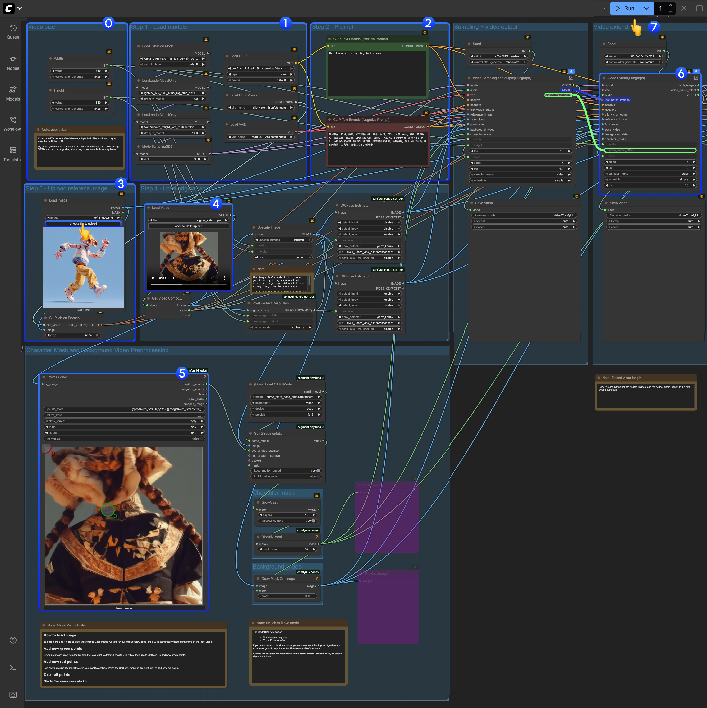
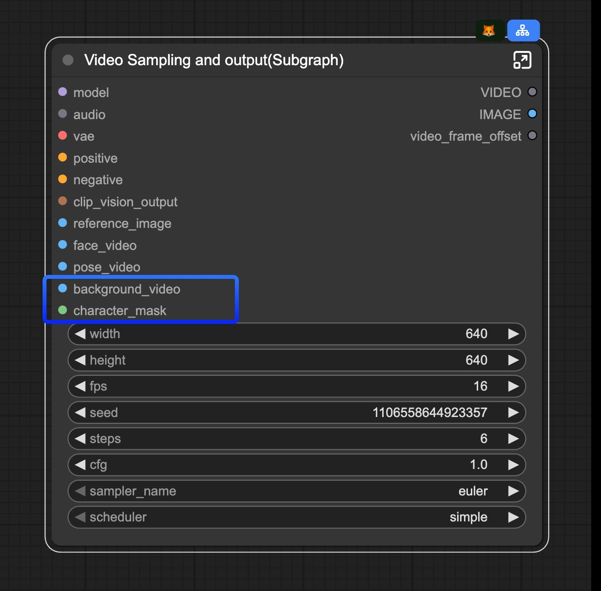

import UpdateReminder from '/snippets/de/tutorials/update-reminder.mdx'

Wan-Animate ist ein einheitliches Framework für Charakteranimation und -ersetzung, das vom WAN-Team entwickelt wurde.

Das Modell kann jede Figur anhand des Videos einer Performerin oder eines Performers animieren und dabei deren Mimik und Bewegungen präzise nachbilden, um besonders realistische Charaktervideos zu generieren.

Es kann Charaktere in einem Video auch durch animierte Charaktere ersetzen, wobei deren Mimik und Bewegungen erhalten bleiben und gleichzeitig die ursprüngliche Beleuchtung und Farbtönung für eine nahtlose Integration in die Umgebung nachgebildet werden.

## Modell-Highlights

- Dualmodus-Funktionalität: Eine einzige Architektur unterstützt sowohl Animations- als auch Ersetzungsfunktionen, sodass Sie einfach zwischen den Betriebsarten wechseln können.
- Erweiterte Steuerung der Körperbewegung: Nutzt räumlich ausgerichtete Skelettsignale für eine präzise Reproduktion der Körperbewegung.
- Präzise Bewegung und Ausdruck: Reproduziert die Bewegungen und Gesichtsausdrücke aus dem Referenzvideo präzise.
- Natürliche Integration in die Umgebung: Fügt die ersetzte Figur nahtlos in die Umgebung des Originalvideos ein.
- Flüssige Generierung langer Videos: Die iterative Generierung sorgt für konsistente Bewegung und visuellen Fluss bei längeren Videos.

## ComfyOrg Wan2.2 Animate: Stream-Wiederholung

<iframe
  className="w-full aspect-video rounded-xl"
 src="https://www.youtube.com/embed/5kb-rP0m5BA?si=lbIYkCP5akkG2N6D" 
 title="Wan 2.2 Animate in ComfyUI with Flipping Sigmas / September 19th, 2025" frameborder="0" 
 allow="accelerometer; clipboard-write; encrypted-media; gyroscope; picture-in-picture; web-share" 
 referrerpolicy="strict-origin-when-cross-origin" 
 allowfullscreen>
 </iframe>

<UpdateReminder/>

## Über den Wan2.2 Animate-Workflow

Dieser Workflow unterstützt zwei Modi: Mix (eine Figur in einem Video durch eine Figur aus einem Referenzbild ersetzen) und Move (eine Figur mit der Bewegung aus einem Eingabevideo animieren).

### Wan2.2 Animate, Figurenanimation und Figurenersetzung {#video_wan2_2_14B_animate}

Einheitliches Framework für Figurenanimation und Figurenersetzung mit präziser Nachbildung von Bewegung und Mimik.


<CardGroup cols={2}>
  <Card title="Auf Comfy Cloud ausführen" icon="cloud" href="https://cloud.comfy.org/?template=video_wan2_2_14B_animate&utm_source=docs&utm_medium=referral&utm_campaign=wan2-2-animate">
    In Comfy Cloud öffnen
  </Card>
  <Card title="Workflow herunterladen" icon="download" href="https://github.com/Comfy-Org/workflow_templates/blob/main/templates/video_wan2_2_14B_animate.json">
    JSON herunterladen oder in der Vorlagenbibliothek nach „Wan2.2 Animate“ suchen
  </Card>
</CardGroup>

**Eingabematerialien**

Laden Sie diese Dateien in die passenden Nodes hoch:

<CardGroup cols={2}>
  <Card title="video_wan2_2_14B_animate_reference_image.png" icon="image" href="https://raw.githubusercontent.com/Comfy-Org/workflow_templates/main/input/video_wan2_2_14B_animate_reference_image.png">
    `LoadImage` Node 10 · `video_wan2_2_14B_animate_reference_image.png`
  </Card>
  <Card title="video_wan2_2_14B_animate_original_video.mp4" icon="video" href="https://raw.githubusercontent.com/Comfy-Org/workflow_templates/main/input/video_wan2_2_14B_animate_original_video.mp4">
    `LoadVideo` Node 145 · `video_wan2_2_14B_animate_original_video.mp4`
  </Card>
</CardGroup>

<div style={{display: 'grid', gridTemplateColumns: 'repeat(2, minmax(0, 1fr))', gap: '1rem', alignItems: 'start'}}>
  
</div>

### 2. Modell-Links

Alle in dieser Anleitung verwendeten Modelle finden Sie [hier](https://huggingface.co/Comfy-Org/Wan_2.2_ComfyUI_Repackaged/tree/main/split_files).

**Diffusionsmodelle**

<CardGroup cols={2}>
  <Card title="Wan2.2 Animate 14B FP8 (Kijai)" icon="download" href="https://huggingface.co/Kijai/WanVideo_comfy_fp8_scaled/blob/main/Wan22Animate/Wan2_2-Animate-14B_fp8_e4m3fn_scaled_KJ.safetensors">
    Wan2_2-Animate-14B_fp8_e4m3fn_scaled_KJ.safetensors: Skalierte FP8-Version aus Kijais Repository
  </Card>
  <Card title="Wan2.2 Animate 14B BF16" icon="download" href="https://huggingface.co/Comfy-Org/Wan_2.2_ComfyUI_Repackaged/blob/main/split_files/diffusion_models/wan2.2_animate_14B_bf16.safetensors">
    wan2.2_animate_14B_bf16.safetensors: Originales bf16-Modellgewicht
  </Card>
</CardGroup>

**CLIP Vision**

<Card title="CLIP Vision H" icon="download" href="https://huggingface.co/Comfy-Org/Wan_2.1_ComfyUI_repackaged/blob/main/split_files/clip_vision/clip_vision_h.safetensors">
  clip_vision_h.safetensors: Encoder für CLIP Vision
</Card>
**LoRAs**

<Card title="LightX2V I2V 14B 4-Step LoRA" icon="download" href="https://huggingface.co/Kijai/WanVideo_comfy/blob/main/Lightx2v/lightx2v_I2V_14B_480p_cfg_step_distill_rank64_bf16.safetensors">
  lightx2v_I2V_14B_480p_cfg_step_distill_rank64_bf16.safetensors: LoRA zur 4-Step-Beschleunigung
</Card>
**VAE**

<Card title="Wan2.1 VAE" icon="download" href="https://huggingface.co/Comfy-Org/Wan_2.2_ComfyUI_Repackaged/blob/main/split_files/vae/wan_2.1_vae.safetensors">
  wan_2.1_vae.safetensors: Wan2.1-VAE zum Kodieren und Dekodieren
</Card>
**Textencoder**

<Card title="UMT5 XXL FP8 Scaled" icon="download" href="https://huggingface.co/Comfy-Org/Wan_2.1_ComfyUI_repackaged/blob/main/split_files/text_encoders/umt5_xxl_fp8_e4m3fn_scaled.safetensors">
  umt5_xxl_fp8_e4m3fn_scaled.safetensors: Skalierter FP8-Textencoder
</Card>
```
ComfyUI/
├───📂 models/
│   ├───📂 diffusion_models/
│   │   ├─── Wan2_2-Animate-14B_fp8_e4m3fn_scaled_KJ.safetensors
│   │   └─── wan2.2_animate_14B_bf16.safetensors
│   ├───📂 loras/
│   │   └─── lightx2v_I2V_14B_480p_cfg_step_distill_rank64_bf16.safetensors
│   ├───📂 text_encoders/
│   │   └─── umt5_xxl_fp8_e4m3fn_scaled.safetensors 
│   ├───📂 clip_visions/ 
│   │   └─── clip_vision_h.safetensors
│   └───📂 vae/
│       └── wan_2.1_vae.safetensors
```

### 3. Custom Nodes installieren

Laden Sie die folgende Workflow-Datei herunter und ziehen Sie sie in ComfyUI, um den Workflow zu laden. Wenn Sie [ComfyUI-Manager](https://github.com/Comfy-Org/ComfyUI-Manager) installiert haben, können Sie einfach auf die Schaltfläche `Fehlende Nodes installieren` klicken, um die fehlenden Nodes zu installieren.

Wir müssen die folgenden Custom Nodes installieren:

- [ComfyUI-KJNodes](https://github.com/kijai/ComfyUI-KJNodes)
- [ComfyUI-comfyui_controlnet_aux](https://github.com/Fannovel16/comfyui_controlnet_aux)

Wenn Sie nicht wissen, wie Sie Custom Nodes installieren, lesen Sie bitte [So installieren Sie Custom Nodes](/de/installation/install_custom_node)

### 4. Anweisungen zum Workflow

Wan2.2 Animate bietet zwei Modi: Mix und Move.
- Mix: Verwenden Sie das Referenzbild, um den Charakter im Video zu ersetzen.
- Move: Verwenden Sie die Bewegung des Charakters aus dem Eingabevideo, um den Charakter im Referenzbild zu animieren (wie bei Wan2.2 Fun Control).

#### 4.1 Mix-Modus


0. Wenn Sie diesen Workflow zum ersten Mal ausführen, verwenden Sie bitte eine kleine Größe für die Videogenerierung, falls Ihr VRAM nicht ausreicht, um den Workflow auszuführen. Aufgrund der Einschränkung von `WanAnimateToVideo` müssen die Breite und die Höhe des Videos Vielfache von 16 sein.
1. Stellen Sie sicher, dass alle Modelle korrekt geladen sind.
2. Aktualisieren Sie den Prompt, wenn Sie möchten.
3. Laden Sie das Referenzbild hoch. Der Charakter in diesem Bild wird zum Zielcharakter.
4. Sie können die von uns bereitgestellten Videos beim ersten Mal als Eingabevideos verwenden. Der Node **DWPose Estimator** in [comfyui_controlnet_aux](https://github.com/Fannovel16/comfyui_controlnet_aux) verarbeitet das Eingabevideo vorab zu Pose- und Gesichtssteuerungsvideos.
5. Der `Points Editor` stammt aus [KJNodes](https://github.com/kijai/ComfyUI-KJNodes/). Standardmäßig lädt dieser Node nicht das erste Frame aus dem Eingabevideo. Sie müssen den Workflow einmal ausführen oder das erste Frame manuell hochladen.
    - Unter dem Node `Points Editor` haben wir einen Hinweis hinzugefügt, wie dieser Node funktioniert und wie er bearbeitet wird. Bitte beachten Sie diesen.
6. Die Gruppe „Video Extend“ dient dazu, die Länge des Ausgabevideos zu verlängern.
    - Jeder `Video Extend` verlängert das Video um weitere 77 Frames (etwa 4.8125 Sekunden).
    - Wenn Ihr Eingabevideo kürzer als 5 s ist, benötigen Sie diese möglicherweise nicht.
    - Wenn Sie länger verlängern möchten, müssen Sie den Vorgang mehrmals kopieren und einfügen. Sie müssen die `batch_images` vom letzten Video Extend mit dem nächsten verbinden und ebenso den `video_frame_offset` vom letzten Video Extend mit dem nächsten.
7. Klicken Sie auf die Schaltfläche `Run` oder verwenden Sie die Tastenkombination `Ctrl(cmd) + Enter`, um die Videogenerierung auszuführen.

#### 4.2 Move-Modus

Im Wan2.2 Animate Workflow haben wir ein [Subgraph](/de/interface/features/subgraph) verwendet. So wechseln Sie in den Move-Modus:



Wenn Sie in den Move-Modus wechseln möchten, können Sie die Eingänge `background_video` und `character_mask` vom Node `Video Sampling and output(Subgraph)` trennen.
