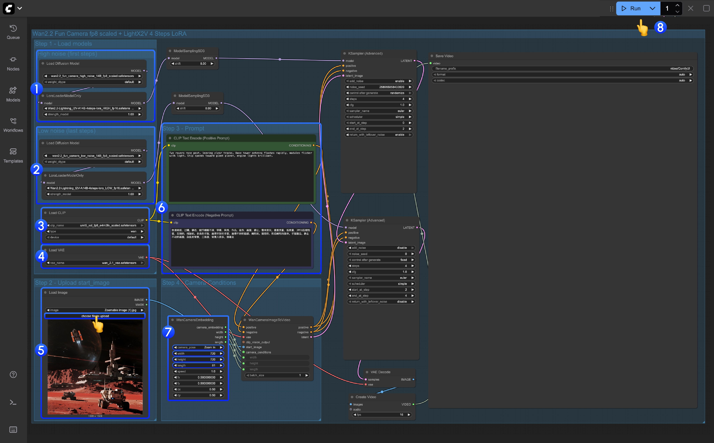

import UpdateReminder from "/snippets/de/tutorials/update-reminder.mdx"

**Wan2.2-Fun-Camera-Control** ist ein Videogenerierungs- und Kamerasteuerungsmodell der nächsten Generation, das von Alibaba PAI entwickelt wurde. Durch die Einführung innovativer Camera Control Codes und die Kombination von Deep Learning mit multimodalen konditionalen Eingaben erzeugt es hochwertige Videos, die vordefinierten Kamerabewegungen folgen. Das Modell wird unter der **Apache 2.0 Lizenz** veröffentlicht und erlaubt die kommerzielle Nutzung.

**Hauptfunktionen**:
- **Kamerabewegungssteuerung**: Unterstützt verschiedene Kamerabewegungsmodi, darunter **Pan Up**, **Pan Down**, **Pan Left**, **Pan Right**, **Zoom In**, **Zoom Out** und Kombinationen davon.
- **Hochwertige Videogenerierung**: Basierend auf der Wan2.2-Architektur gibt es Videos in Kinoqualität aus.

Hier finden Sie die relevanten Modellgewichte und das Code-Repository:

- [🤗Wan2.2-Fun-A14B-Control-Camera](https://huggingface.co/alibaba-pai/Wan2.2-Fun-A14B-Control-Camera)
- Code-Repository: [VideoX-Fun](https://github.com/aigc-apps/VideoX-Fun)

## Wan2.2 Fun Camera Control: Beispiel für einen Videogenerierungs-Workflow

<UpdateReminder/>

Der bereitgestellte Workflow enthält zwei Versionen:
1. Verwendung des [Wan2.2-Lightning](https://huggingface.co/lightx2v/Wan2.2-Lightning) 4-Schritt-LoRA über lightx2v: Dies kann die Videodynamik verringern, bietet aber eine schnellere Generierung.
2. Die fp8_scaled-Version ohne das Beschleunigungs-LoRA.

Im Folgenden finden Sie die Testergebnisse auf einer RTX4090D mit 24 GB GPU bei einer Auflösung von 640*640 und einer Länge von 81 Frames:

| Modelltyp                   | Auflösung  | VRAM-Auslastung | Erste Generierungszeit | Zweite Generierungszeit |
| --------------------------- | ---------- | --------------- | ---------------------- | ----------------------- |
| fp8_scaled                  | 640×640    | 84%             | ≈ 536 Sekunden         | ≈ 513 Sekunden          |
| fp8_scaled + 4-step LoRA    | 640×640    | 89%             | ≈ 108 Sekunden         | ≈ 71 Sekunden           |

Das 4-Schritt-LoRA verbessert das Erlebnis beim ersten Start, kann aber die Videodynamik verringern. Standardmäßig ist die beschleunigte LoRA-Version aktiviert. Um den Workflow zu wechseln, wählen Sie die Nodes aus und drücken Sie **Ctrl+B**.

### 1. Workflow und Assets herunterladen

Laden Sie das untenstehende Video oder die JSON-Datei herunter und ziehen Sie sie in ComfyUI, um den entsprechenden Workflow zu laden. Der Workflow fordert Sie auf, die Modelle herunterzuladen.

<video
  controls
  className="w-full aspect-video"
  src="https://raw.githubusercontent.com/Comfy-Org/example_workflows/refs/heads/main/video/wan/wan2.2_fun_camera/wan2.2_14B_fun_camera.mp4"
></video>


<CardGroup cols={2}>
  <Card title="Run on Comfy Cloud" icon="cloud" href="https://cloud.comfy.org/?template=video_wan2_2_14B_fun_camera&utm_source=docs&utm_medium=referral&utm_campaign=wan2-2-fun-camera">
    In Comfy Cloud öffnen
  </Card>
  <Card title="Download Workflow" icon="download" href="https://github.com/Comfy-Org/workflow_templates/blob/main/templates/video_wan2_2_14B_fun_camera.json">
    JSON herunterladen oder in der Vorlagenbibliothek nach „Wan2.2 Fun Camera“ suchen
  </Card>
</CardGroup>

Bitte laden Sie das untenstehende Bild herunter, das wir als Eingabe verwenden.

**Eingangsmaterial**

<CardGroup cols={2}>
  <Card title="video_wan2_2_14B_fun_camera_start_image.jpg" icon="image" href="https://raw.githubusercontent.com/Comfy-Org/workflow_templates/main/input/video_wan2_2_14B_fun_camera_start_image.jpg">
    Startbild für die Videogenerierung. Laden Sie dieses Bild herunter und verwenden Sie es, oder ersetzen Sie es durch Ihr eigenes.
  </Card>
</CardGroup>

### 2. Modell-Links

Die folgenden Modelle finden Sie in [Wan_2.2_ComfyUI_Repackaged](https://huggingface.co/Comfy-Org/Wan_2.2_ComfyUI_Repackaged):

**Diffusionsmodelle**

<CardGroup cols={2}>
  <Card title="wan2.2_fun_camera_high_noise_14B_fp8_scaled.safetensors" icon="download" href="https://huggingface.co/Comfy-Org/Wan_2.2_ComfyUI_Repackaged/blob/main/split_files/diffusion_models/wan2.2_fun_camera_high_noise_14B_fp8_scaled.safetensors">
    High-Noise-Diffusionsmodell für Wan2.2 Fun Camera
  </Card>
  <Card title="wan2.2_fun_camera_low_noise_14B_fp8_scaled.safetensors" icon="download" href="https://huggingface.co/Comfy-Org/Wan_2.2_ComfyUI_Repackaged/blob/main/split_files/diffusion_models/wan2.2_fun_camera_low_noise_14B_fp8_scaled.safetensors">
    Low-Noise-Diffusionsmodell für Wan2.2 Fun Camera
  </Card>
</CardGroup>

**Wan2.2-Lightning LoRA (optional, zur Beschleunigung)**

<CardGroup cols={2}>
  <Card title="wan2.2_i2v_lightx2v_4steps_lora_v1_high_noise.safetensors" icon="download" href="https://huggingface.co/Comfy-Org/Wan_2.2_ComfyUI_Repackaged/blob/main/split_files/loras/wan2.2_i2v_lightx2v_4steps_lora_v1_high_noise.safetensors">
    4-Schritt-Beschleunigungs-LoRA für das High-Noise-Modell
  </Card>
  <Card title="wan2.2_i2v_lightx2v_4steps_lora_v1_low_noise.safetensors" icon="download" href="https://huggingface.co/Comfy-Org/Wan_2.2_ComfyUI_Repackaged/blob/main/split_files/loras/wan2.2_i2v_lightx2v_4steps_lora_v1_low_noise.safetensors">
    4-Schritt-Beschleunigungs-LoRA für das Low-Noise-Modell
  </Card>
</CardGroup>

**VAE**

<Card title="wan_2.1_vae.safetensors" icon="download" href="https://huggingface.co/Comfy-Org/Wan_2.2_ComfyUI_Repackaged/blob/main/split_files/vae/wan_2.1_vae.safetensors">
  Wan2.1 VAE zum Kodieren/Dekodieren
</Card>
**Text-Encoder**

<Card title="umt5_xxl_fp8_e4m3fn_scaled.safetensors" icon="download" href="https://huggingface.co/Comfy-Org/Wan_2.1_ComfyUI_repackaged/blob/main/split_files/text_encoders/umt5_xxl_fp8_e4m3fn_scaled.safetensors">
  FP8-Text-Encoder (scaled)
</Card>
Speicherort der Dateien

```
ComfyUI/
├───📂 models/
│   ├───📂 diffusion_models/
│   │   ├─── wan2.2_fun_camera_low_noise_14B_fp8_scaled.safetensors
│   │   └─── wan2.2_fun_camera_high_noise_14B_fp8_scaled.safetensors
│   ├───📂 loras/
│   │   ├─── wan2.2_i2v_lightx2v_4steps_lora_v1_high_noise.safetensors
│   │   └─── wan2.2_i2v_lightx2v_4steps_lora_v1_low_noise.safetensors
│   ├───📂 text_encoders/
│   │   └─── umt5_xxl_fp8_e4m3fn_scaled.safetensors
│   └───📂 vae/
│       └── wan_2.1_vae.safetensors
```

### 3. Den Workflow Schritt für Schritt vervollständigen



<Note>
  Dieser Workflow verwendet LoRA. Stellen Sie sicher, dass Diffusionsmodell und LoRA zusammenpassen; High-Noise- und Low-Noise-Modelle und -LoRAs müssen jeweils paarweise zugeordnet werden.
</Note>

1. **High-Noise**-Modell und **LoRA** laden
  - Stellen Sie sicher, dass der Node `Load Diffusion Model` `wan2.2_fun_camera_high_noise_14B_fp8_scaled.safetensors` lädt
  - Stellen Sie sicher, dass der Node `LoraLoaderModelOnly` `wan2.2_i2v_lightx2v_4steps_lora_v1_high_noise.safetensors` lädt
2. **Low-Noise**-Modell und **LoRA** laden
  - Stellen Sie sicher, dass der Node `Load Diffusion Model` `wan2.2_fun_camera_low_noise_14B_fp8_scaled.safetensors` lädt
  - Stellen Sie sicher, dass der Node `LoraLoaderModelOnly` `wan2.2_i2v_lightx2v_4steps_lora_v1_low_noise.safetensors` lädt
3. Stellen Sie sicher, dass der Node `Load CLIP` `umt5_xxl_fp8_e4m3fn_scaled.safetensors` lädt
4. Stellen Sie sicher, dass der Node `Load VAE` `wan_2.1_vae.safetensors` lädt
5. Laden Sie das Startbild im Node `Load Image` hoch
6. Ändern Sie den Prompt (Chinesisch und Englisch sind beide möglich)
7. Legen Sie die Kamerasteuerungsparameter im Node `WanCameraEmbedding` fest:
   - **Camera Motion**: Wählen Sie den Typ der Kamerabewegung (Zoom In, Zoom Out, Pan Up, Pan Down, Pan Left, Pan Right, Static usw.)
   - **Width/Height**: Legen Sie die Videoauflösung fest
   - **Length**: Legen Sie die Anzahl der Videoframes fest (Standard sind 81 Frames)
   - **Speed**: Legen Sie die Videogeschwindigkeit fest (Standard ist 1.0)
8. Klicken Sie auf die Schaltfläche `Run` oder verwenden Sie die Tastenkombination `Ctrl(cmd) + Enter`, um die Videogenerierung auszuführen