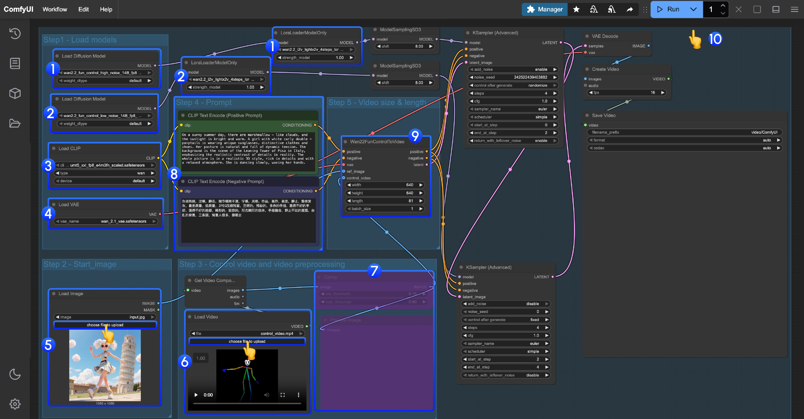

import UpdateReminder from "/snippets/de/tutorials/update-reminder.mdx"

**Wan2.2-Fun-Control** ist ein Modell der nächsten Generation für Videogenerierung und -steuerung, das vom Alibaba PAI-Team vorgestellt wurde. Durch einen innovativen Control-Codes-Mechanismus in Kombination mit Deep Learning und multimodalen konditionalen Eingaben kann es hochwertige Videos generieren, die vorgegebene Steuerungsbedingungen erfüllen. Das Modell wird unter der **Apache 2.0-Lizenz** veröffentlicht und unterstützt die kommerzielle Nutzung.

**Wichtige Funktionen**:
- **Multimodale Steuerung**: Unterstützt mehrere Steuerungsbedingungen, darunter **Canny (Strichzeichnung)**, **Depth (Tiefe)**, **OpenPose (menschliche Pose)**, **MLSD (geometrische Kanten)** und **Trajektoriensteuerung**
- **Hochwertige Videogenerierung**: Basiert auf der Wan2.2-Architektur und liefert Videos in Filmqualität
- **Mehrsprachiger Support**: Unterstützt mehrsprachige Prompts, einschließlich Chinesisch und Englisch

Im Folgenden finden Sie die relevanten Modellgewichte und Code-Repositories:

- [🤗Wan2.2-Fun-A14B-Control](https://huggingface.co/alibaba-pai/Wan2.2-Fun-A14B-Control)
- Code-Repository: [VideoX-Fun](https://github.com/aigc-apps/VideoX-Fun)

## ComfyOrg Wan2.2 Fun InP & Control: YouTube-Livestream-Aufzeichnung

<iframe
  className="w-full aspect-video rounded-xl"
  src="https://www.youtube.com/embed/YcAerNYIvho?si=Zh8tzRwI_OTAFx3m"
  title="Neue Funktionen der ComfyUI Selection Toolbox"
  allow="accelerometer; clipboard-write; encrypted-media; gyroscope; picture-in-picture"
  allowFullScreen
></iframe>

## Beispiel-Workflow zur Videogenerierung mit Wan2.2 Fun Control

<UpdateReminder/>

Dieser Workflow bietet zwei Versionen:
1. Eine Version, die das 4-Step-LoRA [Wan2.2-Lightning](https://huggingface.co/lightx2v/Wan2.2-Lightning) von lightx2v verwendet: kann die Videodynamik etwas beeinträchtigen, bietet aber eine höhere Geschwindigkeit
2. Eine fp8_scaled-Version ohne Beschleunigungs-LoRA

Nachfolgend finden Sie die Testergebnisse mit einer RTX4090D mit 24 GB VRAM bei einer Auflösung von 640×640 und 81 Frames

| Modelltyp                | VRAM-Nutzung | Erste Generierungszeit | Zweite Generierungszeit |
| ------------------------ | ------------ | ---------------------- | ----------------------- |
| fp8_scaled               | 83%          | ≈ 524s                 | ≈ 520s                  |
| fp8_scaled + 4-step LoRA | 89%          | ≈ 138s                 | ≈ 79s                   |

Da die Verwendung des 4-Step-LoRA für Erstnutzer des Workflows eine bessere Erfahrung bietet, aber die Videodynamik etwas beeinträchtigen kann, haben wir die beschleunigte LoRA-Version standardmäßig aktiviert. Wenn Sie den anderen Workflow aktivieren möchten, wählen Sie ihn aus und aktivieren Sie ihn mit **Ctrl+B**.

### 1. Workflow und Materialien herunterladen

Aktualisieren Sie Ihr ComfyUI auf die neueste Version, laden Sie dann die Workflow-Datei herunter und ziehen Sie sie in ComfyUI, oder suchen Sie in der Vorlagenbibliothek unter `Workflow` → `Browse Templates` → `Video` nach „Wan2.2 Fun Control“.


<CardGroup cols={2}>
  <Card title="Auf Comfy Cloud ausführen" icon="cloud" href="https://cloud.comfy.org/?template=video_wan2_2_14B_fun_control&utm_source=docs&utm_medium=referral&utm_campaign=wan2-2-fun-control">
    In Comfy Cloud öffnen
  </Card>
  <Card title="Workflow herunterladen" icon="download" href="https://github.com/Comfy-Org/workflow_templates/blob/main/templates/video_wan2_2_14B_fun_control.json">
    JSON herunterladen oder in der Vorlagenbibliothek nach „Wan2.2 Fun Control“ suchen
  </Card>
</CardGroup>

Bitte laden Sie die folgenden Bilder und Videos als Eingabematerialien herunter.

**Eingabematerialien**

<CardGroup cols={2}>
  <Card title="video_wan2_2_14B_fun_control_start_image.jpg" icon="image" href="https://raw.githubusercontent.com/Comfy-Org/workflow_templates/main/input/video_wan2_2_14B_fun_control_start_image.jpg">
    Start-Frame für die Videogenerierung. Laden Sie dieses Bild herunter und verwenden Sie es, oder ersetzen Sie es durch Ihr eigenes.
  </Card>
  <Card title="video_wan2_2_14B_fun_control_start_image_control_video.mp4" icon="video" href="https://raw.githubusercontent.com/Comfy-Org/workflow_templates/main/input/video_wan2_2_14B_fun_control_start_image_control_video.mp4">
    Vorverarbeitetes Pose-Control-Video. Laden Sie dieses Video herunter und verwenden Sie es, oder ersetzen Sie es durch Ihr eigenes.
  </Card>
</CardGroup>

> Wir verwenden hier ein vorverarbeitetes Video.

### 2. Modelle

Alle in dieser Anleitung verwendeten Modelle finden Sie [hier](https://huggingface.co/Comfy-Org/Wan_2.2_ComfyUI_Repackaged/tree/main/split_files).

**Diffusionsmodelle**

<CardGroup cols={2}>
  <Card title="Wan2.2 Fun Control High Noise 14B FP8" icon="download" href="https://huggingface.co/Comfy-Org/Wan_2.2_ComfyUI_Repackaged/blob/main/split_files/diffusion_models/wan2.2_fun_control_high_noise_14B_fp8_scaled.safetensors">
    wan2.2_fun_control_high_noise_14B_fp8_scaled.safetensors: Diffusionsmodell für hohes Rauschen
  </Card>
  <Card title="Wan2.2 Fun Control Low Noise 14B FP8" icon="download" href="https://huggingface.co/Comfy-Org/Wan_2.2_ComfyUI_Repackaged/blob/main/split_files/diffusion_models/wan2.2_fun_control_low_noise_14B_fp8_scaled.safetensors">
    wan2.2_fun_control_low_noise_14B_fp8_scaled.safetensors: Diffusionsmodell für niedriges Rauschen
  </Card>
</CardGroup>

**Wan2.2-Lightning LoRA (optional, zur Beschleunigung)**

<CardGroup cols={2}>
  <Card title="High Noise 4-Step LoRA" icon="download" href="https://huggingface.co/Comfy-Org/Wan_2.2_ComfyUI_Repackaged/blob/main/split_files/loras/wan2.2_i2v_lightx2v_4steps_lora_v1_high_noise.safetensors">
    wan2.2_i2v_lightx2v_4steps_lora_v1_high_noise.safetensors: LoRA zur Beschleunigung bei hohem Rauschen mit 4 Schritten
  </Card>
  <Card title="Low Noise 4-Step LoRA" icon="download" href="https://huggingface.co/Comfy-Org/Wan_2.2_ComfyUI_Repackaged/blob/main/split_files/loras/wan2.2_i2v_lightx2v_4steps_lora_v1_low_noise.safetensors">
    wan2.2_i2v_lightx2v_4steps_lora_v1_low_noise.safetensors: LoRA zur Beschleunigung bei niedrigem Rauschen mit 4 Schritten
  </Card>
</CardGroup>

**VAE**

<Card title="Wan2.1 VAE" icon="download" href="https://huggingface.co/Comfy-Org/Wan_2.2_ComfyUI_Repackaged/blob/main/split_files/vae/wan_2.1_vae.safetensors">
  wan_2.1_vae.safetensors: Wan2.1 VAE zum Kodieren/Dekodieren
</Card>
**Text-Encoder**

<Card title="UMT5 XXL FP8 Scaled" icon="download" href="https://huggingface.co/Comfy-Org/Wan_2.1_ComfyUI_repackaged/blob/main/split_files/text_encoders/umt5_xxl_fp8_e4m3fn_scaled.safetensors">
  umt5_xxl_fp8_e4m3fn_scaled.safetensors: Skalierter FP8-Text-Encoder
</Card>
```
ComfyUI/
├───📂 models/
│   ├───📂 diffusion_models/
│   │   ├─── wan2.2_fun_control_low_noise_14B_fp8_scaled.safetensors
│   │   └─── wan2.2_fun_control_high_noise_14B_fp8_scaled.safetensors
│   ├───📂 loras/
│   │   ├─── wan2.2_i2v_lightx2v_4steps_lora_v1_high_noise.safetensors
│   │   └─── wan2.2_i2v_lightx2v_4steps_lora_v1_low_noise.safetensors
│   ├───📂 text_encoders/
│   │   └─── umt5_xxl_fp8_e4m3fn_scaled.safetensors 
│   └───📂 vae/
│       └── wan_2.1_vae.safetensors
```

### 3. Workflow-Anleitung



<Note>
  Dieser Workflow verwendet LoRA. Bitte stellen Sie sicher, dass das entsprechende Diffusionsmodell und die LoRA zueinander passen: High-Noise- und Low-Noise-Modelle sowie die zugehörigen LoRAs müssen jeweils passend verwendet werden.
</Note>

1. Laden des **High-Noise**-Modells und der **LoRA**
   - Stellen Sie sicher, dass der Node `Load Diffusion Model` das Modell `wan2.2_fun_control_high_noise_14B_fp8_scaled.safetensors` lädt
   - Stellen Sie sicher, dass der Node `LoraLoaderModelOnly` die LoRA `wan2.2_i2v_lightx2v_4steps_lora_v1_high_noise.safetensors` lädt
2. Laden des **Low-Noise**-Modells und der **LoRA**
   - Stellen Sie sicher, dass der Node `Load Diffusion Model` das Modell `wan2.2_fun_control_low_noise_14B_fp8_scaled.safetensors` lädt
   - Stellen Sie sicher, dass der Node `LoraLoaderModelOnly` die LoRA `wan2.2_i2v_lightx2v_4steps_lora_v1_low_noise.safetensors` lädt
3. Stellen Sie sicher, dass der Node `Load CLIP` das Modell `umt5_xxl_fp8_e4m3fn_scaled.safetensors` lädt
4. Stellen Sie sicher, dass der Node `Load VAE` das Modell `wan_2.1_vae.safetensors` lädt
5. Laden Sie im Node `Load Image` das Start-Frame hoch
6. Laden Sie im zweiten Node `Load video` das Pose-Control-Video. Das bereitgestellte Video wurde bereits vorverarbeitet und kann direkt verwendet werden
7. Da wir ein vorverarbeitetes Pose-Video bereitstellen, muss der entsprechende Vorverarbeitungs-Node für das Videobild deaktiviert werden. Sie können ihn auswählen und mit `Ctrl + B` deaktivieren
8. Prompt anpassen: Sie können sowohl Chinesisch als auch Englisch verwenden
9. Passen Sie in `Wan22FunControlToVideo` die Abmessungen des Videos an. Standardmäßig ist die Auflösung auf 640×640 eingestellt, damit die Verarbeitung bei Nutzern mit wenig VRAM nicht zu lange dauert
10. Klicken Sie auf die Schaltfläche `Run` oder verwenden Sie die Tastenkombination `Ctrl(cmd) + Enter`, um die Videogenerierung auszuführen

### Zusätzliche Hinweise

Da die in ComfyUI integrierten Nodes nur den Canny-Preprocessor enthalten, können Sie Tools wie [ComfyUI-comfyui_controlnet_aux](https://github.com/Fannovel16/comfyui_controlnet_aux) verwenden, um andere Arten der Bildvorverarbeitung umzusetzen.
