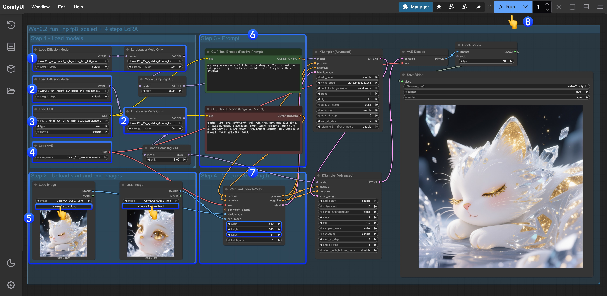

import UpdateReminder from '/snippets/de/tutorials/update-reminder.mdx'

**Wan2.2-Fun-Inp** ist ein vom Alibaba-PAI-Team vorgestelltes Modell zur Videogenerierung mit Steuerung über Start- und End-Frame. Es unterstützt die Eingabe von **Start- und End-Frame-Bildern**, um dazwischenliegende Übergangsvideos zu generieren, und bietet Kreativen damit mehr kreative Kontrolle. Das Modell ist unter der **Apache-2.0-Lizenz** veröffentlicht und unterstützt die kommerzielle Nutzung.

**Hauptmerkmale**:
- **Start-End-Frame-Steuerung**: Unterstützt die Eingabe von Start- und End-Frame-Bildern, um dazwischenliegende Übergangsvideos zu generieren, was die Kohärenz des Videos und die kreative Freiheit erhöht
- **Hochwertige Videogenerierung**: Basierend auf der Wan2.2-Architektur werden Videos in Filmqualität ausgegeben
- **Unterstützung mehrerer Auflösungen**: Unterstützt die Generierung von Videos in 512x512, 768x768, 1024x1024 und anderen Auflösungen für unterschiedliche Szenarien

**Modellversion**:
- **14B-Hochleistungsversion**: Das Modell ist über 32GB groß und liefert bessere Ergebnisse, erfordert jedoch viel VRAM

Im Folgenden finden Sie die relevanten Modellgewichte und Code-Repositories:

- [🤗Wan2.2-Fun-Inp-14B](https://huggingface.co/alibaba-pai/Wan2.2-Fun-A14B-InP)
- Code-Repository: [VideoX-Fun](https://github.com/aigc-apps/VideoX-Fun)

## ComfyOrg Wan2.2 Fun InP & Control: YouTube-Livestream-Aufzeichnung

<iframe
  className="w-full aspect-video rounded-xl"
  src="https://www.youtube.com/embed/YcAerNYIvho?si=Zh8tzRwI_OTAFx3m"
  title="ComfyUI Selection Toolbox New Features"
  allow="accelerometer; clipboard-write; encrypted-media; gyroscope; picture-in-picture"
  allowFullScreen
></iframe>

## Wan2.2 Fun Inp: Beispiel-Workflow für die Videogenerierung mit Start- und End-Frame

<UpdateReminder/>

Dieser Workflow bietet zwei Versionen:
1. Eine Version mit dem 4-Step-LoRA von [Wan2.2-Lightning](https://huggingface.co/lightx2v/Wan2.2-Lightning) aus lightx2v für eine beschleunigte Videogenerierung
2. Eine fp8_scaled-Version ohne Beschleunigungs-LoRA

Nachfolgend finden Sie die Testergebnisse mit einer RTX4090D-GPU mit 24 GB VRAM bei einer Auflösung von 640x640 und 81 Frames.

| Modelltyp               | VRAM-Nutzung | Zeit für die erste Generierung | Zeit für die zweite Generierung |
| ------------------------ | ---------- | -------------------- | --------------------- |
| fp8_scaled               | 83%        | ≈ 524s               | ≈ 520s                |
| fp8_scaled + 4-step LoRA | 89%        | ≈ 138s               | ≈ 79s                 |

Da die Beschleunigung durch LoRA erheblich ist, aber die Videodynamik verloren geht, aktivieren die bereitgestellten Workflows standardmäßig die beschleunigte LoRA-Version. Wenn Sie den anderen Workflow aktivieren möchten, wählen Sie ihn aus und aktivieren Sie ihn mit **Ctrl+B**.

### 1. Workflow-Datei herunterladen

Aktualisieren Sie Ihr ComfyUI auf die neueste Version und suchen Sie im Menü `Workflow` -> `Browse Templates` -> `Video` nach „Wan2.2 Fun Inp“, um den Workflow zu laden.

Alternativ können Sie nach dem Aktualisieren von ComfyUI auf die neueste Version den unten stehenden Workflow herunterladen und ihn zum Laden in ComfyUI ziehen.


<CardGroup cols={2}>
  <Card title="Auf Comfy Cloud ausführen" icon="cloud" href="https://cloud.comfy.org/?template=video_wan2_2_14B_fun_inpaint&utm_source=docs&utm_medium=referral&utm_campaign=wan2-2-fun-inp">
    In Comfy Cloud öffnen
  </Card>
  <Card title="Workflow herunterladen" icon="download" href="https://github.com/Comfy-Org/workflow_templates/blob/main/templates/video_wan2_2_14B_fun_inpaint.json">
    JSON herunterladen oder in der Vorlagenbibliothek nach „Wan2.2 Fun Inp“ suchen
  </Card>
</CardGroup>

Verwenden Sie die folgenden Materialien als Start- und End-Frame.

**Eingabematerialien**

<CardGroup cols={2}>
  <Card title="video_wan2_2_14B_fun_inpaint_start_image.png" icon="image" href="https://raw.githubusercontent.com/Comfy-Org/workflow_templates/main/input/video_wan2_2_14B_fun_inpaint_start_image.png">
    Start-Frame für die Videogenerierung. Laden Sie dieses Bild herunter und verwenden Sie es, oder ersetzen Sie es durch Ihr eigenes.
  </Card>
  <Card title="video_wan2_2_14B_fun_inpaint_end_image.png" icon="image" href="https://raw.githubusercontent.com/Comfy-Org/workflow_templates/main/input/video_wan2_2_14B_fun_inpaint_end_image.png">
    End-Frame für die Videogenerierung. Laden Sie dieses Bild herunter und verwenden Sie es, oder ersetzen Sie es durch Ihr eigenes.
  </Card>
</CardGroup>

### 2. Modelle

Alle in dieser Anleitung verwendeten Modelle finden Sie [hier](https://huggingface.co/Comfy-Org/Wan_2.2_ComfyUI_Repackaged/tree/main/split_files).

**Diffusionsmodelle**

<CardGroup cols={2}>
  <Card title="High Noise 14B FP8 Scaled" icon="download" href="https://huggingface.co/Comfy-Org/Wan_2.2_ComfyUI_Repackaged/blob/main/split_files/diffusion_models/wan2.2_fun_inpaint_high_noise_14B_fp8_scaled.safetensors">
    wan2.2_fun_inpaint_high_noise_14B_fp8_scaled.safetensors: Diffusionsmodell mit hohem Rauschen für Start-End-Frame-Inpainting
  </Card>
  <Card title="Low Noise 14B FP8 Scaled" icon="download" href="https://huggingface.co/Comfy-Org/Wan_2.2_ComfyUI_Repackaged/blob/main/split_files/diffusion_models/wan2.2_fun_inpaint_low_noise_14B_fp8_scaled.safetensors">
    wan2.2_fun_inpaint_low_noise_14B_fp8_scaled.safetensors: Diffusionsmodell mit niedrigem Rauschen für Start-End-Frame-Inpainting
  </Card>
</CardGroup>

**Lightning LoRA (optional, zur Beschleunigung)**

<CardGroup cols={2}>
  <Card title="Lightning 4-Step High Noise LoRA" icon="download" href="https://huggingface.co/Comfy-Org/Wan_2.2_ComfyUI_Repackaged/blob/main/split_files/loras/wan2.2_i2v_lightx2v_4steps_lora_v1_high_noise.safetensors">
    wan2.2_i2v_lightx2v_4steps_lora_v1_high_noise.safetensors: LoRA zur 4-Schritt-Beschleunigung für das Modell mit hohem Rauschen
  </Card>
  <Card title="Lightning 4-Step Low Noise LoRA" icon="download" href="https://huggingface.co/Comfy-Org/Wan_2.2_ComfyUI_Repackaged/blob/main/split_files/loras/wan2.2_i2v_lightx2v_4steps_lora_v1_low_noise.safetensors">
    wan2.2_i2v_lightx2v_4steps_lora_v1_low_noise.safetensors: LoRA zur 4-Schritt-Beschleunigung für das Modell mit niedrigem Rauschen
  </Card>
</CardGroup>

**VAE**

<Card title="Wan2.1 VAE" icon="download" href="https://huggingface.co/Comfy-Org/Wan_2.2_ComfyUI_Repackaged/blob/main/split_files/vae/wan_2.1_vae.safetensors">
  wan_2.1_vae.safetensors: Wan2.1 VAE zum Kodieren und Dekodieren
</Card>
**Textencoder**

<Card title="UMT5 XXL FP8 Scaled" icon="download" href="https://huggingface.co/Comfy-Org/Wan_2.1_ComfyUI_repackaged/blob/main/split_files/text_encoders/umt5_xxl_fp8_e4m3fn_scaled.safetensors">
  umt5_xxl_fp8_e4m3fn_scaled.safetensors: Skalierter FP8-Textencoder
</Card>
```
ComfyUI/
├───📂 models/
│   ├───📂 diffusion_models/
│   │   ├─── wan2.2_fun_inpaint_high_noise_14B_fp8_scaled.safetensors
│   │   └─── wan2.2_fun_inpaint_low_noise_14B_fp8_scaled.safetensors
│   ├───📂 loras/
│   │   ├─── wan2.2_i2v_lightx2v_4steps_lora_v1_high_noise.safetensors
│   │   └─── wan2.2_i2v_lightx2v_4steps_lora_v1_low_noise.safetensors
│   ├───📂 text_encoders/
│   │   └─── umt5_xxl_fp8_e4m3fn_scaled.safetensors 
│   └───📂 vae/
│       └── wan_2.1_vae.safetensors
```

### 3. Workflow-Anleitung



<Note>
  Dieser Workflow verwendet LoRA. Bitte stellen Sie sicher, dass das entsprechende Diffusionsmodell und das LoRA aufeinander abgestimmt sind.
</Note>

1. **High-Noise**-Modell und **LoRA** laden
   - Stellen Sie sicher, dass der Node `Load Diffusion Model` das Modell `wan2.2_fun_inpaint_high_noise_14B_fp8_scaled.safetensors` lädt
   - Stellen Sie sicher, dass der Node `LoraLoaderModelOnly` das LoRA `wan2.2_i2v_lightx2v_4steps_lora_v1_high_noise.safetensors` lädt
2. **Low-Noise**-Modell und **LoRA** laden
   - Stellen Sie sicher, dass der Node `Load Diffusion Model` das Modell `wan2.2_fun_inpaint_low_noise_14B_fp8_scaled.safetensors` lädt
   - Stellen Sie sicher, dass der Node `LoraLoaderModelOnly` das LoRA `wan2.2_i2v_lightx2v_4steps_lora_v1_low_noise.safetensors` lädt
3. Stellen Sie sicher, dass der Node `Load CLIP` das Modell `umt5_xxl_fp8_e4m3fn_scaled.safetensors` lädt
4. Stellen Sie sicher, dass der Node `Load VAE` das Modell `wan_2.1_vae.safetensors` lädt
5. Laden Sie die Start- und End-Frame-Bilder als Materialien hoch
6. Geben Sie Ihren Prompt in der Prompt-Gruppe ein
7. Passen Sie die Größe und die Videolänge im Node `WanFunInpaintToVideo` an
    - Passen Sie die Parameter `width` und `height` an. Der Standardwert ist `640`. Wir haben eine kleinere Größe eingestellt, Sie können sie aber nach Bedarf ändern.
    - Passen Sie den Parameter `length` an, der die Gesamtzahl der Frames angibt. Der aktuelle Workflow verwendet 16 fps. Wenn Sie beispielsweise ein 5-Sekunden-Video generieren möchten, sollten Sie den Wert auf 5*16 = 80 setzen.
8. Klicken Sie auf die Schaltfläche `Run` oder verwenden Sie die Tastenkombination `Ctrl(cmd) + Enter`, um die Videogenerierung auszuführen
