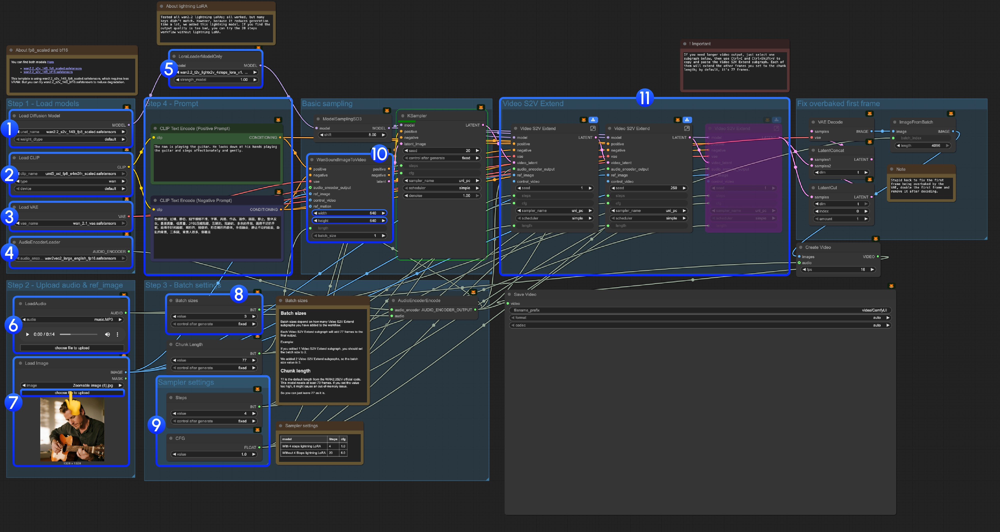

import UpdateReminder from "/snippets/de/tutorials/update-reminder.mdx"

Wir freuen uns, bekannt zu geben, dass Wan2.2-S2V, das fortschrittliche audiogesteuerte Videogenerierungsmodell, jetzt nativ in ComfyUI unterstützt wird! Dieses leistungsstarke KI-Modell kann statische Bilder und Audioeingaben in dynamische Videoinhalte verwandeln und unterstützt Dialoge, Gesang, Performance und verschiedene kreative Inhaltsanforderungen.

**Modell-Highlights**
- **Audiogesteuerte Videogenerierung**: Wandelt statische Bilder und Audio in synchronisierte Videos um
- **Qualität auf Kino-Niveau**: Generiert Videos in Filmqualität mit natürlichen Gesichtsausdrücken und Bewegungen
- **Generierung von Videos in Minutenlänge**: Unterstützt die Erstellung von Videos in Langform
- **Unterstützung mehrerer Formate**: Funktioniert mit Ganzkörper- und Halbkörperfiguren
- **Erweiterte Bewegungskontrolle**: Generiert Aktionen und Umgebungen aus Textanweisungen

Wan2.2 S2V Code: [GitHub](https://github.com/aigc-apps/VideoX-Fun)
Wan2.2 S2V Modell: [Hugging Face](https://huggingface.co/Wan-AI/Wan2.2-S2V-14B)

## Nativer ComfyUI-Workflow für Wan2.2 S2V

<UpdateReminder/>

### Wan2.2-S2V: Audiogesteuerte Videogenerierung {#video_wan2_2_14B_s2v}

Verwandeln Sie statische Bilder und Audio in dynamische Videos mit perfekter Synchronisation und Generierung in Minutenlänge.


<CardGroup cols={2}>
  <Card title="Auf Comfy Cloud ausführen" icon="cloud" href="https://cloud.comfy.org/?template=video_wan2_2_14B_s2v&utm_source=docs&utm_medium=referral&utm_campaign=wan2-2-s2v">
    In Comfy Cloud öffnen
  </Card>
  <Card title="Workflow herunterladen" icon="download" href="https://github.com/Comfy-Org/workflow_templates/blob/main/templates/video_wan2_2_14B_s2v.json">
    JSON herunterladen oder in der Vorlagenbibliothek nach „Wan2.2 S2V“ suchen
  </Card>
</CardGroup>

**Eingangsmaterialien**

Laden Sie diese Dateien in die passenden Nodes hoch:

<CardGroup cols={2}>
  <Card title="video_wan2_2_14B_s2v_reference_image.jpg" icon="image" href="https://raw.githubusercontent.com/Comfy-Org/workflow_templates/main/input/video_wan2_2_14B_s2v_reference_image.jpg">
    `LoadImage` Node 52 · `video_wan2_2_14B_s2v_reference_image.jpg`
  </Card>
  <Card title="video_wan2_2_14B_s2v_input_audio.MP3" icon="music" href="https://raw.githubusercontent.com/Comfy-Org/workflow_templates/main/input/video_wan2_2_14B_s2v_input_audio.MP3">
    `LoadAudio` Node 58 · `video_wan2_2_14B_s2v_input_audio.MP3`
  </Card>
</CardGroup>

<div style={{display: 'grid', gridTemplateColumns: 'repeat(2, minmax(0, 1fr))', gap: '1rem', alignItems: 'start'}}>
  
</div>

### 2. Modell-Links

Die Modelle finden Sie in [unserem Repository](https://huggingface.co/Comfy-Org/Wan_2.2_ComfyUI_Repackaged)

**diffusion_models**

<CardGroup cols={2}>
  <Card title="wan2.2_s2v_14B_fp8_scaled.safetensors" icon="download" href="https://huggingface.co/Comfy-Org/Wan_2.2_ComfyUI_Repackaged/blob/main/split_files/diffusion_models/wan2.2_s2v_14B_fp8_scaled.safetensors?download=true">
    FP8-skaliertes Diffusionsmodell. Ablegen in <code>ComfyUI/models/diffusion_models/</code>
  </Card>
  <Card title="wan2.2_s2v_14B_bf16.safetensors" icon="download" href="https://huggingface.co/Comfy-Org/Wan_2.2_ComfyUI_Repackaged/blob/main/split_files/diffusion_models/wan2.2_s2v_14B_bf16.safetensors?download=true">
    BF16-Diffusionsmodell. Ablegen in <code>ComfyUI/models/diffusion_models/</code>
  </Card>
</CardGroup>

**audio_encoders**

<Card title="wav2vec2_large_english_fp16.safetensors" icon="download" href="https://huggingface.co/Comfy-Org/Wan_2.2_ComfyUI_Repackaged/blob/main/split_files/audio_encoders/wav2vec2_large_english_fp16.safetensors?download=true">
  Audio-Encoder-Modell. Ablegen in <code>ComfyUI/models/audio_encoders/</code>
</Card>
**vae**

<Card title="wan_2.1_vae.safetensors" icon="download" href="https://huggingface.co/Comfy-Org/Wan_2.2_ComfyUI_Repackaged/blob/main/split_files/vae/wan_2.1_vae.safetensors?download=true">
  Wan2.1 VAE-Modell. Ablegen in <code>ComfyUI/models/vae/</code>
</Card>
**text_encoders**

<Card title="umt5_xxl_fp8_e4m3fn_scaled.safetensors" icon="download" href="https://huggingface.co/Comfy-Org/Wan_2.1_ComfyUI_repackaged/blob/main/split_files/text_encoders/umt5_xxl_fp8_e4m3fn_scaled.safetensors?download=true">
  FP8-skalierter Text-Encoder. Ablegen in <code>ComfyUI/models/text_encoders/</code>
</Card>
```
ComfyUI/
├───📂 models/
│   ├───📂 diffusion_models/
│   │   ├─── wan2.2_s2v_14B_fp8_scaled.safetensors
│   │   └─── wan2.2_s2v_14B_bf16.safetensors
│   ├───📂 text_encoders/
│   │   └─── umt5_xxl_fp8_e4m3fn_scaled.safetensors 
│   ├───📂 audio_encoders/ # Erstellen Sie diesen Ordner, wenn Sie ihn nicht finden
│   │   └─── wav2vec2_large_english_fp16.safetensors 
│   └───📂 vae/
│       └── wan_2.1_vae.safetensors
```

### 3. Anweisungen für den Workflow



#### 3.1 Über Lightning LoRA

#### 3.2 Über die Modelle fp8_scaled und bf16

Beide Modelle finden Sie [hier](https://huggingface.co/Comfy-Org/Wan_2.2_ComfyUI_Repackaged/tree/main/split_files/diffusion_models):

<CardGroup cols={2}>
  <Card title="wan2.2_s2v_14B_fp8_scaled.safetensors" icon="download" href="https://huggingface.co/Comfy-Org/Wan_2.2_ComfyUI_Repackaged/blob/main/split_files/diffusion_models/wan2.2_s2v_14B_fp8_scaled.safetensors?download=true">
    FP8-skaliertes Diffusionsmodell
  </Card>
  <Card title="wan2.2_s2v_14B_bf16.safetensors" icon="download" href="https://huggingface.co/Comfy-Org/Wan_2.2_ComfyUI_Repackaged/blob/main/split_files/diffusion_models/wan2.2_s2v_14B_bf16.safetensors?download=true">
    BF16-Diffusionsmodell
  </Card>
</CardGroup>

Diese Vorlage verwendet `wan2.2_s2v_14B_fp8_scaled.safetensors`, das weniger VRAM benötigt. Sie können aber `wan2.2_s2v_14B_bf16.safetensors` ausprobieren, um Qualitätsverluste zu reduzieren.

#### 3.3 Schritt-für-Schritt-Anleitung

**Schritt 1: Modelle laden**
1. **Load Diffusion Model**: `wan2.2_s2v_14B_fp8_scaled.safetensors` oder `wan2.2_s2v_14B_bf16.safetensors` laden
   - Der bereitgestellte Workflow verwendet `wan2.2_s2v_14B_fp8_scaled.safetensors`, das weniger VRAM benötigt
   - Sie können aber `wan2.2_s2v_14B_bf16.safetensors` ausprobieren, um Qualitätsverluste zu reduzieren
2. **CLIP laden**: `umt5_xxl_fp8_e4m3fn_scaled.safetensors` laden
3. **VAE laden**: `wan_2.1_vae.safetensors` laden
4. **AudioEncoderLoader**: `wav2vec2_large_english_fp16.safetensors` laden
5. **LoraLoaderModelOnly**: `wan2.2_t2v_lightx2v_4steps_lora_v1.1_high_noise.safetensors` laden (Lightning LoRA)
   - Wir haben alle Wan2.2-Lightning-LoRAs getestet. Da dies keine eigens für Wan2.2 S2V trainierte LoRA ist, passen viele Schlüsselwerte nicht. Wir haben sie dennoch hinzugefügt, weil sie die Generierungszeit deutlich verkürzt. Wir werden diese Vorlage weiter optimieren
   - Ihre Verwendung führt zu deutlichen Einbußen bei Dynamik und Qualität
   - Wenn Sie die Ausgabequalität als zu schlecht empfinden, können Sie den ursprünglichen Workflow mit 20 Schritten ausprobieren
6. **LoadAudio**: Laden Sie unsere bereitgestellte Audiodatei oder Ihr eigenes Audio hoch
7. **Bild laden**: Referenzbild hochladen
8. **Batch-Größen**: Richten Sie sich nach der Anzahl der Subgraph-Nodes „Video S2V Extend“, die Sie hinzufügen
   - Jeder Subgraph „Video S2V Extend“ fügt der endgültigen Ausgabe 77 Frames hinzu
   - Zum Beispiel: Wenn Sie 2 Subgraphs „Video S2V Extend“ hinzugefügt haben, sollte die Batch-Größe 3 betragen, was der Gesamtzahl der Sampling-Durchläufe entspricht
   - **Chunk Length**: Behalten Sie den Standardwert 77 bei

9. **Sampler-Einstellungen**: Wählen Sie je nach Verwendung der Lightning LoRA unterschiedliche Einstellungen
   - Mit 4-Step-Lightning-LoRA: steps: 4, cfg: 1.0
   - Ohne 4-Step-Lightning-LoRA: steps: 20, cfg: 6.0
10. **Größeneinstellungen**: Legen Sie die Abmessungen des Ausgabevideos fest
11. **Video S2V Extend**: Subgraph-Nodes zur Videoerweiterung. Da wir standardmäßig 77 Frames pro Sampling erzeugen und es sich um ein Modell mit 16 fps handelt, erzeugt jede Erweiterung 77 / 16 = 4.8125 Sekunden Video
    - Sie müssen etwas rechnen, um die Anzahl der Subgraph-Nodes zur Videoerweiterung an die Länge des Eingangsaudios anzupassen. Zum Beispiel: Bei 14s Eingangsaudio werden insgesamt 14x16=224 Frames benötigt, jede Videoerweiterung liefert 77 Frames, also benötigen Sie 224/77 = 2.9, aufgerundet 3 Subgraph-Nodes zur Videoerweiterung
12. Drücken Sie Strg+Enter oder klicken Sie auf die Schaltfläche „Run“, um den Workflow auszuführen