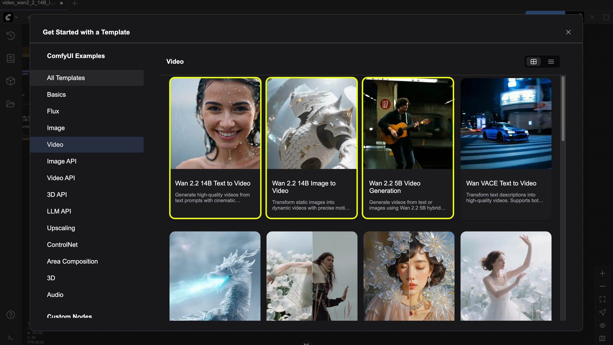
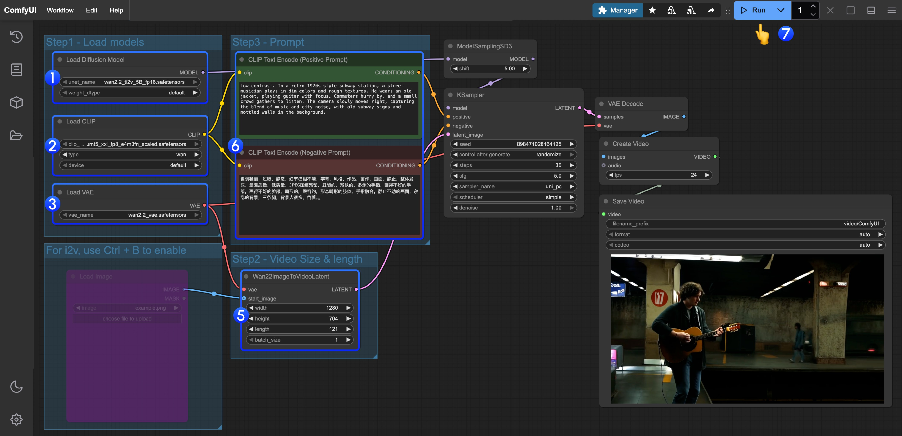
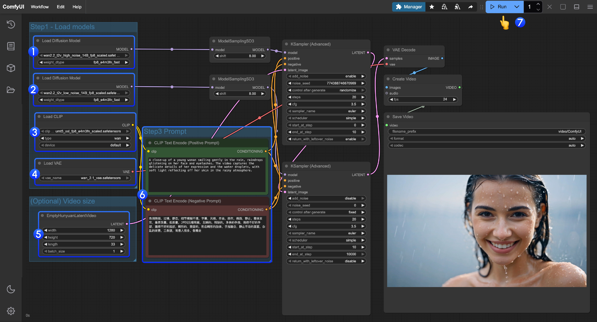
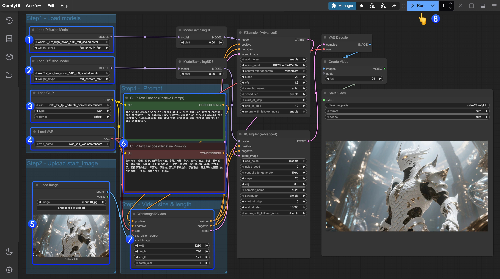
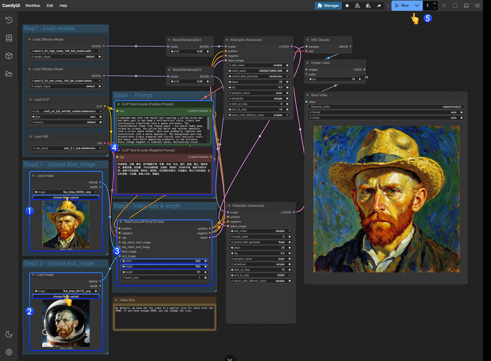

import UpdateReminder from "/snippets/de/tutorials/update-reminder.mdx"

<iframe
  className="w-full aspect-video rounded-xl"
  src="https://www.youtube.com/embed/S45XQXFOutM?si=Qvfco7Cyr_3akZ3Hv"
  title="ComfyUI Selection Toolbox New Features"
  allow="accelerometer; clipboard-write; encrypted-media; gyroscope; picture-in-picture"
  allowFullScreen
></iframe>

Wan 2.2 ist ein neues multimodales generatives Modell, das WAN AI veröffentlicht hat. Das Modell verwendet eine innovative MoE-Architektur (Mixture of Experts), die aus High-Noise- und Low-Noise-Expertenmodellen besteht. Es kann die Expertenmodelle anhand der Denoising-Zeitschritte aufteilen und so Videoinhalte in höherer Qualität erzeugen.

Wan 2.2 hat drei Kernfunktionen: ästhetische Steuerung auf Kinoniveau, die die ästhetischen Standards der professionellen Filmbranche tief integriert und mehrdimensionale visuelle Steuerung wie Licht, Farbe und Bildkomposition unterstützt; komplexe Bewegungen in großem Maßstab, die verschiedene komplexe Bewegungen mühelos wiedergeben und die Flüssigkeit und Kontrollierbarkeit der Bewegung verbessern; präzise semantische Umsetzung, die sich in komplexen Szenen und bei der Generierung mehrerer Objekte auszeichnet und die kreativen Absichten der Nutzer besser wiedergibt.
Das Modell unterstützt mehrere Generierungsmodi wie Text zu Video und Bild zu Video und eignet sich für Content-Erstellung, künstlerisches Schaffen, Aus- und Weiterbildung und weitere Anwendungsszenarien.

[Wan2.2 Prompt Guide](https://alidocs.dingtalk.com/i/nodes/EpGBa2Lm8aZxe5myC99MelA2WgN7R35y)

## Modell-Highlights

- **Ästhetische Steuerung auf Kinoniveau**: Professionelle Kamerasprache, unterstützt mehrdimensionale visuelle Steuerung wie Beleuchtung, Farbe und Komposition
- **Groß angelegte komplexe Bewegungen**: Stellt verschiedene komplexe Bewegungen flüssig wieder her und verbessert die Steuerbarkeit und Natürlichkeit der Bewegung
- **Präzise semantische Umsetzung**: Komplexes Szenenverständnis, Generierung mehrerer Objekte, bessere Umsetzung kreativer Absichten
- **Effiziente Kompressionstechnologie**: 5B-Version mit VAE mit hoher Kompressionsrate, Speicheroptimierung, unterstützt gemischtes Training

## Open-Source-Modellversionen von Wan2.2

Die Modelle der Wan2.2-Serie basieren auf der Open-Source-Lizenz Apache 2.0 und sind für die kommerzielle Nutzung freigegeben. Die Apache-2.0-Lizenz erlaubt es Ihnen, diese Modelle frei zu verwenden, zu verändern und weiterzugeben, auch zu kommerziellen Zwecken, solange Sie den ursprünglichen Copyright-Hinweis und den Lizenztext beibehalten.

| Modelltyp | Modellname | Parameter | Hauptfunktion | Modell-Repository |
|------------|------------|------------|---------------|-----------------|
| Hybridmodell | Wan2.2-TI2V-5B | 5B | Hybridversion, die sowohl Text zu Video als auch Bild zu Video unterstützt; ein einziges Modell erfüllt zwei zentrale Aufgabenstellungen | 🤗 [Wan2.2-TI2V-5B](https://huggingface.co/Wan-AI/Wan2.2-TI2V-5B) |
| Bild zu Video | Wan2.2-I2V-A14B | 14B | Wandelt statische Bilder in dynamische Videos um und bewahrt dabei die inhaltliche Konsistenz sowie einen glatten dynamischen Verlauf | 🤗 [Wan2.2-I2V-A14B](https://huggingface.co/Wan-AI/Wan2.2-I2V-A14B) |
| Text zu Video | Wan2.2-T2V-A14B | 14B | Erzeugt hochwertige Videos aus Textbeschreibungen, mit ästhetischer Steuerung auf Kinoniveau und präziser semantischer Treue | 🤗 [Wan2.2-T2V-A14B](https://huggingface.co/Wan-AI/Wan2.2-T2V-A14B) |

## ComfyOrg Wan2.2 Live Streams

Zur Nutzung von ComfyUI Wan2.2 haben wir Live Streams durchgeführt. Sie können sie sich ansehen, um zu lernen, wie Sie Wan2.2 verwenden.

<iframe
  className="w-full aspect-video rounded-xl"
  src="https://www.youtube.com/embed/Z0yo16LzReA?si=I-BlUfktxqt9URQk"
  title="ComfyUI Wan2.2 Live Streams"
  allow="accelerometer; clipboard-write; encrypted-media; gyroscope; picture-in-picture"
  allowFullScreen
></iframe>

<iframe
  className="w-full aspect-video rounded-xl"
  src="https://www.youtube.com/embed/z62QLQ3XqSA?si=yUenvPa9Q4-VX28M"
  title="ComfyUI Wan2.2 Deep Dive"
  allow="accelerometer; clipboard-write; encrypted-media; gyroscope; picture-in-picture"
  allowFullScreen
></iframe>

<iframe
  className="w-full aspect-video rounded-xl"
  src="https://www.youtube.com/embed/0fyZhXga8P8?si=PMv9xQLP32wP8Ni9"
  title="ComfyUI Wan2.2 Deep Dive #2"
  allow="accelerometer; clipboard-write; encrypted-media; gyroscope; picture-in-picture"
  allowFullScreen
></iframe>

Dieses Tutorial verwendet die Version [🤗 Comfy-Org/Wan_2.2_ComfyUI_Repackaged](https://huggingface.co/Comfy-Org/Wan_2.2_ComfyUI_Repackaged).

<UpdateReminder/>



## Wan2.2 TI2V 5B Workflow-Beispiel (Hybridversion)

<Tip>
  Die Wan2.2 5B Version sollte mit dem nativen Offloading von ComfyUI gut auf 8 GB VRAM passen.
</Tip>

### Wan 2.2 5B Videogenerierung {#video_wan2_2_5B_ti2v}

Schnelle Generierung von Text zu Video und Bild zu Video mit 5B Parametern. Optimiert für schnelles Prototyping und kreatives Experimentieren.


<CardGroup cols={2}>
  <Card title="Auf Comfy Cloud ausführen" icon="cloud" href="https://cloud.comfy.org/?template=video_wan2_2_5B_ti2v&utm_source=docs&utm_medium=referral&utm_campaign=wan2_2">
    In Comfy Cloud öffnen
  </Card>
  <Card title="Workflow herunterladen" icon="download" href="https://github.com/Comfy-Org/workflow_templates/blob/main/templates/video_wan2_2_5B_ti2v.json">
    JSON herunterladen oder in der Vorlagenbibliothek nach „Wan2.2 5B“ suchen
  </Card>
</CardGroup>

### 2. Modelle manuell herunterladen

Alle genannten Modelle finden Sie unter [Comfy-Org/Wan_2.2_ComfyUI_Repackaged](https://huggingface.co/Comfy-Org/Wan_2.2_ComfyUI_Repackaged).

**Diffusionsmodell**

<CardGroup cols={1}>
  <Card title="wan2.2_ti2v_5B_fp16.safetensors" icon="download" href="https://huggingface.co/Comfy-Org/Wan_2.2_ComfyUI_Repackaged/blob/main/split_files/diffusion_models/wan2.2_ti2v_5B_fp16.safetensors">
    Hybrides 5B-Diffusionsmodell. Nach <code>ComfyUI/models/diffusion_models/</code> legen
  </Card>
</CardGroup>

**VAE**

<CardGroup cols={1}>
  <Card title="wan2.2_vae.safetensors" icon="download" href="https://huggingface.co/Comfy-Org/Wan_2.2_ComfyUI_Repackaged/blob/main/split_files/vae/wan2.2_vae.safetensors">
    Wan2.2 VAE. Nach <code>ComfyUI/models/vae/</code> legen
  </Card>
</CardGroup>

**Text-Encoder**

<CardGroup cols={1}>
  <Card title="umt5_xxl_fp8_e4m3fn_scaled.safetensors" icon="download" href="https://huggingface.co/Comfy-Org/Wan_2.1_ComfyUI_repackaged/blob/main/split_files/text_encoders/umt5_xxl_fp8_e4m3fn_scaled.safetensors">
    FP8 Text-Encoder. Nach <code>ComfyUI/models/text_encoders/</code> legen
  </Card>
</CardGroup>

```
ComfyUI/
├───📂 models/
│   ├───📂 diffusion_models/
│   │   └───wan2.2_ti2v_5B_fp16.safetensors
│   ├───📂 text_encoders/
│   │   └─── umt5_xxl_fp8_e4m3fn_scaled.safetensors 
│   └───📂 vae/
│       └── wan2.2_vae.safetensors
```

### 3. Befolgen Sie die Schritte


1. Stellen Sie sicher, dass der Node `Load Diffusion Model` das Modell `wan2.2_ti2v_5B_fp16.safetensors` lädt.
2. Stellen Sie sicher, dass der Node `Load CLIP` das Modell `umt5_xxl_fp8_e4m3fn_scaled.safetensors` lädt.
3. Stellen Sie sicher, dass der Node `Load VAE` das Modell `wan2.2_vae.safetensors` lädt.
4. (Optional) Wenn Sie eine Bild-zu-Video-Generierung durchführen möchten, können Sie mit dem Tastenkürzel Ctrl+B den Node `Load image` aktivieren, um ein Bild hochzuladen.
5. (Optional) Im Node `Wan22ImageToVideoLatent` können Sie die Größe und die Gesamtzahl der Videoframes (`length`) anpassen.
6. (Optional) Wenn Sie die Prompts (Positiv und Negativ) ändern möchten, tun Sie dies im Node `CLIP Text Encoder` in Schritt 5.
7. Klicken Sie auf die Schaltfläche `Run` oder verwenden Sie das Tastenkürzel `Ctrl(cmd) + Enter`, um die Videogenerierung auszuführen.

## Wan2.2 14B T2V Text-zu-Video-Workflow-Beispiel

### Wan 2.2 14B Text zu Video {#video_wan2_2_14B_t2v}

Generieren Sie mit Wan 2.2 hochwertige Videos aus Text-Prompts mit filmischer Bildästhetik und dynamischer Bewegungsgenerierung.


<CardGroup cols={2}>
  <Card title="Auf Comfy Cloud ausführen" icon="cloud" href="https://cloud.comfy.org/?template=video_wan2_2_14B_t2v&utm_source=docs&utm_medium=referral&utm_campaign=wan2_2">
    In Comfy Cloud öffnen
  </Card>
  <Card title="Workflow herunterladen" icon="download" href="https://github.com/Comfy-Org/workflow_templates/blob/main/templates/video_wan2_2_14B_t2v.json">
    JSON herunterladen oder in der Vorlagenbibliothek nach „Wan2.2 14B T2V“ suchen
  </Card>
</CardGroup>

### 2. Modelle manuell herunterladen

Alle genannten Modelle finden Sie unter [Comfy-Org/Wan_2.2_ComfyUI_Repackaged](https://huggingface.co/Comfy-Org/Wan_2.2_ComfyUI_Repackaged).

**Diffusionsmodelle**

<CardGroup cols={2}>
  <Card title="wan2.2_t2v_high_noise_14B_fp8_scaled.safetensors" icon="download" href="https://huggingface.co/Comfy-Org/Wan_2.2_ComfyUI_Repackaged/blob/main/split_files/diffusion_models/wan2.2_t2v_high_noise_14B_fp8_scaled.safetensors">
    Diffusionsmodell mit hohem Rauschen. Ablegen in <code>ComfyUI/models/diffusion_models/</code>
  </Card>
  <Card title="wan2.2_t2v_low_noise_14B_fp8_scaled.safetensors" icon="download" href="https://huggingface.co/Comfy-Org/Wan_2.2_ComfyUI_Repackaged/blob/main/split_files/diffusion_models/wan2.2_t2v_low_noise_14B_fp8_scaled.safetensors">
    Diffusionsmodell mit niedrigem Rauschen. Ablegen in <code>ComfyUI/models/diffusion_models/</code>
  </Card>
</CardGroup>

**VAE**

<CardGroup cols={1}>
  <Card title="wan_2.1_vae.safetensors" icon="download" href="https://huggingface.co/Comfy-Org/Wan_2.2_ComfyUI_Repackaged/blob/main/split_files/vae/wan_2.1_vae.safetensors">
    Wan2.1 VAE (kompatibel mit Wan2.2). Ablegen in <code>ComfyUI/models/vae/</code>
  </Card>
</CardGroup>

**Textencoder**

<CardGroup cols={1}>
  <Card title="umt5_xxl_fp8_e4m3fn_scaled.safetensors" icon="download" href="https://huggingface.co/Comfy-Org/Wan_2.1_ComfyUI_repackaged/blob/main/split_files/text_encoders/umt5_xxl_fp8_e4m3fn_scaled.safetensors">
    FP8-Textencoder. Ablegen in <code>ComfyUI/models/text_encoders/</code>
  </Card>
</CardGroup>

```
ComfyUI/
├───📂 models/
│   ├───📂 diffusion_models/
│   │   ├─── wan2.2_t2v_low_noise_14B_fp8_scaled.safetensors
│   │   └─── wan2.2_t2v_high_noise_14B_fp8_scaled.safetensors
│   ├───📂 text_encoders/
│   │   └─── umt5_xxl_fp8_e4m3fn_scaled.safetensors 
│   └───📂 vae/
│       └── wan_2.1_vae.safetensors
```

### 3. Die Schritte befolgen


1. Stellen Sie sicher, dass der erste Node `Load Diffusion Model` das Modell `wan2.2_t2v_high_noise_14B_fp8_scaled.safetensors` lädt.
2. Stellen Sie sicher, dass der zweite Node `Load Diffusion Model` das Modell `wan2.2_t2v_low_noise_14B_fp8_scaled.safetensors` lädt.
3. Stellen Sie sicher, dass der Node `Load CLIP` das Modell `umt5_xxl_fp8_e4m3fn_scaled.safetensors` lädt.
4. Stellen Sie sicher, dass der Node `Load VAE` das Modell `wan_2.1_vae.safetensors` lädt.
5. (Optional) Im Node `EmptyHunyuanLatentVideo` können Sie die Einstellungen für die Größe und die Gesamtzahl der Videoframes (`length`) anpassen.
6. (Optional) Wenn Sie die Prompts (Positiv und Negativ) ändern möchten, tun Sie dies im Node `CLIP Text Encoder` in Schritt 5.
7. Klicken Sie auf die Schaltfläche `Run` oder verwenden Sie die Tastenkombination `Ctrl(cmd) + Enter`, um die Videogenerierung auszuführen.

## Wan2.2 14B I2V Workflow-Beispiel für Bild zu Video

### Wan 2.2 14B Bild zu Video {#video_wan2_2_14B_i2v}

Mit Wan 2.2 verwandeln Sie statische Bilder in dynamische Videos, mit präziser Steuerung der Bewegung und Beibehaltung des Stils.


<CardGroup cols={2}>
  <Card title="Auf Comfy Cloud ausführen" icon="cloud" href="https://cloud.comfy.org/?template=video_wan2_2_14B_i2v&utm_source=docs&utm_medium=referral&utm_campaign=wan2_2">
    In Comfy Cloud öffnen
  </Card>
  <Card title="Workflow herunterladen" icon="download" href="https://github.com/Comfy-Org/workflow_templates/blob/main/templates/video_wan2_2_14B_i2v.json">
    JSON herunterladen oder in der Vorlagenbibliothek nach „Wan2.2 14B I2V“ suchen
  </Card>
</CardGroup>

**Eingabematerialien**

Laden Sie diese Datei in den passenden `LoadImage`-Node hoch:

<CardGroup cols={2}>
  <Card title="video_wan2_2_14B_i2v_input_image.jpg" icon="image" href="https://raw.githubusercontent.com/Comfy-Org/workflow_templates/main/input/video_wan2_2_14B_i2v_input_image.jpg">
    `LoadImage`-Node 97 · `video_wan2_2_14B_i2v_input_image.jpg`
  </Card>
</CardGroup>

**Beispielausgabe**

<div style={{display: 'grid', gridTemplateColumns: 'repeat(2, minmax(0, 1fr))', gap: '1rem', alignItems: 'start'}}>
  
  <video controls src="https://raw.githubusercontent.com/Comfy-Org/workflow_templates/main/output/video_wan2_2_14B_i2v.mp4" style={{width: '100%', height: 'auto', objectFit: 'contain'}}></video>
</div>

### 2. Modelle manuell herunterladen

Alle genannten Modelle finden Sie unter [Comfy-Org/Wan_2.2_ComfyUI_Repackaged](https://huggingface.co/Comfy-Org/Wan_2.2_ComfyUI_Repackaged).

**Diffusionsmodelle**

<CardGroup cols={2}>
  <Card title="wan2.2_i2v_high_noise_14B_fp16.safetensors" icon="download" href="https://huggingface.co/Comfy-Org/Wan_2.2_ComfyUI_Repackaged/blob/main/split_files/diffusion_models/wan2.2_i2v_high_noise_14B_fp16.safetensors">
    I2V-Diffusionsmodell für hohes Rauschen. Ablegen in <code>ComfyUI/models/diffusion_models/</code>
  </Card>
  <Card title="wan2.2_i2v_low_noise_14B_fp16.safetensors" icon="download" href="https://huggingface.co/Comfy-Org/Wan_2.2_ComfyUI_Repackaged/blob/main/split_files/diffusion_models/wan2.2_i2v_low_noise_14B_fp16.safetensors">
    I2V-Diffusionsmodell für niedriges Rauschen. Ablegen in <code>ComfyUI/models/diffusion_models/</code>
  </Card>
</CardGroup>

**VAE**

<CardGroup cols={1}>
  <Card title="wan_2.1_vae.safetensors" icon="download" href="https://huggingface.co/Comfy-Org/Wan_2.2_ComfyUI_Repackaged/blob/main/split_files/vae/wan_2.1_vae.safetensors">
    Wan2.1 VAE (kompatibel mit Wan2.2). Ablegen in <code>ComfyUI/models/vae/</code>
  </Card>
</CardGroup>

**Textencoder**

<CardGroup cols={1}>
  <Card title="umt5_xxl_fp8_e4m3fn_scaled.safetensors" icon="download" href="https://huggingface.co/Comfy-Org/Wan_2.1_ComfyUI_repackaged/blob/main/split_files/text_encoders/umt5_xxl_fp8_e4m3fn_scaled.safetensors">
    FP8-Textencoder. Ablegen in <code>ComfyUI/models/text_encoders/</code>
  </Card>
</CardGroup>

```
ComfyUI/
├───📂 models/
│   ├───📂 diffusion_models/
│   │   ├─── wan2.2_i2v_low_noise_14B_fp16.safetensors
│   │   └─── wan2.2_i2v_high_noise_14B_fp16.safetensors
│   ├───📂 text_encoders/
│   │   └─── umt5_xxl_fp8_e4m3fn_scaled.safetensors 
│   └───📂 vae/
│       └── wan_2.1_vae.safetensors
```
### 3. Den Schritten folgen


1. Stellen Sie sicher, dass der erste `Load Diffusion Model`-Node das Modell `wan2.2_t2v_high_noise_14B_fp8_scaled.safetensors` lädt.
2. Stellen Sie sicher, dass der zweite `Load Diffusion Model`-Node das Modell `wan2.2_t2v_low_noise_14B_fp8_scaled.safetensors` lädt.
3. Stellen Sie sicher, dass der `Load CLIP`-Node das Modell `umt5_xxl_fp8_e4m3fn_scaled.safetensors` lädt.
4. Stellen Sie sicher, dass der `Load VAE`-Node das Modell `wan_2.1_vae.safetensors` lädt.
5. Laden Sie im `Load Image`-Node das Bild hoch, das als erstes Frame verwendet werden soll.
6. Wenn Sie die Prompts (positiv und negativ) ändern müssen, tun Sie dies im `CLIP Text Encoder`-Node in Schritt 6.
7. (Optional) In `EmptyHunyuanLatentVideo` können Sie die Einstellungen für die Größe und die Gesamtzahl der Videoframes (`length`) anpassen.
8. Klicken Sie auf die Schaltfläche `Run` oder verwenden Sie die Tastenkombination `Ctrl(cmd) + Enter`, um die Videogenerierung auszuführen.

## Wan2.2 14B FLF2V Workflow-Beispiel

Der Workflow für erstes und letztes Frame verwendet dieselben Modellspeicherorte wie der I2V-Abschnitt.

### Wan 2.2 14B First-Last Frame to Video {#video_wan2_2_14B_flf2v}

Generieren Sie glatte Videotransitionen, indem Sie Start- und Endframe festlegen.


<CardGroup cols={2}>
  <Card title="Auf Comfy Cloud ausführen" icon="cloud" href="https://cloud.comfy.org/?template=video_wan2_2_14B_flf2v&utm_source=docs&utm_medium=referral&utm_campaign=wan2_2">
    In Comfy Cloud öffnen
  </Card>
  <Card title="Workflow herunterladen" icon="download" href="https://github.com/Comfy-Org/workflow_templates/blob/main/templates/video_wan2_2_14B_flf2v.json">
    JSON herunterladen oder in der Vorlagenbibliothek nach „Wan2.2 14B FLF2V“ suchen
  </Card>
</CardGroup>

**Eingabematerialien**

Laden Sie diese Dateien in die passenden `LoadImage`-Nodes hoch:

<CardGroup cols={2}>
  <Card title="video_wan2_2_14B_flf2v_start_image.png" icon="image" href="https://raw.githubusercontent.com/Comfy-Org/workflow_templates/main/input/video_wan2_2_14B_flf2v_start_image.png">
    `LoadImage`-Node 62 · `video_wan2_2_14B_flf2v_start_image.png`
  </Card>
  <Card title="video_wan2_2_14B_flf2v_end_image.png" icon="image" href="https://raw.githubusercontent.com/Comfy-Org/workflow_templates/main/input/video_wan2_2_14B_flf2v_end_image.png">
    `LoadImage`-Node 68 · `video_wan2_2_14B_flf2v_end_image.png`
  </Card>
</CardGroup>

<div style={{display: 'grid', gridTemplateColumns: 'repeat(2, minmax(0, 1fr))', gap: '1rem', alignItems: 'start'}}>
  
  
</div>

### 2. Den Schritten folgen



1. Laden Sie das Bild, das als Startframe dienen soll, in den ersten `Load Image`-Node hoch.
2. Laden Sie das Bild, das als Endframe dienen soll, in den zweiten `Load Image`-Node hoch.
3. Passen Sie die Größeneinstellungen im `WanFirstLastFrameToVideo`-Node an.
    - Standardmäßig ist eine relativ kleine Größe eingestellt, damit Nutzer mit wenig VRAM nicht zu viele Ressourcen verbrauchen.
    - Wenn Sie genügend VRAM haben, können Sie eine Auflösung um 720P ausprobieren.
4. Schreiben Sie passende Prompts, die zu Ihrem ersten und letzten Frame passen.
5. Klicken Sie auf die Schaltfläche `Run` oder verwenden Sie die Tastenkombination `Ctrl(cmd) + Enter`, um die Videogenerierung auszuführen.

## Community-Ressourcen

### GGUF-Versionen

- [bullerwins/Wan2.2-I2V-A14B-GGUF/](https://huggingface.co/bullerwins/Wan2.2-I2V-A14B-GGUF/)
- [bullerwins/Wan2.2-T2V-A14B-GGUF](https://huggingface.co/bullerwins/Wan2.2-T2V-A14B-GGUF)
- [QuantStack/Wan2.2 GGUFs](https://huggingface.co/collections/QuantStack/wan22-ggufs-6887ec891bdea453a35b95f3)

**Custom Node**
[City96/ComfyUI-GGUF](https://github.com/city96/ComfyUI-GGUF)

### WanVideoWrapper
[Kijai/ComfyUI-WanVideoWrapper](https://github.com/kijai/ComfyUI-WanVideoWrapper)

**Wan2.2-Modelle**
[Kijai/WanVideo_comfy_fp8_scaled](https://hf-mirror.com/Kijai/WanVideo_comfy_fp8_scaled)

**Wan2.1-Modelle**
[Kijai/WanVideo_comfy/Lightx2v](https://huggingface.co/Kijai/WanVideo_comfy/tree/main/Lightx2v)

**Lightx2v 4steps LoRA**
- [Wan2.2-T2V-A14B-4steps-lora-rank64-V1](https://huggingface.co/lightx2v/Wan2.2-Lightning/tree/main/Wan2.2-T2V-A14B-4steps-lora-rank64-V1)
