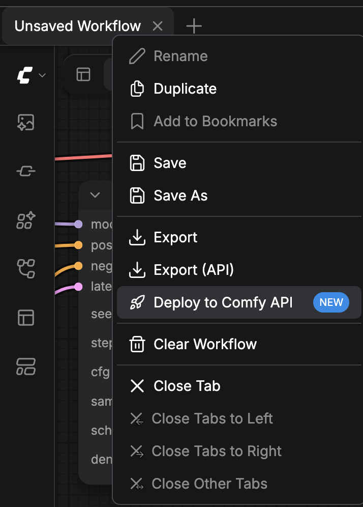
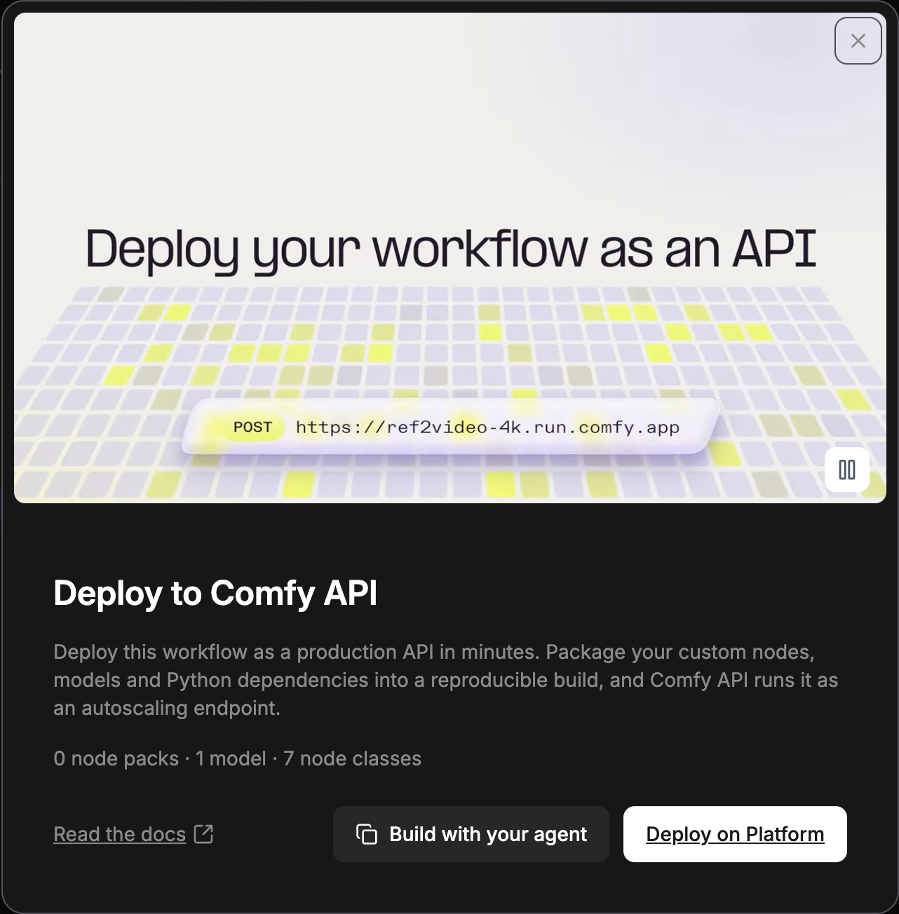
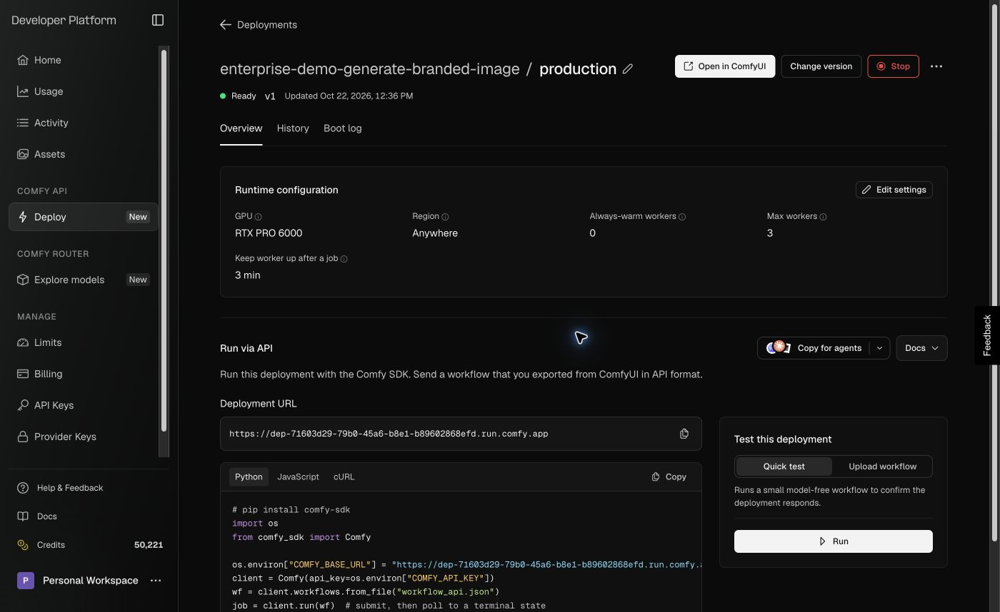

You can run your ComfyUI Workflows on Comfy Cloud, on your own Comfy API deployment, or on a server you manage. Comfy Cloud and Comfy API run on Comfy GPUs, so they don't need a GPU on your computer. Pick the option that fits your Workflow, and start from its card.

<CardGroup cols={3}>
  <Card title="Comfy Cloud" icon="cloud" href="/development/deploy/cloud">
    Run Workflows whose Custom Nodes and models are already on Comfy Cloud, with no build or deployment.
  </Card>
  <Card title="Comfy API" icon="cloud-arrow-up" href="/development/serverless/quickstart">
    Package Custom Nodes, models, and Python dependencies into a build, and run it as an autoscaling endpoint.
  </Card>
  <Card title="Self-hosting" icon="server" href="/development/deploy/self-hosting">
    Run ComfyUI on a machine you manage, and serve it on your network with `--listen`.
  </Card>
</CardGroup>

To call any of the three from your own code, send the Workflow in [API format](/development/api-development/workflow-api-format).

## Deploy from the ComfyUI app

In ComfyUI on your computer or in Comfy Desktop, the **Deploy to Comfy API** card starts a Comfy API build from the open Workflow.

<Warning>
  Publishing a version is free. When its build finishes, the **Serverless build** row shows a **Deploy** button. Deploying costs storage from the moment you deploy, plus GPU time while a worker is up. The deploy dialog shows the estimated cost before you confirm.
</Warning>

<Steps>
  <Step title="Open the Workflow actions menu">
    In the **Top bar**, right-click the Workflow's tab. You can also click the **Workflow actions** button at the top left of the **Canvas**.

    
  </Step>
  <Step title="Select Deploy to Comfy API">
    Select **Deploy to Comfy API**. The entry is marked **NEW**. The **Deploy to Comfy API** card opens and counts the Node packs, models, and Node classes the Workflow uses.

    
  </Step>
  <Step title="Continue on the Developer Platform">
    Click **Deploy on Platform**. The Developer Platform at [platform.comfy.org](https://platform.comfy.org) opens in a new tab.
  </Step>
</Steps>

On the Developer Platform, you create a build from the Workflow, publish a version, and deploy it. [Build sources](/development/serverless/build-sources) covers starting a build from a Workflow file, and the [Comfy API quickstart](/development/serverless/quickstart) covers the same flow with comfy-cli.

## Run a deployment from the Cloud editor

Your deployment can run Workflows in ComfyUI on Comfy Cloud, with the Custom Nodes and models in its build.

### Create a deployment from Comfy Cloud

On Comfy Cloud, the **Workflow actions** menu has no **Deploy to Comfy API** entry. Start from the menu next to **Run** instead:

1. Click the menu next to **Run**.
2. Select **Create a custom deployment**, and then click **Create on Platform**. Your builds on the Developer Platform open in a new tab.

When your workspace already has deployments, the menu shows **Manage deployments** instead. It opens the same builds page on the Developer Platform.

When you open a Workflow that uses Custom Nodes Comfy Cloud doesn't have, the **Run this workflow on a custom deployment** dialog lists what's missing. Click **Create on Platform** to start a build for it.

### Open your deployment in the Cloud editor

1. In the deploy dialog, leave **Ready for the Cloud editor** selected if the dialog shows it. The option is on by default. If you clear **Ready for the Cloud editor**, opening the deployment in the editor later takes a minute.
2. On the deployment's page, wait for the status under its name to read **Ready**. **Open in ComfyUI** stays disabled until then.
3. Click **Open in ComfyUI**. ComfyUI on Comfy Cloud opens in a new tab and reloads onto your deployment.

To check where your Workflows run:

1. Click the menu next to **Run**.
2. Find the check mark next to the deployment your Workflows run on.
3. Click **Run** to run the Workflow on it.

- The menu lists every deployment in your workspace. Select a **Ready** deployment to switch to it.
- Each deployment row shows the Build name (or the deployment's own name when it has no Build) on the first line, and the deployment name or short ID with the Release it runs now on the second. A row that is not ready shows **Stopped** or **Starting**. Each row also reports whether that deployment can run the open workflow: **Runs this workflow**, **Missing N nodes**, or **Not checked**.
- Switching reloads the editor, because the node catalog and the custom nodes' JavaScript are fixed when the editor starts. By default, your tabs stay open. When a workflow has unsaved changes, the editor asks whether to save before it switches.
- A stopped deployment runs no jobs until it is started on the Developer Platform, and a starting deployment runs none until it is ready. The button's tooltip says so.
- A deployment keeps its address while its owner moves it to newer Releases, and the menu then offers **Reload** so the editor picks up the new nodes. If a pick no longer exists, the editor falls back to Comfy Cloud.
- This browser keeps running your Workflows on the selected deployment until you select another one.
- **Use the workspace default** appears when the workspace has a default deployment and this browser picked one of its own. It drops the pick and reloads onto the workspace default.
- The menu appears once your workspace's deployment list loads, and Comfy Cloud offers it only when you are signed in with your account rather than an API key. Without it, the editor runs on Comfy Cloud and deployment links are refused.

To open the editor on a deployment from a link, use `https://cloud.comfy.org/?workspace=<workspace id>&deployment=<deployment id>`. The link switches to that workspace first when needed, then loads the editor on the deployment. A link is refused when the workspace is not one you can open, or when the deployment is gone or belongs to another workspace, and the editor keeps running what it ran before.

### Set the default deployment for a workspace

Workspace owners choose where members start:

- **Set as workspace default** appears after you pick a deployment that is not already the default. It makes that deployment the starting point for every member who has not picked one.
- **Clear workspace default** appears while a default is set, and puts members without a pick back on Comfy Cloud.

### Switch back to Comfy Cloud

1. Click the menu next to **Run**.
2. Select **Comfy Cloud**.

The editor reloads. If a Workflow has unsaved changes, a **Save your workflows before switching?** dialog opens. Click **Save and switch**, or **Switch without saving**.

## Stop or delete a deployment

Stop a deployment to stop its jobs, or delete it to remove it and end its storage billing. Both actions are on the deployment's page on the Developer Platform.

<Warning>
  A stopped deployment runs no jobs, but its storage still bills. Delete the deployment to end storage billing.
</Warning>

To open the deployment's page:

1. In the Developer Platform sidebar, click **Deploy**.
2. In the **Deployments** section, click the deployment's name.

To stop the deployment:

1. Click **Stop**.
2. In the **Stop deployment** dialog, click **Stop**.

The status reads **Stopping**, and then **Stopped**.

To run the deployment again:

- Click **Start**.

<Warning>
  Deleting removes the deployment and its history permanently. The build stays.
</Warning>

To delete the deployment:

1. On a stopped deployment, click **Delete**. On a running deployment, open the **More actions** menu, and then select **Delete**.
2. In the **Delete deployment** dialog, click **Delete**.

The next time a browser that ran the Cloud editor on the deployment loads ComfyUI, ComfyUI runs on Comfy Cloud instead of the deleted deployment.

## Run Workflows from your application

When a deployment is **Ready**, see [Running Workflows](/development/run-workflows/overview) to call it from your application. The [Comfy SDKs](/development/api-development/sdks) work with Comfy Cloud and with your deployments. A self-hosted ComfyUI needs the [API Proxy](/development/comfyui-server/api-proxy) to serve Comfy API v2.
