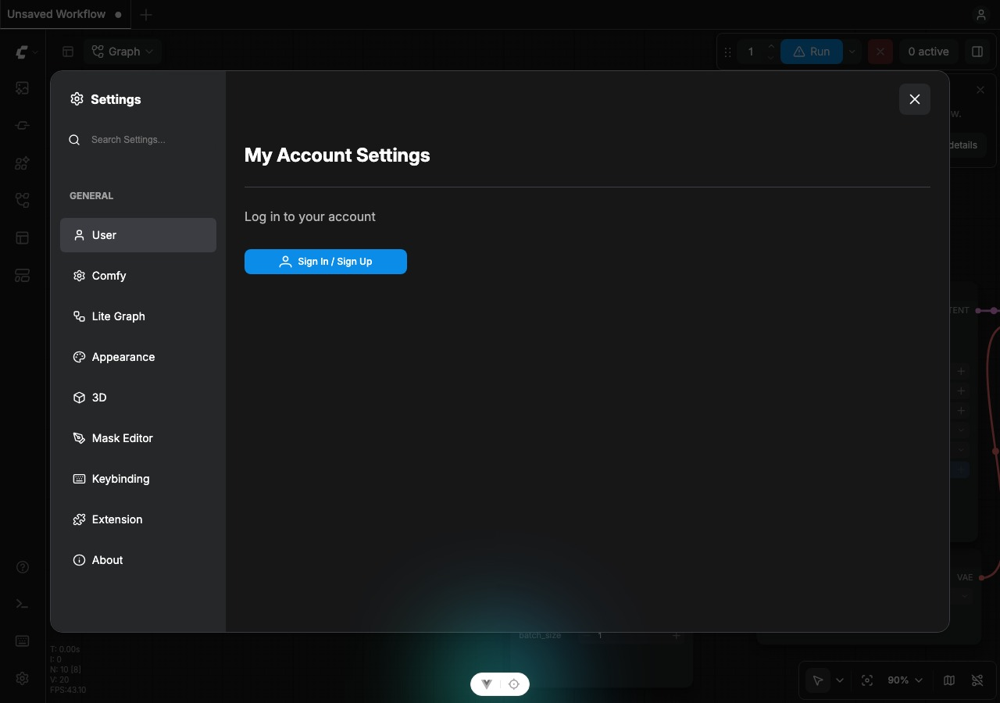
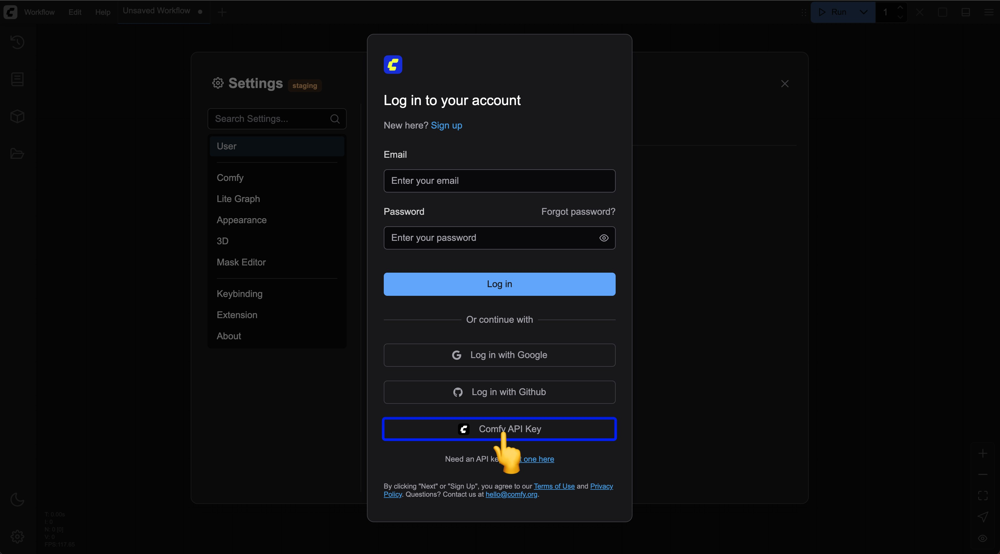
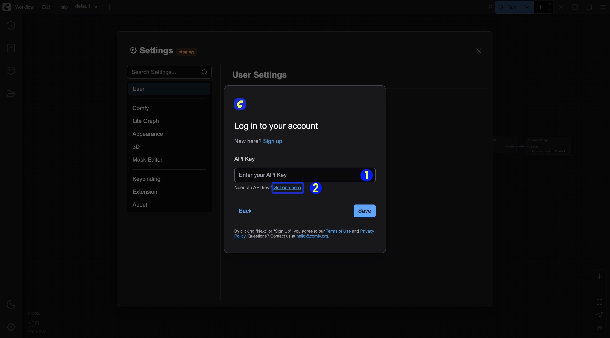
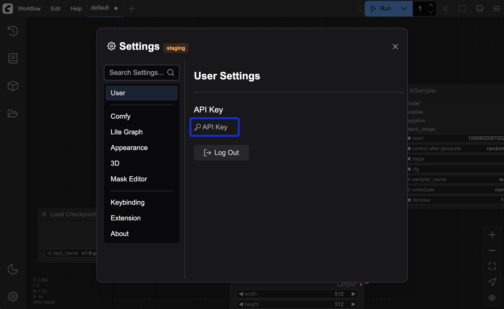
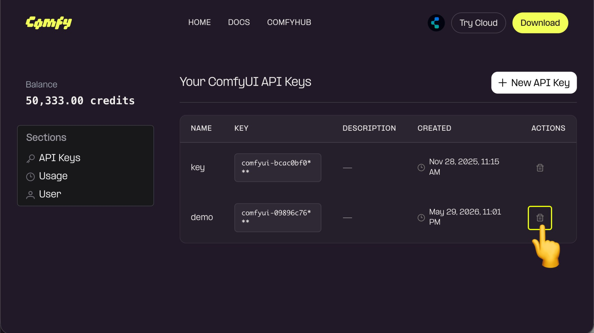
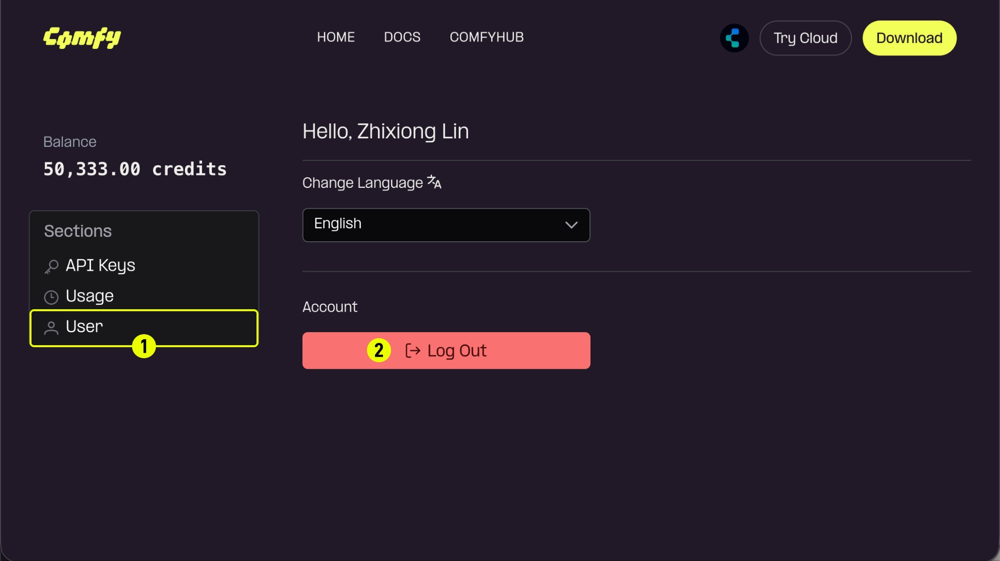

import GetApiKey from "/snippets/es/get-api-key.mdx"

Tu cuenta de Comfy te da acceso a los [Nodos asociados (Partner Node)](/es/tutorials/partner-nodes/overview) y a las [suscripciones de nube](https://www.comfy.org/cloud), lo que te permite usar funciones y servicios premium en toda la plataforma de ComfyUI.

## Métodos de inicio de sesión compatibles

ComfyUI es compatible con los siguientes métodos de inicio de sesión:
- **Correo electrónico**: Inicia sesión con tu dirección de correo electrónico y tu contraseña
- **Google**: Inicia sesión con tu cuenta de Google
- **GitHub**: Inicia sesión con tu cuenta de GitHub
- **Inicio de sesión único (SSO)**: Inicia sesión con el proveedor de identidad de tu organización

## Acceder con inicio de sesión único (SSO)

Si tu organización gestiona las cuentas de Comfy con un proveedor de identidad, inicias sesión con **Continuar con SSO** en lugar de tu correo y contraseña, Google o GitHub.

El inicio de sesión único está disponible después de que tu organización lo active. Hasta entonces, usa correo, Google o GitHub.

1. En la página de inicio de sesión, introduce tu correo electrónico o haz clic primero en **Continuar con SSO**.
2. Si aparece el aviso, haz clic en **Continuar con SSO**.
3. Completa el inicio de sesión en la página de tu proveedor de identidad. Vuelves a Comfy Cloud con la sesión iniciada.

Si el inicio de sesión único no está configurado, o un administrador lo desactivó para tu organización, consulta con el administrador de tu organización.

<Note>
Las cuentas SSO aún no pueden iniciar sesión en la aplicación de escritorio de ComfyUI. Usa el navegador. Tampoco se pueden aceptar enlaces de invitación a un espacio de trabajo desde una cuenta SSO, así que pide a un administrador del espacio de trabajo que te añada directamente.
</Note>

## Iniciar sesión en Comfy Cloud

Para acceder a tu cuenta de Comfy para ComfyUI en Comfy Cloud:

1. Ve a [Comfy Cloud](https://www.comfy.org)
2. Haz clic en **Log in** o **Sign in**
3. Elige tu método de inicio de sesión:
   - **Correo electrónico**: Ingresa tu correo electrónico y tu contraseña, luego haz clic en **Log in**
   - **Google**: Haz clic en el botón de inicio de sesión de Google y autentícate
   - **GitHub**: Haz clic en el botón de inicio de sesión de GitHub y autentícate
   - **SSO**: Haz clic en **Continuar con SSO** (puedes introducir el correo antes o ir directo a SSO) y termina en tu proveedor de identidad

## Iniciar sesión de forma local

Si tienes ComfyUI instalado de forma local:

1. Abre ComfyUI en tu máquina local
2. Ve a **Configuraciones** en la interfaz
3. Entra a la sección **Usuario** (consulta [Configuraciones de usuario](/es/interface/user) para más detalles)
4. Elige tu método de inicio de sesión:
   - **Correo electrónico**: Ingresa tu correo electrónico y tu contraseña
   - **Google**: Haz clic en el botón de inicio de sesión de Google y autentícate
   - **GitHub**: Haz clic en el botón de inicio de sesión de GitHub y autentícate
   - **Clave API**: Usa una clave API para implementaciones que no están en la lista blanca (ver más abajo)

### Iniciar sesión con una clave API

Como no todas las implementaciones de ComfyUI están en la lista blanca de autorización de dominios, en una actualización reciente (2025-05-10) incluimos el inicio de sesión con clave API para acceder a través de sitios que no están en la lista blanca. A continuación, los pasos para iniciar sesión con una clave API:

<video
  controls
  className="w-full aspect-video"
  src="/images/interface/setting/user/api_login.mp4"
></video>

<Tabs>

  <Tab title="Tienes una clave API">

  <Steps>
  <Step title="Selecciona el inicio de sesión con clave API de Comfy en la pantalla de inicio de sesión">
    Selecciona el inicio de sesión `Comfy API Key` en la ventana emergente de inicio de sesión
    
  </Step>

  <Step title="Introduce tu clave API">
    
    1. Introduce tu clave API y guárdala
    2. Si no tienes una clave API, haz clic en el enlace `Get one here` para ir a la [página de inicio de sesión de la plataforma Comfy](https://platform.comfy.org/login) e inicia sesión para obtenerla.
  </Step>
  <Step title="Inicio de sesión exitoso">
  Después de iniciar sesión correctamente, puedes ver la información correspondiente de inicio de sesión con clave API en el menú de configuraciones
    
  </Step>
</Steps>

  </Tab>
  <Tab title="No tienes clave API, solicita una primero">
Consulta los siguientes pasos para solicitar y obtener una clave API:

<GetApiKey />

<Steps>
  <Step title="Administración de claves API">
    
    Para las claves API que no uses o que estén en riesgo de filtrarse, puedes hacer clic en `Delete` para eliminarlas y evitar pérdidas innecesarias.
  </Step>
  <Step title="(Opcional) Cerrar sesión">
    
    Si ya obtuviste una clave API y estás conectado en un dispositivo público, cierra la sesión de inmediato.
  </Step>
</Steps>

  </Tab>
</Tabs>

## ¿Olvidaste tu contraseña?

Si no recuerdas tu contraseña (para iniciar sesión con correo electrónico):

1. Haz clic en el enlace **¿Olvidaste tu contraseña?** en la página de inicio de sesión
2. Ingresa tu correo electrónico registrado
3. Revisa tu correo electrónico para ver las instrucciones para reiniciar tu contraseña
4. Haz clic en el enlace de reinicio en el correo electrónico
5. Crea una nueva contraseña
6. Inicia sesión con tu nueva contraseña

## Solución de problemas al iniciar sesión

Si tienes problemas para iniciar sesión:

- Verifica que tu correo electrónico sea correcto
- Comprueba que Bloq Mayús no esté activado al introducir tu contraseña
- Limpia las cookies y la caché de tu navegador
- Prueba con otro navegador o en modo incógnito
- Asegúrate de que el correo electrónico de tu cuenta esté verificado
- Contacta con [soporte](/es/support/contact-support) si los problemas continúan

## Consejos de seguridad

Para mantener la seguridad de tu cuenta:
- Usa una contraseña segura y única
- No compartas tus credenciales de inicio de sesión
- Cierra sesión cuando uses dispositivos compartidos
- Actualiza tu contraseña con regularidad
