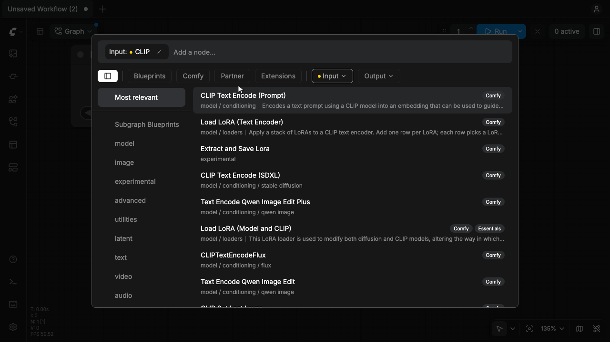
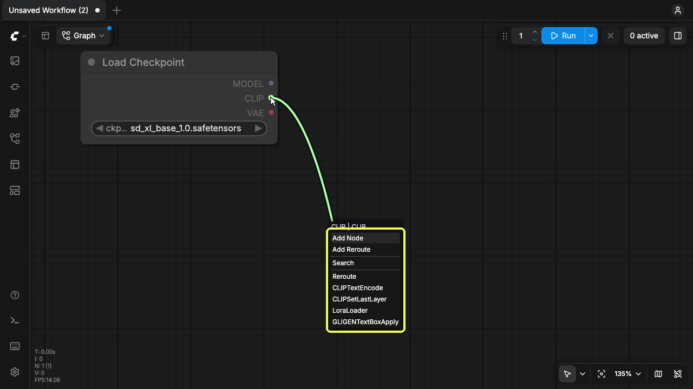
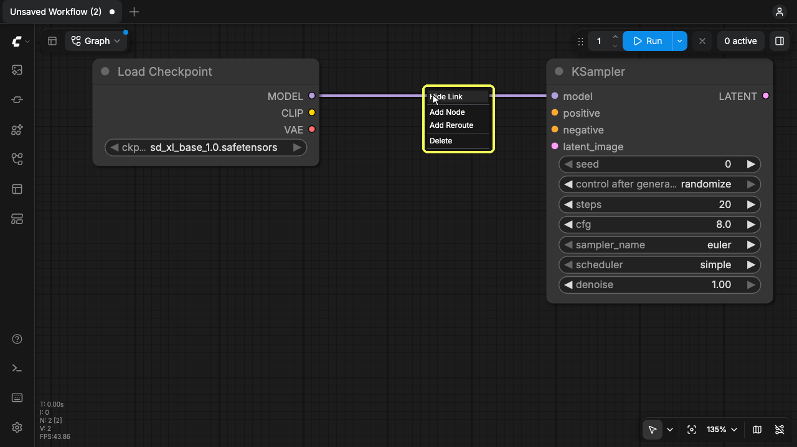
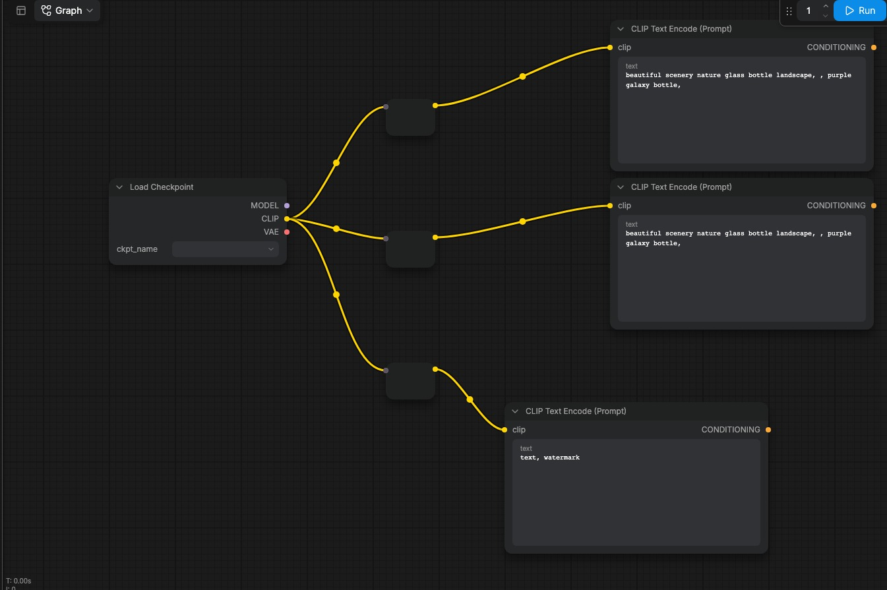
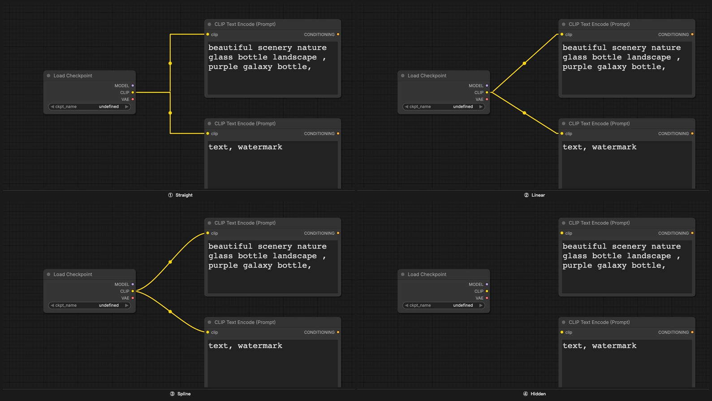
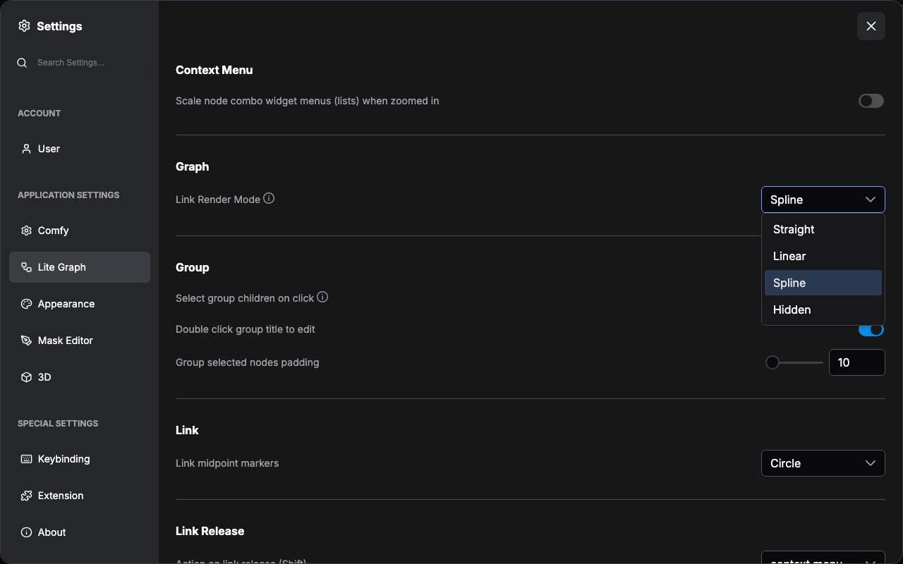
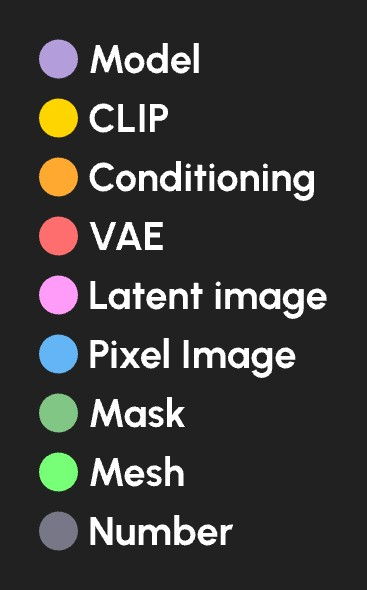

## Links connect nodes

En ComfyUI, las líneas o curvas dibujadas entre nodos se llaman **_enlaces_** (también **_conexiones_** o cables). Transportan datos de la salida de un nodo a la entrada de otro y definen el flujo del workflow.

Todas las operaciones siguientes actúan sobre lo mismo: el círculo de color en el borde del nodo. Las salidas están en el borde derecho y las entradas en el izquierdo.

### Connect two nodes

Arrastra desde un puerto de salida hasta el puerto de entrada del mismo color. Los puertos compatibles se resaltan mientras arrastras y el enlace se acopla al soltar.

<video
  controls
  className="w-full aspect-video"
  src="/images/basic-concepts/links/connect-two-nodes.mp4"
></video>

Solo se conectan puertos del mismo color, porque el color es el tipo de dato. Consulta [Color-coding](#color-coding).

### Drop a link on empty canvas

Si sueltas el enlace sobre el lienzo vacío se abre la búsqueda para añadir nodo, ya filtrada al tipo de dato que llevas. Al elegir un nodo se crea conectado.

<video
  controls
  className="w-full aspect-video"
  src="/images/basic-concepts/links/release-on-empty-search.mp4"
></video>

Mantén `Shift` al soltar para abrir el menú contextual: **Add Node**, **Add Reroute**, **Search** y los tipos de nodo que aceptan ese dato.

<video
  controls
  className="w-full aspect-video"
  src="/images/basic-concepts/links/release-shift-context-menu.mp4"
></video>

Ambas formas de soltar se configuran en **Settings → Lite Graph → Link Release**: una entrada para la liberación normal y otra para `Shift`.

### Hide or delete a link

Haz clic derecho en un enlace para abrir su menú:

- **Hide Link** mantiene la conexión y solo oculta el cable, así que los datos siguen fluyendo
- **Delete** elimina la conexión
- **Add Reroute** coloca un punto de reroute en el cable
- **Add Node** inserta un nodo en el enlace

<video
  controls
  className="w-full aspect-video"
  src="/images/basic-concepts/links/delete-link.mp4"
></video>

### Hide every link

El interruptor de visibilidad de enlaces en la barra del lienzo oculta todos los cables a la vez sin cambiar el workflow. Es lo mismo que poner **Link Render Mode** en **Hidden**; al volver a activarlo se restaura el estilo anterior.

<video
  controls
  className="w-full aspect-video"
  src="/images/basic-concepts/links/hide-links.mp4"
></video>

<Tip>
Mostrar los enlaces es especialmente útil al aprender, compartir o depurar un workflow: hacen visible el flujo de datos de un vistazo. En workflows terminados que no se van a editar, ocultarlos reduce el desorden visual.
</Tip>

### Reroute a link

Cuando el workflow se complica, los cables se solapan o pasan detrás de nodos. **Add Reroute** en el menú del enlace coloca un punto de reroute nativo en el cable; arrástralo para rodear otros nodos.

<video
  controls
  className="w-full aspect-video"
  src="/images/basic-concepts/links/link-menu-reroute.mp4"
></video>

ComfyUI también incluye un nodo **Reroute**, que hace el mismo trabajo con un nodo explícito que puedes agrupar, omitir o reutilizar. En workflows nuevos, el punto de reroute nativo suele bastar.

## Link render modes

Los enlaces pueden dibujarse como curvas, ángulos rectos, líneas rectas u ocultarse por completo.

Cambia el estilo en **Settings → Lite Graph → Graph → Link Render Mode**, o alterna la visibilidad desde la barra del lienzo.

## Color-coding

Cada tipo de dato en ComfyUI tiene un color distinto. Los puertos de entrada y salida, y los cables que los unen, comparten ese esquema. **Solo puedes conectar puertos del mismo color**. Así se mantiene la seguridad de tipos en el workflow.

| Tipo de dato              | Color           |
|---------------------------|-----------------|
| Modelo de difusión        | Lavanda         |
| Modelo CLIP               | Amarillo        |
| Modelo VAE                | Rosa            |
| Acondicionamiento         | Naranja         |
| Imagen latente            | Rosado          |
| Imagen de píxeles         | Azul            |
| Máscara                   | Verde           |
| Número (entero o flotante)| Gris            |
| Malla                     | Verde brillante |
