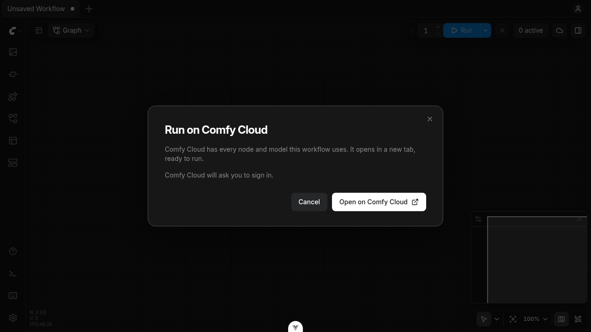
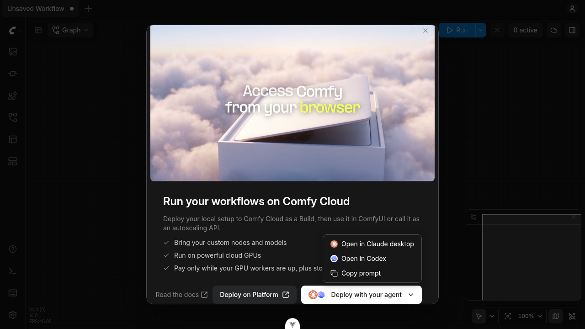

## Descripción general

El botón Cloud de la barra Run envía a Comfy Cloud el flujo de trabajo que tienes abierto. ComfyUI primero comprueba el flujo de trabajo en Cloud y luego lo abre en una pestaña nueva del navegador con el gráfico cargado.

El botón solo aparece cuando ComfyUI se ejecuta en tu propia máquina (localhost, una dirección de LAN privada o la aplicación de escritorio) y el despliegue gradual de Open on Cloud está habilitado para tu cuenta. Comfy Cloud no lo muestra. Si no lo ves, actualiza ComfyUI a la última versión y recarga la página.

## Abrir el flujo de trabajo en Comfy Cloud

1. Abre el flujo de trabajo que quieres ejecutar en Cloud.
2. Haz clic en el icono de la nube de la barra Run. ComfyUI comprueba qué paquetes de nodos y modelos usa el flujo de trabajo.
3. Si Cloud los tiene todos, se abre el diálogo **Ejecutar en Comfy Cloud**. Haz clic en **Abrir en Comfy Cloud**.
4. Comfy Cloud se abre en una pestaña nueva y carga el flujo de trabajo en el editor. Inicia sesión allí si te lo pide.

Antes de enviar los nombres de nodos y modelos del flujo de trabajo a Comfy Cloud, ComfyUI pide permiso. Marca **Don't ask again** antes de iniciar la comprobación para que no vuelva a preguntar. Para que vuelva a preguntar, abre **Configuraciones → Comfy → Comfy Cloud** y activa **Ask before sending node and model names to check Comfy Cloud compatibility**.

Hay entradas de modelo que no se pueden comprobar desde el lado local, como una entrada de modelo enlazada o un archivo de modelo que coincide con más de una carpeta local. El diálogo las marca como no comprobadas y no impiden abrir el flujo de trabajo.

Deja abierta la pestaña local hasta que el flujo de trabajo aparezca en Cloud. El gráfico se transfiere cuando la pestaña de Cloud termina de cargarse, y ComfyUI desiste después de 10 minutos. Si nunca llega, haz clic de nuevo en el botón Cloud.

Si tu navegador bloquea la pestaña nueva, permite las ventanas emergentes para la dirección de tu ComfyUI e inténtalo de nuevo. Un flujo de trabajo sin nodos activos se rechaza con un mensaje, así que añade nodos o quítales el silencio, guarda y haz clic de nuevo en el botón.

## Cuando a Cloud le faltan archivos de modelo

Si lo único que falta son archivos de modelo, el diálogo muestra los archivos que Cloud no tiene y no ofrece ninguna acción para abrir. Tampoco puedes subirlos desde tu ComfyUI, así que ciérralo e importa esos archivos en Cloud. Consulta [Importar modelos](/es/cloud/import-models).

## Cuando el flujo de trabajo necesita nodos personalizados o modelos poco habituales

Si el flujo de trabajo usa paquetes de nodos personalizados que Cloud no tiene, o un modelo que Cloud no puede resolver en un solo archivo, el diálogo ofrece implementar tu configuración en su lugar. **Implementar en la plataforma** empaqueta tus nodos personalizados y modelos en una Build de la Developer Platform. **Implementar con tu agente** entrega esa misma configuración a Claude desktop o Codex, o copia el prompt; primero te pide que guardes el flujo de trabajo. Consulta [Custom Builds](/es/development/deploy/cloud-custom-builds).

## En la aplicación de escritorio

La aplicación de escritorio pasa el flujo de trabajo a Cloud mediante su propio relay. Cuando el relay no está disponible, ComfyUI descarga el flujo de trabajo como un archivo JSON, abre Comfy Cloud y te pide que arrastres el archivo al editor de Cloud.
