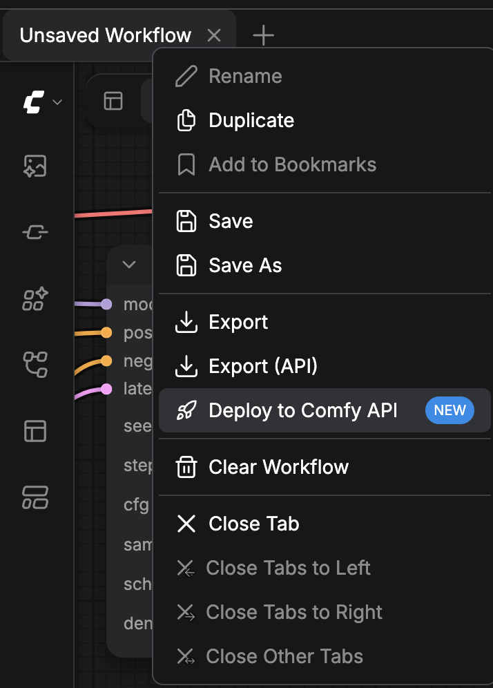
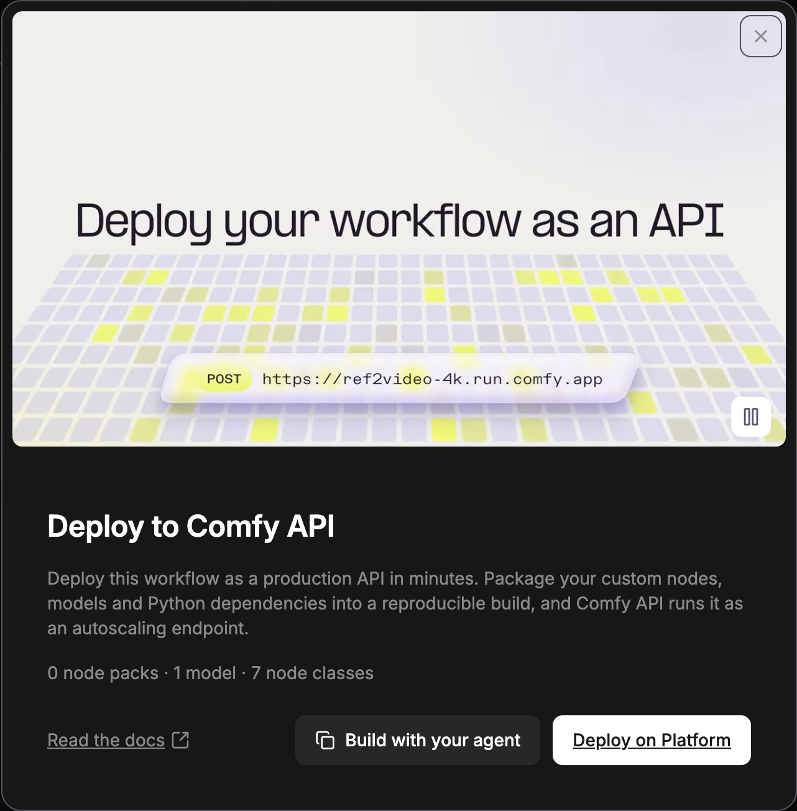
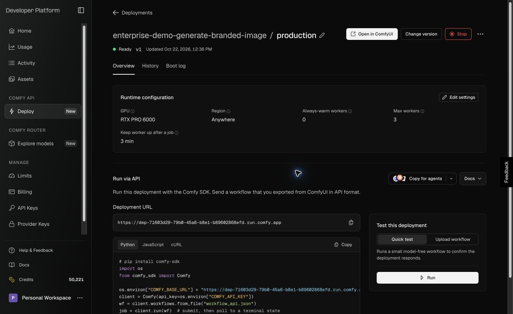

Puedes ejecutar tus flujos de trabajo de ComfyUI en Comfy Cloud, en tu propia implementación de Comfy API o en un servidor que administres. Comfy Cloud y Comfy API se ejecutan en GPU de Comfy, así que no necesitas una GPU en tu equipo. Elige la opción que encaje con tu flujo de trabajo y empieza desde su tarjeta.

<CardGroup cols={3}>
  <Card title="Comfy Cloud" icon="cloud" href="/es/development/deploy/cloud">
    Ejecuta flujos de trabajo cuyos nodos personalizados y modelos ya están en Comfy Cloud, sin crear un build ni un despliegue.
  </Card>
  <Card title="Comfy API" icon="cloud-arrow-up" href="/es/development/serverless/quickstart">
    Empaqueta nodos personalizados, modelos y dependencias de Python en un build y ejecútalo como un endpoint con escalado automático.
  </Card>
  <Card title="Autoalojamiento" icon="server" href="/es/development/deploy/self-hosting">
    Ejecuta ComfyUI en una máquina que administres y sírvelo en tu red con `--listen`.
  </Card>
</CardGroup>

Para llamar a cualquiera de las tres desde tu propio código, envía el flujo de trabajo en [formato API](/es/development/api-development/workflow-api-format).

## Implementar desde la aplicación ComfyUI

En ComfyUI en tu equipo o en Comfy Desktop, la tarjeta **Deploy to Comfy API** inicia un build de Comfy API a partir del flujo de trabajo abierto.

<Warning>
  Publicar una versión es gratis. Cuando termina su build, la fila **Serverless build** muestra un botón **Deploy**. Al implementar se cobra almacenamiento desde el momento del despliegue, más el tiempo de GPU mientras un worker está activo. El diálogo de despliegue muestra el coste estimado antes de confirmar.
</Warning>

<Steps>
  <Step title="Abrir el menú Workflow actions">
    En la **Top bar**, haz clic derecho en la pestaña del flujo de trabajo. También puedes hacer clic en el botón **Workflow actions** de la esquina superior izquierda del **Canvas**.

    
  </Step>
  <Step title="Seleccionar Deploy to Comfy API">
    Selecciona **Deploy to Comfy API**. La entrada está marcada como **NEW**. Se abre la tarjeta **Deploy to Comfy API** y cuenta los paquetes de nodos, los modelos y las clases de nodo que usa el flujo de trabajo.

    
  </Step>
  <Step title="Continuar en Developer Platform">
    Haz clic en **Deploy on Platform**. Developer Platform en [platform.comfy.org](https://platform.comfy.org) se abre en una pestaña nueva.
  </Step>
</Steps>

En Developer Platform, creas un build a partir del flujo de trabajo, publicas una versión y la implementas. [Orígenes de compilación](/es/development/serverless/build-sources) cubre cómo iniciar un build desde un archivo de flujo de trabajo, y la [guía rápida de Comfy API](/es/development/serverless/quickstart) cubre el mismo flujo con comfy-cli.

## Ejecutar una implementación desde el editor de Cloud

Tu implementación puede ejecutar flujos de trabajo en ComfyUI en Comfy Cloud, con los nodos personalizados y los modelos de su build.

### Crear una implementación desde Comfy Cloud

En Comfy Cloud, el menú **Workflow actions** no tiene la entrada **Deploy to Comfy API**. Empieza desde el menú junto a **Run**:

1. Haz clic en el menú junto a **Run**.
2. Selecciona **Create a custom deployment** y luego haz clic en **Create on Platform**. Tus builds en Developer Platform se abren en una pestaña nueva.

Cuando tu espacio de trabajo ya tiene implementaciones, el menú muestra **Manage deployments** en su lugar. Abre la misma página de builds en Developer Platform.

Cuando abres un flujo de trabajo que usa nodos personalizados que Comfy Cloud no tiene, el diálogo **Run this workflow on a custom deployment** enumera lo que falta. Haz clic en **Create on Platform** para iniciar un build.

### Abrir tu implementación en el editor de Cloud

1. En el diálogo de despliegue, deja seleccionado **Ready for the Cloud editor** si el diálogo lo muestra. La opción está activada por defecto. Si desmarcas **Ready for the Cloud editor**, abrir la implementación en el editor más tarde tarda un minuto.
2. En la página de la implementación, espera a que el estado bajo su nombre diga **Ready**. **Open in ComfyUI** permanece deshabilitado hasta entonces.
3. Haz clic en **Open in ComfyUI**. ComfyUI en Comfy Cloud se abre en una pestaña nueva y se recarga en tu implementación.

Para comprobar dónde se ejecutan tus flujos de trabajo:

1. Haz clic en el menú junto a **Run**.
2. Busca la marca de verificación junto a la implementación en la que se ejecutan tus flujos de trabajo.
3. Haz clic en **Run** para ejecutar el flujo de trabajo en ella.

- El menú enumera cada implementación de tu espacio de trabajo. Selecciona una implementación **Ready** para cambiar a ella.
- Al cambiar se recarga el editor. Por defecto, tus pestañas permanecen abiertas.
- Este navegador sigue ejecutando tus flujos de trabajo en la implementación seleccionada hasta que elijas otra.

### Volver a Comfy Cloud

1. Haz clic en el menú junto a **Run**.
2. Selecciona **Comfy Cloud**.

El editor se recarga. Si un flujo de trabajo tiene cambios sin guardar, se abre el diálogo **Save your workflows before switching?**. Haz clic en **Save and switch** o en **Switch without saving**.

## Detener o eliminar una implementación

Detén una implementación para parar sus trabajos, o elimínala para quitarla y terminar su facturación de almacenamiento. Ambas acciones están en la página de la implementación en Developer Platform.

<Warning>
  Una implementación detenida no ejecuta trabajos, pero su almacenamiento sigue facturándose. Elimina la implementación para terminar la facturación de almacenamiento.
</Warning>

Para abrir la página de la implementación:

1. En la barra lateral de Developer Platform, haz clic en **Deploy**.
2. En la sección **Deployments**, haz clic en el nombre de la implementación.

Para detener la implementación:

1. Haz clic en **Stop**.
2. En el diálogo **Stop deployment**, haz clic en **Stop**.

El estado pasa a **Stopping** y luego a **Stopped**.

Para volver a ejecutar la implementación:

- Haz clic en **Start**.

<Warning>
  Eliminar quita la implementación y su historial de forma permanente. El build permanece.
</Warning>

Para eliminar la implementación:

1. En una implementación detenida, haz clic en **Delete**. En una implementación en ejecución, abre el menú **More actions** y luego selecciona **Delete**.
2. En el diálogo **Delete deployment**, haz clic en **Delete**.

La próxima vez que un navegador que ejecutó el editor de Cloud en la implementación cargue ComfyUI, ComfyUI se ejecutará en Comfy Cloud en lugar de en la implementación eliminada.

## Ejecutar flujos de trabajo desde tu aplicación

Cuando una implementación está **Ready**, consulta [Ejecutar flujos de trabajo](/es/development/run-workflows/overview) para llamarla desde tu aplicación. Los [SDK de Comfy](/es/development/api-development/sdks) funcionan con Comfy Cloud y con tus implementaciones. Un ComfyUI autoalojado necesita el [API Proxy](/es/development/comfyui-server/api-proxy) para servir Comfy API v2.
