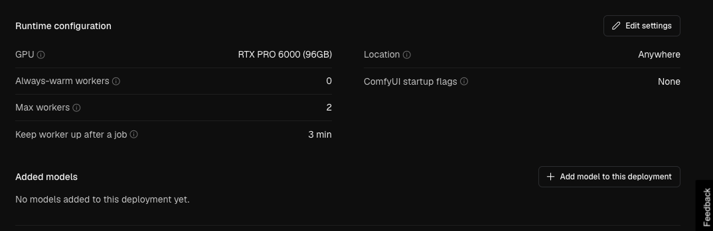
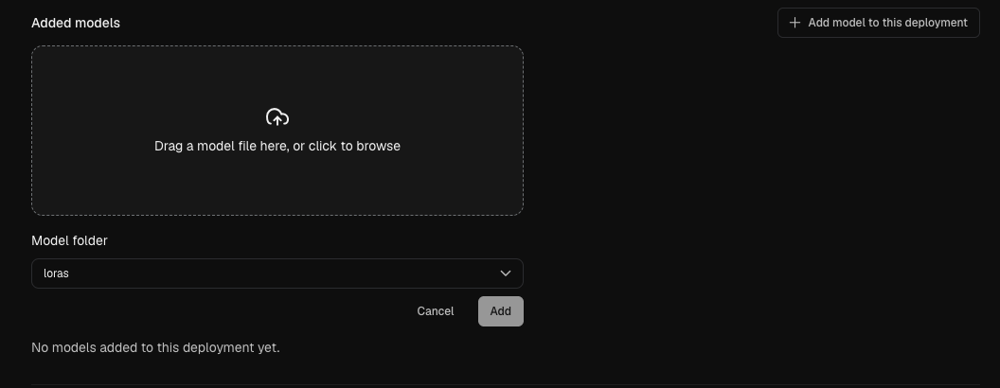
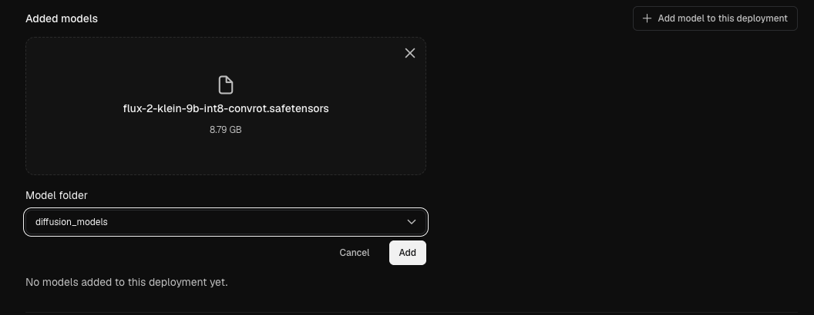
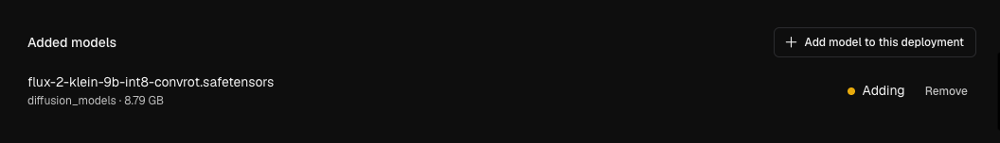
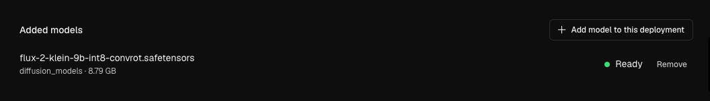

Después de desplegar tu Build en Comfy Cloud, puedes publicar nuevas versiones del Build, cambiar la GPU y los workers del despliegue y llamar al despliegue desde tu aplicación en su propia URL. Un despliegue consume tiempo de GPU mientras sus workers están en ejecución y almacenamiento hasta que lo eliminas. Puedes seguir gestionándolo después de crearlo. Esta página muestra cómo iniciar un Build desde otros orígenes, publicar versiones, elegir la GPU y los workers, llamar al despliegue, añadirle un modelo, seguirlo y detenerlo o eliminarlo.

Para crear tu primer Build y despliegue, consulta [Custom Builds](/es/development/deploy/cloud-custom-builds).

<Note>
  Si Comfy Cloud ya admite todos los nodos de tu flujo de trabajo, puedes ejecutarlo en Comfy Cloud sin un Build ni un despliegue. Consulta [Desplegar en Comfy Cloud](/es/development/deploy/cloud).
</Note>

## Antes de empezar

Cada tarea de esta página funciona en dos lugares: en la Developer Platform, en [platform.comfy.org](https://platform.comfy.org) en tu navegador, y con comfy-cli en una terminal. Asegúrate de tener lo siguiente:

- **Un espacio de trabajo con créditos de Comfy o un plan activo**: crear o iniciar un despliegue requiere uno de los dos.
- **Para las pestañas de comfy-cli, comfy-cli con la sesión iniciada en tu cuenta de Comfy**: ejecuta `comfy cloud login`.

<Tip>
  Para crear un Build y un despliegue con comfy-cli en lugar del navegador, ejecuta estos comandos en la carpeta de instalación de `ComfyUI`:

  ```bash
  comfy build init
  comfy build push --release --target linux/nvidia
  comfy deploy up
  ```

  `comfy build init` escribe el archivo de Build, `comfy-build.yaml`, en la carpeta. Los comandos `comfy build` posteriores lo leen, así que ejecútalos en la misma carpeta.
</Tip>

## Iniciar un Build desde Comfy Desktop, un archivo de flujo de trabajo o ComfyUI

Si todavía no tienes un Build, puedes iniciar uno a partir de algo que ya tengas. [Custom Builds](/es/development/deploy/cloud-custom-builds) muestra el flujo principal en el navegador, a partir de un flujo de trabajo guardado en Comfy Cloud. Elige la pestaña según el origen.

<Tabs>
  <Tab title="Instantánea de Comfy Desktop">
    Una instantánea de Comfy Desktop traslada a un Build la versión de ComfyUI, los nodos personalizados y los paquetes de Python de una instancia. No incluye modelos, así que añádelos en los pasos posteriores del Build.

    1. En Comfy Desktop, haz clic en **Manage** en tu instancia y después en la pestaña **Snapshots**.
    2. Si el estado actual de la instancia no aparece en la lista, haz clic en **Create Snapshot**.
    3. En la instantánea que quieras, haz clic en **Export**.

       

    4. En la Developer Platform, en la **Developer Platform sidebar**, haz clic en **Deploy** y después en **New build**. Si aún no tienes Builds, haz clic en **Start from scratch**.
    5. En el paso **Start with a workflow or snapshot?**, suelta el archivo `.json` exportado en el área de carga, o haz clic en el área para buscarlo.

    Otra instantánea que sueltes reemplaza a la actual. Continúa con [Crear el Build con los valores sugeridos](/es/development/deploy/cloud-custom-builds#crear-una-build-desde-tu-flujo-de-trabajo) en Custom Builds.
  </Tab>
  <Tab title="Archivo de flujo de trabajo">
    1. En la Developer Platform, en la **Developer Platform sidebar**, haz clic en **Deploy** y después en **New build**. Si aún no tienes Builds, haz clic en **Start from scratch**.
    2. En el paso **Start with a workflow or snapshot?**, suelta el archivo `.json` del flujo de trabajo, o una imagen `.png` creada con él, en el área de carga. También puedes hacer clic en el área para buscarlo.

    

    La Developer Platform lee los modelos y los nodos personalizados que usa el flujo de trabajo. Cada flujo de trabajo que sueltes se suma a los anteriores. Continúa con [Crear el Build con los valores sugeridos](/es/development/deploy/cloud-custom-builds#crear-una-build-desde-tu-flujo-de-trabajo) en Custom Builds.
  </Tab>
  <Tab title="ComfyUI">
    En ComfyUI, la entrada **Deploy to Comfy API** cuenta lo que necesita el flujo de trabajo abierto y después abre la Developer Platform.

    1. En la **Top bar**, haz clic con el botón derecho en la pestaña del flujo de trabajo. También puedes hacer clic en el botón **Workflow actions**.

       

    2. Selecciona **Deploy to Comfy API**. Se abre la tarjeta **Deploy to Comfy API**, que cuenta los paquetes de nodos, los modelos y las clases de nodo que usa el flujo de trabajo.

       

    3. Haz clic en **Deploy on Platform**. La Developer Platform se abre en una pestaña nueva.

    Para iniciar el Build desde este flujo de trabajo, selecciona **Export** en el mismo menú para guardarlo como archivo `.json` y después sigue la pestaña **Archivo de flujo de trabajo**.
  </Tab>
</Tabs>

## Encontrar tu despliegue

De aquí en adelante, la página da por hecho que tienes un Build con al menos un despliegue. Todas las tareas posteriores parten del despliegue, así que encuéntralo primero. Consultar un despliegue no tiene costo. Elige la pestaña según el lugar donde trabajes.

<Tabs>
  <Tab title="Developer Platform">
    1. En la **Developer Platform sidebar**, haz clic en **Deploy**.
    2. En la sección **Deployments**, haz clic en el nombre del despliegue.

    Se abre la página del despliegue. Debajo del nombre muestra el estado, como **Ready** o **Stopped**, y la versión que ejecuta, como `v2`. La pestaña **Overview** muestra su **Runtime configuration**.
  </Tab>
  <Tab title="comfy-cli">
    Lista todos los despliegues de tu espacio de trabajo:

    ```bash
    comfy deploy ls --workspace
    ```

    Cada línea muestra el nombre de un despliegue, su ID, su estado y la versión que ejecuta. Los comandos posteriores seleccionan un despliegue con `--deployment` seguido de su ID. Un nombre suelto como `production` funciona solo cuando ejecutas el comando en la carpeta del Build. En otros lugares, usa el ID o `<build>/<name>`.
  </Tab>
</Tabs>

## Publicar una versión de tu Build

Una versión publicada de un Build no cambia nunca. Para añadir un nodo personalizado, publicas una versión y después mueves el despliegue a ella. Para añadir un modelo o una LoRA a un solo despliegue sin una versión nueva, consulta [Añadir un modelo a un despliegue en ejecución](#añadir-un-modelo-a-un-despliegue-en-ejecución). La Developer Platform llama a una versión `v1`, `v2`, etc. comfy-cli la llama release.

<Warning>
  Mover un despliegue a otra versión, o revertirlo, consume tiempo de GPU mientras la versión antigua y la nueva se ejecutan a la vez. En la Developer Platform, el diálogo **Change version** muestra el importe.
</Warning>

<Tabs>
  <Tab title="Developer Platform">
    Para publicar una versión:

    1. En la **Developer Platform sidebar**, haz clic en **Deploy**.
    2. En la sección **Builds**, haz clic en tu Build.
    3. Haz clic en **New version** y aplica tus cambios en los pasos.
    4. En el último paso, haz clic en **Save changes**. La página del Build muestra **Changed since v**_N_, donde _N_ es la última versión.
    5. Haz clic en **Publish**. En el diálogo **Choose build targets**, mantén **Serverless build** seleccionado y haz clic en **Publish**.

    La compilación suele tardar de 10 a 15 minutos. Si la compilación falla, consulta [Corregir una compilación o un despliegue que falla](#corregir-una-compilación-o-un-despliegue-que-falla).

    Para mover el despliegue a la versión:

    1. Abre la página del despliegue. Cuando hay una versión más reciente lista, la página muestra **v**_N_ **available** debajo del nombre del despliegue.
    2. Haz clic en **Change version**.
    3. Selecciona la versión y haz clic en **Update to v**_N_.

    El despliegue sigue sirviendo la versión que ejecuta hasta que la nueva está lista, y su URL no cambia. Cuando la actualización termina, la versión debajo del nombre del despliegue muestra **v**_N_.

    Para volver a una versión anterior:

    1. En la página del despliegue, haz clic en la pestaña **History**.
    2. En la fila de la versión, haz clic en **Roll back to this version**.
  </Tab>
  <Tab title="comfy-cli">
    Ejecuta estos comandos en la carpeta del Build.

    1. Después de cambiar la instalación de ComfyUI, vuelve a escanearla en el archivo de Build:

       ```bash
       comfy build update --yes
       ```

    2. Compara el archivo de Build con la instalación y con el Build en Comfy Cloud:

       ```bash
       comfy build status
       ```

    3. Sube el archivo de Build y crea un release para el destino `linux/nvidia`, el destino que ejecuta un despliegue:

       ```bash
       comfy build push --release --target linux/nvidia
       ```

    4. Sigue el registro de compilación del release hasta que la compilación termine:

       ```bash
       comfy build release logs --target linux/nvidia --follow
       ```

    5. Mueve el despliegue al release más reciente:

       ```bash
       comfy deploy up --deployment <deployment>
       ```

    `comfy deploy up` sigue el despliegue hasta que el cambio se aplica. Hasta entonces, el despliegue sigue sirviendo su release actual.

    Para volver a un release anterior:

    - Para volver al release anterior al actual, ejecuta:

      ```bash
      comfy deploy rollback --deployment <deployment>
      ```

    - Para volver a un release concreto, añade `--to`, por ejemplo `--to v5`.
  </Tab>
</Tabs>

Cada versión de cada Build cuenta para el límite de versiones de Build de tu espacio de trabajo. Cuando lo alcances, elimina una versión que ya no necesites. Consulta [Limpieza](#limpieza).

## Cambiar la GPU o la región

La GPU decide cuánta VRAM recibe un flujo de trabajo y cuánto cuesta cada worker por hora. La región decide dónde se ejecuta el despliegue, y las GPU que puedes elegir dependen de ella.

<Warning>
  En un despliegue en ejecución, un cambio de GPU o de región inicia una copia del despliegue en la nueva GPU. La copia antigua sigue sirviendo, y consume tiempo de GPU, hasta que Comfy Cloud mueve el despliegue a la copia nueva. En un despliegue detenido, el cambio se aplica la próxima vez que lo inicies.
</Warning>

<Tabs>
  <Tab title="Developer Platform">
    Eliges la **Location** cuando creas un despliegue: **Anywhere** o **United States**. La Developer Platform no puede cambiar la ubicación de un despliegue existente. Para ejecutarlo en otra ubicación, despliega el Build de nuevo desde su página.

    Para cambiar la GPU:

    1. En la página del despliegue, haz clic en **Edit settings**.
    2. En **Edit deployment**, selecciona una GPU. Cada GPU muestra su VRAM y su precio por hora.
    3. Haz clic en **Save changes**.
  </Tab>
  <Tab title="comfy-cli">
    1. Lista las regiones y las GPU que ofrece cada una:

       ```bash
       comfy deploy refs compute
       ```

       La tabla muestra cada región, cada clase de GPU, su VRAM y su disponibilidad. Para listar una sola región, añade `--region <region>`.

    2. Define la clase de GPU, la región o ambas:

       ```bash
       comfy deploy scale --deployment <deployment> --gpu <gpu-class> --region <region>
       ```

    Si el comando se rechaza porque el despliegue está en ejecución, ejecuta primero `comfy deploy stop --deployment <deployment>`, vuelve a ejecutar `scale` y después `comfy deploy start --deployment <deployment>`. La nueva GPU o región se aplica cuando el despliegue se inicia.
  </Tab>
</Tabs>

## Escalar los workers

Cada worker es una GPU que ejecuta tus trabajos. Defines dos números:

- **Workers always-warm**: workers que permanecen en ejecución para que los trabajos no esperen a que arranque una GPU. Con `0`, el despliegue apaga sus GPU cuando no llegan trabajos.
- **Máximo de workers**: el número máximo de workers que el despliegue ejecuta a la vez cuando llegan trabajos. Las solicitudes que superan ese número esperan en la cola del despliegue hasta que un worker queda libre.

<Warning>
  Los **workers always-warm** consumen tiempo de GPU durante todo el tiempo que están en ejecución, aunque no haya trabajos.
</Warning>

<Tabs>
  <Tab title="Developer Platform">
    1. En la página del despliegue, haz clic en **Edit settings**.
    2. Define **Always-warm workers** y **Max workers**.
    3. Haz clic en **Save changes**.

    La **Runtime configuration** muestra los valores guardados.
  </Tab>
  <Tab title="comfy-cli">
    Define ambos límites juntos. `--min` acepta de `0` a `20`, y `--max` de `1` a `20`:

    ```bash
    comfy deploy scale --deployment <deployment> --min 0 --max 3
    ```

    El comando imprime `Scaled deployment <id> to min=0, max=3`.
  </Tab>
</Tabs>

Tu plan define el número máximo de workers que puede ejecutar un despliegue. Para verlo, abre [**Limits**](https://platform.comfy.org/settings/limits) en la Developer Platform y consulta **Max workers per deployment**.

## Detener e iniciar un despliegue

Detén un despliegue para conservarlo, con su URL y sus modelos, sin ejecutar trabajos. Inícialo de nuevo cuando lo necesites.

<Warning>
  Un despliegue detenido sigue generando costos de almacenamiento. La facturación de almacenamiento termina cuando eliminas el último despliegue del Build en esa región. Consulta [Limpieza](#limpieza).
</Warning>

<Tabs>
  <Tab title="Developer Platform">
    Para detener e iniciar el despliegue en el navegador, consulta [Detener o eliminar tu despliegue](/es/development/deploy/cloud-custom-builds#detener-o-eliminar-tu-despliegue).

    Para iniciar un despliegue detenido en otra versión:

    1. Haz clic en la flecha junto a **Start** y después selecciona **Start on v**_N_.
    2. En el diálogo, haz clic en **Start on v**_N_.
  </Tab>
  <Tab title="comfy-cli">
    Para detener el despliegue:

    ```bash
    comfy deploy stop --deployment <deployment>
    ```

    Para iniciarlo de nuevo:

    ```bash
    comfy deploy start --deployment <deployment>
    ```

    Cada comando imprime que el servicio lo ha aceptado. Para seguir el despliegue hasta que se estabilice, consulta [Monitorizar un despliegue](#monitorizar-un-despliegue).
  </Tab>
</Tabs>

## Llamar a tu despliegue desde tu aplicación

Tu aplicación envía flujos de trabajo en formato API a la URL del despliegue con la [Comfy API v2](/es/api-reference/v2/overview), usando una clave API del espacio de trabajo. Antes de enviar un trabajo, comprueba que el estado del despliegue muestra **Ready**. Un trabajo en un despliegue con `0` workers always-warm puede esperar unos minutos mientras arranca una GPU.

<Tabs>
  <Tab title="Developer Platform">
    1. En la página del despliegue, busca **Run via API** en la pestaña **Overview**.
    2. Copia la **Deployment URL**.
    3. Haz clic en **Create API key** y copia la clave.
    4. Copia el fragmento de Python, JavaScript o cURL.
    5. Ejecuta el fragmento con la clave en la variable de entorno `COMFY_API_KEY`.

    Para probar el despliegue desde la página, usa **Quick test**. Ejecuta un flujo de trabajo pequeño, sin modelos, en el despliegue.

    <Warning>
      Un **Quick test** consume tiempo de GPU del despliegue.
    </Warning>

    1. Abre **Test this deployment**.
    2. Selecciona **Quick test**.
    3. Haz clic en **Run**.

    Cuando la prueba termina, muestra **Finished in** seguido del tiempo que ha tardado.
  </Tab>
  <Tab title="comfy-cli">
    Envía un flujo de trabajo en formato API y espera sus salidas:

    ```bash
    comfy deploy run --deployment <deployment> --workflow workflow_api.json
    ```

    El comando espera al trabajo y descarga sus salidas en la carpeta `outputs`. Para guardarlas en otro lugar, añade `--output-dir <folder>`.
  </Tab>
</Tabs>

Desde tu propio código, usa los [Comfy SDKs](/es/development/api-development/sdks). Define `COMFY_BASE_URL` con la **Deployment URL**. Consulta [Elegir una URL base](/es/development/api-development/sdks#elegir-una-url-base).

## Añadir un modelo a un despliegue en ejecución

Puedes añadir un modelo o una LoRA a un solo despliegue sin publicar una versión nueva del Build. El archivo se coloca en el mismo almacenamiento que los modelos del Build, así que cada worker lo lee del disco sin descargarlo. El despliegue conserva su URL. El Build y tus otros despliegues no cambian.

<Warning>
  Un modelo añadido cuenta para el almacenamiento de modelos del despliegue, que se factura como se describe en [Facturación de despliegues](/es/development/deploy/cloud-usage#facturación-de-despliegues). Además, cada adición reemplaza los workers en ejecución del despliegue por otros nuevos que tienen el archivo, y los nuevos workers consumen tiempo de GPU como siempre.
</Warning>

### Antes de empezar

Asegúrate de tener lo siguiente:

- **Un despliegue cuyo estado sea Ready o Stopped**: mientras se inicia, se detiene o se actualiza, la adición se rechaza.
- **El archivo del modelo en tu computadora**: un nombre de archivo con letras, dígitos, `.`, `_` y `-`, como se describe en [Reglas y errores](#reglas-y-errores).

### Añadir el archivo

<Tabs>
  <Tab title="Developer Platform">
    1. Abre la página del despliegue, como muestra [Encontrar tu despliegue](#encontrar-tu-despliegue).
    2. En la pestaña **Overview**, debajo de **Added models**, haz clic en **Add model to this deployment**.

       

    3. Arrastra el archivo del modelo al recuadro, o haz clic en el recuadro y selecciona el archivo.

       

    4. En **Model folder**, selecciona la carpeta donde va el archivo, como `loras` o `diffusion_models`. El recuadro muestra el nombre y el tamaño del archivo.
    5. Haz clic en **Add**.

       

    El archivo aparece debajo de **Added models** con su carpeta, tamaño y estado. Mientras el despliegue coloca el archivo, muestra **Adding**:

    

    Cuando los trabajos pueden usar el archivo, muestra **Ready**:

    
  </Tab>
  <Tab title="comfy-cli">
    1. Comprueba que comfy-cli es la versión 1.29.0 o posterior:

       ```bash
       comfy --version
       ```

    2. Encuentra el ID del despliegue, como muestra [Encontrar tu despliegue](#encontrar-tu-despliegue):

       ```bash
       comfy deploy ls --workspace
       ```

    3. Sube el archivo y añádelo al despliegue. Indica la carpeta de modelos con `--type`, como `loras` o `diffusion_models`:

       ```bash
       comfy deploy models add <deployment> my_style.safetensors --type loras
       ```

       `<deployment>` es el ID del despliegue, o `<build>/<name>`. Un nombre suelto funciona solo en la carpeta del Build. El comando sube el archivo y espera hasta que el despliegue puede usarlo. Para volver en cuanto se envía la adición, añade `--no-wait`.

    4. Comprueba que el archivo muestra ready:

       ```bash
       comfy deploy models ls <deployment>
       ```

       Cada línea muestra la carpeta, el nombre, el tamaño y el estado de un archivo añadido.
  </Tab>
</Tabs>

Mientras el archivo muestra adding, el despliegue lo copia a su almacenamiento, inicia workers nuevos que lo tienen y detiene los antiguos. Los trabajos que ya están en ejecución terminan en los workers antiguos. En nuestras pruebas, una LoRA de 130 MB mostró ready entre 40 segundos y unos 3 minutos después de la adición. En un despliegue detenido, el archivo muestra ready en cuanto termina su subida, y el siguiente inicio lo coloca.

Un archivo que muestra failed no se ha añadido. Elimínalo y vuelve a añadirlo.

<Accordion title="Añadir el archivo con la API de despliegues">
  Para añadir un archivo desde tu propio código, usa la API de despliegues con una clave API del espacio de trabajo. Necesitas:

  - **El ID del despliegue**: es la primera parte de la **Deployment URL**, como `dep-2bf42665-0a61-4702-962f-0774c6391e96` en `https://dep-2bf42665-0a61-4702-962f-0774c6391e96.run.comfy.app`.
  - **Una clave API del espacio de trabajo**: consulta [Obtener una clave API](/es/development/api-development/getting-an-api-key). Los comandos siguientes la leen de la variable de entorno `COMFY_API_KEY` y la envían en la cabecera `X-API-Key`.

  Antes de subir el archivo, lista los modelos del despliegue, como muestra el último paso, y comprueba que `addEnabled` es `true`. Si es `false`, una adición responde `404`.

  <Steps>
    <Step title="Solicitar un enlace de subida">
      Envía el nombre, el tamaño y el hash SHA-256 del archivo. `kind` siempre es `model`:

      ```bash
      FILE=my_style.safetensors
      SIZE=$(wc -c < "$FILE" | tr -d ' ')
      SHA256=$(shasum -a 256 "$FILE" | cut -d ' ' -f 1)

      curl -sS https://platformapi.comfy.org/builder/v1/blobs \
        -H "X-API-Key: $COMFY_API_KEY" \
        -H "Content-Type: application/json" \
        -d "{\"kind\": \"model\", \"filename\": \"$FILE\", \"sizeBytes\": $SIZE, \"sha256\": \"$SHA256\"}"
      ```

      La respuesta contiene el `blobId` de la subida, un `uploadUrl` y `expiresAt`, el momento en que el enlace deja de funcionar:

      ```json
      {
        "blobId": "b1f0c2d4-...",
        "deduplicated": false,
        "uploadUrl": "https://storage.googleapis.com/...",
        "expiresAt": "2026-11-23T20:15:00Z"
      }
      ```
    </Step>
    <Step title="Subir el archivo">
      Haz un PUT del archivo a `uploadUrl` antes de `expiresAt`. El enlace solo acepta un cuerpo del tamaño que declaraste y necesita la cabecera `x-goog-if-generation-match: 0`:

      ```bash
      curl -sS -X PUT "<uploadUrl>" \
        -H "x-goog-if-generation-match: 0" \
        --upload-file "$FILE"
      ```
    </Step>
    <Step title="Añadir la subida al despliegue">
      Envía el `blobId` y la carpeta de modelos donde va el archivo, como `loras` o `checkpoints`:

      ```bash
      curl -sS https://platformapi.comfy.org/deploy/v1/deployments/<deployment-id>/models \
        -H "X-API-Key: $COMFY_API_KEY" \
        -H "Content-Type: application/json" \
        -d '{"blobId": "<blobId>", "type": "loras"}'
      ```

      La respuesta es `202` con la entrada del despliegue para el archivo, que muestra `adding`:

      ```json
      {
        "id": "655fa851-...",
        "type": "loras",
        "filename": "my_style.safetensors",
        "status": "adding",
        "sizeBytes": 134621556
      }
      ```

      Para dar otro nombre al archivo en la carpeta, añade `"filename"` a la solicitud. Sin él, el archivo conserva el nombre con el que lo subiste.
    </Step>
    <Step title="Esperar a que el archivo muestre ready">
      Lista los modelos del despliegue:

      ```bash
      curl -sS https://platformapi.comfy.org/deploy/v1/deployments/<deployment-id>/models \
        -H "X-API-Key: $COMFY_API_KEY"
      ```

      ```json
      {
        "addEnabled": true,
        "models": [
          { "id": "655fa851-...", "type": "loras", "filename": "my_style.safetensors", "status": "ready", "sizeBytes": 134621556 }
        ]
      }
      ```
    </Step>
  </Steps>

  Si no recibiste respuesta a una adición, envía la misma adición otra vez. Mientras el archivo muestra `adding`, la misma subida, carpeta y nombre devuelven la misma entrada.

  **Subir un archivo grande por partes.** Para un archivo grande, pide la subida por partes, para que un enlace caducado o una conexión perdida no reinicien el archivo entero. Añade `"parts": true` a la solicitud de subida. La respuesta contiene entonces una lista `parts` en lugar de un solo `uploadUrl`. Un archivo se divide en 32 partes como máximo, de al menos 64 MiB cada una, y puede llegar a 128 GiB.

  1. Haz un PUT de los bytes de cada parte, desde `offsetBytes` durante `sizeBytes` bytes del archivo, al `uploadUrl` de esa parte, con la misma cabecera `x-goog-if-generation-match: 0`.
  2. Si los enlaces caducan antes de que estén todas las partes, envía `POST https://platformapi.comfy.org/builder/v1/blobs/<blobId>/parts` para obtener enlaces nuevos de las partes aún no almacenadas.
  3. Cuando estén todas las partes, envía `POST https://platformapi.comfy.org/builder/v1/blobs/<blobId>/complete`. Une las partes en un solo archivo.

  Con partes, puedes añadir la subida al despliegue antes de que lleguen todas. El despliegue copia cada parte a medida que llega, así que el archivo muestra `ready` antes tras terminar la subida.
</Accordion>

### Usar el modelo añadido

Nombra el archivo en tu flujo de trabajo como nombrarías un modelo del Build. Para una LoRA, define la entrada `lora_name` del cargador con el nombre del archivo, como muestra [Definir lora\_name en el flujo de trabajo](#usar-modelos-de-la-biblioteca-del-espacio-de-trabajo-en-solicitudes-a-la-api), y envía el trabajo al despliegue.

Un trabajo que nombra un archivo que aún se está añadiendo se rechaza antes de llegar a un worker. La API responde `422`:

```json
{
  "error": {
    "code": "model_not_ready",
    "message": "my_style.safetensors is still being added to this deployment. Try again when it shows Ready."
  }
}
```

Un trabajo que nombra un archivo fallido se rechaza con el código `model_failed` y el mensaje `my_style.safetensors was not added to this deployment. Remove it and add it again.` Una ejecución desde el editor de Comfy Cloud se rechaza con la misma frase.

<Tip>
  Envía los trabajos que usan el archivo solo cuando muestre ready. Un nodo cargador de un paquete de nodos personalizados se comprueba solo contra lo que el despliegue listó unos segundos antes, así que un trabajo enviado justo después de una adición puede llegar a un worker sin el archivo y fallar con el error `Value not in list`.
</Tip>

En el editor de Comfy Cloud, selecciona el despliegue en **Run on** y después recarga la página o pulsa `R` cuando el archivo muestre ready. El editor no actualiza por su cuenta los modelos del despliegue. Después, el archivo aparece en la lista del nodo cargador, como la lista `lora_name` de un nodo `Load LoRA (Model and CLIP)`, y en la **Model Library** de la **Left sidebar**.

El despliegue conserva los modelos añadidos cuando pasa a otra versión, revierte, se detiene o se inicia. Si la versión a la que pasas tiene su propio archivo con la misma carpeta y el mismo nombre, el despliegue usa el archivo de la versión.

### Eliminar un modelo añadido

<Warning>
  Eliminar un modelo borra el archivo del almacenamiento del despliegue. Los trabajos que lo nombran fallan. Un trabajo ya en ejecución puede terminar igualmente. Un worker que ya cargó el archivo puede seguir usándolo unos minutos, y un worker en ejecución puede devolver el resultado guardado de un trabajo idéntico a uno que ya ejecutó.
</Warning>

<Tabs>
  <Tab title="Developer Platform">
    1. Abre la página del despliegue.
    2. Debajo de **Added models**, en la fila del archivo, haz clic en **Remove**.
  </Tab>
  <Tab title="comfy-cli">
    Nombra el archivo como `<folder>/<name>`, la carpeta y el nombre que muestra `comfy deploy models ls`:

    ```bash
    comfy deploy models rm <deployment> loras/my_style.safetensors
    ```

    El comando pregunta antes de eliminar el archivo. Para omitir la pregunta, añade `--yes`.

    También puedes indicar el ID del archivo en lugar de `<folder>/<name>`. `comfy deploy models ls` no imprime IDs. Para verlos, ejecuta `comfy --json deploy models ls <deployment>`.
  </Tab>
</Tabs>

El archivo muestra removing y después sale de la lista cuando termina la eliminación, incluso cuando el archivo no se pudo borrar. Si la versión que ejecuta el despliegue tiene su propio archivo con la misma carpeta y el mismo nombre, solo se elimina la entrada y el archivo de la versión permanece.

### Reglas y errores

Una adición sigue estas reglas:

- **El nombre del archivo** es un nombre con letras, dígitos, `.`, `_` y `-`, y empieza por una letra o un dígito.
- **La carpeta** (`type`) es una carpeta de modelos, como `loras`, `checkpoints` o `vae`, u otra carpeta dentro de `models`. No puede ser `custom_nodes` ni `configs`, ni otra capitalización de una carpeta conocida, como `LoRAs`.
- **Un archivo por carpeta y nombre**: se rechaza un nombre que la versión del Build o el despliegue ya tenga en esa carpeta.
- **Se aplica el ajuste de modelos del Build**: un Build definido como **Choose which models** rechaza todos los modelos añadidos, y un Build que bloquea un nombre de archivo rechaza ese nombre.

Cada rechazo no añade nada y responde con un código `error` y un `message` que puedes mostrar:

```json
{
  "error": "MODEL_NAME_TAKEN",
  "message": "This deployment already has loras/my_style.safetensors. Remove it first, or add the file under another name."
}
```

| Estado | `error` | Cuándo |
|--------|---------|------|
| `400` | `INVALID_REQUEST` | Falta `blobId`, `type` no es una carpeta de modelos, o el nombre del archivo incumple la regla anterior. |
| `404` | `UPLOAD_NOT_FOUND` | La subida no es de este espacio de trabajo, no es un modelo, o su archivo aún no está disponible. Sube el archivo antes de añadirlo, salvo que subas por partes. |
| `404` | `NOT_FOUND` | El despliegue, o la entrada que eliminas, no existe en este espacio de trabajo. |
| `409` | `DEPLOYMENT_BUSY` | El despliegue se está iniciando, deteniendo o actualizando. Añade o elimina el modelo cuando muestre Ready o Stopped. |
| `409` | `MODEL_POLICY` | El ajuste de modelos del Build no permite el archivo. |
| `409` | `MODEL_NAME_TAKEN` | La versión del Build o el despliegue ya tiene un archivo con esa carpeta y ese nombre. |
| `409` | `MODEL_STORAGE_EXCEEDED` | Los modelos del Build y los modelos añadidos necesitarían más almacenamiento del que puede tener el despliegue. |
| `409` | `MODEL_LIST_TOO_LARGE` | El despliegue tiene demasiados modelos para añadir otro. El mensaje indica si debes eliminar un modelo añadido o usar una versión con menos modelos. |
| `409` | `VOLUME_SHARED` | El despliegue comparte su almacenamiento con otro despliegue, así que no se le pueden añadir modelos. |
| `503` | `SERVICE_UNAVAILABLE` | El servicio no pudo comprobar la adición a tiempo. Envía la misma adición otra vez. |

## Usar modelos de la biblioteca del espacio de trabajo en solicitudes a la API

Un despliegue ejecuta modelos `.safetensors` de la biblioteca de tu espacio de trabajo, incluso cuando su release no los incluye. Para elegir una LoRA por solicitud, súbela una vez a la biblioteca y después nómbrala en cada flujo de trabajo que envíes.

<Steps>
  <Step title="Subir la LoRA a la biblioteca de tu espacio de trabajo">
    Para subir un modelo en el editor de Comfy Cloud o en la Developer Platform, consulta [Añadir tu propia LoRA o modelo](/es/development/deploy/cloud-custom-builds#agregar-tu-propio-lora-o-modelo). Esa página también indica el plan y el tamaño de archivo que necesita una subida.

    Para subir desde una terminal, define el tipo de modelo con `--type`:

    ```bash
    comfy assets library upload my_style.safetensors --type loras
    ```

    Cuando la subida termina, el comando imprime `Added my_style.safetensors to loras`.
  </Step>
  <Step title="Definir lora_name en el flujo de trabajo">
    En el [flujo de trabajo en formato API](/es/development/api-development/workflow-api-format), define la entrada `lora_name` del cargador con el nombre del archivo de la biblioteca, incluida la extensión `.safetensors`:

    ```json
    "10": {
      "class_type": "LoraLoader",
      "inputs": {
        "lora_name": "my_style.safetensors",
        "strength_model": 1.0,
        "strength_clip": 1.0,
        "model": ["4", 0],
        "clip": ["4", 1]
      }
    }
    ```
  </Step>
  <Step title="Enviar la solicitud">
    Envía el flujo de trabajo como muestra [Llamar a tu despliegue desde tu aplicación](#llamar-a-tu-despliegue-desde-tu-aplicación).
  </Step>
</Steps>

Para usar una LoRA diferente, cambia `lora_name` por el nombre de otro archivo de la biblioteca en la siguiente solicitud. No necesitas un Build nuevo, un release nuevo ni volver a desplegar.

- Un flujo de trabajo puede indicar hasta 100 modelos de la biblioteca. Un cargador que indica un modelo número 101 de la biblioteca falla como si el archivo no estuviera en la biblioteca.
- Mantén los nombres de archivo únicos en todas las carpetas que lee un mismo cargador. Si la biblioteca tiene el mismo nombre de archivo en dos de ellas, un trabajo enviado a través de la API no carga ninguno de los dos archivos.

## Monitorizar un despliegue

Comprueba el estado de un despliegue cuando se inicia, después de cambiarlo y cuando fallan los trabajos.

<Tabs>
  <Tab title="Developer Platform">
    En la página del despliegue:

    - El estado debajo del nombre del despliegue muestra **Queued**, **Provisioning** o **Starting** mientras el despliegue arranca, y **Ready** cuando sirve trabajos.
    - Mientras el despliegue arranca, **Deployment progress** muestra cada paso, como **Copying models**. El despliegue sigue iniciándose en el lado de Comfy, así que puedes cerrar la página y volver después.
    - La pestaña **Boot log** muestra lo que ComfyUI imprimió mientras el despliegue se iniciaba.
    - La pestaña **History** lista las versiones que ejecutó el despliegue y qué provocó cada cambio.

    En la página **Deploy**, la sección **Deployments** muestra los créditos de GPU de cada despliegue en los últimos siete días en **Spend · 7d**. No incluye el almacenamiento de modelos.
  </Tab>
  <Tab title="comfy-cli">
    En la carpeta del Build, sigue el despliegue hasta que se estabilice:

    ```bash
    comfy deploy status --deployment <deployment> --watch
    ```

    El comando informa del estado, como `Deployment <name>: ready`, de si hay un release más reciente en espera y de cuántos trabajos están en cola. Para leer más:

    ```bash
    comfy deploy logs --deployment <deployment>      # lo que ComfyUI imprimió durante el inicio
    comfy deploy events --deployment <deployment>    # sus cambios de estado, en orden
    comfy deploy history --deployment <deployment>   # los releases que ejecutó
    ```
  </Tab>
</Tabs>

## Limpieza

Eliminar el último despliegue de un Build en una región detiene su costo de almacenamiento, y eliminar una versión libera un lugar bajo el límite de versiones de Build. No puedes eliminar un Build ni una versión mientras un despliegue los use, así que elimina primero el despliegue.

<Warning>
  Eliminar un despliegue, una versión o un Build es permanente. Eliminar un despliegue quita su URL, así que las aplicaciones que lo llaman dejan de funcionar. El Build y sus versiones permanecen, así que puedes volver a desplegar. Un despliegue que crees después recibe una URL nueva, porque la URL proviene del ID del despliegue. Para conservar la URL, [detén el despliegue](#detener-e-iniciar-un-despliegue).
</Warning>

<Tabs>
  <Tab title="Developer Platform">
    Para eliminar un despliegue, consulta [Detener o eliminar tu despliegue](/es/development/deploy/cloud-custom-builds#detener-o-eliminar-tu-despliegue).

    Para eliminar una versión:

    1. Abre la página del Build.
    2. En la fila de la versión, abre **Version actions** y selecciona **Delete version**.
    3. Haz clic en **Delete**.

    Para eliminar el Build:

    1. En la página del Build, haz clic en **Delete**.
    2. En el diálogo **Delete build**, haz clic en **Delete**.
  </Tab>
  <Tab title="comfy-cli">
    Para eliminar un despliegue:

    ```bash
    comfy deploy delete --deployment <deployment>
    ```

    Para eliminar una versión:

    ```bash
    comfy build release delete <release-id>
    ```

    Para eliminar el Build:

    ```bash
    comfy build delete --id <build-id>
    ```

    Cada comando te pide confirmación. Para listar los releases de un Build y sus IDs, ejecuta `comfy build release ls --id <build-id>`. Para listar tus Builds, ejecuta `comfy build ls`.
  </Tab>
</Tabs>

## Corregir una compilación o un despliegue que falla

Cuando una compilación o un despliegue falla, sus registros indican la causa. Corrige la causa y después vuelve a publicar o a iniciar.

<AccordionGroup>
  <Accordion title="La compilación falló">
    En la Developer Platform, sigue [¿Qué ocurre si falla la compilación?](/es/development/deploy/cloud-custom-builds#publicar-la-build) en Custom Builds.

    Con comfy-cli, lee el estado del release y su registro de compilación en la carpeta del Build:

    ```bash
    comfy build release show
    comfy build release logs --target linux/nvidia
    ```

    Cambia la instalación de ComfyUI, por ejemplo quitando el nodo personalizado que falló, y después [vuelve a publicar](#publicar-una-versión-de-tu-build).
  </Accordion>

  <Accordion title="El estado del despliegue muestra Failed">
    La página del despliegue muestra el error con **This deployment didn't start. Fix what the error names, then start it again.** Haz clic en **Copy** para copiar el error. La pestaña **Boot log** muestra lo que imprimió ComfyUI.

    Con comfy-cli, `comfy deploy status` imprime el motivo. Para el registro y los cambios de estado, consulta [Monitorizar un despliegue](#monitorizar-un-despliegue).

    Corrige lo que indica el error y después inicia el despliegue de nuevo.
  </Accordion>

  <Accordion title="El despliegue tarda mucho en iniciarse">
    Sigue los pasos de **Deployment progress** en la página del despliegue, o ejecuta `comfy deploy status --deployment <deployment> --watch`. El paso **Copying models** tarda más cuantos más modelos tenga la versión. Cuando creas un despliegue en la Developer Platform, **Estimated time** en el diálogo de despliegue muestra cuánto tarda el despliegue en iniciarse.

    Si la GPU que elegiste no tiene capacidad, [cambia la GPU o la región](#cambiar-la-gpu-o-la-región). Con comfy-cli, `comfy deploy refs compute` muestra la disponibilidad de cada GPU.
  </Accordion>

  <Accordion title="El estado muestra Stopped: out of credits">
    El despliegue se detiene cuando tu espacio de trabajo se queda sin créditos. Añade créditos y después inicia el despliegue de nuevo.
  </Accordion>

  <Accordion title="El estado muestra Stop failed">
    La solicitud de detención falló, así que el despliegue puede seguir facturando. Haz clic en **Stop** otra vez, o ejecuta `comfy deploy stop --deployment <deployment>` de nuevo.
  </Accordion>

  <Accordion title="Falló una actualización a una versión">
    La página del despliegue muestra **Update to v**_N_ **failed.**, y el despliegue sigue sirviendo la versión que ejecutaba antes. Haz clic en **Retry**, o corrige la versión y publica de nuevo.
  </Accordion>
</AccordionGroup>

## Preguntas frecuentes

Para saber cómo se facturan los despliegues, consulta [Facturación de despliegues](/es/development/deploy/cloud-usage#facturación-de-despliegues) en Uso y límites.

<AccordionGroup>
  <Accordion title="¿Un mismo Build puede provenir de varios flujos de trabajo?">
    Sí. Cuando creas un Build en la Developer Platform, puedes subir uno o más flujos de trabajo para preseleccionar sus modelos y nodos personalizados. Incluye las dependencias de todos los flujos de trabajo que planeas ejecutar y después envía cada flujo de trabajo en formato API al despliegue.

    Cada despliegue usa una clase de GPU. Para ejecutar flujos de trabajo en clases de GPU distintas, crea despliegues separados del mismo Build.
  </Accordion>
</AccordionGroup>

## Próximos pasos

Cuando tu despliegue esté en ejecución, usa estas páginas para enviarle flujos de trabajo desde tu propio código.

<CardGroup cols={2}>
  <Card title="Comfy SDKs" icon="code" href="/es/development/api-development/sdks">
    Envía flujos de trabajo desde una aplicación de Python o TypeScript y gestiona entradas, progreso y salidas.
  </Card>
  <Card title="Comfy API v2" icon="cloud" href="/es/api-reference/v2/overview">
    Llama a la API HTTP desde cualquier lenguaje y consulta sus formatos de solicitud y respuesta.
  </Card>
  <Card title="Formato de flujo de trabajo de la API" icon="file-code" href="/es/development/api-development/workflow-api-format">
    Prepara un JSON de flujo de trabajo para una solicitud a la API o diagnostica sus entradas y salidas.
  </Card>
  <Card title="Empezar con comfy-cli" icon="terminal" href="/es/comfy-cli/getting-started">
    Instala comfy-cli e inicia sesión en Comfy Cloud con `comfy cloud login`.
  </Card>
</CardGroup>
